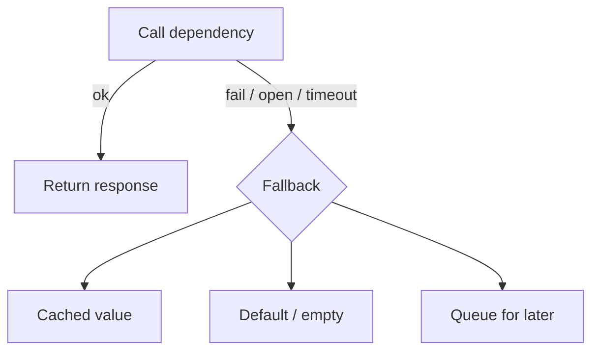

# Fallback strategies

---

## 🟢 Junior Level

### Definition

A **fallback** is the "Plan B" your code executes when the normal call fails, times out, or is rejected by a circuit breaker, bulkhead, or rate limiter. Instead of showing the user an error page, you return something acceptable: a cached value, a default, or a reduced feature.

### Analogy

The elevator is broken, so you take the stairs. Slower, but you still reach your floor.

### Minimal example

```java
@Service
public class PriceService {

    private final RestClient client;

    public PriceService(RestClient.Builder builder) {
        this.client = builder.baseUrl("http://pricing-service").build();
    }

    @CircuitBreaker(name = "pricing", fallbackMethod = "defaultPrice")
    public Price priceOf(String sku) {
        return client.get().uri("/prices/{sku}", sku).retrieve().body(Price.class);
    }

    Price defaultPrice(String sku, Throwable t) {
        return new Price(sku, BigDecimal.ZERO, "UNAVAILABLE");
    }

    public record Price(String sku, BigDecimal amount, String source) {}
}
```

Rules for the annotation fallback: same return type, same parameters as the original plus an optional trailing exception parameter, same class.



### Simple fallback types

1. **Static default** (empty list, `false`, generic message).
2. **Cached/stale data** (last known good).
3. **Reduced functionality** (hide the recommendations widget).
4. **Fail silently** for non-critical features.

---

## 🟡 Middle Level

### The fallback catalogue

| Strategy | Example | Risk |
| :--- | :--- | :--- |
| Stale cache | Show yesterday's product catalogue | Wrong data (prices!) |
| Default value | Recommendations → top sellers | Poor relevance |
| Alternate provider | Secondary payment/SMS gateway | Cost, consistency |
| Queue and process later | "Order accepted, confirmation by email" | Needs reliable queue/outbox |
| Read replica / read-only mode | Disable writes, allow reads | Feature gaps |
| Fail fast with clear error | Payment cannot be faked | The honest fallback |

**Business decides**: some operations must *not* have a fake fallback. Returning a default price of 0 is a bug. For payments, authorization, inventory reservation prefer a clear failure or a pending state.

### Exception-specific fallbacks

```java
@CircuitBreaker(name = "pricing", fallbackMethod = "fallback")
public Price priceOf(String sku) { /* ... */ return null; }

Price fallback(String sku, CallNotPermittedException e) {
    return cache.getIfPresent(sku).orElseThrow(() -> new PricingUnavailableException(sku));
}

Price fallback(String sku, TimeoutException e) {
    return cache.getIfPresent(sku).orElse(Price.unknown(sku));
}

Price fallback(String sku, Throwable t) { // most generic, picked last
    throw new PricingUnavailableException(sku);
}
```

Resilience4j chooses the most specific matching exception type.

### Fallback with cache refresh (stale-while-error)

```java
@Service
public class CachedPriceService {

    private final Cache<String, Price> lastGood = Caffeine.newBuilder()
            .maximumSize(10_000).expireAfterWrite(Duration.ofHours(6)).build();
    private final PriceService delegate;

    public CachedPriceService(PriceService delegate) { this.delegate = delegate; }

    public Price priceOf(String sku) {
        try {
            Price p = delegate.priceOf(sku);
            if (!"UNAVAILABLE".equals(p.source())) lastGood.put(sku, p);
            return p;
        } catch (RuntimeException e) {
            Price stale = lastGood.getIfPresent(sku);
            if (stale != null) return new Price(sku, stale.amount(), "STALE");
            throw e;
        }
    }
}
```

Always **label** degraded responses (`source: STALE`, a header such as `Warning: 110 - "Response is Stale"`, or a UI banner) so downstream code and users aren't misled.

### Spring Cloud CircuitBreaker and Feign

```java
String body = cbFactory.create("pricing").run(
    () -> pricing.call(),
    t -> "{\"degraded\":true}");
```

Feign: `fallbackFactory` (see [OpenFeign vs RestClient](06.%20OpenFeign%20vs%20RestClient%20declarative%20HTTP%20clients.md)). Gateway: `fallbackUri: forward:/fallback`.

### Common mistakes

- Fallback that calls another remote service which can fail too (chained failures, also invisible).
- Swallowing the exception without logging/metrics — you never learn you are in degraded mode.
- Fallback is slow (e.g., heavy DB query) and becomes the new bottleneck.
- Same generic fallback for 4xx validation errors; the client needs the real error.
- Not testing the fallback path.

---

## 🔴 Senior Level

### Fallback as a design contract

Define per-endpoint **degradation levels** in the API contract:

| Level | Behavior | Signal |
| :--- | :--- | :--- |
| 0 Normal | Full data | — |
| 1 Stale | Cached data up to N hours | `X-Data-Freshness: stale` |
| 2 Partial | Missing non-critical sections | `partial: true`, list of missing parts |
| 3 Minimal | Static content | 200 with defaults / 206-style |
| 4 Fail | Error | 503 + `Retry-After` |

Clients and front-end teams must handle every level — otherwise the fallback creates correctness bugs: e.g., checkout totals computed from a stale discount.

### Fallbacks and failure domains

A fallback is only valuable if it is **independent** of the failing dependency: a Redis cache fallback behind a service whose outage is *also* Redis gives nothing. Prefer in-process caches (Caffeine) for last-resort data, replicated across pods by nature; limited by memory and per-pod warm-up. After a restart the cache is cold exactly when you need it; consider persistent snapshots or warm-up on startup.

### Cost and performance

Under outage, 100% of traffic hits the fallback, so it must handle full load at lower latency than the original call. Benchmark: fallback path p99 under 10 ms, no I/O. Avoid allocating heavy objects; precompute static fallbacks as constants. When the breaker is open the fallback executes on the caller thread directly — cheap; but for timeouts the fallback occurs after the whole timeout elapsed, so the user already paid latency (hence short timeouts).

### Observability

Count fallback invocations by cause; log at `WARN` with rate limiting to avoid log storms. Micrometer:

```java
Counter fallbackCounter = Counter.builder("app.fallback")
        .tag("dependency", "pricing").tag("cause", t.getClass().getSimpleName())
        .register(meterRegistry);
fallbackCounter.increment();
```

Alert on fallback rate > baseline; a silently succeeded fallback is the most common reason that an outage is discovered by customers first.

### Anti-patterns at scale

- **Cache stampede on fallback exit**: when the dependency recovers, thousands of keys expire at once. Use request coalescing (`Caffeine.refreshAfterWrite`, `AsyncLoadingCache`) and jittered TTLs.
- **Data poisoning**: caching a fallback value as if it were real (the earlier sample guards with `!UNAVAILABLE`).
- **Fallback masking**: dashboards green because 100% of requests succeed (with defaults). Use SLOs on *quality* (non-degraded ratio), not only HTTP success.
- **Idempotency**: "queue and process later" fallbacks must dedupe (see [Idempotency](14.%20Idempotency%20for%20safe%20retries.md)) and ideally use the transactional outbox to avoid losing the event if the service crashes between the DB write and queueing.

### Test the fallback

```java
@Test
void returnsStalePriceWhenPricingIsDown() {
    server.expect(requestTo("/prices/A1")).andRespond(withServerError());
    Price p = service.priceOf("A1");          // breaker records failure
    assertThat(p.source()).isEqualTo("UNAVAILABLE");
}
```

Run chaos experiments (kill the dependency in staging) to prove the fallback holds under real load, not just in unit tests.

---

## 🎯 Interview Cheat Sheet

**30-second pitch:** A fallback is a deliberate degraded response when the primary path fails: cached data, defaults, alternative provider, or queued work. It turns hard failures into reduced functionality, but must be independent of the failing dependency, cheap, labeled as degraded, observable, and acceptable to the business.

**Must-know bullets**
- Fallback signature rules in Resilience4j; most specific exception wins.
- Not everything can safely have a fallback (money, inventory).
- Label and monitor degraded responses.
- Fallbacks must not call fragile remote systems.
- Test and chaos-test the fallback path.

**Follow-up questions**
- What fallback would you use for checkout vs product recommendations?
- How do you avoid a cache stampede on recovery?
- How do you stop fallbacks from hiding outages?

**Red flags**
- "We return an empty list on any exception."
- Fallback with remote call, or heavy computation.
- No metric on fallback usage.

**Related topics**
- [Circuit breaker pattern with Resilience4j](07.%20Circuit%20breaker%20pattern%20with%20Resilience4j.md)
- [Health checks and graceful degradation](18.%20Health%20checks%20and%20graceful%20degradation.md)
- [API composition and BFF](17.%20API%20composition%20and%20BFF.md)
- [Designing for failure](20.%20Designing%20for%20failure.md)
