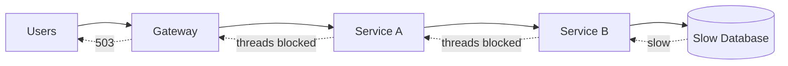

# Cascading failures and retry storms

---

## 🟢 Junior Level

### Definition

A **cascading failure** happens when the failure of one component causes failures in components that depend on it, which in turn fail their callers, until a large part of the system is down. A **retry storm** is a specific cascade driver: clients retry failed requests so aggressively that they multiply load on an already struggling service, preventing recovery.

### Analogy

A traffic jam: one broken-down car blocks a lane, drivers behind brake, the queue grows backward for miles, and even after the car is removed the jam persists because everyone is stuck in it.

### A simple cascade



The database slows down. Service B's threads wait on it; B's thread pool fills. A's calls to B hang and A's pool fills. The gateway fills. Everything is down although only the database was slow.

### Minimal code showing the dangerous pattern

```java
// DANGEROUS: no timeout, retry on every error, no limit
public String loadProfile(String userId) {
    for (int i = 0; i < 5; i++) {
        try {
            return restTemplate.getForObject("http://profile/users/" + userId, String.class);
        } catch (Exception e) {
            // retry immediately
        }
    }
    throw new IllegalStateException("profile unavailable");
}
```

Safe version uses timeouts, bounded retries with backoff, a breaker:

```java
@CircuitBreaker(name = "profile", fallbackMethod = "anonymous")
@Retry(name = "profile")
public String loadProfileSafe(String userId) {
    return restClient.get().uri("/users/{id}", userId).retrieve().body(String.class);
}

String anonymous(String userId, Throwable t) { return "{\"name\":\"guest\"}"; }
```

---

## 🟡 Middle Level

### Causes of cascades

| Cause | Mechanism |
| :--- | :--- |
| Missing timeouts | Threads wait forever, pools exhaust |
| Unbounded queues | Latency grows, memory grows, work done for abandoned clients |
| Retry amplification | N layers × M attempts multiply load |
| Shared resources | One thread/connection pool for many dependencies |
| Synchronized failures | Health checks flap, all instances restart together |
| Overload spirals | Fewer healthy nodes → more load per node → more failures |
| Cold caches/restarts | Restart under load → stampede on DB |

### Defenses (defense in depth)

1. **Timeouts** everywhere ([Timeouts](09.%20Timeouts%20in%20distributed%20calls.md)).
2. **Circuit breakers** to stop calling a failing dependency.
3. **Bulkheads** to isolate pools ([Bulkhead](10.%20Bulkhead%20pattern.md)).
4. **Rate limiting & load shedding** to refuse excess work early.
5. **Backoff + jitter + retry budgets** ([Retry](08.%20Retry%20with%20exponential%20backoff%20and%20jitter.md)).
6. **Bounded queues** with explicit rejection.
7. **Fallbacks/degradation** ([Fallbacks](12.%20Fallback%20strategies.md)).
8. **Autoscaling cautiously** (scaling a service that is failing because of its DB adds more DB load).

### Retry amplification example

```text
Gateway (3 attempts) → Orders (3 attempts) → Inventory (3 attempts) → DB
Normal load: 1000 rps
During Inventory outage: Inventory receives up to 1000 × 3 × 3 × 3 = 27,000 rps of attempts
```

Fix: retry only at one layer; downstream layers fail fast and propagate a non-retryable status, or use the `X-Retry-Attempt` header to disable inner retries.

### Load shedding filter (servlet)

```java
@Component
public class LoadSheddingFilter extends OncePerRequestFilter {

    private final AtomicInteger inFlight = new AtomicInteger();
    private static final int LIMIT = 150;

    @Override
    protected void doFilterInternal(HttpServletRequest req, HttpServletResponse res, FilterChain chain)
            throws ServletException, IOException {
        if (req.getRequestURI().startsWith("/actuator")) { chain.doFilter(req, res); return; }
        if (inFlight.incrementAndGet() > LIMIT) {
            inFlight.decrementAndGet();
            res.setStatus(HttpServletResponse.SC_SERVICE_UNAVAILABLE);
            res.setHeader("Retry-After", "2");
            return;
        }
        try { chain.doFilter(req, res); } finally { inFlight.decrementAndGet(); }
    }
}
```

### Common mistakes

- Treating a 503 as a reason to retry immediately.
- Using client-side load balancers that re-send to *other* instances without limit, spreading the overload.
- Kubernetes liveness probes depending on downstream health: pods restart in a loop, the cluster loses capacity.
- Autoscaling that responds to CPU while the real bottleneck is a connection pool or DB.

---

## 🔴 Senior Level

### Metastable failures

A **metastable failure** is a state where the trigger (e.g., short DB hiccup) has gone, but a sustaining feedback loop keeps the system degraded: retries add load, load causes timeouts, timeouts cause retries. Recovery requires *reducing* load below the recovery threshold, not just fixing the root cause. Typical remedies: shed load aggressively, disable retries globally via a config toggle (feature flag refresh), drain queues, scale the bottleneck first, and bring traffic back gradually (ramp-up).

### Queueing theory intuition

For a service with utilization ρ = λ/μ, mean wait grows like ρ/(1-ρ). At 70% utilization wait multiplier ≈ 2.3; at 90% ≈ 9; at 99% ≈ 99. Small traffic increases past ~80% cause latency explosions; a retry storm that adds +30% load at 75% utilization pushes the system into the nonlinear zone. Target peak utilization 50-70% and use autoscaling lead-time budget.

### Deadlines and cancellation

Propagate remaining deadline; drop requests whose deadline has passed *before* doing work ("don't process zombies"). Use bounded queue with LIFO under overload (serve fresh requests first; old ones have probably been abandoned by clients) — adaptive LIFO is used in large-scale systems.

### Retry budgets in code (token bucket for retries)

```java
public class RetryBudget {
    private final AtomicLong tokens = new AtomicLong();
    private final double ratio;      // e.g. 0.1 = 10% of requests may be retried
    private final long max;

    public RetryBudget(double ratio, long max) { this.ratio = ratio; this.max = max; }

    public void onRequest() {
        tokens.updateAndGet(t -> Math.min(max, t + Math.round(ratio * 1000))); // milli-tokens
    }

    public boolean tryAcquireRetry() {
        while (true) {
            long cur = tokens.get();
            if (cur < 1000) return false;
            if (tokens.compareAndSet(cur, cur - 1000)) return true;
        }
    }
}
```

Each original request deposits 0.1 token; each retry spends 1, capping retries at ~10% of traffic regardless of failure rate. Even with a 100% failure rate extra load stays at +10%.

### Kubernetes-specific amplifiers

- Readiness failures remove pods from endpoints, concentrating load on the remaining pods (cascade within a service).
- HPA reacting to CPU during a stall: new pods start cold (JIT, caches, connection pools) and increase DB connections — DB connection exhaustion. Use `maxSurge`, startup probes, connection-pool caps per pod × max replicas ≤ DB limit.
- `PodDisruptionBudget` and slow rollouts prevent a bad deploy from taking out capacity.

### Diagnostics during an incident

```bash
# Which pools are saturated?
curl localhost:8080/actuator/metrics/executor.active?tag=name:applicationTaskExecutor
curl localhost:8080/actuator/metrics/hikaricp.connections.pending
curl localhost:8080/actuator/metrics/tomcat.threads.busy
# Retry ratio and open breakers
curl localhost:8080/actuator/circuitbreakers | jq '.circuitBreakers | to_entries[] | {n:.key, s:.value.state}'
jcmd <pid> Thread.print | grep -c "TIMED_WAITING"
```

Golden signals (latency, traffic, errors, saturation) at each hop; locate the *first* saturated component — that's the origin; every upstream is a victim.

### Prevention checklist

Timeouts shrink downstream; retries at one layer with budget; breaker + bulkhead per dependency; load-shedding at edges; startup probes; capacity headroom; game days (see [Chaos engineering](19.%20Chaos%20engineering.md)).

---

## 🎯 Interview Cheat Sheet

**30-second pitch:** A cascading failure propagates because callers wait on a slow dependency, exhaust their own pools, and fail their callers; retry storms make it worse by multiplying load. Break the chain with timeouts, circuit breakers, bulkheads, load shedding, backoff with jitter and retry budgets, and by retrying at a single layer.

**Must-know bullets**
- Slow is worse than down.
- Retry multiplication across layers (3×3×3).
- Metastable failure: the cause is gone, the loop persists.
- Don't tie liveness to dependencies.
- Shed load early, fail fast, recover gradually.

**Follow-up questions**
- How would you stop a retry storm during an incident?
- Why can autoscaling worsen an outage?
- What's a retry budget?

**Red flags**
- "Just add more retries."
- Infinite/unbounded queues.
- Scaling out as the first reaction without finding the bottleneck.

**Related topics**
- [Retry with exponential backoff and jitter](08.%20Retry%20with%20exponential%20backoff%20and%20jitter.md)
- [Bulkhead pattern](10.%20Bulkhead%20pattern.md)
- [Rate limiter](11.%20Rate%20limiter.md)
- [Designing for failure](20.%20Designing%20for%20failure.md)
- [Tuning resilience in production](21.%20Tuning%20resilience%20in%20production.md)
