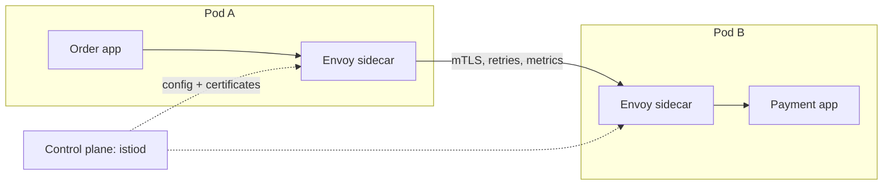

# Service mesh vs Spring Cloud

---

## 🟢 Junior Level

Microservices need the same plumbing: service discovery, load balancing, retries, timeouts, circuit breaking, mTLS, metrics, tracing. There are two ways to provide it:

* **Spring Cloud (library approach)** — the plumbing runs **inside your application** as Java libraries: Spring Cloud LoadBalancer, OpenFeign/RestClient, Resilience4j, Micrometer Tracing, Spring Cloud Gateway.
* **Service mesh (platform approach)** — the plumbing runs **outside your application**, in a proxy next to each service (a *sidecar*, typically Envoy) or in a node-level proxy. Examples: **Istio**, **Linkerd**, Consul Connect, Cilium service mesh. The app just makes plain HTTP calls; the proxy handles the rest.



---

## 🟡 Middle Level

### Feature comparison

| Concern | Spring Cloud | Service mesh |
| --- | --- | --- |
| Discovery & load balancing | Eureka/Consul/K8s + Spring Cloud LoadBalancer | Kubernetes Services + proxy LB (least-request, locality-aware) |
| Retries, timeouts | Resilience4j, client config | `VirtualService` retries/timeouts |
| Circuit breaking | Resilience4j (rich: slow-call rate, half-open) | Outlier detection, connection pool limits (simpler) |
| mTLS & service identity | Manual (certs, Spring SSL bundles) | Automatic, rotated certs (SPIFFE IDs) |
| Authorization between services | In code (Spring Security) | `AuthorizationPolicy` by workload identity |
| Traffic shifting (canary, mirroring) | Gateway routes or custom | Weighted routing, header-based routing, mirroring |
| Metrics & tracing | Micrometer in-app (business context) | Golden signals for every hop, uniform across languages |
| Languages | Java/Spring only | Any language |
| Fallbacks with business logic | Yes (return cached price) | No — the proxy doesn't know your domain |

### Istio example: retries and a canary

```yaml
apiVersion: networking.istio.io/v1
kind: VirtualService
metadata: { name: payment }
spec:
  hosts: [ payment ]
  http:
    - timeout: 2s
      retries:
        attempts: 2
        perTryTimeout: 800ms
        retryOn: connect-failure,refused-stream,unavailable,503
      route:
        - destination: { host: payment, subset: v1 }
          weight: 90
        - destination: { host: payment, subset: v2 }
          weight: 10
```

---

## 🔴 Senior Level

### Combining them without double behavior
Most mature platforms use **both**, with clear ownership:
* **Mesh** owns transport concerns: mTLS, service identity, L7 load balancing, connection-level timeouts, traffic shifting, uniform telemetry.
* **Application** owns business-aware resilience: fallbacks, idempotency keys, bulkheads around specific dependencies, retries that depend on domain error codes, and business metrics.

The classic failure is **duplicated retries**: Resilience4j retries 3× and the sidecar retries 3× → up to 9 attempts per call, and more across hops. Pick one layer for retries (often the mesh for connection-level failures, the app for idempotent business retries) and set the other to zero. Same for timeouts: the app's timeout must be ≥ mesh timeout × attempts, or the app gives up while the mesh is still retrying.

With a mesh on Kubernetes, you usually **drop Eureka and Spring Cloud LoadBalancer**: call `http://payment:8080` and let Kubernetes DNS + the proxy balance. Spring Cloud Kubernetes is only needed for config/secrets integration if you want it.

### Costs of a mesh
* **Latency**: each hop adds two proxy traversals (≈ 0.5–2 ms p50, more at p99 under load).
* **Resources**: an Envoy sidecar per pod (tens of MB RAM, some CPU) × hundreds of pods. **Ambient mode** (Istio) and **eBPF meshes** (Cilium) move L4 into node-level components and only add L7 proxies (waypoints) where needed, cutting overhead.
* **Operational complexity**: control-plane upgrades, CRDs, debugging through `istioctl proxy-config`, certificate expiry incidents. You need a platform team.
* **Startup ordering**: the app may start before the sidecar is ready (connection refused at boot) — use `holdApplicationUntilProxyStarts: true` / native sidecars (Kubernetes 1.29+).

### Decision guide
* Small number of Java services, one team → Spring Cloud libraries (or even plain Kubernetes Services + Resilience4j). A mesh is overhead.
* Polyglot platform, many teams, zero-trust/mTLS compliance requirements, advanced traffic management → mesh, with the app keeping business resilience.
* Already on a managed mesh (GKE, AWS VPC Lattice, Azure) → use its traffic features, keep libraries minimal.

---

## 🎯 Interview Cheat Sheet

**30-second pitch:** Spring Cloud puts discovery, load balancing, resilience and tracing inside the application as libraries; a service mesh moves transport concerns — mTLS, retries, timeouts, traffic shifting, telemetry — into sidecar or node proxies, language-agnostically. I let the mesh own transport and security, keep business-aware resilience like fallbacks and idempotent retries in the app, and avoid duplicating retries and timeouts in both layers.

**Must know:**
* Sidecar/data plane vs control plane; Envoy, istiod.
* Mesh: automatic mTLS, AuthorizationPolicy, weighted routing.
* App: fallbacks, idempotency, business metrics.
* Retry/timeout duplication math.
* Mesh costs: latency, resources, ops; ambient/eBPF options.

**Common follow-ups:**
* Do you still need Eureka on Kubernetes with Istio?
* Who should own retries?
* What does the mesh *not* solve?

**Red flags:** retries configured in app and mesh; adopting Istio for three services; expecting the mesh to provide business fallbacks.

**Related:**
* [What does Spring Cloud provide](01.%20What%20does%20Spring%20Cloud%20provide.md)
* [How does service discovery work in Spring Cloud](02.%20How%20does%20service%20discovery%20work%20in%20Spring%20Cloud.md)
* [Cascading failures and retry storms](13.%20Cascading%20failures%20and%20retry%20storms.md)
* [Securing microservices](../23.%20Spring%20Security%20and%20Authentication/21.%20Securing%20microservices.md)
