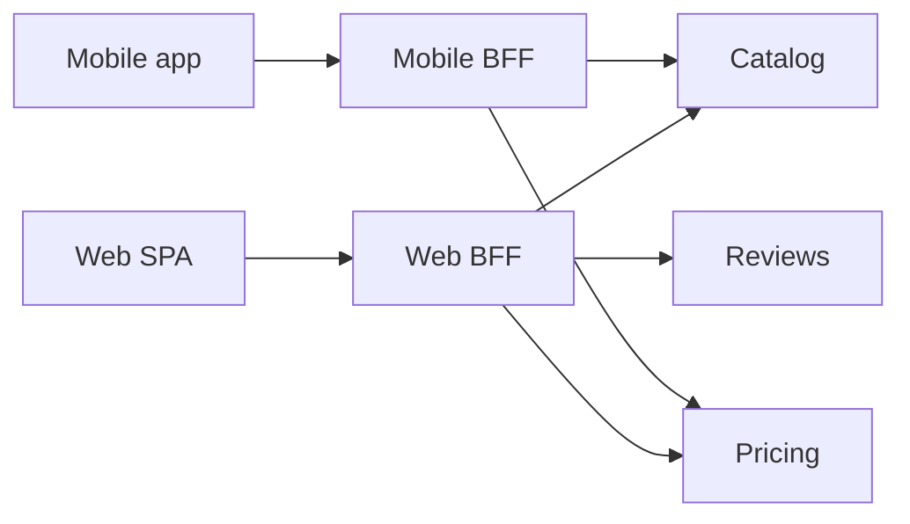

# API composition and BFF

---

## 🟢 Junior Level

In microservices, data for one screen is spread across services: a product page needs the catalog, prices, stock, reviews and recommendations. Two patterns help clients get it efficiently:

* **API composition** — a component calls several services and **merges** their responses into one.
* **Backend for Frontend (BFF)** — a dedicated backend **per client type** (web, mobile, partner API) that does composition and shapes responses for that client's needs.



Without it, the client makes 5+ calls over a slow mobile network, and every service must know every client's needs.

---

## 🟡 Middle Level

### Parallel composition with timeouts and partial results

```java
@RestController
class ProductPageController {
    private final CatalogClient catalog;
    private final PricingClient pricing;
    private final ReviewClient reviews;
    private final Executor vthreads = Executors.newVirtualThreadPerTaskExecutor();

    @GetMapping("/bff/products/{id}")
    ProductPage page(@PathVariable String id) {
        CompletableFuture<Product> product = supplyAsync(() -> catalog.get(id), vthreads);   // required
        CompletableFuture<Price> price = supplyAsync(() -> pricing.get(id), vthreads)
                .completeOnTimeout(Price.unavailable(), 300, MILLISECONDS);                   // degrade
        CompletableFuture<ReviewSummary> rating = supplyAsync(() -> reviews.summary(id), vthreads)
                .completeOnTimeout(ReviewSummary.EMPTY, 200, MILLISECONDS)
                .exceptionally(e -> ReviewSummary.EMPTY);                                     // optional

        return new ProductPage(product.join(), price.join(), rating.join());
    }
}
```

Decide per dependency: **required** (fail the request), **important** (degrade with a marker like "price unavailable"), **optional** (omit silently). Latency of the page ≈ max of required calls, not the sum.

### BFF responsibilities
* Aggregate and **reshape** data for one client (field selection, pagination style, image sizes for mobile).
* Handle client-specific **auth flows** — e.g. the web BFF keeps OAuth tokens server-side and gives the browser an HttpOnly session cookie (the *token handler* / BFF security pattern), so tokens never live in JavaScript.
* Translate errors into client-friendly formats.

### What a BFF must not do
* Contain core business rules (pricing logic, order validation) — they belong in domain services; otherwise web and mobile BFFs drift apart.
* Become a shared "everything gateway" for all clients — that's a monolith again.

---

## 🔴 Senior Level

### Gateway vs BFF vs GraphQL
* **API gateway** — generic cross-cutting concerns (routing, auth, rate limiting) for all clients; little or no composition.
* **BFF** — client-specific composition owned by the **frontend team** ("you build it, you run it" for the UI and its backend).
* **GraphQL** — a flexible composition layer where clients choose fields; resolvers call services. It can serve as a BFF or as a federated graph (Apollo Federation, Netflix DGS). Watch the N+1 problem — batch resolver calls with DataLoaders.

### Resilience in composition
* Use **per-dependency timeouts** shorter than the BFF's overall SLA budget, plus an overall deadline. With a 1 s page budget: catalog 400 ms, pricing 300 ms, reviews 200 ms, all in parallel.
* Use **bulkheads** per downstream so a slow reviews service can't exhaust the BFF's resources for catalog calls.
* **Cache** stable, shared data (catalog descriptions) in the BFF with short TTLs; never cache user-specific data without the user in the key.
* Return **partial responses explicitly** (`"price": null, "warnings": ["PRICING_UNAVAILABLE"]`) so clients can render degraded UI instead of guessing.
* Propagate trace context and request deadlines to downstreams.

### Data consistency across composed data
Composed responses mix data read at slightly different times — price and stock may disagree for a moment. That's acceptable for display; for **decisions** (checkout), the domain service must re-validate against the source of truth. Never let a BFF-composed view drive writes without revalidation.

### When composition becomes a smell
If almost every request needs data from five services, service boundaries may be wrong (chatty, entangled domains). Alternatives:
* **CQRS read models / materialized views** — consume events from services and maintain a denormalized "product page" store (Elasticsearch, Redis, a document DB) the BFF reads in one call.
* Merging services whose data is always used together.

---

## 🎯 Interview Cheat Sheet

**30-second pitch:** API composition merges data from several services in one place, in parallel with per-dependency timeouts and explicit partial results. A BFF is a backend per client type, owned by the frontend team, that composes and reshapes responses and handles client-specific auth like keeping tokens out of the browser. Business rules stay in domain services; heavy composition may signal a need for read models or better boundaries.

**Must know:**
* Parallel calls: latency ≈ max, not sum.
* Required vs degradable vs optional dependencies.
* BFF vs gateway vs GraphQL.
* Token handler pattern for SPAs.
* Read models as an alternative to runtime composition.

**Common follow-ups:**
* How do you avoid duplicated logic across web and mobile BFFs?
* What if one service is slow?
* How does GraphQL compare to a BFF?

**Red flags:** sequential calls in the BFF; business rules in BFFs; one giant shared BFF for all clients.

**Related:**
* [What is Spring Cloud Gateway](04.%20What%20is%20Spring%20Cloud%20Gateway.md)
* [Fallback strategies](12.%20Fallback%20strategies.md)
* [Timeouts in distributed calls](09.%20Timeouts%20in%20distributed%20calls.md)
* [GraphQL schema resolvers and the N+1 problem](../34.%20API%20Design%20and%20Integration/13.%20GraphQL%20schema%20resolvers%20and%20the%20N%2B1%20problem.md)
