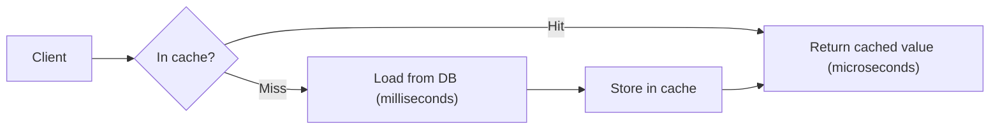

# Why use caching and when not to

---

## 🟢 Junior Level

A **cache** is a fast, temporary storage layer that keeps a copy of data which is expensive to obtain (a slow SQL query, a remote HTTP call, a heavy computation) so the next request can be answered from the copy instead of repeating the work.

### Simple Real-World Analogy
A librarian keeps the 20 most requested books on the desk next to the counter instead of walking to the basement archive for every reader. The desk is small and may hold an outdated edition, but 80% of readers are served in seconds.



### Why cache
1. **Lower latency** – RAM access is ~100 ns, a network round trip to Redis ~0.2–1 ms, a database query 5–500 ms.
2. **Higher throughput** – the same hardware serves many more requests.
3. **Protects backends** – the database sees only misses, so spikes don't take it down.
4. **Lower cost** – fewer DB replicas, fewer paid third-party API calls.

### Minimal working example

```java
import java.util.Map;
import java.util.concurrent.ConcurrentHashMap;

public class ProductService {
    private final Map<Long, String> cache = new ConcurrentHashMap<>();

    public String getProductName(long id) {
        // computeIfAbsent: on a miss, load once and store the result
        return cache.computeIfAbsent(id, this::loadFromDatabase);
    }

    private String loadFromDatabase(long id) {
        try {
            Thread.sleep(200); // simulate slow query
        } catch (InterruptedException e) {
            Thread.currentThread().interrupt();
        }
        return "Product-" + id;
    }

    public static void main(String[] args) {
        ProductService s = new ProductService();
        long t1 = System.nanoTime();
        s.getProductName(1);
        long t2 = System.nanoTime();
        s.getProductName(1);
        long t3 = System.nanoTime();
        System.out.printf("miss=%d ms, hit=%d us%n", (t2 - t1) / 1_000_000, (t3 - t2) / 1_000);
    }
}
```

This map never evicts anything, so it is a memory leak waiting to happen — real caches need size limits and expiry (see the eviction question).

### When NOT to cache (beginner rules)
- Data that changes on almost every read (a live stock-trading balance).
- Data that is cheap to compute or fetch anyway.
- Data where staleness is unacceptable (payment balance during a transfer).

---

## 🟡 Middle Level

### What is worth caching
A good candidate satisfies: **read-heavy**, **expensive to produce**, **tolerates some staleness**, **has a skewed access pattern** (a few keys receive most traffic — Zipf/Pareto distribution), and **small enough to fit** in memory.

| Candidate | Good? | Why |
|---|---|---|
| Product catalog, country list | ✅ | Rarely changes, read constantly |
| User profile page | ✅ | Read-heavy, short TTL is OK |
| Rendered HTML fragment | ✅ | CPU expensive |
| Account balance in a transfer | ❌ | Must be strongly consistent |
| Unique, never-repeated queries (full-text search with random terms) | ❌ | Hit ratio near 0 |
| Large result sets (millions of rows) | ❌ | Memory cost, serialization cost |

### Cache layers in a typical Java system
1. **Browser / CDN** – static assets, HTTP caching.
2. **API gateway / reverse proxy** – Nginx, Varnish.
3. **Application in-process** – Caffeine, Guava, Ehcache.
4. **Distributed cache** – Redis, Memcached, Hazelcast.
5. **ORM** – Hibernate first/second-level cache.
6. **Database** – buffer pool, query cache (removed in MySQL 8).
7. **CPU** – L1/L2/L3 caches (relevant to false sharing, but transparent).

### The costs most people forget
- **Staleness / consistency bugs** – "Why does the user still see the old price?" is the classic ticket.
- **Complexity** – invalidation logic spreads through the codebase. "There are only two hard things in computer science: cache invalidation and naming things."
- **Cold start** – after a restart or deploy the cache is empty and the DB takes full load.
- **Memory & serialization cost** – objects must be serialized for remote caches; large objects cost CPU.
- **Operational burden** – one more cluster to monitor, secure, size, and fail over.
- **Hidden coupling** – the system may silently depend on the cache for capacity; losing it means an outage.

### Example with Spring (declarative)

```java
import org.springframework.cache.annotation.Cacheable;
import org.springframework.stereotype.Service;

@Service
public class CountryService {

    private final CountryRepository repository;

    public CountryService(CountryRepository repository) {
        this.repository = repository;
    }

    // Read-mostly reference data: ideal cache target
    @Cacheable(cacheNames = "countries", key = "#code")
    public Country findByCode(String code) {
        return repository.findByCode(code).orElseThrow();
    }
}

record Country(String code, String name) {}

interface CountryRepository {
    java.util.Optional<Country> findByCode(String code);
}
```

### Common mistakes
- Caching before measuring: always profile first; the bottleneck may be an N+1 query or a missing index, and a cache hides rather than fixes it.
- Caching mutable objects and mutating them after retrieval (affects every consumer in a local cache).
- No TTL — stale data lives forever.
- Treating the cache as a source of truth.

---

## 🔴 Senior Level

### Decision framework: quantify before you cache
Expected latency with hit ratio *h*: `T = T_cache + (1-h)·T_source`. With T_cache = 1 ms, T_source = 50 ms, h = 0.9 → 6 ms (8x better); with h = 0.5 → 26 ms; with h = 0.01 → ~51 ms, i.e. **worse than no cache** because every miss pays the extra lookup. Caching only pays off at a meaningful hit ratio, so measure access distribution (top-N key share) from logs first.

### Amdahl-style thinking
If 70% of request time is DB, perfect caching bounds the speed-up at 1/(1-0.7) ≈ 3.3x. Check where the time goes (distributed tracing) before adding a tier.

### Failure modes that justify "when not to"
- **Metastable failure**: a system that only survives because of a 95% hit ratio collapses when the cache is flushed — the DB receives 20x traffic, slows down, requests pile up and retries amplify the load; recovery needs manual load shedding, not just cache refilling. Design principle: the backend must survive a cold cache at reduced traffic (rate limiting, load shedding, request coalescing, gradual warm-up).
- **Consistency violations**: caching authorization decisions or permissions can create security holes after revocation. Use short TTL plus event-driven invalidation.
- **GC pressure**: large on-heap caches of many small objects increase old-gen occupancy and pause times; cap by weight (`maximumWeight`) or go off-heap / remote.
- **Per-tenant leakage**: forgetting the tenant ID in the key leaks data across customers — a security incident, not a bug.

### Defensive design checklist

```java
import com.github.benmanes.caffeine.cache.Caffeine;
import com.github.benmanes.caffeine.cache.LoadingCache;
import java.time.Duration;

public class SafeCacheFactory {

    // Bounded size, bounded staleness, stats enabled, refresh without blocking readers
    public static LoadingCache<String, String> build() {
        return Caffeine.newBuilder()
                .maximumSize(10_000)                      // never unbounded
                .expireAfterWrite(Duration.ofMinutes(10)) // staleness ceiling
                .refreshAfterWrite(Duration.ofMinutes(5)) // async reload on access
                .recordStats()                            // observability from day one
                .build(SafeCacheFactory::load);
    }

    private static String load(String key) {
        return "value-for-" + key;
    }
}
```

### Diagnosing "do we need a cache?"
1. Record p50/p99 latency per endpoint and per downstream call.
2. Calculate the key-access distribution; if the top 1% of keys cover >50% of reads, caching works.
3. Prototype with `recordStats()` in shadow mode (cache populated, result still taken from the source and compared) to find the real hit ratio and staleness divergence before trusting it.
4. Consider alternatives: indexes, denormalization, read replicas, materialized views, batching, pagination, async processing — often cheaper and less risky.

### Anti-patterns at scale
- Using the cache as primary storage with no persistence plan.
- "Cache everything" via blanket `@Cacheable` — memory exhaustion and invalidation chaos.
- Caching `null`/errors without a short TTL, which turns a transient outage into a long one.
- Ignoring serialization versioning: after a deploy, old cached bytes cannot be deserialized by the new class and cause exceptions. Use versioned key prefixes (`v2:user:42`) or schema-tolerant formats (JSON).

---

## 🎯 Interview Cheat Sheet

**30-second pitch:** A cache stores copies of expensive-to-get data closer to the consumer to cut latency and protect backends. It pays off for read-heavy, skewed, staleness-tolerant data, and it costs consistency, complexity, memory and operational risk. Measure the hit ratio before and after; never let the system depend on it for survival.

**Must know:**
- Latency formula and why a low hit ratio can be worse than no cache.
- Cache layers: browser, CDN, app, distributed, ORM, DB.
- Cache only data that is read-heavy, expensive, tolerant to staleness.
- Always bound size and TTL; record statistics.
- A cold cache must not take the database down.

**Follow-up questions:**
- Give an example where caching made things worse.
- How do you decide the TTL?
- What happens to your system when Redis is down?
- How do you cache user-specific data safely?

**Red flags:** "Cache everything"; no TTL; cache used as the source of truth; never measuring the hit ratio.

**Related topics:**
- [Cache hit ratio, monitoring and sizing](02.%20Cache%20hit%20ratio,%20monitoring%20and%20sizing.md)
- [Caching strategies cache-aside, read-through, write-through, write-behind and refresh-ahead](03.%20Caching%20strategies%20cache-aside,%20read-through,%20write-through,%20write-behind%20and%20refresh-ahead.md)
- [Cache invalidation strategies](13.%20Cache%20invalidation%20strategies.md)
- [Cache consistency with the database](22.%20Cache%20consistency%20with%20the%20database.md)
