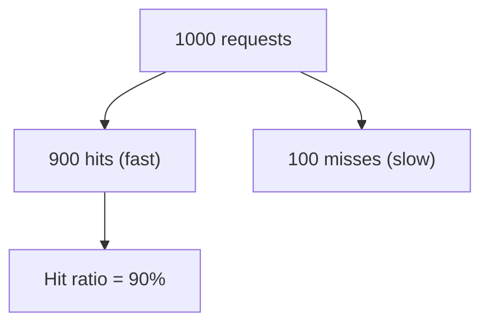

# Cache hit ratio, monitoring and sizing

---

## 🟢 Junior Level

The **cache hit ratio** is the share of lookups answered from the cache:

`hit ratio = hits / (hits + misses)`

If 900 of 1000 requests find their value in the cache, the hit ratio is 90%. A **miss** means the value was absent (never loaded, expired or evicted) and the slow source had to be queried.

### Simple Real-World Analogy
A pizza shop pre-bakes a few popular pizzas. If 9 of 10 customers order a pre-baked one, the "hit ratio" is 90% and the queue moves fast. If customers order exotic custom pizzas, the pre-baked stock is useless.



### Minimal example: measure it

```java
import java.util.Map;
import java.util.concurrent.ConcurrentHashMap;
import java.util.concurrent.atomic.LongAdder;

public class CountingCache<K, V> {
    private final Map<K, V> map = new ConcurrentHashMap<>();
    private final LongAdder hits = new LongAdder();
    private final LongAdder misses = new LongAdder();

    public V get(K key, java.util.function.Function<K, V> loader) {
        V v = map.get(key);
        if (v != null) {
            hits.increment();
            return v;
        }
        misses.increment();
        return map.computeIfAbsent(key, loader);
    }

    public double hitRatio() {
        long h = hits.sum();
        long total = h + misses.sum();
        return total == 0 ? 0.0 : (double) h / total;
    }

    public static void main(String[] args) {
        CountingCache<Integer, String> c = new CountingCache<>();
        for (int i = 0; i < 100; i++) {
            c.get(i % 10, k -> "v" + k);
        }
        System.out.printf("hit ratio = %.2f%n", c.hitRatio()); // 0.90
    }
}
```

### Rule of thumb
- Below ~50%: the cache barely helps, rethink the design.
- 80–95%: healthy for most read-heavy systems.
- 99%+: excellent, but check the system survives a cold cache.

---

## 🟡 Middle Level

### Hit ratio is not the only metric
| Metric | Meaning |
|---|---|
| Hit ratio / miss ratio | Overall effectiveness |
| Eviction count | Cache is too small if high while misses are high |
| Load time (avg / p99) | Cost of a miss |
| Average load penalty | Dominates real latency (`miss ratio × load time`) |
| Memory used / max | Sizing headroom |
| Expired keys vs. evicted keys (Redis) | TTL working vs. memory pressure |

Remember that a miss on an expensive key matters more than a miss on a cheap key — **byte hit ratio** and **cost-weighted hit ratio** can differ greatly from the plain ratio.

### Why the hit ratio is low — diagnosis
1. **Cold cache** (start-up, deploy) – warm up proactively.
2. **Capacity misses** – working set larger than cache; evictions high.
3. **TTL too short** – entries expire before reuse.
4. **Poor key design** – including volatile parts (timestamps, request IDs, unsorted params) so equal requests produce different keys.
5. **Low reuse** – each key is read once (scans, crawlers, search with random terms).
6. **Frequent invalidation** – writes constantly purge entries.
7. **Cache pollution by scans** – a one-off batch job evicts the hot set (fix with TinyLFU admission, as in Caffeine).

### Monitoring Caffeine with Micrometer in Spring Boot

```java
import com.github.benmanes.caffeine.cache.Cache;
import com.github.benmanes.caffeine.cache.Caffeine;
import com.github.benmanes.caffeine.cache.stats.CacheStats;
import io.micrometer.core.instrument.MeterRegistry;
import io.micrometer.core.instrument.binder.cache.CaffeineCacheMetrics;
import org.springframework.context.annotation.Bean;
import org.springframework.context.annotation.Configuration;

@Configuration
public class CacheConfig {

    @Bean
    public Cache<String, String> userCache(MeterRegistry registry) {
        Cache<String, String> cache = Caffeine.newBuilder()
                .maximumSize(50_000)
                .recordStats() // required, otherwise metrics are zero
                .build();
        // exports cache.gets{result=hit|miss}, cache.evictions, cache.size ...
        CaffeineCacheMetrics.monitor(registry, cache, "userCache");
        return cache;
    }

    public static String report(Cache<?, ?> cache) {
        CacheStats s = cache.stats();
        return "hitRate=%.3f evictions=%d avgLoadMs=%.2f"
                .formatted(s.hitRate(), s.evictionCount(), s.averageLoadPenalty() / 1_000_000);
    }
}
```

For Redis, use `INFO stats`:
```
keyspace_hits:1823411
keyspace_misses:204331
evicted_keys:0
expired_keys:55012
```
`hit ratio = keyspace_hits / (keyspace_hits + keyspace_misses)`. Note these counters are server-wide (all clients and all keys, including lock and rate-limit keys), so an application-level metric is more precise.

### Sizing basics
- Estimate **working set** = number of distinct keys accessed within a window × average entry size.
- Add overhead: Redis adds ~50–100 bytes per key plus data-structure overhead; a JVM object has headers and pointers (a `String` of 10 chars ≈ 56+ bytes).
- Leave headroom: Redis needs memory for replication buffers, fork copy-on-write during RDB/AOF rewrite (up to 2x in worst case), and fragmentation.

---

## 🔴 Senior Level

### Hit ratio as a function of cache size
Under a Zipf distribution, hit ratio grows logarithmically with size: doubling memory yields diminishing returns. Plot **hit ratio vs. size** by replaying production access logs through a simulator (Caffeine ships a simulator with many trace formats and policies) — this tells you the knee of the curve and avoids paying for memory that adds 0.2%.

### Cost-aware math
`Average latency = T_hit + miss_ratio × T_miss`. At T_hit = 1 ms and T_miss = 100 ms, going from 95% to 99% improves latency from 6 ms to 2 ms (3x), while 90% to 95% saves 5 ms. The last percentage points matter most when misses are very expensive, and they also reduce load on the backend by 5x (5% → 1%). Always translate to **backend QPS**: at 100k req/s, a 1% hit-ratio drop adds 1,000 QPS to the database.

### Sizing a Redis instance (worked example)
- 20 million keys, each value 500 bytes JSON, key ~40 bytes.
- Per entry ≈ 500 + 40 + ~70 overhead ≈ 610 B → ~12 GB.
- Set `maxmemory` ≈ 60–70% of box RAM if persistence/forking is enabled; with 12 GB data, provision ≈ 24 GB instance.
- Verify with `MEMORY USAGE key`, `MEMORY STATS`, `redis-cli --bigkeys`, and `INFO memory` (`used_memory`, `mem_fragmentation_ratio` — healthy ≈ 1.0–1.5; <1 means swapping!).

### Production dashboards and alerts
1. Hit ratio per cache name (alert on a drop >10% in 5 minutes – usually signals a deploy changed key format or a flush).
2. Evictions per second > 0 for a TTL-managed cache = undersized.
3. Latency p99 of `get` (Redis `LATENCY DOCTOR`, `SLOWLOG GET`).
4. Connected clients, rejected connections, `blocked_clients`.
5. Used memory vs. `maxmemory`; fragmentation ratio.
6. Replication lag (`master_repl_offset` vs. replica offset).

### Experiments on key design
```java
public final class CacheKeys {
    private CacheKeys() {}

    // Bad: parameter order & optional values create duplicate entries for the same logical query
    // Good: normalise, version, and tenant-scope
    public static String productSearch(String tenant, String query, java.util.List<String> filters, int page) {
        var sortedFilters = filters.stream().sorted().toList();
        return "v3:%s:search:%s:%s:%d".formatted(tenant, query.trim().toLowerCase(), String.join(",", sortedFilters), page);
    }
}
```
Normalizing keys alone often lifts hit ratio by double digits.

### Edge cases
- **Negative caching** distorts the ratio: caching "not found" raises hits but may hide real traffic problems.
- **Request coalescing** (single-flight) counts concurrent waiters as misses in some libraries and hits in others; check semantics before comparing numbers.
- **Per-node local caches** have lower hit ratios than a shared cache because each node warms independently; with N nodes the DB sees up to N loads per key. Sticky routing or a two-level design (L1 Caffeine + L2 Redis) mitigates.
- **Sampling bias**: Redis `keyspace_hits` counts commands, so one `MGET` of 100 keys counts per key; pipelining and Lua scripts also change interpretation.

### Capacity planning workflow
1. Collect a week of key access logs (or sampled via `MONITOR` on a replica very briefly — never for long, it halves throughput).
2. Simulate multiple sizes and policies.
3. Choose the size at the knee with ≥20% headroom.
4. Load test with realistic key distribution (not uniform random — that underestimates hit ratio).
5. Rehearse a cold start and a node failure.

---

## 🎯 Interview Cheat Sheet

**30-second pitch:** Hit ratio = hits / (hits + misses). It determines the effective latency (`T_hit + miss ratio × T_miss`) and the load on the backend. Improve it by right-sizing memory, normalising keys, tuning TTLs, using admission-aware eviction, and warming. Monitor it per cache together with evictions, load time and memory; size based on the measured working set, not a guess.

**Must know:**
- The formula and typical healthy range (80–95%+).
- Causes of low ratio: cold start, capacity, short TTL, bad keys, low reuse, heavy invalidation.
- `recordStats()` in Caffeine; `INFO stats` in Redis; Micrometer metrics in Spring.
- Redis memory overhead, fragmentation ratio, `maxmemory`.
- Diminishing returns of adding memory (Zipf).

**Follow-up questions:**
- Hit ratio dropped from 95% to 70% after deployment. What do you check?
- How do you size Redis for 50 million keys?
- Is a higher hit ratio always better?
- Why can local caches have lower hit ratio than a shared one?

**Red flags:** quoting hit ratio without miss cost; using `MONITOR` in production; sizing by gut feeling; ignoring fork memory overhead.

**Related topics:**
- [Why use caching and when not to](01.%20Why%20use%20caching%20and%20when%20not%20to.md)
- [Cache eviction policies LRU, LFU and TTL](04.%20Cache%20eviction%20policies%20LRU,%20LFU%20and%20TTL.md)
- [Hot keys and big keys](16.%20Hot%20keys%20and%20big%20keys.md)
- [Redis persistence RDB and AOF](08.%20Redis%20persistence%20RDB%20and%20AOF.md)
