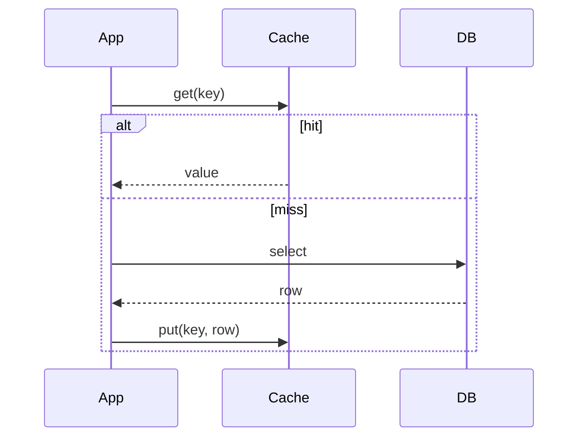

# Caching strategies cache-aside, read-through, write-through, write-behind and refresh-ahead

---

## 🟢 Junior Level

A **caching strategy** defines *who* talks to the cache and the database, and *when* data moves between them. The five classic strategies:

| Strategy | Who loads/writes | One-liner |
|---|---|---|
| **Cache-aside** (lazy loading) | Application | App checks cache, on miss loads from DB and fills the cache |
| **Read-through** | Cache provider | App only talks to cache; cache loads from DB on miss |
| **Write-through** | Cache provider | Write goes to cache and DB synchronously |
| **Write-behind** (write-back) | Cache provider | Write goes to cache, DB updated asynchronously later |
| **Refresh-ahead** | Cache provider | Cache reloads hot entries before they expire |

### Simple Real-World Analogy
- *Cache-aside*: you check your fridge; if empty you go shopping and put groceries in the fridge yourself.
- *Read-through*: you ask a butler; if the fridge is empty, the butler shops.
- *Write-through*: you tell the butler to update both the fridge list and the master ledger immediately.
- *Write-behind*: the butler writes on a sticky note and updates the ledger in the evening.
- *Refresh-ahead*: the butler restocks milk before it runs out.



### Minimal cache-aside example

```java
import java.util.Map;
import java.util.Optional;
import java.util.concurrent.ConcurrentHashMap;

public class UserRepositoryWithCache {
    private final Map<Long, String> cache = new ConcurrentHashMap<>();
    private final Map<Long, String> database = new ConcurrentHashMap<>(Map.of(1L, "Alice"));

    public Optional<String> findName(long id) {
        String cached = cache.get(id);
        if (cached != null) {
            return Optional.of(cached);          // hit
        }
        String fromDb = database.get(id);        // miss: go to DB
        if (fromDb != null) {
            cache.put(id, fromDb);               // populate for next time
        }
        return Optional.ofNullable(fromDb);
    }

    public void updateName(long id, String name) {
        database.put(id, name);                  // write to the source of truth
        cache.remove(id);                        // invalidate, next read reloads
    }
}
```

---

## 🟡 Middle Level

### Cache-aside (most common with Redis)
- **Read:** get → miss → load → set with TTL.
- **Write:** update DB, then **delete** the cache key (not update it — see consistency question).
- **Pros:** resilient (cache failure just means slower reads), only requested data cached, simple, works with any cache.
- **Cons:** first request is always a miss; application contains cache logic; race conditions between concurrent readers and writers; stampede on popular key expiry.

### Read-through
The cache component owns the loader. Caffeine's `LoadingCache` and Spring `@Cacheable` behave like read-through from the caller's view; Hazelcast `MapLoader`, Ehcache `CacheLoaderWriter`, Coherence and Redisson `MapLoader` are true read-through. Benefit: one place for the loading logic and built-in **single-flight** (only one thread loads per key).

### Write-through
Every write updates cache and DB in the same call (DB first or cache first, inside the provider). **Pros:** cache is never staler than DB; reads after writes are hits. **Cons:** write latency = cache + DB; the cache fills with data that may never be read; atomicity between the two stores is not guaranteed (a failed DB write needs rollback of the cache).

### Write-behind (write-back)
Writes land in the cache and are queued; a background thread flushes batches to the DB. **Pros:** very low write latency, batching/coalescing of repeated updates of the same key (huge reduction in DB writes), absorbs bursts. **Cons:** **data loss risk** if the cache node dies before flush, DB is temporarily stale for other readers, ordering and retry complexity, harder debugging. Use for counters, view counts, telemetry — never for money.

### Refresh-ahead
The cache asynchronously reloads an entry when it is accessed near its expiry (e.g., after 80% of TTL). Readers never see a miss for hot keys. Caffeine's `refreshAfterWrite` does exactly this — the stale value keeps being served while a new one loads.

### Choosing

| Need | Pick |
|---|---|
| General purpose, tolerate eventual consistency | Cache-aside |
| Centralized loading logic, stampede protection | Read-through |
| Read-after-write correctness, moderate write volume | Write-through |
| Heavy write bursts, loss-tolerant | Write-behind |
| Latency-critical hot data, predictable TTL | Refresh-ahead |

### Code: Spring Data Redis cache-aside with explicit TTL

```java
import java.time.Duration;
import org.springframework.data.redis.core.StringRedisTemplate;
import org.springframework.stereotype.Service;

@Service
public class ProductCacheService {

    private final StringRedisTemplate redis;
    private final ProductDao dao;

    public ProductCacheService(StringRedisTemplate redis, ProductDao dao) {
        this.redis = redis;
        this.dao = dao;
    }

    public String getProductJson(long id) {
        String key = "product:v1:" + id;
        String cached = redis.opsForValue().get(key);
        if (cached != null) {
            return cached;
        }
        String json = dao.loadJson(id);
        if (json != null) {
            // jitter avoids many keys expiring simultaneously
            long ttl = 300 + (long) (Math.random() * 60);
            redis.opsForValue().set(key, json, Duration.ofSeconds(ttl));
        }
        return json;
    }

    public void update(long id, String json) {
        dao.save(id, json);              // 1. commit to the DB
        redis.delete("product:v1:" + id); // 2. then invalidate
    }

    public interface ProductDao {
        String loadJson(long id);
        void save(long id, String json);
    }
}
```

---

## 🔴 Senior Level

### Race conditions in cache-aside
Classic interleaving: Reader R misses, reads old value from DB; Writer W updates DB and deletes key; R then writes the **old** value into the cache → stale until TTL. Probability is low (R's DB read must be slower than W's whole operation) but real at scale. Mitigations: short TTL as a backstop, **delayed double delete** (delete again after ~500 ms), versioned values (`SET` only if version is newer, via Lua), or CDC-based invalidation (Debezium reading the binlog and deleting keys) which serializes after commit.

### Implementing write-behind safely
A robust write-behind needs: a durable queue (Redis Streams / Kafka rather than an in-memory `BlockingQueue`), idempotent writes with versions, batch size and flush interval limits, retry with backoff and a dead-letter store, and back-pressure when the DB is slower than ingestion (otherwise the queue grows without bound). Simplified in-process variant:

```java
import java.util.ArrayList;
import java.util.List;
import java.util.Map;
import java.util.concurrent.*;

public class WriteBehindBuffer {
    private final ConcurrentMap<String, String> pending = new ConcurrentHashMap<>();
    private final ScheduledExecutorService flusher = Executors.newSingleThreadScheduledExecutor();
    private final java.util.function.Consumer<Map<String, String>> batchWriter;

    public WriteBehindBuffer(java.util.function.Consumer<Map<String, String>> batchWriter) {
        this.batchWriter = batchWriter;
        flusher.scheduleWithFixedDelay(this::flush, 1, 1, TimeUnit.SECONDS);
    }

    public void put(String key, String value) {
        pending.put(key, value); // later writes to the same key coalesce
    }

    private void flush() {
        List<String> keys = new ArrayList<>(pending.keySet());
        Map<String, String> batch = new ConcurrentHashMap<>();
        for (String k : keys) {
            String v = pending.remove(k);
            if (v != null) batch.put(k, v);
        }
        if (batch.isEmpty()) return;
        try {
            batchWriter.accept(batch);
        } catch (RuntimeException e) {
            batch.forEach(pending::putIfAbsent); // naive retry: re-queue unless newer value arrived
        }
    }

    public void shutdown() {
        flusher.shutdown();
        flush(); // drain on graceful stop; a crash still loses data
    }
}
```

### Refresh-ahead with Caffeine

```java
import com.github.benmanes.caffeine.cache.Caffeine;
import com.github.benmanes.caffeine.cache.LoadingCache;
import java.time.Duration;

public class PriceCache {
    private final LoadingCache<String, Double> cache = Caffeine.newBuilder()
            .refreshAfterWrite(Duration.ofSeconds(30)) // reload asynchronously after 30 s, serve old value meanwhile
            .expireAfterWrite(Duration.ofMinutes(5))   // hard ceiling if reloads keep failing
            .maximumSize(100_000)
            .build(this::fetchPrice);

    public double price(String symbol) { return cache.get(symbol); }

    private Double fetchPrice(String symbol) { return Math.random() * 100; }
}
```
Caffeine triggers refresh only on access, so cold keys are not refreshed — that is a feature (no wasted loads).

### Trade-offs in distributed deployments
- **Local cache-aside** over N pods means N independent copies; invalidation must be broadcast (Redis pub/sub, Kafka) or accept TTL staleness.
- **Write-through with Redis**: Redis has no built-in loader/writer; frameworks (Redisson `MapWriter`, Spring Data) emulate it in the client, so a client crash between DB and cache writes leaves them divergent. Prefer *DB first, then invalidate*.
- **Dual writes** (writing DB and cache independently) are inherently non-atomic; the transactional outbox pattern or CDC is the reliable way to propagate to the cache.
- **Failure semantics**: decide per strategy what happens when the cache is down — cache-aside should fall back to the DB (with circuit breaker); write-through must fail or degrade.

### Diagnostic questions in production
- Are stale reads occurring only briefly after writes? → look at the race above.
- DB write volume unexpectedly high with write-behind? → coalescing is not working (keys too unique).
- Latency spikes at the same time every 5 minutes? → synchronized TTL expiry; add jitter or use refresh-ahead.

---

## 🎯 Interview Cheat Sheet

**30-second pitch:** Cache-aside (app manages cache, lazy loading) is the default. Read-through/write-through move the logic into the cache provider for simplicity and consistency. Write-behind trades durability for write speed through async batching. Refresh-ahead reloads hot entries before expiry to hide miss latency. Pick based on consistency, write volume and loss tolerance.

**Must know:**
- Cache-aside read and write flow; invalidate (delete) on write rather than update.
- Differences between read-through and cache-aside (who owns loading).
- Write-behind risk: data loss and ordering.
- Caffeine `refreshAfterWrite` vs `expireAfterWrite`.
- Race condition causing stale data in cache-aside and how to mitigate.

**Follow-up questions:**
- Why delete the key instead of updating it on write?
- How would you make write-behind durable?
- Which strategy does `@Cacheable` implement?
- How do you avoid dual-write inconsistencies?

**Red flags:** claiming write-through guarantees atomicity; using write-behind for financial data; updating DB and cache in separate transactions and assuming they stay in sync.

**Related topics:**
- [Cache eviction policies LRU, LFU and TTL](04.%20Cache%20eviction%20policies%20LRU,%20LFU%20and%20TTL.md)
- [Spring Cache abstraction and its annotations](05.%20Spring%20Cache%20abstraction%20and%20its%20annotations.md)
- [Cache invalidation strategies](12.%20Cache%20invalidation%20strategies.md)
- [Cache consistency with the database](17.%20Cache%20consistency%20with%20the%20database.md)
