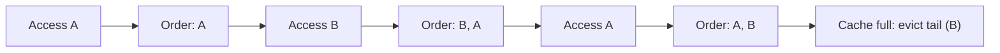

# Cache eviction policies LRU, LFU and TTL

---

## 🟢 Junior Level

A cache has limited memory. When it is full (or data gets too old) it must remove entries — this is **eviction**. The rule choosing the victim is the **eviction policy**.

| Policy | Evicts | Idea |
|---|---|---|
| **TTL** (time to live) | Entries older than a fixed duration | "Data is valid for 5 minutes" |
| **LRU** (least recently used) | Entry not touched for the longest time | Recent use predicts future use |
| **LFU** (least frequently used) | Entry with fewest accesses | Popular items stay |
| **FIFO** | Oldest inserted | Simple, ignores usage |
| **Random** | Random entry | Cheap, surprisingly OK |

### Simple Real-World Analogy
Your desk holds 10 documents. **LRU**: when full, throw away the one you haven't touched for longest. **LFU**: throw away the one you used least overall. **TTL**: shred any paper older than a week regardless of use.



### Minimal LRU in Java

```java
import java.util.LinkedHashMap;
import java.util.Map;

public class LruCache<K, V> extends LinkedHashMap<K, V> {
    private final int capacity;

    public LruCache(int capacity) {
        super(16, 0.75f, true); // accessOrder = true: get() moves entry to the end
        this.capacity = capacity;
    }

    @Override
    protected boolean removeEldestEntry(Map.Entry<K, V> eldest) {
        return size() > capacity; // evict the least recently used
    }

    public static void main(String[] args) {
        LruCache<String, Integer> c = new LruCache<>(2);
        c.put("a", 1);
        c.put("b", 2);
        c.get("a");      // a is now most recent
        c.put("c", 3);   // evicts b
        System.out.println(c.keySet()); // [a, c]
    }
}
```
Not thread-safe: wrap with `Collections.synchronizedMap` or use a real cache library.

---

## 🟡 Middle Level

### LRU vs LFU trade-offs
- **LRU** adapts quickly to changing workloads but is vulnerable to **scan pollution**: a one-time full scan flushes the hot set.
- **LFU** keeps long-term popular items but suffers from **frequency aging**: an item popular last week stays forever while new hot items get evicted; also needs counters (memory).
- **Hybrids**: ARC, LIRS, 2Q, **W-TinyLFU** (Caffeine) combine recency and frequency with an **admission filter**: a new entry replaces the victim only if its estimated frequency (Count-Min Sketch) is higher.

### TTL variants
- **Time-to-live (expire after write)**: absolute age since creation — bounds staleness.
- **Time-to-idle (expire after access)**: removed if unused for a period — frees memory of cold data, but hot data may live forever and become stale; combine with TTL.
- **Per-entry TTL** (Caffeine `Expiry`, Redis `EXPIRE`) for variable lifetimes.

### Redis eviction (`maxmemory-policy`)
| Policy | Behavior |
|---|---|
| `noeviction` (default) | Writes fail with OOM error when full |
| `allkeys-lru` | Approximated LRU across all keys (recommended for pure caches) |
| `allkeys-lfu` | Approximated LFU across all keys (Redis 4+) |
| `volatile-lru` / `volatile-lfu` / `volatile-ttl` / `volatile-random` | Only among keys with an expiry |
| `allkeys-random` | Random across all keys |

Redis uses **approximated** LRU/LFU: it samples `maxmemory-samples` keys (default 5) and evicts the best candidate among them — cheaper than a global linked list. Raising samples to 10 approaches true LRU at some CPU cost. Redis LFU uses a probabilistic 8-bit logarithmic counter with decay (`lfu-log-factor`, `lfu-decay-time`).

Expiration is separate: Redis expires keys **lazily** (when accessed) and **actively** (10 times per second samples keys with TTL and removes expired ones; repeats if >25% were expired). Hence expired keys may linger in memory briefly.

### Caffeine configuration

```java
import com.github.benmanes.caffeine.cache.Cache;
import com.github.benmanes.caffeine.cache.Caffeine;
import com.github.benmanes.caffeine.cache.Expiry;
import java.util.concurrent.TimeUnit;

public class EvictionDemo {
    public static void main(String[] args) {
        // size-based (W-TinyLFU) + time-based
        Cache<String, String> sized = Caffeine.newBuilder()
                .maximumSize(1_000)
                .expireAfterAccess(10, TimeUnit.MINUTES)
                .expireAfterWrite(1, TimeUnit.HOURS) // upper bound on staleness
                .removalListener((k, v, cause) -> System.out.println(k + " removed: " + cause))
                .build();

        // weight-based: bound memory instead of count
        Cache<String, byte[]> weighted = Caffeine.newBuilder()
                .maximumWeight(64L * 1024 * 1024)
                .weigher((String k, byte[] v) -> v.length)
                .build();

        // variable per-entry TTL
        Cache<String, Integer> variable = Caffeine.newBuilder()
                .expireAfter(new Expiry<String, Integer>() {
                    public long expireAfterCreate(String k, Integer v, long now) {
                        return TimeUnit.SECONDS.toNanos(v); // value decides lifetime
                    }
                    public long expireAfterUpdate(String k, Integer v, long now, long cur) { return cur; }
                    public long expireAfterRead(String k, Integer v, long now, long cur) { return cur; }
                })
                .build();

        sized.put("k", "v");
        weighted.put("blob", new byte[1024]);
        variable.put("short", 5);
    }
}
```

### Common mistakes
- Leaving Redis at `noeviction` for a cache — the app starts throwing `OOM command not allowed`.
- Using `volatile-*` policies when most keys have no TTL: nothing is evictable, so OOM errors appear anyway.
- Setting the same TTL for millions of keys written together (synchronized expiry → avalanche).
- Expecting `maximumSize` to be exact: Caffeine eviction is asynchronous; size may briefly exceed the limit.

---

## 🔴 Senior Level

### W-TinyLFU internals (Caffeine)
Structure: a small **window** LRU (~1%) for recency bursts, and a main region split into **probation** and **protected** segments (SLRU). A candidate leaving the window competes with the probation victim; the **TinyLFU** sketch (4-bit Count-Min Sketch with periodic halving as aging) decides admission. Result: near-optimal hit ratios across recency- and frequency-biased workloads, with O(1) operations. Reads are recorded in lock-free ring buffers and applied in batches by an async maintenance task, so reads rarely contend on a lock — this is why Caffeine outperforms `LinkedHashMap`+lock and Guava.

### Implementing LFU efficiently (interview classic)
O(1) LFU uses `HashMap<K, Node>`, `HashMap<Integer, LinkedHashSet<K>>` keyed by frequency and a `minFreq` variable:

```java
import java.util.HashMap;
import java.util.LinkedHashSet;
import java.util.Map;

public class LfuCache<K, V> {
    private final int capacity;
    private int minFreq = 0;
    private final Map<K, V> values = new HashMap<>();
    private final Map<K, Integer> freqs = new HashMap<>();
    private final Map<Integer, LinkedHashSet<K>> buckets = new HashMap<>();

    public LfuCache(int capacity) { this.capacity = capacity; }

    public V get(K key) {
        if (!values.containsKey(key)) return null;
        touch(key);
        return values.get(key);
    }

    public void put(K key, V value) {
        if (capacity == 0) return;
        if (values.containsKey(key)) {
            values.put(key, value);
            touch(key);
            return;
        }
        if (values.size() >= capacity) {
            K victim = buckets.get(minFreq).iterator().next(); // oldest among least frequent
            buckets.get(minFreq).remove(victim);
            values.remove(victim);
            freqs.remove(victim);
        }
        values.put(key, value);
        freqs.put(key, 1);
        buckets.computeIfAbsent(1, f -> new LinkedHashSet<>()).add(key);
        minFreq = 1;
    }

    private void touch(K key) {
        int f = freqs.get(key);
        buckets.get(f).remove(key);
        if (buckets.get(f).isEmpty() && minFreq == f) minFreq++;
        freqs.put(key, f + 1);
        buckets.computeIfAbsent(f + 1, x -> new LinkedHashSet<>()).add(key);
    }
}
```

### Production considerations
- **Redis memory pressure**: when `used_memory > maxmemory`, each command may trigger evictions inside the single thread; large evictions (big keys, `UNLINK` vs `DEL`) cause latency spikes. Enable `lazyfree-lazy-eviction yes` and `lazyfree-lazy-expire yes` so freeing happens in a background thread.
- **Replicas** do not evict independently; they follow DEL commands from the master (and AOF/replication stream carries synthesized DELs).
- **Choosing LRU vs LFU in Redis**: workloads with stable popular items (product catalog) → `allkeys-lfu`; recency-driven (sessions, news) → `allkeys-lru`. Verify by comparing `keyspace_hits` ratio after switching on a canary.
- **Monitoring**: `evicted_keys` rising continuously means the working set exceeds memory; `expired_keys` large relative to dataset means TTL does the cleaning.
- **Tombstones of timers**: Caffeine uses a hierarchical timer wheel for variable expiration — O(1) scheduling, so millions of per-entry TTLs are cheap, unlike a naive priority queue.
- **GC**: eviction of on-heap entries produces garbage; large weights and `Duration` objects are fine, but `SoftReferences` (`softValues()`) make eviction depend on GC pressure and are discouraged for predictable behavior.

---

## 🎯 Interview Cheat Sheet

**30-second pitch:** Eviction frees memory by removing entries: TTL by age, LRU by least recent use, LFU by least frequent use. LRU is simple and adaptive but scan-vulnerable; LFU favors long-term hot data but needs aging. Modern libraries (Caffeine W-TinyLFU) combine both. Redis uses sampled approximations configured via `maxmemory-policy`; for a pure cache use `allkeys-lru` or `allkeys-lfu`.

**Must know:**
- Implementation of LRU with `LinkedHashMap(accessOrder=true)` and `removeEldestEntry`.
- Redis policies and default `noeviction`.
- Lazy and active expiration in Redis.
- `expireAfterWrite` vs `expireAfterAccess` in Caffeine.
- Scan pollution problem and TinyLFU admission.

**Follow-up questions:**
- Design an LRU cache that is thread-safe.
- Why does Redis sample instead of true LRU?
- When is LFU worse than LRU?
- What happens when Redis hits `maxmemory` with `noeviction`?

**Red flags:** confusing eviction with expiration; unbounded caches; same TTL for all keys; ignoring that `volatile-*` policies need TTLs.

**Related topics:**
- [Cache hit ratio, monitoring and sizing](02.%20Cache%20hit%20ratio,%20monitoring%20and%20sizing.md)
- [Local caches Caffeine and Ehcache vs distributed caches](06.%20Local%20caches%20Caffeine%20and%20Ehcache%20vs%20distributed%20caches.md)
- [Cache stampede and thundering herd](13.%20Cache%20stampede%20and%20thundering%20herd.md)
- [Redis single-threaded model and performance](09.%20Redis%20single-threaded%20model%20and%20performance.md)
