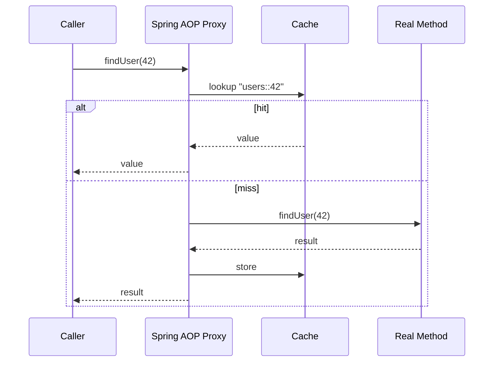

# Spring Cache abstraction and its annotations

---

## 🟢 Junior Level

The **Spring Cache abstraction** lets you add caching to methods declaratively with annotations, without writing cache code. You choose a backing provider (Caffeine, Redis, Ehcache, simple `ConcurrentMap`) by configuration.

| Annotation | Purpose |
|---|---|
| `@EnableCaching` | Turns the caching infrastructure on |
| `@Cacheable` | If the key is cached, return it and skip the method; otherwise run and store |
| `@CachePut` | Always run the method and store the result |
| `@CacheEvict` | Remove one entry (or all with `allEntries = true`) |
| `@Caching` | Combine several cache annotations |
| `@CacheConfig` | Class-level shared settings (cache names, key generator) |

### Simple Real-World Analogy
`@Cacheable` is a sticky note on a recipe: "I already worked out the answer for 4 guests, here it is" — you don't recalculate. `@CacheEvict` is tearing off the note when the recipe changes.



### Minimal example (Spring Boot 3)

```java
import org.springframework.boot.SpringApplication;
import org.springframework.boot.autoconfigure.SpringBootApplication;
import org.springframework.cache.annotation.CacheEvict;
import org.springframework.cache.annotation.CachePut;
import org.springframework.cache.annotation.Cacheable;
import org.springframework.cache.annotation.EnableCaching;
import org.springframework.stereotype.Service;

@SpringBootApplication
@EnableCaching
public class App {
    public static void main(String[] args) {
        SpringApplication.run(App.class, args);
    }
}

@Service
class BookService {

    @Cacheable("books")                 // key defaults to the isbn argument
    public String findTitle(String isbn) {
        System.out.println("Loading " + isbn + " from DB...");
        return "Title of " + isbn;
    }

    @CachePut(cacheNames = "books", key = "#isbn")
    public String rename(String isbn, String newTitle) {
        return newTitle;                // result replaces the cached value
    }

    @CacheEvict(cacheNames = "books", key = "#isbn")
    public void delete(String isbn) { }
}
```
Dependency: `spring-boot-starter-cache`. Without a provider on the classpath Spring Boot falls back to a simple in-memory `ConcurrentMapCacheManager` (no eviction, no TTL!).

---

## 🟡 Middle Level

### How it works
`@EnableCaching` registers a `CacheInterceptor` (an AOP advice) driven by `CacheOperationSource`. A proxy (JDK dynamic or CGLIB) wraps the bean. On each call it evaluates conditions, resolves the `Cache` through `CacheManager`, builds the key, and either returns the cached value or invokes the method.

### Key generation
- Default `SimpleKeyGenerator`: no params → `SimpleKey.EMPTY`; one param → that param itself; multiple → `SimpleKey` wrapping all (uses `equals/hashCode`).
- Custom via SpEL: `key = "#user.id"`, `key = "#root.methodName + ':' + #id"`, `key = "T(java.util.Objects).hash(#a, #b)"`.
- Custom `KeyGenerator` bean referenced by `keyGenerator = "myGen"` (key and keyGenerator are mutually exclusive).
- Parameter names in SpEL require `-parameters` compiler flag (Spring Boot's Maven/Gradle plugins enable it) or use `#p0`/`#a0`.
- Key objects must implement proper `equals`/`hashCode`; for Redis they also must be convertible to String (a `Cache` key conversion service is used — otherwise "Cannot convert cache key" errors).

### Conditions
```java
@Cacheable(cacheNames = "users", key = "#id",
           condition = "#id > 0",           // evaluated before: skip cache if false
           unless = "#result == null || #result.disabled") // evaluated after: don't store
public User find(long id) { ... }
```
`sync = true` makes concurrent calls for the same key block while one loads (single-flight) — prevents local stampede; unsupported together with `unless` and only one cache name allowed.

### The self-invocation pitfall
Because caching is proxy-based, calling a `@Cacheable` method from another method **of the same class** bypasses the proxy and the cache does nothing. Same for `@Transactional`, `@Async`.

```java
@Service
class PriceService {

    public double priceWithTax(String sku) {
        return price(sku) * 1.2;      // this.price(...) -> NO caching!
    }

    @Cacheable("prices")
    public double price(String sku) { return 10.0; }
}
```
Fixes: move the cached method to another bean; inject the proxy of itself (`@Lazy` self-injection); use `AopContext.currentProxy()` with `exposeProxy=true`; or switch to AspectJ weaving mode (`@EnableCaching(mode = AdviceMode.ASPECTJ)`).
Other proxy limits: methods must be `public` (for proxy mode, protected/package-private works only with CGLIB in newer Spring but is discouraged), class cannot be `final`.

### Other typical mistakes
- Caching mutable entities and then modifying them (for local caches the cached instance is the same reference).
- JPA lazy entities in cache → `LazyInitializationException` after serialization or outside session; cache DTOs.
- `@Cacheable` on a method returning `Optional` is supported (unwrapped), but `null` caching depends on provider; Redis cache config `disableCachingNullValues()`.
- Not setting TTL: `RedisCacheManager` default is no expiry.
- JDK serialization of values in Redis (default) — use JSON.

### Redis cache manager with TTL per cache and JSON

```java
import java.time.Duration;
import java.util.Map;
import org.springframework.cache.CacheManager;
import org.springframework.context.annotation.Bean;
import org.springframework.context.annotation.Configuration;
import org.springframework.data.redis.cache.RedisCacheConfiguration;
import org.springframework.data.redis.cache.RedisCacheManager;
import org.springframework.data.redis.connection.RedisConnectionFactory;
import org.springframework.data.redis.serializer.GenericJackson2JsonRedisSerializer;
import org.springframework.data.redis.serializer.RedisSerializationContext.SerializationPair;

@Configuration
public class RedisCacheConfig {

    @Bean
    public CacheManager cacheManager(RedisConnectionFactory cf) {
        RedisCacheConfiguration defaults = RedisCacheConfiguration.defaultCacheConfig()
                .entryTtl(Duration.ofMinutes(10))
                .disableCachingNullValues()
                .prefixCacheNameWith("myapp:v1:")
                .serializeValuesWith(SerializationPair.fromSerializer(
                        new GenericJackson2JsonRedisSerializer()));

        return RedisCacheManager.builder(cf)
                .cacheDefaults(defaults)
                .withInitialCacheConfigurations(Map.of(
                        "countries", defaults.entryTtl(Duration.ofHours(12)),
                        "prices", defaults.entryTtl(Duration.ofSeconds(30))))
                .transactionAware()
                .build();
    }
}
```

---

## 🔴 Senior Level

### Internals worth knowing
- `CacheAspectSupport.execute` processes operations in order: `beforeInvocation` evictions → cache lookup (`@Cacheable`) → invoke if miss → collect `@CachePut` requests → apply puts → `afterInvocation` evictions. `@CacheEvict(beforeInvocation = true)` evicts even if the method throws.
- `CacheErrorHandler`: by default exceptions from the cache provider (Redis down) **propagate and fail the request**. Implement `CachingConfigurer.errorHandler()` returning a handler that logs and swallows so the cache degrades to a pass-through:

```java
import org.springframework.cache.Cache;
import org.springframework.cache.annotation.CachingConfigurer;
import org.springframework.cache.interceptor.CacheErrorHandler;
import org.springframework.context.annotation.Configuration;
import org.slf4j.Logger;
import org.slf4j.LoggerFactory;

@Configuration
public class CacheErrorConfig implements CachingConfigurer {
    private static final Logger log = LoggerFactory.getLogger(CacheErrorConfig.class);

    @Override
    public CacheErrorHandler errorHandler() {
        return new CacheErrorHandler() {
            public void handleCacheGetError(RuntimeException e, Cache c, Object k) {
                log.warn("cache get failed {}:{}", c.getName(), k, e);
            }
            public void handleCachePutError(RuntimeException e, Cache c, Object k, Object v) {
                log.warn("cache put failed {}:{}", c.getName(), k, e);
            }
            public void handleCacheEvictError(RuntimeException e, Cache c, Object k) {
                log.error("cache evict failed {}:{} - stale data possible", c.getName(), k, e);
            }
            public void handleCacheClearError(RuntimeException e, Cache c) {
                log.error("cache clear failed {}", c.getName(), e);
            }
        };
    }
}
```
Combine with short Redis command timeouts and a circuit breaker; otherwise a hung Redis still blocks threads.

- **Transactions**: with `transactionAware()` puts/evicts happen after the transaction commits, preventing caching of rolled-back data. Without it, `@CacheEvict` inside `@Transactional` runs before commit and a concurrent reader may re-cache the old row (the race from the strategies question). Prefer evict-after-commit via `@TransactionalEventListener(phase = AFTER_COMMIT)`.
- **Cache stampede**: `sync = true` locks per key only within one JVM; across pods use Redis locks or jittered TTL.
- **Bulk operations**: Spring Cache has no multi-get. For batch lookups use the `Cache` API directly (`cache.get(key)` per key) or Redis `MGET`; Spring 6.1 added `CompletableFuture` and reactive return type support in `@Cacheable` (needs an async-capable cache like Caffeine `AsyncCache`, or Redis in reactive mode).
- **`allEntries = true` on Redis** uses `KEYS`-like scan with the prefix — O(N) on a huge keyspace; avoid on big caches.
- **Metrics**: Spring Boot Actuator exposes `cache.gets`, `cache.puts`, `cache.evictions`; for Redis hit/miss statistics enable `enableStatistics()` on `RedisCacheManager`.
- **Testing**: use `@SpringBootTest` and assert call counts with a Mockito spy bean; remember to clear caches between tests (`cacheManager.getCacheNames().forEach(n -> cacheManager.getCache(n).clear())`).
- **Key collisions**: two methods using `@Cacheable("data")` with default keys and the same parameter type share entries and return the wrong object (`ClassCastException`). Use distinct cache names or include `#root.methodName` in the key.

### Design guidance
Use annotations for simple read-mostly lookups. Switch to programmatic `Cache`/`RedisTemplate` for batching, conditional logic, stampede protection, versioned keys, or when you need precise TTLs per entry. Keep the cache boundary at the service layer that returns immutable DTOs/records.

---

## 🎯 Interview Cheat Sheet

**30-second pitch:** Spring Cache is an AOP-based abstraction: annotations on beans are intercepted by a proxy that consults a `CacheManager`. `@Cacheable` reads/populates, `@CachePut` always writes, `@CacheEvict` removes. Providers are pluggable (Caffeine, Redis). Pitfalls: self-invocation bypasses the proxy, default keys collide, no TTL by default, errors from the cache propagate unless handled.

**Must know:**
- Purpose and order of the annotations; `condition` vs `unless`; `sync = true`.
- Default key generation and SpEL keys.
- Self-invocation limitation and its fixes.
- Configure TTL, serializer, and null handling for `RedisCacheManager`.
- `CacheErrorHandler` for graceful degradation; transaction-aware caches.

**Follow-up questions:**
- Why does `@Cacheable` not work when called from the same class?
- Difference between `@CachePut` and `@Cacheable`?
- How do you set different TTLs per cache?
- What happens to requests if Redis is down?

**Red flags:** assuming default cache has eviction; caching JPA entities with lazy associations; two different methods sharing a cache name and key shape; `allEntries = true` on huge Redis caches.

**Related topics:**
- [Caching strategies cache-aside, read-through, write-through, write-behind and refresh-ahead](03.%20Caching%20strategies%20cache-aside,%20read-through,%20write-through,%20write-behind%20and%20refresh-ahead.md)
- [Local caches Caffeine and Ehcache vs distributed caches](06.%20Local%20caches%20Caffeine%20and%20Ehcache%20vs%20distributed%20caches.md)
- [Cache invalidation strategies](12.%20Cache%20invalidation%20strategies.md)
- [Cache stampede and thundering herd](13.%20Cache%20stampede%20and%20thundering%20herd.md)
