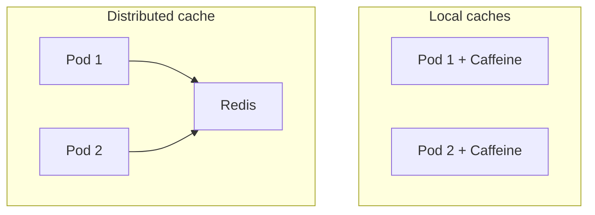

# Local caches Caffeine and Ehcache vs distributed caches

---

## 🟢 Junior Level

A **local (in-process) cache** lives in the JVM heap of one application instance. A **distributed cache** is a separate service (Redis, Memcached, Hazelcast) shared by all instances over the network.

| | Local (Caffeine, Ehcache, Guava) | Distributed (Redis, Memcached) |
|---|---|---|
| Latency | ~10–100 ns | ~0.2–2 ms (network + serialization) |
| Shared between pods | No | Yes |
| Survives app restart | No | Yes (the cache server stays up) |
| Capacity | Limited by JVM heap | Limited by cluster memory |
| Consistency across nodes | Each node has its own copy | Single logical copy |

### Simple Real-World Analogy
A local cache is a notebook in your pocket: instant, but every employee has their own copy, which may differ. A distributed cache is the shared whiteboard in the office: everyone sees the same data, but walking to it takes a moment.



### Minimal Caffeine example

```java
import com.github.benmanes.caffeine.cache.Cache;
import com.github.benmanes.caffeine.cache.Caffeine;
import java.time.Duration;

public class CaffeineQuickStart {
    public static void main(String[] args) {
        Cache<String, String> cache = Caffeine.newBuilder()
                .maximumSize(1_000)
                .expireAfterWrite(Duration.ofMinutes(5))
                .build();

        cache.put("greeting", "hello");
        System.out.println(cache.getIfPresent("greeting"));                 // hello
        System.out.println(cache.get("other", k -> "computed-" + k));       // computed-other
    }
}
```
Maven: `com.github.ben-manes.caffeine:caffeine:3.1.8` (Java 11+).

---

## 🟡 Middle Level

### Caffeine
The de-facto standard JVM local cache (default in Spring Boot when on the classpath). Features: W-TinyLFU eviction, size/weight/time-based expiry, `refreshAfterWrite`, async loading (`AsyncLoadingCache` returning `CompletableFuture`), removal listeners, statistics, `Policy` API for inspection, JCache adapter. Loading is atomic per key (single-flight inside one JVM).

```java
import com.github.benmanes.caffeine.cache.AsyncLoadingCache;
import com.github.benmanes.caffeine.cache.Caffeine;
import java.time.Duration;
import java.util.concurrent.CompletableFuture;

public class AsyncCaffeine {
    private final AsyncLoadingCache<Long, String> cache = Caffeine.newBuilder()
            .maximumSize(10_000)
            .expireAfterWrite(Duration.ofMinutes(10))
            .buildAsync((Long id, java.util.concurrent.Executor ex) ->
                    CompletableFuture.supplyAsync(() -> "user-" + id, ex));

    public CompletableFuture<String> find(long id) {
        return cache.get(id);
    }
}
```

### Ehcache (3.x)
A mature cache with **tiering**: heap → off-heap → disk (persistent), JSR-107 (JCache) support, XML or programmatic configuration, transactions via JTA in older versions, clustering through Terracotta (commercial/OSS server). Use when you need **off-heap storage** (avoid GC pressure for GBs of data) or disk persistence across restarts.

```java
import org.ehcache.Cache;
import org.ehcache.CacheManager;
import org.ehcache.config.builders.CacheConfigurationBuilder;
import org.ehcache.config.builders.CacheManagerBuilder;
import org.ehcache.config.builders.ResourcePoolsBuilder;
import org.ehcache.config.units.MemoryUnit;

public class EhcacheDemo {
    public static void main(String[] args) {
        try (CacheManager cm = CacheManagerBuilder.newCacheManagerBuilder()
                .withCache("products", CacheConfigurationBuilder.newCacheConfigurationBuilder(
                        Long.class, String.class,
                        ResourcePoolsBuilder.newResourcePoolsBuilder()
                                .heap(1_000)                   // entries on heap
                                .offheap(64, MemoryUnit.MB)))  // serialized off-heap tier
                .build(true)) {
            Cache<Long, String> products = cm.getCache("products", Long.class, String.class);
            products.put(1L, "Laptop");
            System.out.println(products.get(1L));
        }
    }
}
```
Values in off-heap/disk tiers are serialized, so they must be `Serializable` (or have a custom `Serializer`).

### Local vs distributed: decision guide
Choose **local** when: data is small, read-only or tolerates staleness, latency is critical (config, feature flags, permission lookups, reference data), and you can accept N copies.
Choose **distributed** when: data must be shared (sessions, rate limits, locks, counters), must survive deployments, is larger than heap, or when consistency between nodes matters.
Choose **both (two-level)**: L1 Caffeine with short TTL (seconds) in front of L2 Redis for hot keys — dramatically reduces Redis traffic and latency at the price of bounded staleness.

### Pitfalls
- **Inconsistency across pods**: update on pod A is not visible on pod B until expiry. Fix: Redis pub/sub or Kafka invalidation messages, or short TTLs.
- **Memory**: a 2 GB local cache × 20 pods = 40 GB of RAM for duplicate data.
- **Cold start** at every deploy; with rolling restarts the hit ratio dips, loading the DB.
- **Mutable cached objects** shared by reference between threads — use immutables/records.
- **Serialization** to Redis costs CPU; large JSON payloads slow both sides.

---

## 🔴 Senior Level

### Two-level cache with invalidation over Redis pub/sub

```java
import com.github.benmanes.caffeine.cache.Cache;
import com.github.benmanes.caffeine.cache.Caffeine;
import java.time.Duration;
import java.util.function.Function;
import org.springframework.data.redis.core.StringRedisTemplate;

public class TwoLevelCache {
    private static final String CHANNEL = "cache-invalidation";

    private final Cache<String, String> l1 = Caffeine.newBuilder()
            .maximumSize(20_000)
            .expireAfterWrite(Duration.ofSeconds(30)) // upper bound if a message is lost
            .build();
    private final StringRedisTemplate redis;

    public TwoLevelCache(StringRedisTemplate redis) {
        this.redis = redis;
    }

    public String get(String key, Function<String, String> loader) {
        return l1.get(key, k -> {
            String v = redis.opsForValue().get(k);            // L2
            if (v == null) {
                v = loader.apply(k);                          // source of truth
                redis.opsForValue().set(k, v, Duration.ofMinutes(10));
            }
            return v;
        });
    }

    public void evict(String key) {
        redis.delete(key);                                    // L2
        l1.invalidate(key);                                   // this node's L1
        redis.convertAndSend(CHANNEL, key);                   // other nodes' L1
    }

    // register with RedisMessageListenerContainer: onMessage -> l1.invalidate(message)
    public void onInvalidation(String key) {
        l1.invalidate(key);
    }
}
```
Pub/sub is **fire-and-forget** (at-most-once): a node disconnected during the message misses it, therefore L1 TTL is mandatory. Redis 6 **client-side caching** (`CLIENT TRACKING`) is a built-in server-assisted alternative: the server tells the client which keys changed; Lettuce supports it via `ClientSideCaching` (since 6.x). Spring Data Redis doesn't wrap it yet, and Redisson offers `RLocalCachedMap` with similar semantics.

### Heap sizing and GC
A large on-heap cache increases live set; with G1 this raises mixed-collection work, with ZGC/Shenandoah the pause impact is smaller but allocation rate and footprint still matter. Rules: keep local caches to <20–30% of heap, bound by weight, use compact value representations (primitive arrays, interned strings, no deep object graphs), and measure via `jcmd GC.class_histogram` or JFR allocation profiling. Off-heap (Ehcache, Chronicle Map, OHC) trades GC pressure for serialization cost.

### Consistency models
| Approach | Staleness | Complexity |
|---|---|---|
| Short TTL only | ≤ TTL | Low |
| TTL + pub/sub invalidation | usually ms, ≤ TTL on message loss | Medium |
| Versioned keys (`product:42:v17`) | none for the reader that knows the version | Medium |
| Client-side caching with tracking | ms | Higher, needs RESP3 client support |

### Failure scenarios
- **Redis outage**: L1 absorbs reads for hot keys, giving natural resilience; the DB sees only L1 misses — protect it with circuit breaker and rate limiting.
- **Thundering herd after deploy**: all pods start with empty L1; stagger deployments and pre-warm from a hot-key list.
- **Hot key**: local caching is the primary mitigation for a single extremely hot key that saturates one Redis shard.

### Benchmark mindset
Caffeine `get` hit: ~20–50 ns, millions of ops/s per thread (JMH). Redis GET via Lettuce on the same data center: ~150–500 µs including serialization. This 3–4 orders of magnitude difference is why L1 is so effective even with a 1-second TTL.

---

## 🎯 Interview Cheat Sheet

**30-second pitch:** Local caches (Caffeine, Ehcache) are fastest but private to each JVM, so copies diverge and memory is duplicated. Distributed caches (Redis) are shared and persistent beyond restarts but pay network and serialization cost. Production systems often combine them: Caffeine L1 with a short TTL plus Redis L2 and pub/sub invalidation.

**Must know:**
- Caffeine features: W-TinyLFU, async, refresh, weight.
- Ehcache tiers: heap/off-heap/disk; serialization requirement.
- Local vs distributed trade-offs: latency, consistency, memory duplication.
- Two-level cache and invalidation by pub/sub (at-most-once!).
- Redis client-side caching exists.

**Follow-up questions:**
- How do you invalidate a local cache across 50 pods?
- When would you pick Ehcache over Caffeine?
- What is the risk of a very large on-heap cache?
- How would you handle a hot key that overloads a Redis shard?

**Red flags:** local cache for data that must be consistent (balances, permissions revocation) with a long TTL; unbounded maps as "cache"; ignoring multi-pod divergence.

**Related topics:**
- [Cache eviction policies LRU, LFU and TTL](04.%20Cache%20eviction%20policies%20LRU,%20LFU%20and%20TTL.md)
- [Redis fundamentals and data structures](07.%20Redis%20fundamentals%20and%20data%20structures.md)
- [Hot keys and big keys](16.%20Hot%20keys%20and%20big%20keys.md)
- [Cache invalidation strategies](13.%20Cache%20invalidation%20strategies.md)
