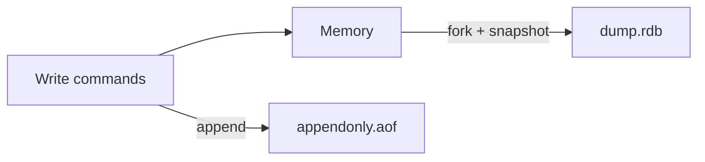

# Redis persistence RDB and AOF

---

## 🟢 Junior Level

Redis keeps data in RAM, so a restart would lose everything unless it is saved to disk. Redis offers two persistence mechanisms:

- **RDB (Redis Database snapshot):** a compact binary point-in-time snapshot of the whole dataset (`dump.rdb`), produced periodically.
- **AOF (Append Only File):** a log of every write command, replayed on startup to rebuild the dataset.

| | RDB | AOF |
|---|---|---|
| What is stored | Snapshot of data | Log of write operations |
| Data loss on crash | Everything since the last snapshot (minutes) | ~0–1 second (`everysec`) |
| File size | Small, compact | Larger (compacted by rewrite) |
| Restart speed | Fast | Slower (replay), faster with RDB preamble |
| Impact on performance | Fork spikes | Constant small fsync cost |

### Simple Real-World Analogy
RDB is taking a photo of your whiteboard every 15 minutes. AOF is a secretary writing down every change you make as it happens. After a power cut, the photo gives you the board as of 10 minutes ago; the secretary's notes let you rebuild it up to the last second.



### Basic configuration (redis.conf)
```
# RDB: save if >=1 change in 3600s, >=100 in 300s, >=10000 in 60s
save 3600 1 300 100 60 10000
dbfilename dump.rdb

# AOF
appendonly yes
appendfsync everysec
```

### Minimal Java: trigger and check persistence

```java
import redis.clients.jedis.JedisPooled;

public class PersistenceDemo {
    public static void main(String[] args) {
        try (JedisPooled jedis = new JedisPooled("localhost", 6379)) {
            jedis.set("important", "data");
            System.out.println(jedis.bgsave());          // "Background saving started"
            System.out.println(jedis.lastsave());        // epoch seconds of last successful save
        }
    }
}
```
`SAVE` blocks the server – never use it in production; use `BGSAVE`.

---

## 🟡 Middle Level

### RDB internals
`BGSAVE` calls `fork()`. The child process gets a copy-on-write (COW) view of memory and writes the snapshot to a temp file, then atomically renames it. The parent continues serving traffic; pages modified by the parent are copied lazily. Consequences:
- The `fork()` itself copies page tables and can block the main thread for tens to hundreds of milliseconds on large heaps (e.g. ~10–20 ms per GB on bare metal, much worse on some virtualized/Xen hosts). Visible in `INFO stats`: `latest_fork_usec`.
- During the snapshot, a write-heavy workload can touch many pages → memory up to ~2× dataset. Plan RAM headroom and `vm.overcommit_memory=1` (otherwise fork may fail with "Cannot allocate memory").
- Disable Transparent Huge Pages (THP): huge pages make COW copying 2 MB instead of 4 KB and cause latency spikes.

### AOF internals
Every write command is appended to the AOF buffer and written via `write()`; `appendfsync` controls `fsync`:
- `always`: fsync every command – safest, slowest (throughput drops by an order of magnitude on HDD/network disks).
- `everysec` (default recommendation): fsync once per second in a background thread – lose ≤ ~1–2 s.
- `no`: let the OS decide (~30 s on Linux).

AOF grows, so Redis performs **AOF rewrite** (`BGREWRITEAOF`, auto via `auto-aof-rewrite-percentage 100` and `auto-aof-rewrite-min-size 64mb`): a fork creates a minimal command set representing current data. Since Redis 7 the AOF is **multi-part** (a base file RDB/AOF plus incremental files and a manifest) and the rewrite no longer needs the in-memory rewrite buffer. With `aof-use-rdb-preamble yes` (default) the base is an RDB blob followed by incremental commands – fast load and small size.

### Which to choose
| Requirement | Choice |
|---|---|
| Pure cache, data re-creatable | No persistence (fastest) or RDB only for warm restarts |
| Some loss acceptable (minutes), backups | RDB |
| Low data loss (≈1 s) | AOF `everysec` (+ RDB for backups) |
| Maximum durability | AOF `always` – and consider whether Redis is the right system of record |
| Recommended general production | Both RDB + AOF |

If both are enabled, Redis loads the AOF at startup because it is more complete.

### Backups and replication interplay
- Replicas get an RDB (or, with diskless replication, a socket-streamed RDB) for full sync, so a master with persistence disabled still forks on replica attach.
- A dangerous setup: master with persistence disabled and auto-restart → it restarts empty, replicas sync from it and **wipe their data**. Disable automatic restart or enable persistence on the master.
- Copy `dump.rdb` (or AOF files) off-box periodically (S3, etc.) — persistence is not a backup if the disk dies.

### Verify with Java/Spring and `INFO persistence`

```java
import org.springframework.data.redis.connection.RedisConnection;
import org.springframework.data.redis.core.RedisCallback;
import org.springframework.data.redis.core.StringRedisTemplate;
import org.springframework.stereotype.Component;
import java.util.Properties;

@Component
public class PersistenceHealth {
    private final StringRedisTemplate redis;

    public PersistenceHealth(StringRedisTemplate redis) { this.redis = redis; }

    public boolean lastBgsaveOk() {
        Properties p = redis.execute((RedisCallback<Properties>) c -> c.serverCommands().info("persistence"));
        return p != null && "ok".equals(p.getProperty("rdb_last_bgsave_status"))
                && "ok".equals(p.getProperty("aof_last_write_status", "ok"));
    }
}
```
Monitor: `rdb_last_bgsave_status`, `aof_last_write_status`, `aof_delayed_fsync`, `rdb_last_cow_size`, `latest_fork_usec`, `aof_current_size`.

### Common mistakes
- Believing `appendfsync everysec` means zero loss.
- Placing the AOF and RDB on a slow shared disk – fsync latency blocks the AOF thread; Redis may delay writes (`aof_delayed_fsync` increments).
- Running out of disk during rewrite (needs space for old + new files).
- Not testing restore.

---

## 🔴 Senior Level

### Failure and corruption handling
- A crash mid-append can leave a truncated AOF tail; `aof-load-truncated yes` (default) loads up to the last valid command. For corruption in the middle use `redis-check-aof --fix` (it discards data after the corruption!). `redis-check-rdb` validates snapshots.
- If the last `BGSAVE` fails, by default (`stop-writes-on-bgsave-error yes`) Redis **rejects writes** with `MISCONF` — a safety feature that surprises people using Redis as cache on a full disk. For caches, you may set it to `no`, but understand the trade-off.

### Latency analysis of persistence
Run `redis-cli --intrinsic-latency 100` on the host to measure baseline jitter; `LATENCY DOCTOR` and `latency-monitor-threshold 100` capture events named `fork`, `aof-write`, `aof-fsync-always`, `aof-rewrite-diff-write`, `expire-cycle`. If `fork` events are large, options: smaller instances (shard the dataset: 4×8 GB forks faster than 1×32 GB), use dedicated bare-metal or hosts with efficient fork, schedule snapshots from **replicas only** (disable persistence on master, enable on a replica), and disable THP.

### Durability guarantees in a replicated setup
Persistence to local disk does not protect against failover loss: replication is asynchronous, so a master crash can lose acknowledged writes not yet replicated. Mitigation: `WAIT numreplicas timeout` after critical writes (blocks until N replicas ack — improves but does not guarantee, because a failover might still elect a lagging replica), plus `min-replicas-to-write 1` / `min-replicas-max-lag 10` to refuse writes when isolated. Real durability requirements belong to a database; use Redis as the system of record only when loss of seconds is acceptable.

```java
import redis.clients.jedis.Jedis;

public class CriticalWrite {
    public static void write(Jedis jedis,  String key, String value) {
        jedis.set(key, value);
        long acked = jedis.waitReplicas(1, 100); // wait up to 100 ms for 1 replica
        if (acked < 1) {
            throw new IllegalStateException("Write not replicated; treat as at risk");
        }
    }
}
```

### Sizing and operational planning
- Disk throughput: an RDB of 10 GB written in ~1–2 minutes needs sustained 100+ MB/s; cloud network volumes may throttle (burst credits) and extend the COW window, increasing memory.
- Memory: `used_memory + (write rate × snapshot duration × page-size amplification)`. Measure `rdb_last_cow_size`.
- Startup time: loading a 10 GB RDB takes ~1–3 minutes; large AOF without preamble can take much longer. Health checks and Kubernetes `readinessProbe` should wait for `loading:0` in `INFO persistence`; otherwise clients get `LOADING Redis is loading the dataset in memory`.
- Kubernetes: persistent volume + `terminationGracePeriodSeconds` long enough for a final `SAVE` on shutdown (Redis does it on SIGTERM if save points are configured).
- Managed services (ElastiCache, Azure Cache, Memorystore) expose their own backup scheduling; AOF may be limited (e.g., ElastiCache Redis 7 supports Multi-AZ rather than AOF).

### Cache-only deployments
For a pure cache, use `save ""` and `appendonly no`, and make the application survive an empty cache (gradual warm-up, rate limiting backend). A snapshot-based warm restart can still be valuable for very large caches where cold start would overwhelm the DB — evaluate cost vs risk.

---

## 🎯 Interview Cheat Sheet

**30-second pitch:** RDB makes periodic compact snapshots using fork + copy-on-write – fast restarts and backups but can lose minutes of data. AOF logs every write and fsyncs (always / everysec / no) – loses ≤1 s with `everysec` but bigger files, with background rewrite to compact. Production typically enables both; remember fork latency, COW memory overhead, async replication gaps, and that persistence is not a backup.

**Must know:**
- `SAVE` vs `BGSAVE`; fork + COW and memory overhead.
- `appendfsync` modes and rewrite; RDB preamble; multi-part AOF in Redis 7.
- Both enabled → AOF loaded on startup.
- `MISCONF` error and `stop-writes-on-bgsave-error`.
- `WAIT` and `min-replicas-to-write` for stronger durability.

**Follow-up questions:**
- Redis crashed; how much data do you lose with each mode?
- Why can `BGSAVE` cause latency spikes?
- How do you back up Redis safely?
- Why is a master that restarts empty dangerous in a replicated setup?

**Red flags:** `SAVE` in production; THP enabled; thinking replication equals backup; no disk space planning; persistence on the same disk as other busy workloads.

**Related topics:**
- [Redis fundamentals and data structures](07.%20Redis%20fundamentals%20and%20data%20structures.md)
- [Redis single-threaded model and performance](09.%20Redis%20single-threaded%20model%20and%20performance.md)
- [Redis replication, Sentinel and Cluster](10.%20Redis%20replication,%20Sentinel%20and%20Cluster.md)
- [Cache hit ratio, monitoring and sizing](02.%20Cache%20hit%20ratio,%20monitoring%20and%20sizing.md)
