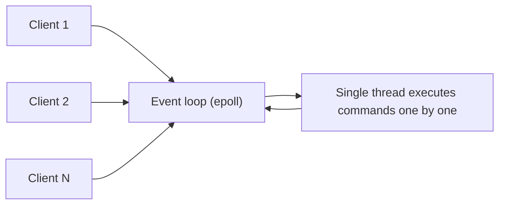

# Redis single-threaded model and performance

---

## 🟢 Junior Level

Redis executes client commands on **one main thread**. Only one command runs at a time, so each command is **atomic** without locks, and there are no race conditions inside the server. Despite being single-threaded, Redis handles 100,000+ operations per second per instance.

### Why is it fast?
1. **Everything is in memory** – no disk seeks for reads.
2. **Efficient data structures** – hash tables, skip lists, compact encodings.
3. **No locking or context switching** – one thread executes commands sequentially.
4. **I/O multiplexing** – one thread watches thousands of sockets using `epoll`/`kqueue` (event loop).
5. **Simple protocol (RESP)** – cheap to parse.

### Simple Real-World Analogy
A single very fast barista with a perfectly organized station. Because there is only one person at the machine, nobody collides or waits for a shared tool. As long as each order takes microseconds, a long queue still clears quickly. But if one customer orders a 10-minute special (an O(N) command), everyone behind them waits.



### Minimal Java demo: slow command blocks others

```java
import redis.clients.jedis.JedisPooled;

public class BlockingDemo {
    public static void main(String[] args) throws Exception {
        JedisPooled jedis = new JedisPooled("localhost", 6379);
        for (int i = 0; i < 1_000_000; i++) {
            jedis.sadd("big", "member-" + i);
        }
        Thread slow = new Thread(() -> jedis.smembers("big")); // O(N), returns 1M elements
        slow.start();
        Thread.sleep(5);
        long t = System.nanoTime();
        jedis.ping(); // must wait for the slow command to finish
        System.out.printf("ping took %d ms%n", (System.nanoTime() - t) / 1_000_000);
    }
}
```

---

## 🟡 Middle Level

### Is Redis really single-threaded?
Command execution is single-threaded, but Redis has helper threads/processes:
- **Background threads (bio)**: closing files, fsync for AOF, lazy-free (`UNLINK`, async flush).
- **Forked child processes**: RDB snapshots and AOF rewrite.
- **I/O threads (Redis 6+)**: optional (`io-threads 4`, `io-threads-do-reads yes`) to parallelize **reading/parsing and writing socket data**; command execution is still done by the main thread. Helps when network I/O dominates (large payloads, many clients) — typically up to ~2× throughput.
- Redis 8 reworked I/O threading further, with notable gains; alternatives like Dragonfly are fully multi-threaded (shared-nothing).

### What actually limits performance
1. **Network round trips (RTT):** at 0.5 ms RTT a sequential client does ≤2,000 ops/s per connection. Fix with **pipelining**, `MGET`/`MSET`, multiple connections.
2. **Slow commands (O(N))**: `KEYS`, `SMEMBERS`, `HGETALL`, `LRANGE 0 -1`, `SORT`, big `DEL`, `FLUSHALL` (sync), Lua scripts with loops.
3. **Big values**: a 10 MB value takes ms to serialize/send and blocks.
4. **Fork latency** during persistence.
5. **Swap**: Redis memory on swap → catastrophic latency; ensure no swapping.
6. **CPU saturation of the single core** (e.g. 100% of one core with TLS, many Lua calls).
7. **Slow clients** with large output buffers (`client-output-buffer-limit`).

### Pipelining (big win)

```java
import redis.clients.jedis.JedisPooled;
import redis.clients.jedis.Pipeline;
import redis.clients.jedis.UnifiedJedis;

public class PipelineDemo {
    public static void main(String[] args) {
        try (JedisPooled pool = new JedisPooled("localhost", 6379)) {
            long t0 = System.nanoTime();
            for (int i = 0; i < 10_000; i++) {
                pool.set("k" + i, "v" + i);          // 10,000 round trips
            }
            long t1 = System.nanoTime();
            try (Pipeline p = ((UnifiedJedis) pool).pipelined()) {
                for (int i = 0; i < 10_000; i++) {
                    p.set("k" + i, "v" + i);         // one batch of writes
                }
                p.sync();
            }
            long t2 = System.nanoTime();
            System.out.printf("sequential=%d ms, pipelined=%d ms%n", (t1 - t0) / 1_000_000, (t2 - t1) / 1_000_000);
        }
    }
}
```
Pipelining is not a transaction: other clients' commands can interleave. Keep batches reasonable (e.g. 500–5,000 commands) to bound memory and latency of the reply buffer.

### Measuring
- `redis-benchmark -q -n 100000 -c 50 -P 16` (shows ops/s with pipelining 16).
- `redis-cli --latency` and `--latency-history`; `--intrinsic-latency 60`.
- `SLOWLOG GET 20` (config `slowlog-log-slower-than 10000` µs): note it measures **execution time only**, not queueing or network.
- `INFO commandstats` (calls, usec_per_call), `INFO clients`, `INFO stats` (`instantaneous_ops_per_sec`).

### Atomicity consequences
Each command is atomic, so `INCR`, `SETNX`, `LPUSH` are safe under concurrency. Sequences of commands are not; use `MULTI/EXEC`, `WATCH`, or Lua. **Long Lua scripts block everyone** (`lua-time-limit`/`busy-reply-threshold` 5 s then other clients get `BUSY`).

---

## 🔴 Senior Level

### Why single-threaded is a deliberate design choice
CPU is rarely the bottleneck: memory bandwidth and network are. A single thread avoids lock contention, cache-line bouncing and complex concurrency bugs; data structures stay simple and predictable. Scaling beyond one core is done by **sharding** (Redis Cluster) – run one process per core on a box with several instances (pin with `taskset`, memory limit each) rather than thread-level parallelism. Trade-off: a single hot key cannot be spread across cores; one slow command hurts all clients of that shard (head-of-line blocking).

### Event loop internals
`aeMain` loop: `beforeSleep` (handle pending writes, flush AOF buffer, process blocked clients, active expire cycle, client eviction) → `aeProcessEvents` (poll socket readiness via epoll) → read query buffer → parse RESP → `processCommand` → `call()` → write reply buffer to the client output. Timer events (`serverCron`, 10 Hz by default `hz 10`) handle expiry sampling, resizing of hash tables (incremental rehashing — two tables during rehash to avoid pauses), stats, and persistence triggers. Raising `hz` to 100 makes expired keys purged faster at some CPU cost.

### Tail-latency diagnosis checklist
1. `LATENCY LATEST` / `LATENCY DOCTOR` – which event type? (`fork`, `command`, `expire-cycle`, `aof-fsync-always`).
2. `SLOWLOG GET` – offending commands and arguments.
3. `INFO commandstats` – high `usec_per_call` commands.
4. `INFO stats`: `expired_keys` bursts (mass TTL expiry → add jitter), `evicted_keys`.
5. Check swap (`INFO memory`, OS `vmstat`), THP (`/sys/kernel/mm/transparent_hugepage/enabled` must be `never`), CPU steal on VMs, noisy neighbors.
6. `CLIENT LIST` for huge `omem`, `qbuf` or blocked clients; use `CLIENT NO-EVICT`, buffer limits.
7. Network: `tcp-backlog`, `somaxconn`, Nagle, packet loss; client-side connection pool exhaustion often mimics Redis latency (the timing is measured in the client, including pool wait and GC pauses!).

### Client-side performance (Lettuce)
Lettuce multiplexes many threads over one connection with automatic pipelining (Netty), which is ideal for a single-threaded server: more connections than needed only add context switches for Redis. Example of explicit async batching:

```java
import io.lettuce.core.RedisClient;
import io.lettuce.core.RedisFuture;
import io.lettuce.core.api.StatefulRedisConnection;
import io.lettuce.core.api.async.RedisAsyncCommands;
import java.util.ArrayList;
import java.util.List;
import java.util.concurrent.TimeUnit;

public class LettuceBatch {
    public static void main(String[] args) {
        RedisClient client = RedisClient.create("redis://localhost:6379");
        try (StatefulRedisConnection<String, String> conn = client.connect()) {
            RedisAsyncCommands<String, String> async = conn.async();
            conn.setAutoFlushCommands(false);             // batch writes into fewer packets
            List<RedisFuture<?>> futures = new ArrayList<>();
            for (int i = 0; i < 10_000; i++) {
                futures.add(async.set("k" + i, "v" + i));
            }
            conn.flushCommands();
            io.lettuce.core.LettuceFutures.awaitAll(5, TimeUnit.SECONDS, futures.toArray(new RedisFuture[0]));
        } finally {
            client.shutdown();
        }
    }
}
```

### Numbers to remember
- Typical single instance: 80–150k ops/s without pipelining (limited by RTT/syscalls), 1M+ ops/s with pipelining on simple commands.
- Latency: p50 ≈ 0.1–0.3 ms in the same AZ; each additional AZ hop adds ~0.5–1 ms.
- `epoll` syscalls and `write()` per reply dominate CPU at high rates – which is why I/O threads and pipelining help.
- One key `GET` of 1 KB: ~10 µs server time; 10 MB value: ~10+ ms.

### Design rules derived from the model
- Keep values small (<10 KB ideally), collections bounded (<10k elements for O(N) reads), use `SCAN`-family and `UNLINK`.
- Avoid heavy Lua; keep scripts O(1)/O(log N).
- Shard hot workloads (separate instances for locks/rate limits and for bulk cache) so noisy traffic doesn't affect critical paths.
- Use replicas for read scaling of O(N) analytic reads (accepting replication lag) instead of the master.

---

## 🎯 Interview Cheat Sheet

**30-second pitch:** Redis runs commands on a single thread using an epoll-based event loop, so every command is atomic and there is no locking. It is fast because data is in memory with efficient structures and the CPU is rarely the bottleneck; background threads and forked children handle I/O, lazy-free and persistence, and Redis 6+ can use I/O threads for socket read/write. The weakness: any slow command blocks everyone, so avoid O(N) operations, big keys and long scripts, and use pipelining to beat network latency.

**Must know:**
- Single-threaded command execution; what is multi-threaded (bio threads, I/O threads, fork).
- Reasons for high throughput; head-of-line blocking.
- Pipelining and `MGET`; difference from transactions.
- Tools: `SLOWLOG`, `LATENCY DOCTOR`, `redis-benchmark`, `INFO commandstats`.
- Scale via sharding/Cluster rather than threads.

**Follow-up questions:**
- If Redis is single-threaded, how does it serve thousands of clients?
- Why are Redis commands atomic?
- What would you check if p99 latency suddenly jumps?
- Does Redis use all CPU cores? How do you exploit them?

**Red flags:** "Redis is single-threaded so it can't handle load"; `KEYS` / `FLUSHALL` synchronous in production; huge Lua scripts; measuring latency only from the client without ruling out pool wait.

**Related topics:**
- [Redis fundamentals and data structures](07.%20Redis%20fundamentals%20and%20data%20structures.md)
- [Redis persistence RDB and AOF](08.%20Redis%20persistence%20RDB%20and%20AOF.md)
- [Lettuce vs Jedis](11.%20Lettuce%20vs%20Jedis.md)
- [Hot keys and big keys](14.%20Hot%20keys%20and%20big%20keys.md)
