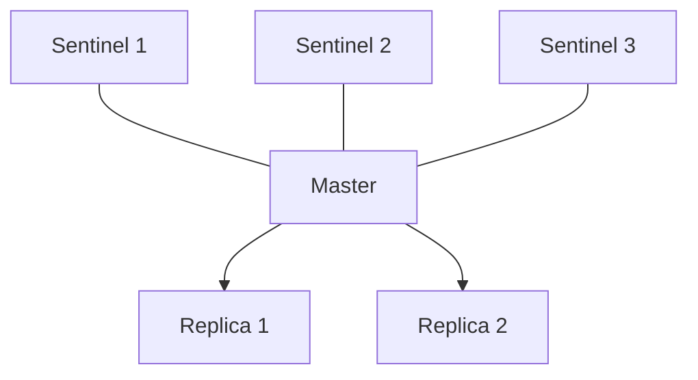

# Redis replication, Sentinel and Cluster

---

## 🟢 Junior Level

One Redis server is a single point of failure and has limited memory and throughput. Three mechanisms address this:

- **Replication:** a **master** (primary) copies its data to one or more **replicas**. Replicas serve reads and hold a backup copy.
- **Sentinel:** separate monitoring processes that detect a failed master and **automatically promote** a replica (high availability).
- **Cluster:** data is **sharded** across several masters (each with replicas) using **16384 hash slots** — scales memory and writes and also provides failover.

| Need | Use |
|---|---|
| Backup copy / read scaling | Replication |
| Automatic failover, dataset fits one node | Replication + Sentinel |
| Dataset or write rate exceeds one node | Redis Cluster |

### Simple Real-World Analogy
Replication: a photocopier makes copies of the master document for colleagues. Sentinel: a team of guards who, when the manager disappears, vote and appoint a deputy. Cluster: a library with 16384 shelves split among several librarians, and an index that says which librarian owns which shelf.



### Minimal Java: connecting through Sentinel (Spring Boot 3 properties)
```
spring.data.redis.sentinel.master=mymaster
spring.data.redis.sentinel.nodes=sentinel1:26379,sentinel2:26379,sentinel3:26379
```

```java
import io.lettuce.core.ReadFrom;
import org.springframework.boot.autoconfigure.data.redis.LettuceClientConfigurationBuilderCustomizer;
import org.springframework.context.annotation.Bean;
import org.springframework.context.annotation.Configuration;

@Configuration
public class RedisReadConfig {
    // Prefer replicas for reads, fall back to master
    @Bean
    public LettuceClientConfigurationBuilderCustomizer readFromReplica() {
        return builder -> builder.readFrom(ReadFrom.REPLICA_PREFERRED);
    }
}
```

---

## 🟡 Middle Level

### Replication mechanics
1. Replica connects and sends `PSYNC <replid> <offset>`.
2. If it cannot do a **partial resync** (offset not in the master's replication backlog, `repl-backlog-size`), the master does a **full resync**: forks, creates an RDB (to disk or directly to the socket with `repl-diskless-sync yes`), sends it, then streams buffered writes.
3. Afterwards the master streams every write command asynchronously. Replicas are read-only (`replica-read-only yes`) and can chain (replica of replica).

**Asynchronous** replication means a failover can lose the last writes. Replica reads can be stale (replication lag). Tools: `INFO replication` (`master_repl_offset`, replica `offset`, `lag`), `WAIT`.

### Sentinel
Typically 3 or 5 Sentinels (odd, on independent hosts). Duties: monitoring, notification, automatic failover, configuration provider (clients ask Sentinel for the current master address).
Failover process: a Sentinel marks the master **SDOWN** (no reply for `down-after-milliseconds`) → when `quorum` Sentinels agree it becomes **ODOWN** → Sentinels elect a leader (majority of all Sentinels) → leader picks the best replica (priority, replication offset, run ID) → promotes it (`REPLICAOF NO ONE`) → reconfigures the others → clients get switch notifications.
Risks: **split brain** (an isolated old master keeps accepting writes until demoted – mitigate with `min-replicas-to-write 1`), client must be Sentinel-aware, Docker/NAT announce-ip issues.

### Redis Cluster
- Key → slot: `CRC16(key) mod 16384` (for `{tag}` keys only the tag is hashed).
- Each master owns slot ranges; nodes gossip over a **cluster bus** (port+10000) to exchange state and detect failures (majority of masters must agree a node is FAIL, then its replica is promoted).
- Clients are **cluster-aware**: fetch the slot map (`CLUSTER SLOTS` / `CLUSTER SHARDS`), route to the right node. Wrong node → `-MOVED slot host:port` (permanent redirect, refresh the map) or `-ASK` (during slot migration).
- Minimum: 3 masters (6 nodes with one replica each for HA).
- Limitations: only database 0; multi-key operations need the same slot (hash tags); no cross-slot transactions/Lua; `KEYS`/`SCAN` per node; larger operational complexity. Pub/Sub broadcasts across nodes (sharded Pub/Sub since 7.0 uses `SSUBSCRIBE`).
- Resharding: `redis-cli --cluster reshard` or `rebalance` migrates slots online using `MIGRATE`.
- Cluster is available only if all slots are covered (`cluster-require-full-coverage yes` default) – losing a master with no replica makes the entire cluster reject writes unless you turn that off.

### Spring Boot with Cluster

```java
import java.util.List;
import io.lettuce.core.cluster.ClusterClientOptions;
import io.lettuce.core.cluster.ClusterTopologyRefreshOptions;
import java.time.Duration;
import org.springframework.context.annotation.Bean;
import org.springframework.context.annotation.Configuration;
import org.springframework.data.redis.connection.RedisClusterConfiguration;
import org.springframework.data.redis.connection.lettuce.LettuceClientConfiguration;
import org.springframework.data.redis.connection.lettuce.LettuceConnectionFactory;

@Configuration
public class ClusterConfig {

    @Bean
    public LettuceConnectionFactory connectionFactory() {
        RedisClusterConfiguration cluster = new RedisClusterConfiguration(
                List.of("10.0.0.1:6379", "10.0.0.2:6379", "10.0.0.3:6379"));
        cluster.setMaxRedirects(3);

        // Without topology refresh, clients keep using stale maps after failover/reshard
        ClusterTopologyRefreshOptions refresh = ClusterTopologyRefreshOptions.builder()
                .enablePeriodicRefresh(Duration.ofSeconds(30))
                .enableAllAdaptiveRefreshTriggers()
                .build();

        LettuceClientConfiguration client = LettuceClientConfiguration.builder()
                .clientOptions(ClusterClientOptions.builder().topologyRefreshOptions(refresh).build())
                .commandTimeout(Duration.ofSeconds(1))
                .build();

        return new LettuceConnectionFactory(cluster, client);
    }
}
```

### Common mistakes
- Using only 2 Sentinels (no majority possible when one dies) or all on one host.
- Reading from replicas for read-your-writes flows (stale).
- Multi-key commands across slots in Cluster (`CROSSSLOT` error).
- Ignoring `repl-backlog-size` – short network blips trigger expensive full resyncs.
- Clients without topology refresh.

---

## 🔴 Senior Level

### Consistency and loss analysis
- **Replication = AP-leaning**: writes are acknowledged by the master before replication; a crash then failover loses them. The Cluster doc states clearly: it does not guarantee strong consistency. Partitions: a master in the minority side keeps accepting writes for `cluster-node-timeout`, after which it stops; the majority side promotes a replica → writes accepted by the old master in that window are lost. Reduce with smaller `cluster-node-timeout` (trade-off: false failovers on GC/VM pauses), `min-replicas-to-write`, `WAIT`.
- **Sentinel vs Cluster failover**: Sentinel failover usually takes `down-after-milliseconds` (5–30 s) + election (a few sec); Cluster uses `cluster-node-timeout` (default 15 s) and replica election delay. Plan client retry with exponential backoff and idempotent writes.

### Slot math and hash tags
```java
import java.nio.charset.StandardCharsets;

public class SlotCalculator {
    // CRC16-CCITT (XMODEM), as used by Redis Cluster
    static int crc16(byte[] bytes) {
        int crc = 0;
        for (byte b : bytes) {
            crc ^= (b & 0xFF) << 8;
            for (int i = 0; i < 8; i++) {
                crc = (crc & 0x8000) != 0 ? (crc << 1) ^ 0x1021 : crc << 1;
                crc &= 0xFFFF;
            }
        }
        return crc;
    }

    public static int slot(String key) {
        int s = key.indexOf('{');
        if (s >= 0) {
            int e = key.indexOf('}', s + 1);
            if (e > s + 1) key = key.substring(s + 1, e); // non-empty tag
        }
        return crc16(key.getBytes(StandardCharsets.UTF_8)) % 16384;
    }

    public static void main(String[] args) {
        System.out.println(slot("user:1000"));
        System.out.println(slot("{user:1000}:cart") == slot("{user:1000}:profile")); // true
    }
}
```
Why 16384 slots? Gossip messages carry a bitmap of owned slots: 16384 bits = 2 KB per heartbeat, a compromise for bandwidth, and the design limit is ~1000 masters.

### Operational scenarios
- **Hot shard**: one slot/tag receives disproportionate traffic; cluster cannot split a single key. Use key-splitting (`counter:{n}` with N sub-keys), local caching, or read replicas (`READONLY` + `ReadFrom.REPLICA`).
- **Full resync storms**: after a master restart, many replicas request a full sync, each forking; use diskless replication with `repl-diskless-sync-delay` to batch replicas, and ensure memory headroom for COW.
- **Scaling out**: adding a master requires moving slots (migration of big keys blocks – `MIGRATE` is synchronous per key). Prefer to pre-shard with spare capacity and avoid big keys. Redis 8 / Valkey 8 improve migration (atomic slot migration in newer versions).
- **Managed services**: ElastiCache with cluster mode enabled exposes a configuration endpoint; the client must use cluster mode. Failover happens through DNS updates—check JVM DNS caching (`networkaddress.cache.ttl`) or the client keeps the dead IP.
- **Testing failover**: kill the master in staging with `DEBUG SLEEP`/`SIGSTOP` and measure client error window; verify `ReadFrom`, timeouts, and retries. Lettuce default command timeout is 60 s – set it to ~1–2 s so requests fail fast and the circuit breaker works.

### Deciding between them
- Dataset < ~25–50 GB and no write bottleneck → Primary + replicas + Sentinel (simpler, multi-key ops work, DB selection works).
- Large dataset or > 100k writes/s needed or memory > a node → Cluster, invest in key design (hash tags) up-front; retrofitting is painful.
- Many teams / mixed workloads → multiple separate Redis deployments by purpose instead of one giant cluster.

---

## 🎯 Interview Cheat Sheet

**30-second pitch:** Replication gives asynchronous copies (read scaling, backup). Sentinel adds monitoring and automatic failover for a single-shard setup via quorum and leader election. Cluster shards data over 16384 hash slots across masters with gossip-based failure detection and per-master replicas, supporting redirects (MOVED/ASK) and requiring hash tags for multi-key operations. All are asynchronous, so failovers can lose recent writes.

**Must know:**
- PSYNC, partial vs full resync, replication backlog, diskless sync.
- Sentinel quorum vs majority, SDOWN/ODOWN, why 3+ Sentinels.
- `CRC16(key) mod 16384`, hash tags, MOVED vs ASK, `CROSSSLOT`.
- Async replication → possible data loss; `WAIT`, `min-replicas-to-write`.
- Client topology refresh and timeouts.

**Follow-up questions:**
- How does Sentinel decide which replica becomes master?
- What happens in Cluster if a master and its replica both die?
- How do you run a transaction across keys in Cluster?
- How would you scale a Cluster with a hot key?

**Red flags:** two Sentinels; assuming strong consistency; using `KEYS` and multi-key commands across slots; clients without Sentinel/Cluster awareness; default 60 s timeouts.

**Related topics:**
- [Redis persistence RDB and AOF](08.%20Redis%20persistence%20RDB%20and%20AOF.md)
- [Lettuce vs Jedis](11.%20Lettuce%20vs%20Jedis.md)
- [Hot keys and big keys](14.%20Hot%20keys%20and%20big%20keys.md)
- [Distributed locks with Redis, SETNX and Redlock](15.%20Distributed%20locks%20with%20Redis,%20SETNX%20and%20Redlock.md)
