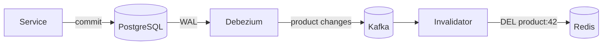

# Cache consistency with the database

---

## 🟢 Junior Level

When data lives in both a **database** (source of truth) and a **cache** (copy), the two can disagree. Because they are separate systems, you can't update both atomically — there is no transaction spanning PostgreSQL and Redis. So every caching design accepts some **inconsistency window** and must keep it small and harmless.

### The usual pattern: cache-aside + delete on write

```java
public Product get(long id) {
    Product cached = cache.get(id);
    if (cached != null) return cached;            // hit
    Product p = repo.findById(id).orElseThrow();  // miss: load from DB
    cache.put(id, p, Duration.ofMinutes(10));      // populate with TTL
    return p;
}

@Transactional
public void rename(long id, String name) {
    repo.updateName(id, name);                     // 1. write DB
}                                                  // 2. after commit: delete cache key (see below)
```

Delete (not update) the key after the database commit; the next read loads the fresh value.

---

## 🟡 Middle Level

### Why ordering matters

| Order | Failure scenario |
| --- | --- |
| Update cache, then DB | DB write fails/rolls back → cache holds data that never existed |
| Delete cache, then DB | Concurrent reader repopulates the old value before the DB write commits |
| DB, then update cache | Two concurrent writers can set cache in the opposite order of DB commits |
| **DB commit, then delete cache** | Small race (reader loaded old value before the write, puts it after the delete) — rarest, bounded by TTL |

Make the delete happen **after commit**:

```java
@Transactional
public void rename(long id, String name) {
    repo.updateName(id, name);
    TransactionSynchronizationManager.registerSynchronization(new TransactionSynchronization() {
        @Override public void afterCommit() { cache.evict(id); }
    });
}
// or publish an event and handle it with @TransactionalEventListener(phase = AFTER_COMMIT)
```

### What if the delete fails?
Redis is briefly unreachable → the delete is lost → stale data until TTL. Mitigations: retry the eviction asynchronously, keep TTLs short enough to bound staleness, or drive eviction from a durable source (outbox/CDC) instead of an in-memory callback.

---

## 🔴 Senior Level

### Durable invalidation with CDC or outbox
In-process eviction is lost on crashes between commit and delete. More robust:
* **Transactional outbox**: write a `CacheInvalidation(productId)` row in the same transaction; a relay publishes it and a consumer deletes the key (with retries until success).
* **Change Data Capture**: Debezium reads the database's WAL/binlog and emits change events; a consumer evicts or refreshes keys. Covers *all* writers — other services, migrations, admin SQL — which application-level eviction never will.



### Closing the "stale repopulate" race
The remaining race: reader R loads v1 from DB (slow), writer W commits v2 and deletes the key, then R puts v1 into the cache. Fixes:
* **Versioned writes**: store `(version, value)`; populate only if the cached version is lower (compare-and-set Lua script). Use the row's `@Version`/`updated_at`/LSN.
* **Lease/lock on miss** (Facebook's memcache leases): a miss obtains a lease token; a delete invalidates outstanding leases; a put with an invalidated lease is rejected.
* **Delayed double delete**: delete again ~1 s after commit.

### Reading your own writes
After a user updates their profile, a cached read may still show the old value — confusing even if consistency is "eventual". Options: bypass the cache for that user for a short time after a write (session flag), write-through the new value for that user's key, or return the updated entity directly from the write endpoint.

### Decide per data class
* **Never** make authoritative decisions from cache for money, inventory reservations, or authorization changes; read the source of truth (or a version check) at decision time.
* For display data, define and document the maximum acceptable staleness (e.g. 60 s), set TTLs accordingly, and **measure** it: background samplers compare cached values with DB values and emit a staleness metric.

### Write-behind is a different consistency model
Writing to the cache first and flushing to the database later (write-behind) makes the **cache** the temporary source of truth. It improves write throughput but risks data loss if the cache node fails before flushing; use it only with durable caches (Redis AOF `appendfsync everysec` still loses up to ~1 s) and for data where that's acceptable (counters, analytics).

---

## 🎯 Interview Cheat Sheet

**30-second pitch:** Cache and database can't be updated atomically, so I use cache-aside with delete-after-commit plus TTLs to bound staleness. For robustness I drive invalidation from an outbox or CDC so no write path is missed, close the stale-repopulate race with versioned compare-and-set, handle read-your-writes explicitly, and never make authoritative decisions from cached data.

**Must know:**
* Why "DB commit then delete cache" is the safest simple order.
* `afterCommit` / `@TransactionalEventListener(AFTER_COMMIT)` for eviction.
* Lost deletes → TTL bound, retries, outbox/CDC.
* Versioned writes, leases, delayed double delete.
* Write-behind risks.

**Common follow-ups:**
* What if Redis is down during the delete?
* How do you guarantee users see their own updates?
* How do you invalidate caches when another service writes the table?

**Red flags:** updating the cache before the DB; caches without TTL; authorization or balance checks from cache.

**Related:**
* [Cache invalidation strategies](12.%20Cache%20invalidation%20strategies.md)
* [Caching strategies cache-aside, read-through, write-through, write-behind and refresh-ahead](03.%20Caching%20strategies%20cache-aside,%20read-through,%20write-through,%20write-behind%20and%20refresh-ahead.md)
* [Transactional outbox pattern](../28.%20Messaging%20Beyond%20Kafka/12.%20Transactional%20outbox%20pattern.md)
* [Redis persistence RDB and AOF](08.%20Redis%20persistence%20RDB%20and%20AOF.md)
