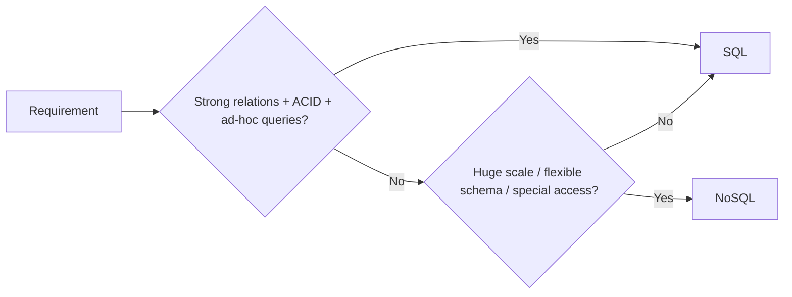

# SQL vs NoSQL and how to choose

---

## 🟢 Junior Level

### 1. What is the difference?

**SQL (relational) databases** (PostgreSQL, MySQL, Oracle) store data in **tables** with a fixed schema, rows and columns, and relate tables through foreign keys. You query them with SQL and they give you **ACID transactions**.

**NoSQL ("Not Only SQL") databases** (MongoDB, Cassandra, DynamoDB, Redis, Neo4j, Elasticsearch) drop one or more relational assumptions: a rigid schema, joins, or single-node ACID. In exchange they gain flexible data shapes, horizontal scalability, or specialised query models.

**Analogy:** A relational database is a well-organised accounting ledger: every entry has the same columns and is cross-checked. A NoSQL document store is a filing cabinet of folders: each folder can contain different papers, and you grab the whole folder in one go.

| Aspect | SQL | NoSQL |
| :--- | :--- | :--- |
| Data model | Tables, rows, fixed schema | Documents, key-value, wide-column, graph |
| Schema | Schema-on-write | Usually schema-on-read (flexible) |
| Relations | Joins, foreign keys | Embedding or application-level references |
| Transactions | Full ACID | Varies: single-document/partition, or full |
| Scaling | Vertical first, horizontal is hard | Designed to scale horizontally |
| Query language | Standard SQL | Vendor-specific APIs |

### 2. Minimal example: same data, two shapes

```java
// Relational: two tables, joined at query time
// users(id, name)   orders(id, user_id, total)
@Entity
class UserEntity {
    @Id Long id;
    String name;
    @OneToMany(mappedBy = "user") List<OrderEntity> orders;
}

// Document: one self-contained aggregate stored together
record Order(String sku, int qty, double total) {}
record UserDocument(String id, String name, List<Order> orders) {}
```



> [!IMPORTANT]
> **Default to a relational database.** Choose NoSQL when you can name a concrete requirement (scale, latency, data shape) that SQL cannot satisfy cheaply.

---

## 🟡 Middle Level

### 1. Real decision criteria

| Question | Leans SQL | Leans NoSQL |
| :--- | :--- | :--- |
| Are access patterns unknown or ad-hoc (reporting, BI)? | ✅ | ❌ |
| Are access patterns fixed and known up front? | ➖ | ✅ |
| Multi-row/multi-entity invariants (money transfer)? | ✅ | ⚠️ (possible, harder) |
| Write throughput beyond one node (>50k writes/s)? | ⚠️ | ✅ |
| Data is semi-structured and evolves quickly? | ⚠️ (JSONB helps) | ✅ |
| Multi-region active-active writes? | ❌ | ✅ (Cassandra, DynamoDB global tables) |

Modern relational databases blur the line: PostgreSQL has `jsonb` with GIN indexes, and CockroachDB/Spanner/YugabyteDB offer horizontally scalable SQL (**NewSQL**). Do not present the choice as binary.

### 2. The same use case in Spring

Relational with Spring Data JPA:

```java
public interface OrderRepository extends JpaRepository<OrderEntity, Long> {
    @Query("select o from OrderEntity o join fetch o.items where o.customerId = :cid")
    List<OrderEntity> findWithItems(@Param("cid") Long customerId);
}
```

Document with Spring Data MongoDB:

```java
@Document("orders")
public record OrderDoc(@Id String id, String customerId, List<Item> items, Instant createdAt) {
    public record Item(String sku, int qty, long priceCents) {}
}

public interface OrderDocRepository extends MongoRepository<OrderDoc, String> {
    List<OrderDoc> findByCustomerIdOrderByCreatedAtDesc(String customerId);
}
```

Note the shift: the JPA version needs a join to rebuild the order; the document version reads one aggregate in a single I/O.

### 3. Common mistakes

1. **Choosing NoSQL because it is "web scale"** while the data fits in one PostgreSQL node (most systems do: a modern node handles terabytes and thousands of TPS).
2. **Choosing NoSQL "to avoid schema"**: the schema moves into application code. Every reader must cope with every historic document shape.
3. **Recreating joins in the application** with N+1 lookups: a sign that the data is relational.
4. **Ignoring operational cost**: a new store means new backups, monitoring, upgrades, expertise, security review.
5. **Assuming NoSQL = no transactions**. MongoDB supports multi-document transactions; DynamoDB has `TransactWriteItems`. They just cost more.

### 4. Trade-offs summary

- SQL: flexible querying, mature tooling, integrity enforced by the database; costs: harder write scaling, schema migrations on huge tables.
- NoSQL: scale and shape fit; costs: query flexibility is designed away, integrity is the application's burden, eventual consistency surprises.

---

## 🔴 Senior Level

### 1. Decision by workload, not by brand

Think in terms of **read/write ratio, access patterns, consistency requirement, data volume growth, latency SLO, and team skills**:

| Workload | Typical fit | Reason |
| :--- | :--- | :--- |
| Core banking ledger | PostgreSQL / Oracle | Strict invariants, serialisable isolation |
| Product catalogue with varied attributes | MongoDB / PostgreSQL jsonb | Heterogeneous attributes, read-heavy aggregates |
| IoT telemetry, 1M writes/s | Cassandra / Timescale / ClickHouse | Append-only, time-partitioned |
| Session / cart with TTL | Redis / DynamoDB | Key lookup, expiry |
| Full-text search, faceting | Elasticsearch / OpenSearch | Inverted index, relevance |
| Recommendations, fraud rings | Neo4j | Multi-hop traversals |

### 2. Quantify before deciding

Rough sizing: 5,000 writes/s x 1 KB = ~5 MB/s = 430 GB/day raw. A single Postgres primary with NVMe can sustain this write rate but retention of 1 year (150 TB) requires partitioning or a distributed store. Capture: peak QPS, p99 latency, dataset size in 1/3 years, read:write ratio, number of distinct query shapes. If distinct query shapes are fewer than ~10 and well known, a NoSQL store modelled around them is feasible.

### 3. Hidden costs diagnostics

```java
// Detecting accidental relational access in a document design:
// count round trips per request with Micrometer.
@Component
class MongoRoundTripMetrics {
    private final MeterRegistry registry;
    MongoRoundTripMetrics(MeterRegistry registry) { this.registry = registry; }

    <T> T timed(String op, java.util.function.Supplier<T> call) {
        return registry.timer("db.call", "op", op).record(call);
    }
}
```

If a single HTTP request produces 20+ `db.call` events against a document store, the model is wrong (or the data should live in SQL).

### 4. Hybrid architectures

Real systems use **both**: PostgreSQL as the system of record, with change data capture (Debezium -> Kafka) feeding Elasticsearch for search and Redis for hot reads. The source of truth must be one store; derived stores are rebuildable. See [Polyglot persistence and choosing a database in interviews](19.%20Polyglot%20persistence%20and%20choosing%20a%20database%20in%20interviews.md).

### 5. Edge cases

- **Hot partitions**: scale is theoretical if the key distribution is skewed (celebrity user, current-day partition).
- **Schema evolution**: use a `schemaVersion` field and lazy migration on read.
- **Lock-in**: DynamoDB is cloud-only; Mongo-compatible APIs (DocumentDB, Cosmos) differ subtly.

---

## 🎯 Interview Cheat Sheet

### 30-second pitch
"SQL gives me flexible queries and strong integrity; NoSQL trades some of that for horizontal scale, flexible schema, or a specialised model. I default to relational, and pick NoSQL when I can name the access pattern, volume, or latency need that justifies the operational cost."

### Must-know bullets
- NoSQL is a family, not one thing: document, key-value, wide-column, graph, search, time-series.
- Schema flexibility is moved, not removed.
- Joins and ad-hoc queries are what you sacrifice most often.
- Modern SQL (jsonb, partitioning, NewSQL) covers many "NoSQL" cases.
- Polyglot persistence with one source of truth is the usual real-world answer.

### Common follow-ups
- When would you pick MongoDB over PostgreSQL jsonb?
- Can NoSQL databases do ACID transactions?
- How would you migrate from SQL to NoSQL safely?
- What breaks when you scale a relational database horizontally?

### 🚩 Red flags
- "NoSQL is faster than SQL" with no workload context.
- "NoSQL has no schema, so no design needed."
- Picking a store from a blog post instead of access patterns.

### Related topics
- [NoSQL families](02.%20NoSQL%20families.md)
- [CAP theorem and PACELC](03.%20CAP%20theorem%20and%20PACELC.md)
- [BASE vs ACID](04.%20BASE%20vs%20ACID.md)
- [Data modeling for access patterns and SQL to NoSQL migration pitfalls](20.%20Data%20modeling%20for%20access%20patterns%20and%20SQL%20to%20NoSQL%20migration%20pitfalls.md)
