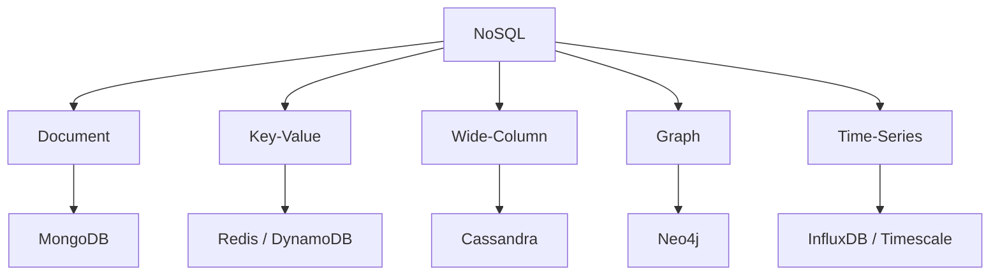

# NoSQL families

---

## 🟢 Junior Level

### 1. The five main families

NoSQL is an umbrella term. Each family optimises a different data shape and access pattern:

| Family | Data model | Examples | Best for |
| :--- | :--- | :--- | :--- |
| **Document** | JSON/BSON documents in collections | MongoDB, Couchbase, Firestore | Catalogues, user profiles, CMS |
| **Key-value** | Opaque value looked up by key | Redis, DynamoDB, Riak | Sessions, caching, carts, counters |
| **Wide-column** | Rows with partition key and sparse columns | Cassandra, ScyllaDB, HBase | Massive write-heavy, time-ordered data |
| **Graph** | Nodes and edges with properties | Neo4j, JanusGraph, Neptune | Social networks, fraud, recommendations |
| **Time-series** | Timestamped points, downsampling | InfluxDB, TimescaleDB, Prometheus | Metrics, IoT, monitoring |

(Search engines such as Elasticsearch are often listed as a sixth family.)

**Analogy:** Key-value is a coat-check (ticket in, coat out). Document is a folder per customer. Wide-column is a giant spreadsheet sharded by customer. Graph is a mind map. Time-series is a heart-rate chart.

### 2. Minimal Java examples

```java
// Key-value (conceptually): Map<String, byte[]>
Map<String, String> sessions = new ConcurrentHashMap<>();
sessions.put("sess:abc123", "{\"userId\":42}");

// Document: a self-describing aggregate
record Product(String id, String name, Map<String, Object> attributes) {}
Product p = new Product("p1", "Laptop", Map.of("ramGb", 16, "color", "silver"));
```



---

## 🟡 Middle Level

### 1. Characteristics and trade-offs

**Document stores** keep an aggregate (order + items) in one document. Reads are single-seek. Secondary indexes and rich queries are supported. Weakness: cross-document consistency and many-to-many relationships.

**Key-value stores** have the simplest API (`GET`, `PUT`, `DELETE`) and the highest throughput, but you can only query by key (DynamoDB adds sort key and secondary indexes).

**Wide-column stores** are not "column-oriented" like Parquet. They are **partitioned, sorted, sparse row stores**: you address data by `(partition key, clustering key)`. Writes are fast (LSM tree), queries must follow the table's design.

**Graph databases** store relationships as first-class pointers (index-free adjacency in Neo4j), so traversing 5 hops is O(edges visited) instead of five joins.

**Time-series databases** exploit append-only ordered data: delta/gorilla compression, retention policies, downsampling, time-bucketed partitions.

### 2. Choosing by access pattern

| Access pattern | Family |
| :--- | :--- |
| `get by id` at 100k ops/s | Key-value |
| `get order with its lines`, filter by status/date | Document |
| `last 100 events for device X` with huge ingest | Wide-column / time-series |
| `friends of friends who liked Y` | Graph |
| `search text with typo tolerance` | Search engine |

### 3. Java usage side by side

```java
// Key-value with Spring Data Redis
@Service
class CartService {
    private final StringRedisTemplate redis;
    CartService(StringRedisTemplate redis) { this.redis = redis; }

    void addItem(String cartId, String sku) {
        redis.opsForHash().increment("cart:" + cartId, sku, 1);
        redis.expire("cart:" + cartId, java.time.Duration.ofDays(7));
    }
}

// Document with Spring Data MongoDB
@Document("products")
record ProductDoc(@Id String id, String name, Map<String, Object> attributes) {}

// Wide-column with Spring Data Cassandra
@Table("sensor_readings")
record Reading(
    @PrimaryKeyColumn(name = "device_id", type = PrimaryKeyType.PARTITIONED) String deviceId,
    @PrimaryKeyColumn(name = "ts", type = PrimaryKeyType.CLUSTERED, ordering = Ordering.DESCENDING) java.time.Instant ts,
    double value) {}
```

### 4. Common mistakes

- Using a document DB as a relational one (references everywhere, many lookups).
- Using Cassandra for ad-hoc queries; it is table-per-query by design.
- Treating a graph DB as a general store: it shines only for traversal-heavy workloads.
- Using Redis as the only durable store without understanding persistence (RDB/AOF) trade-offs. Redis details live in the Caching and Redis section.

---

## 🔴 Senior Level

### 1. Storage-engine view

| Family | Typical engine | Write cost | Read cost |
| :--- | :--- | :--- | :--- |
| Document (MongoDB WiredTiger) | B-tree + journal | Random I/O, in-place updates | 1 seek via index |
| Wide-column (Cassandra, ScyllaDB) | LSM tree (memtable, SSTable) | Sequential, very cheap | Read amplification across SSTables |
| Key-value (Redis) | In-memory hash tables | Memory speed | Memory speed |
| Key-value (RocksDB-based) | LSM tree | Sequential | Bloom filters + levels |
| Graph (Neo4j) | Fixed-size record files with pointers | Moderate | Pointer chasing, O(1) per hop |
| Time-series | Time-partitioned columnar chunks | Append | Range scans with compression |

LSM vs B-tree is the core tension: LSM trees have higher write throughput and write amplification controlled by compaction; B-trees give more predictable reads. See [Cassandra write path, LSM tree, compaction and tombstones](15.%20Cassandra%20write%20path%20LSM%20tree%20compaction%20and%20tombstones.md).

### 2. Multi-model databases

PostgreSQL (jsonb, ltree, pg_trgm, TimescaleDB, Apache AGE), Cosmos DB (document, graph, key-value, column APIs) and ArangoDB blur boundaries. For small-to-medium scale, one multi-model engine often beats three specialised ones operationally.

### 3. Production scenario

An IoT platform ingests 200k readings/s. Design: Kafka for buffering; Cassandra/ScyllaDB partitioned by `(device_id, day_bucket)` for raw data; a time-series store or ClickHouse for aggregates; PostgreSQL for device metadata. The bucket keeps partitions bounded (e.g., 86,400 rows per device per day at 1 Hz) - unbounded partitions are a classic failure.

```java
// Partition bucketing helper: bounds partition size
static String partitionKey(String deviceId, java.time.Instant ts) {
    return deviceId + ":" + java.time.LocalDate.ofInstant(ts, java.time.ZoneOffset.UTC);
}
```

### 4. Edge cases

- Wide-column "schemaless" rows are really schema-defined in CQL; the "wide" refers to many clustering rows per partition.
- Graph DBs struggle with **super-nodes** (millions of edges on one node).
- Time-series high **cardinality** (unique label combinations) is what kills Prometheus/Influx, not volume.

---

## 🎯 Interview Cheat Sheet

### 30-second pitch
"NoSQL has five main families: document, key-value, wide-column, graph, time-series. Each trades general querying for a specific strength: aggregates, raw speed, write scale, relationship traversal, or ordered append-only data. I pick by access pattern."

### Must-know bullets
- Document = aggregate per document; key-value = lookup by key; wide-column = partitioned sorted rows; graph = traversals; time-series = ordered append-only.
- Wide-column is not the same as columnar analytics.
- LSM vs B-tree explains write vs read characteristics.
- Multi-model databases reduce operational load.

### Common follow-ups
- Give one use case where each family is the right choice.
- Why is Cassandra bad at ad-hoc queries?
- Why are graph traversals faster than SQL joins?
- Where does Elasticsearch fit?

### 🚩 Red flags
- Mixing up wide-column with columnar.
- Claiming one family is universally best.

### Related topics
- [SQL vs NoSQL and how to choose](01.%20SQL%20vs%20NoSQL%20and%20how%20to%20choose.md)
- [MongoDB basics](06.%20MongoDB%20basics.md)
- [Cassandra data model](14.%20Cassandra%20data%20model.md)
- [Graph databases and Neo4j basics](18.%20Graph%20databases%20and%20Neo4j%20basics.md)
- [DynamoDB basics](17.%20DynamoDB%20basics.md)
