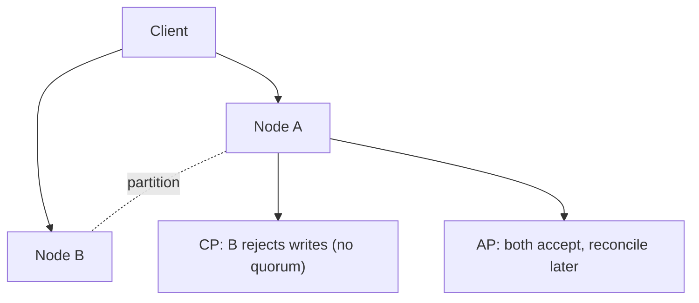

# CAP theorem and PACELC

---

## 🟢 Junior Level

### 1. What is the CAP theorem?

In a distributed data store you can guarantee at most two of three properties at the same time **when a network partition happens**:

- **C - Consistency (linearizability):** every read sees the latest write, as if there were one copy.
- **A - Availability:** every request to a non-failed node gets a (non-error) response.
- **P - Partition tolerance:** the system keeps working when messages between nodes are lost or delayed.

Networks do fail, so **P is not optional** in a distributed system. The real choice is: during a partition, do you stay **consistent (CP)** and reject some requests, or stay **available (AP)** and risk stale/conflicting data?

**Analogy:** Two bank branches lose their phone line. Either each refuses withdrawals until the line returns (consistent, not available) or each keeps serving customers and reconciles later (available, maybe overdrawn).

### 2. Classification (typical defaults)

| Type | Behaviour in partition | Examples |
| :--- | :--- | :--- |
| **CP** | Minority side refuses requests | MongoDB (majority concern), HBase, ZooKeeper, etcd |
| **AP** | All sides keep answering | Cassandra, DynamoDB (eventual reads), Riak, CouchDB |



### 3. Tiny Java demonstration

```java
// Simplified: a replica that refuses writes without a majority (CP behaviour)
class QuorumWriter {
    private final int totalNodes;
    QuorumWriter(int totalNodes) { this.totalNodes = totalNodes; }

    boolean write(int reachableNodes) {
        int quorum = totalNodes / 2 + 1;
        if (reachableNodes < quorum) {
            throw new IllegalStateException("No quorum: write rejected (CP)");
        }
        return true; // replicate to reachable nodes
    }
}
```

---

## 🟡 Middle Level

### 1. Common misunderstandings

1. **"Pick any two of three"** is misleading. Without partitions you can have C and A. CAP only constrains behaviour *during* a partition.
2. CAP "C" is **linearizability**, not the "C" in ACID (which means invariants hold).
3. CAP "A" means *every non-failing node* responds, a strict definition. Real systems are "highly available" in a softer sense.
4. Systems are not CP or AP wholesale; they are **tunable per operation** (Cassandra `QUORUM` vs `ONE`; MongoDB read/write concerns; DynamoDB strongly consistent reads).

### 2. PACELC: the missing half

Daniel Abadi observed that trade-offs exist **even without partitions** (Else): you trade **Latency** for **Consistency**, because replicating synchronously costs round trips.

> **PACELC:** if **P**artition, choose **A** or **C**; **E**lse, choose **L**atency or **C**onsistency.

| System | P: | E: | Notation |
| :--- | :--- | :--- | :--- |
| Cassandra / Dynamo (default) | A | L | PA/EL |
| MongoDB (default concerns) | A* / C | C | PA/EC (commonly cited) |
| PNUTS (Yahoo) | C | L | PC/EL |
| Spanner, VoltDB, HBase | C | C | PC/EC |
| Single-leader PostgreSQL sync replication | C | C | PC/EC |

(*classifications depend on configuration, so be careful in interviews and say "by default".)

### 3. Spring Data example: choosing per operation

```java
@Configuration
class MongoConfig {
    @Bean
    MongoTemplate strictTemplate(MongoDatabaseFactory factory, MappingMongoConverter converter) {
        MongoTemplate t = new MongoTemplate(factory, converter);
        t.setWriteConcern(com.mongodb.WriteConcern.MAJORITY);          // consistency
        t.setReadPreference(com.mongodb.ReadPreference.primary());      // no stale reads
        return t;
    }

    @Bean
    MongoTemplate fastTemplate(MongoDatabaseFactory factory, MappingMongoConverter converter) {
        MongoTemplate t = new MongoTemplate(factory, converter);
        t.setWriteConcern(com.mongodb.WriteConcern.W1);                 // latency
        t.setReadPreference(com.mongodb.ReadPreference.secondaryPreferred());
        return t;
    }
}
```

Use the strict template for payments, the fast one for page-view counters.

### 4. Trade-offs

- CP systems give simple reasoning but lose write availability on the minority side; clients need retries and timeouts.
- AP systems stay up but you need conflict resolution: last-write-wins (LWW), vector clocks, CRDTs, or application merge.

---

## 🔴 Senior Level

### 1. Subtleties

- **Partitions are not binary.** Gray failures (slow nodes, GC pauses, asymmetric links) are far more common than clean splits. A 30 s stop-the-world GC looks like a partition to the rest of the cluster and can trigger an election in a CP system.
- **Availability is also about latency.** A CP system with a quorum that times out after 5 s is "available" in theory and broken in practice.
- **Linearizability is expensive**: Jepsen tests have repeatedly shown that databases claiming CP often lose acknowledged writes under specific configurations (e.g., MongoDB with `w:1`, old versions with lagging rollback).

### 2. Production scenario: shopping cart vs inventory

- Cart: AP is fine. Merge divergent carts with union semantics (Dynamo's original design).
- Inventory decrement: needs CP/serialisable semantic or compensating logic (reservation with TTL), else overselling occurs.

```java
// Optimistic concurrency for a CP-ish decrement in MongoDB
Query q = Query.query(Criteria.where("sku").is(sku).and("stock").gte(qty));
Update u = new Update().inc("stock", -qty);
UpdateResult r = mongoTemplate.updateFirst(q, u, "inventory");
if (r.getModifiedCount() == 0) {
    throw new OutOfStockException(sku); // atomic check-and-decrement on a single doc
}
```

A single-document atomic update avoids the distributed problem entirely: the shard that owns the document is the serialization point.

### 3. Diagnostics

- Cassandra: `nodetool status`, hinted handoff backlog, `nodetool tpstats` dropped mutations.
- MongoDB: `rs.status()` for `optimeDate` lag, `db.serverStatus().wiredTiger` for stalls, `w: "majority"` with `wtimeout` to bound waiting.
- Chaos tests: Toxiproxy or Jepsen-style fault injection to validate your *application's* behaviour under partitions, not just the database's.

### 4. Beyond CAP

Real design vocabulary: **consistency models** ([next topics](05.%20Consistency%20models%20eventual%20causal%20and%20strong.md)), **quorum math** (R + W > N), **CRDTs**, **sagas** for cross-service transactions, **idempotent consumers** for at-least-once delivery.

---

## 🎯 Interview Cheat Sheet

### 30-second pitch
"CAP says that during a network partition a distributed store must choose between consistency and availability. Since partitions happen, it's really CP vs AP. PACELC extends it: even without partitions you trade latency against consistency. Most modern databases let you tune this per operation."

### Must-know bullets
- P is mandatory; the choice is C or A during a partition.
- CAP's C is linearizability, not ACID's C.
- PACELC: PA/EL (Cassandra), PC/EC (Spanner, HBase).
- Tunable: Cassandra consistency level, MongoDB read/write concerns.
- AP needs conflict resolution (LWW, vector clock, CRDT).

### Common follow-ups
- Is MongoDB CP or AP? (It depends on concerns; by default primary-based, so CP-leaning.)
- What happens to a MongoDB primary on the minority side of a partition?
- Why is "CA" system a myth in distributed settings?
- How do you avoid overselling in an AP store?

### 🚩 Red flags
- "Choose any two" without mentioning partitions.
- Labelling a database CP/AP without mentioning configuration.

### Related topics
- [BASE vs ACID](04.%20BASE%20vs%20ACID.md)
- [Consistency models](05.%20Consistency%20models%20eventual%20causal%20and%20strong.md)
- [Tunable consistency in Cassandra](16.%20Tunable%20consistency%20in%20Cassandra.md)
- [Replication strategies](22.%20Replication%20strategies.md)
