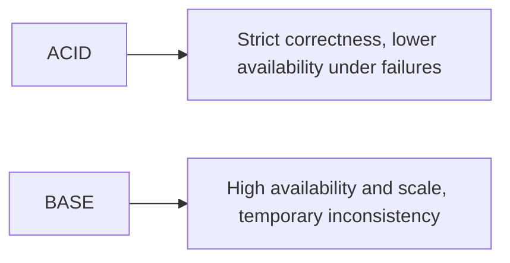

# BASE vs ACID

---

## 🟢 Junior Level

### 1. ACID

Traditional relational transactions follow **ACID**:

- **Atomicity** - all operations of a transaction succeed or none do.
- **Consistency** - a transaction moves the database from one valid state to another (constraints hold).
- **Isolation** - concurrent transactions do not see each other's partial work.
- **Durability** - once committed, data survives crashes (write-ahead log, fsync).

### 2. BASE

Many NoSQL systems favour **BASE**:

- **B**asically **A**vailable - the system answers even during partial failure.
- **S**oft state - state may change over time even without input (replicas converging).
- **E**ventual consistency - if writes stop, all replicas eventually agree.

**Analogy:** ACID is a bank counter: you leave only when the transfer is fully completed. BASE is a social network "like" count: it may show 99 on one phone and 101 on another for a few seconds, and that's acceptable.

### 3. Example

```java
// ACID with Spring + JPA: both updates commit or neither
@Service
class TransferService {
    private final AccountRepository accounts;
    TransferService(AccountRepository accounts) { this.accounts = accounts; }

    @Transactional
    public void transfer(long from, long to, java.math.BigDecimal amount) {
        Account a = accounts.findById(from).orElseThrow();
        Account b = accounts.findById(to).orElseThrow();
        a.withdraw(amount);
        b.deposit(amount);
    }
}
```

```java
// BASE-style: fire-and-forget counter increment, replicas converge later
interface LikeCounter { void like(String postId); }
```



---

## 🟡 Middle Level

### 1. ACID is not binary across databases

| Property | PostgreSQL | MongoDB | Cassandra | DynamoDB |
| :--- | :--- | :--- | :--- | :--- |
| Atomicity | Multi-row | Single document always; multi-doc since 4.0 | Single partition row-level; **batches** logged | Single item; `TransactWriteItems` up to 100 items |
| Isolation | Read committed to serializable | Snapshot within a transaction | Lightweight transactions (LWT, Paxos) only | Serializable transactions |
| Durability | WAL | Journal + write concern | Commit log | Replicated across AZs |

### 2. Isolation levels and anomalies (SQL side)

| Level | Dirty read | Non-repeatable read | Phantom |
| :--- | :--- | :--- | :--- |
| Read Uncommitted | possible | possible | possible |
| Read Committed (PG default) | no | possible | possible |
| Repeatable Read | no | no | possible (PG: no) |
| Serializable | no | no | no |

### 3. How BASE systems compensate

1. **Idempotent operations** with request IDs, so retries are safe.
2. **Sagas** for multi-service workflows (compensating actions rather than rollback).
3. **Outbox pattern** to make "write to DB + publish event" atomic.
4. **Conditional writes** (compare-and-set) for optimistic concurrency.

```java
// Idempotent write with a unique key in MongoDB: duplicate retries are harmless
@Document("payments")
@CompoundIndex(def = "{'requestId': 1}", unique = true)
record Payment(@Id String id, String requestId, long amountCents) {}

try {
    mongoTemplate.insert(new Payment(null, requestId, 1000));
} catch (org.springframework.dao.DuplicateKeyException e) {
    // already processed: return the previous result
}
```

### 4. Common mistakes

- Treating "eventual consistency" as "eventually correct regardless of design": without conflict resolution, concurrent writes can silently lose data (LWW).
- Reading your own writes from a lagging secondary right after a write.
- Using Cassandra `BATCH` to "speed up" writes: it is for atomicity across tables of the same partition, not performance.

---

## 🔴 Senior Level

### 1. Internals: how durability is implemented

- PostgreSQL: WAL record flushed (`fsync`) before commit returns; `synchronous_commit = off` trades up to ~3x wal_writer_delay loss window for latency.
- MongoDB WiredTiger: journal flushed every 100 ms by default (or on `j:true`); checkpoint every 60 s. Write concern `{w: "majority", j: true}` is the safe combo.
- Cassandra: commit log with `periodic` (default, 10 s sync) or `batch` mode. With periodic, a crash of all replicas simultaneously can lose up to 10 s of acknowledged writes, mitigated by RF > 1 across racks.

### 2. Distributed transactions

Two-phase commit (2PC) offers ACID across resources but blocks if the coordinator dies and holds locks across network latency. Alternatives:

```java
// Transactional outbox: atomic local write + event record, relayed asynchronously
@Transactional
public void placeOrder(Order order) {
    orderRepository.save(order);
    outboxRepository.save(new OutboxEvent("OrderPlaced", toJson(order)));
}
// A relay (Debezium CDC or a poller) publishes outbox rows to Kafka at-least-once.
```

Consumers must be idempotent because delivery is at-least-once; keep a `processed_events` table or use natural idempotency.

### 3. Performance perspective

Serializable isolation in PostgreSQL (SSI) can abort transactions with `40001`; the application must retry. Under high contention, throughput drops sharply. BASE systems avoid coordination, so write latency is near single-node latency - at the cost of read-time reconciliation.

### 4. Production scenario

An e-commerce checkout: payment and order in PostgreSQL (ACID), inventory reservation via conditional update, search index and recommendation updates via events (BASE). The **boundary** between ACID and BASE is placed at the business invariant: money and stock must not be wrong; search results can lag by seconds.

### 5. Edge cases

- MongoDB transactions with `readConcern: snapshot` and a 60 s default `transactionLifetimeLimitSeconds`; long transactions hold WiredTiger cache pressure.
- DynamoDB transactions cost 2x the capacity units of normal operations.
- Cassandra LWT (`IF NOT EXISTS`) costs ~4 round trips (Paxos), so avoid in hot paths (Accord/CEP-15 in Cassandra 5.x aims to improve this).

---

## 🎯 Interview Cheat Sheet

### 30-second pitch
"ACID guarantees atomic, consistent, isolated, durable transactions, ideal for money. BASE - basically available, soft state, eventually consistent - gives up immediate consistency for availability and scale. In practice I use ACID for invariants and BASE-style events and idempotency for everything that can tolerate staleness."

### Must-know bullets
- ACID vs BASE is a spectrum, not a binary.
- NoSQL databases increasingly support transactions, with limits and costs.
- Use idempotency keys, outbox, sagas for BASE systems.
- Durability depends on fsync/journal/write-concern settings.

### Common follow-ups
- Do MongoDB transactions make it fully ACID?
- What is the difference between ACID consistency and CAP consistency?
- Explain the outbox pattern.
- What isolation level does PostgreSQL use by default?

### 🚩 Red flags
- "NoSQL has no transactions."
- "BASE means the data may be wrong."
- Using 2PC across microservices by default.

### Related topics
- [CAP theorem and PACELC](03.%20CAP%20theorem%20and%20PACELC.md)
- [Consistency models](05.%20Consistency%20models%20eventual%20causal%20and%20strong.md)
- [MongoDB replica sets, sharding and transactions](09.%20MongoDB%20replica%20sets%20sharding%20and%20transactions.md)
