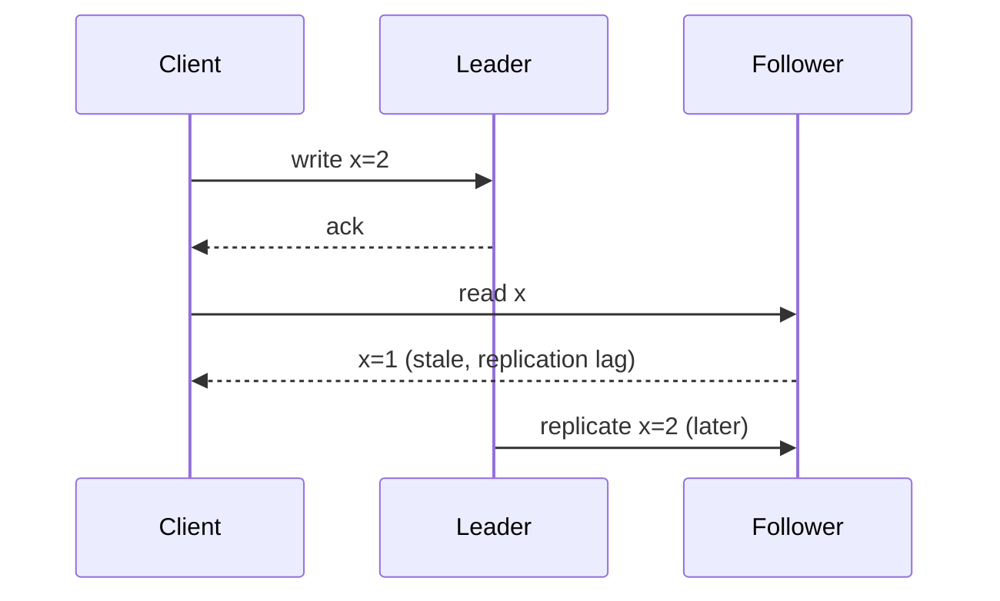

# Consistency models eventual causal and strong

---

## 🟢 Junior Level

### 1. What is a consistency model?

A **consistency model** is a contract that defines which values a read may return when data is replicated across several nodes. The stronger the model, the simpler it is for developers, and the slower or less available the system.

| Model | Plain-English promise |
| :--- | :--- |
| **Strong (linearizable)** | Every read returns the most recent write, as if there were one copy. |
| **Causal** | If event B was caused by event A, everyone sees A before B. Unrelated events may appear in any order. |
| **Eventual** | If writes stop, all replicas eventually converge. No promise about when. |

**Analogy:** A group chat. Strong: everybody sees messages instantly in the same order. Causal: a reply never shows up before the question it answers. Eventual: your phone catches up later when the network returns.

### 2. A visible symptom

```java
// Write to primary, then read from a lagging replica: may return stale data
userRepository.save(new User("42", "Alice"));                 // goes to the leader
Optional<User> u = readReplicaUserRepository.findById("42");  // may still be empty!
```



---

## 🟡 Middle Level

### 1. The consistency spectrum

From strongest to weakest:

1. **Strict / Linearizable** - real-time ordering on single objects (etcd, ZooKeeper writes, Spanner, MongoDB `readConcern: linearizable`).
2. **Sequential** - all see the same order, but not necessarily real-time.
3. **Causal** - preserves happens-before (MongoDB causally consistent sessions).
4. **Session guarantees** - read-your-writes, monotonic reads, monotonic writes, writes-follow-reads.
5. **Eventual** - convergence only (Cassandra `ONE`, DynamoDB default reads).

### 2. Session guarantees developers actually need

| Guarantee | Bug it prevents |
| :--- | :--- |
| **Read-your-writes** | User edits profile, refreshes, sees old data. |
| **Monotonic reads** | User sees a comment, refreshes, comment disappears (second read hits older replica). |
| **Monotonic writes** | Two writes by the same client applied out of order. |
| **Writes-follow-reads** | Reply is visible without the post it answers. |

### 3. Practical patterns in Java

**MongoDB causal consistency** guarantees read-your-writes across secondaries within a session:

```java
try (ClientSession session = mongoClient.startSession(
        ClientSessionOptions.builder().causallyConsistent(true).build())) {
    MongoCollection<Document> col = mongoClient.getDatabase("shop")
        .getCollection("users")
        .withReadConcern(ReadConcern.MAJORITY)
        .withWriteConcern(WriteConcern.MAJORITY);

    col.insertOne(session, new Document("_id", 42).append("name", "Alice"));
    Document d = col.withReadPreference(ReadPreference.secondary())
                    .find(session, Filters.eq("_id", 42)).first(); // sees the write
}
```

**Read-your-writes by routing** (works with any store):

```java
// Route the user's reads to the leader for N seconds after they write
class StickyReadRouter {
    private final Map<String, Instant> lastWrite = new ConcurrentHashMap<>();

    void recordWrite(String userId) { lastWrite.put(userId, Instant.now()); }

    boolean useLeader(String userId) {
        Instant t = lastWrite.get(userId);
        return t != null && t.isAfter(Instant.now().minusSeconds(5));
    }
}
```

### 4. Quorum arithmetic

With replication factor **N**, write quorum **W**, read quorum **R**: if **R + W > N** then every read set overlaps the latest write set (strong-ish). Example N=3: `QUORUM` writes (2) and `QUORUM` reads (2) give 4 > 3. N=3, W=1, R=1 gives eventual consistency.

### 5. Common mistakes

- Assuming `R + W > N` yields linearizability. It does not with sloppy quorums, concurrent writes with LWW, or clock skew.
- Using eventual consistency for uniqueness checks (usernames) - two replicas accept the same value.
- Reading from secondaries for "read-after-write" flows without causal sessions.

---

## 🔴 Senior Level

### 1. How eventual consistency converges

- **Anti-entropy / Merkle trees** - Cassandra `nodetool repair` compares tree hashes and streams differences.
- **Read repair** - the coordinator compares replica responses and fixes stale replicas.
- **Hinted handoff** - a coordinator stores writes for a down node and replays on return (bounded by `max_hint_window`, default 3 h).
- **Conflict resolution:**
  - **Last-write-wins** based on timestamps: simple but loses concurrent updates and depends on clock sync (NTP drift can silently discard the "newer" write).
  - **Vector clocks / dotted version vectors** (Riak): detect concurrency, return siblings to the app.
  - **CRDTs** (counters, sets, LWW-registers, Redis Enterprise, Riak data types): merge is commutative, associative and idempotent.

```java
// A grow-only counter CRDT (G-Counter): merge by taking the per-node max
final class GCounter {
    private final Map<String, Long> counts = new HashMap<>();
    private final String nodeId;
    GCounter(String nodeId) { this.nodeId = nodeId; }

    void increment() { counts.merge(nodeId, 1L, Long::sum); }
    long value() { return counts.values().stream().mapToLong(Long::longValue).sum(); }

    void merge(GCounter other) {
        other.counts.forEach((k, v) -> counts.merge(k, v, Math::max));
    }
}
```

### 2. Hybrid logical clocks

Physical clocks drift, logical (Lamport) clocks lose real time. **HLC** (used by CockroachDB, MongoDB's cluster time) combines both: monotonically increasing, close to wall-clock. Google Spanner uses **TrueTime** with commit-wait (waits out the clock uncertainty, typically < 7 ms) to get external consistency.

### 3. Measuring staleness in production

- MongoDB: `rs.printSecondaryReplicationInfo()`; expose `replSetGetStatus.members[].optimeDate` lag as a metric and alert beyond e.g. 10 s.
- Cassandra: probe with write-then-read canaries at `LOCAL_ONE`, record the staleness window.
- Expose a "data freshness" header or timestamp so the UI can display "updated 3 s ago".

```java
// Canary: measure how long a write takes to be visible on secondaries
long start = System.nanoTime();
secondaryReader.waitUntilVisible(key, expectedVersion, Duration.ofSeconds(30));
meterRegistry.timer("replication.visibility").record(System.nanoTime() - start, TimeUnit.NANOSECONDS);
```

### 4. Edge cases

- **Write skew** under snapshot isolation (two doctors both go off-call) - fix with serializable isolation or explicit locking.
- **Linearizability vs serializability**: the first is about single-object recency; the second about multi-object transaction order. "Strict serializability" is both.
- A **stale primary** (zombie leader) can accept writes after it has been deposed; fencing tokens or term numbers (Raft epochs) prevent it.

---

## 🎯 Interview Cheat Sheet

### 30-second pitch
"A consistency model is the contract about what reads may return on replicated data. Strong means always the latest, causal preserves cause-and-effect order, eventual just promises convergence. I pick the weakest model that satisfies the business invariant, and add session guarantees like read-your-writes where users would notice."

### Must-know bullets
- Linearizable > sequential > causal > session guarantees > eventual.
- R + W > N gives quorum overlap, but not automatically linearizability.
- LWW loses concurrent writes; CRDTs and vector clocks avoid that.
- Read repair, hinted handoff and anti-entropy make replicas converge.
- Staleness must be measured and bounded in production.

### Common follow-ups
- Implement read-your-writes with a leader-follower setup.
- What is the difference between serializability and linearizability?
- Why is LWW dangerous with clock skew?
- What are CRDTs? Give an example.

### 🚩 Red flags
- "Eventual consistency means data is sometimes wrong."
- Using timestamps from application servers as the sole conflict arbiter.

### Related topics
- [CAP theorem and PACELC](03.%20CAP%20theorem%20and%20PACELC.md)
- [Tunable consistency in Cassandra](16.%20Tunable%20consistency%20in%20Cassandra.md)
- [Replication strategies](22.%20Replication%20strategies.md)
- [MongoDB replica sets, sharding and transactions](09.%20MongoDB%20replica%20sets%20sharding%20and%20transactions.md)
