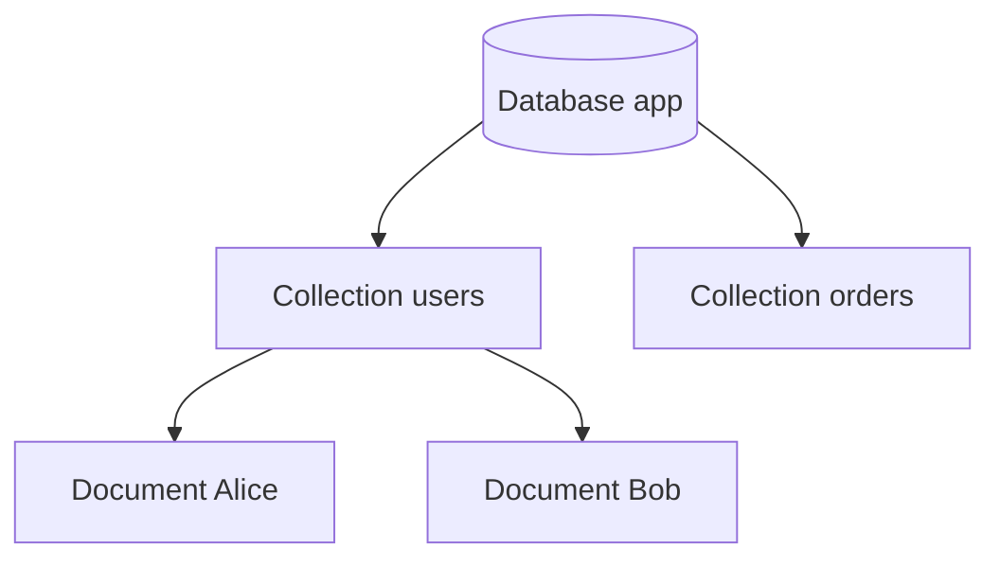

# MongoDB basics

---

## 🟢 Junior Level

### 1. What is MongoDB?

MongoDB is the most popular **document database**. Instead of rows in tables it stores **documents** (JSON-like objects) in **collections**, inside **databases**.

| Relational | MongoDB |
| :--- | :--- |
| Database | Database |
| Table | Collection |
| Row | Document |
| Column | Field |
| Primary key | `_id` (always present, unique per collection) |
| Join | `$lookup` or embedding |

Documents are stored as **BSON** (Binary JSON): JSON plus extra types such as `ObjectId`, `Date`, `Decimal128`, `Binary`, `Int64`. BSON is traversable (length-prefixed) so the server skips fields quickly. Maximum document size is **16 MB**.

**Analogy:** a collection is a drawer; each document is a form that can have different fields filled in.

```json
{
  "_id": { "$oid": "665f1c2e9b1e8a3d4c5b6a7f" },
  "name": "Alice",
  "email": "alice@example.com",
  "age": 31,
  "addresses": [ { "city": "Berlin", "primary": true } ],
  "createdAt": { "$date": "2025-01-15T10:00:00Z" }
}
```

### 2. Basic CRUD with the Java sync driver

```java
import com.mongodb.client.*;
import org.bson.Document;
import static com.mongodb.client.model.Filters.*;
import static com.mongodb.client.model.Updates.*;

public class MongoBasics {
    public static void main(String[] args) {
        try (MongoClient client = MongoClients.create("mongodb://localhost:27017")) {
            MongoCollection<Document> users = client.getDatabase("app").getCollection("users");

            users.insertOne(new Document("name", "Alice").append("age", 31));          // Create
            Document found = users.find(eq("name", "Alice")).first();                  // Read
            users.updateOne(eq("name", "Alice"), set("age", 32));                      // Update
            users.deleteOne(eq("name", "Alice"));                                      // Delete
            System.out.println(found.toJson());
        }
    }
}
```



> [!IMPORTANT]
> Create `MongoClient` **once** per application (it holds a connection pool and is thread-safe), never per request.

---

## 🟡 Middle Level

### 1. Schema flexibility and validation

Collections do not enforce a schema by default, but you can add **JSON Schema validation**:

```javascript
db.createCollection("users", {
  validator: { $jsonSchema: {
    bsonType: "object",
    required: ["email", "createdAt"],
    properties: {
      email:     { bsonType: "string", pattern: "^.+@.+$" },
      age:       { bsonType: "int", minimum: 0 },
      createdAt: { bsonType: "date" }
    }
  } },
  validationLevel: "strict",
  validationAction: "error"
});
```

### 2. The `_id` and ObjectId

`ObjectId` is 12 bytes: 4-byte timestamp, 5-byte random value (per process), 3-byte counter. It is roughly monotonic, so inserts append to the right of the `_id` B-tree (cache friendly) and it can be generated client-side without coordination. It leaks creation time - do not use it as a secret token.

### 3. Query operators

| Category | Operators |
| :--- | :--- |
| Comparison | `$eq $ne $gt $gte $lt $lte $in $nin` |
| Logical | `$and $or $not $nor` |
| Element | `$exists $type` |
| Array | `$all $elemMatch $size` |
| Update | `$set $unset $inc $push $pull $addToSet $rename` |

```java
// Array query with $elemMatch and atomic update operators
users.updateOne(
    and(eq("_id", id), elemMatch("addresses", and(eq("city", "Berlin"), eq("primary", true)))),
    combine(inc("loginCount", 1), push("tags", "vip"), currentDate("lastLogin")));
```

### 4. Atomicity and durability basics

Writes to a **single document** (including nested arrays) are atomic. Durability is controlled by **write concern** (`w:1`, `w:"majority"`, `j:true`); read isolation by **read concern** (`local`, `majority`, `snapshot`).

### 5. Common mistakes

1. **Unbounded arrays** (e.g., all comments in a post) that grow to MBs: documents are rewritten on growth and may hit 16 MB.
2. **Missing indexes**: every query without an index is a collection scan. Check with `explain("executionStats")`.
3. **Field names stored in every document**: very long names waste space at scale.
4. **Storing money as `double`**: use `Decimal128` or integer cents.
5. **Creating a new `MongoClient` per request** - connection storms.
6. Using `ObjectId` string vs real ObjectId inconsistently, so queries silently match nothing.

### 6. Storage engine

Default **WiredTiger**: B-tree based, document-level concurrency control (MVCC), compression (snappy by default for collections, zstd optional), write-ahead journal and checkpoints every 60 s. Memory: WiredTiger cache defaults to the larger of 50% of (RAM - 1 GB) or 256 MB.

---

## 🔴 Senior Level

### 1. Reading an explain plan

```java
Document explain = users.find(and(eq("status", "ACTIVE"), gt("age", 30)))
    .sort(Sorts.descending("createdAt"))
    .explain(ExplainVerbosity.EXECUTION_STATS);
```

Key signals in `executionStats`:

- `totalDocsExamined` vs `nReturned` - ideal ratio near 1.
- `stage: COLLSCAN` - no index used.
- `stage: SORT` with `usedDisk: true` - in-memory sort exceeded 100 MB; add an index covering the sort.
- `executionTimeMillis` and `keysExamined`.

### 2. Operational diagnostics

| Tool | Purpose |
| :--- | :--- |
| `db.currentOp()` | Long-running operations |
| Database profiler (`db.setProfilingLevel(1, { slowms: 100 })`) | Capture slow queries |
| `db.collection.stats()` / `$collStats` | Size, index sizes |
| `mongostat`, `mongotop` | Throughput and contention |
| Atlas Performance Advisor | Index suggestions |

### 3. Performance guidance

- Working set (hot data + indexes) should fit in RAM; if cache eviction is high (`wiredTiger.cache` "pages read into cache" climbing) you are memory-bound.
- Prefer **projection** to cut network and deserialisation costs.
- Use **bulk writes** (`bulkWrite`, ordered=false) for ingest: 10-50x faster than per-document inserts.

```java
List<WriteModel<Document>> ops = new ArrayList<>();
for (Event e : events) {
    ops.add(new InsertOneModel<>(new Document("deviceId", e.deviceId()).append("ts", e.ts())));
}
events_col.bulkWrite(ops, new BulkWriteOptions().ordered(false));
```

- Pool sizing: `maxPoolSize` default 100 per server; for thousands of app instances connection counts (each ~1 MB server-side) become the bottleneck - use `maxPoolSize` and `maxIdleTimeMS` sensibly.

### 4. Edge cases

- **Schema drift**: documents of different shapes break deserialisation; keep a `schemaVersion` field.
- **Document growth and the padding myth**: WiredTiger rewrites the document on growth; keep hot documents small.
- **Dates**: BSON date is UTC milliseconds; time zones belong in the app layer.
- **`$where` and JS execution** are slow and injection-prone; avoid. Never build queries by concatenating user input (NoSQL injection with `{"$ne": null}`), always bind typed values.

---

## 🎯 Interview Cheat Sheet

### 30-second pitch
"MongoDB is a document database storing BSON documents in collections. It gives flexible schemas, rich queries and secondary indexes, atomic single-document writes, and built-in replication and sharding. The main skill is modelling documents around access patterns and indexing them properly."

### Must-know bullets
- Database -> collection -> document; `_id` is mandatory and unique.
- BSON adds types like ObjectId, Date, Decimal128; max document 16 MB.
- Single-document operations are atomic.
- WiredTiger: document-level locking, compression, journal.
- One `MongoClient` per application.
- Always check `explain()` for index use.

### Common follow-ups
- What is BSON and how does it differ from JSON?
- What does ObjectId contain?
- How do you enforce a schema in MongoDB?
- Why avoid unbounded arrays?

### 🚩 Red flags
- "MongoDB is schemaless so no modelling needed."
- No indexes beyond `_id` on a large collection.
- Floating-point types for money.

### Related topics
- [MongoDB data modeling embed vs reference](07.%20MongoDB%20data%20modeling%20embed%20vs%20reference.md)
- [MongoDB indexes and aggregation pipeline](08.%20MongoDB%20indexes%20and%20aggregation%20pipeline.md)
- [Spring Data MongoDB](10.%20Spring%20Data%20MongoDB.md)
