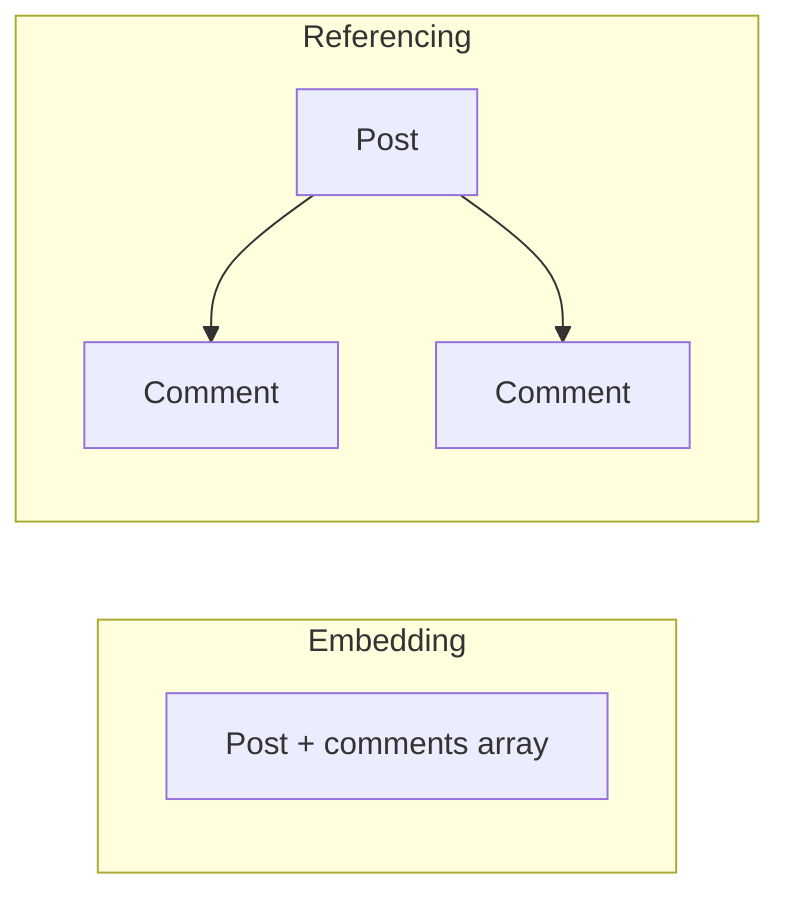

# MongoDB data modeling embed vs reference

---

## 🟢 Junior Level

### 1. The core question

When two pieces of data are related (a blog **post** and its **comments**, a **user** and their **addresses**), you choose between:

- **Embedding**: store the related data *inside* the parent document.
- **Referencing**: store it in a separate collection and keep an id pointing to it.

**Analogy:** Embedding is stapling the receipt to the expense report. Referencing is writing "see receipt #1234 in the filing cabinet".

### 2. Embedded example

```java
record Address(String street, String city, String zip) {}
record Customer(String id, String name, List<Address> addresses) {}
// One read returns the customer with all addresses.
```

```json
{ "_id": "c1", "name": "Alice",
  "addresses": [ { "city": "Berlin", "zip": "10115" }, { "city": "Paris", "zip": "75001" } ] }
```

### 3. Referenced example

```java
record Author(String id, String name) {}
record Book(String id, String title, String authorId) {}   // authorId references Author
```



### 4. Rule of thumb

| Choose embed when | Choose reference when |
| :--- | :--- |
| Data is read together | Data is read independently |
| One-to-few relationship | One-to-many (huge) or many-to-many |
| Child has no meaning outside parent | Child is shared by many parents |
| Child changes rarely | Child changes frequently on its own |

---

## 🟡 Middle Level

### 1. Relationship patterns

| Relationship | Typical model |
| :--- | :--- |
| One-to-one | Embed (or subdocument) |
| One-to-few (<~100) | Embed array |
| One-to-many (hundreds to thousands) | Reference, child stores parent id; or array of child ids |
| One-to-squillions (logs, events) | Child stores parent id, **never** array in parent |
| Many-to-many | Arrays of ids on one or both sides, or a junction collection |

### 2. Useful design patterns

- **Subset pattern**: embed only the 10 latest comments in the post; keep the full set in a `comments` collection.
- **Extended reference**: copy a few stable fields (author name) into the child to avoid `$lookup`. Accept duplication.
- **Bucket pattern**: group time-series points into one document per device per hour (`{deviceId, hour, readings: [...]}`), reducing document count and index size.
- **Computed pattern**: store precomputed `commentCount`, `totalPrice`, updated atomically with `$inc`.
- **Polymorphic pattern**: one collection with a `type` discriminator for related but different shapes.
- **Schema versioning**: a `schemaVersion` field plus lazy upgrade.

### 3. Spring Data example: embed with subset pattern

```java
@Document("posts")
public record Post(
    @Id String id,
    String title,
    String authorId,
    String authorName,              // extended reference (denormalised)
    List<CommentSnippet> latestComments,  // subset pattern
    int commentCount) {

    public record CommentSnippet(String commentId, String author, String text, Instant at) {}
}

@Document("comments")
@CompoundIndex(name = "post_time", def = "{'postId': 1, 'createdAt': -1}")
public record Comment(@Id String id, String postId, String author, String text, Instant createdAt) {}
```

Adding a comment updates both atomically *per document*:

```java
public void addComment(Comment c) {
    mongoTemplate.insert(c);
    Update u = new Update()
        .inc("commentCount", 1)
        .push("latestComments").slice(-10)
        .each(new Post.CommentSnippet(c.id(), c.author(), c.text(), c.createdAt()));
    mongoTemplate.updateFirst(Query.query(Criteria.where("_id").is(c.postId())), u, Post.class);
}
```

(The two writes are not atomic together unless wrapped in a transaction; design the code to be idempotent or repairable.)

### 4. Common mistakes

1. **Unbounded array growth** (embedding all events/comments) leading to 16 MB limit and slow updates.
2. **Over-normalising** like SQL, then calling `$lookup` for every request.
3. **Over-denormalising** data that changes often (user display names copied to millions of documents).
4. **Embedding data that is queried alone**, forcing scanning of parents.
5. Ignoring **update atomicity**: only single-document updates are atomic by default.

---

## 🔴 Senior Level

### 1. Model from the workload

Process:
1. List the top queries and their frequency, latency target and read:write ratio.
2. Pick the aggregate that satisfies the *hottest* queries in one document read.
3. Validate document size growth (average and 99th percentile), array growth, and update frequency.
4. Decide the consistency price of every duplicate field (who updates it, how stale may it be).
5. Index for the queries, then iterate with real data.

### 2. Internals that affect the model

- WiredTiger rewrites the **whole document** (copy-on-write at page level) when it changes; large documents with small frequent updates amplify I/O. Split hot, tiny fields (counters) from large cold blobs.
- The cache stores uncompressed pages; larger documents reduce cache efficiency.
- Arrays: indexed arrays create a **multikey index** with one entry per element - a 1,000-element array creates 1,000 index entries per document; compound multikey indexes cannot index two parallel arrays.
- 16 MB limit; for large binaries use GridFS or object storage.

### 3. Handling denormalised data updates

```java
// When an author renames, propagate with a bulk update; tolerate staleness via a background job
Query q = Query.query(Criteria.where("authorId").is(authorId));
Update u = Update.update("authorName", newName);
UpdateResult r = mongoTemplate.updateMulti(q, u, Post.class);   // many documents, not atomic as a whole
```

On a large collection, run in batches (by `_id` ranges), throttled, to avoid replication lag spikes. Consider change streams to drive propagation reliably:

```java
mongoTemplate.getCollection("authors").watch(List.of(
        Aggregates.match(Filters.eq("operationType", "update"))))
    .forEach(change -> propagateRename(change));
```

### 4. Production scenario: time-series buckets

Raw design: 1 document per reading, 10k devices x 1 Hz x 1 year = 315 billion docs. Bucket design: one doc per device per hour with an array of 3,600 readings (~100 KB), giving ~88 million docs and a far smaller index. Since MongoDB 5.0, native **time series collections** do bucketing, compression and TTL for you:

```javascript
db.createCollection("readings", {
  timeseries: { timeField: "ts", metaField: "deviceId", granularity: "seconds" },
  expireAfterSeconds: 7776000   // 90 days
});
```

### 5. Edge cases

- Many-to-many via two-way id arrays duplicates truth; pick one owner side and derive the other with an index (`{ tagIds: 1 }`).
- `$lookup` on a sharded foreign collection is supported only in newer versions (5.1+ for sharded `from`), and it is still costly; prefer denormalisation for hot paths.
- Anti-pattern: **massive number of collections** (>10k), which exhausts file handles because each collection and index is a file.

---

## 🎯 Interview Cheat Sheet

### 30-second pitch
"In MongoDB I model for access patterns: embed data that is read together and bounded in size, reference data that is large, shared, or changes independently. I use patterns like subset, bucket, extended reference and computed fields, and I weigh duplication costs against saved joins."

### Must-know bullets
- Embed for one-to-few, reference for one-to-many and many-to-many.
- Never use unbounded arrays; 16 MB document limit.
- Single-document atomicity is the biggest benefit of embedding.
- Denormalisation = faster reads, harder updates.
- Multikey indexes create one entry per array element.

### Common follow-ups
- Model a blog with posts, comments and authors.
- How do you keep denormalised data in sync?
- When would you use `$lookup`?
- What is the bucket pattern?

### 🚩 Red flags
- Mirroring a 3NF SQL schema in MongoDB.
- Embedding "everything" in one giant document.

### Related topics
- [MongoDB basics](06.%20MongoDB%20basics.md)
- [MongoDB indexes and aggregation pipeline](08.%20MongoDB%20indexes%20and%20aggregation%20pipeline.md)
- [Data modeling for access patterns and SQL to NoSQL migration pitfalls](20.%20Data%20modeling%20for%20access%20patterns%20and%20SQL%20to%20NoSQL%20migration%20pitfalls.md)
