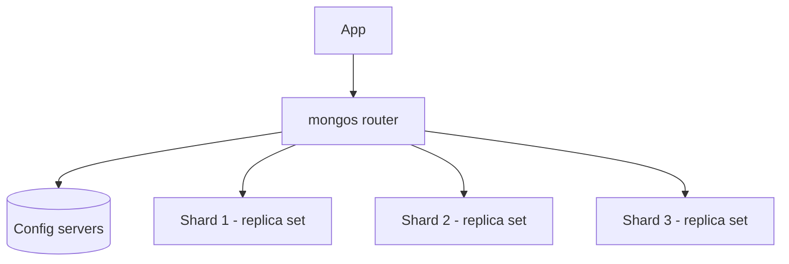

# MongoDB replica sets sharding and transactions

---

## 🟢 Junior Level

### 1. Replica set

A **replica set** is a group of MongoDB servers holding the same data. One is the **primary** (accepts writes); the others are **secondaries** that copy the primary's operations from its **oplog**. If the primary dies, the secondaries **elect** a new one automatically (typically within 10-12 seconds). Purpose: **high availability and redundancy**.

**Analogy:** a head chef (primary) and sous-chefs (secondaries) copying the recipe book. If the head chef falls ill, the sous-chefs vote for a new head.

### 2. Sharding

**Sharding** splits one huge collection across multiple replica sets (**shards**) so storage and throughput scale horizontally. A **shard key** decides which shard owns a document. Purpose: **horizontal scalability**.



### 3. Transactions

Operations on one document are always atomic. **Multi-document ACID transactions** (replica sets since 4.0, sharded clusters since 4.2) let several writes commit or abort together.

```java
try (ClientSession session = client.startSession()) {
    session.withTransaction(() -> {
        accounts.updateOne(session, Filters.eq("_id", "A"), Updates.inc("balance", -100));
        accounts.updateOne(session, Filters.eq("_id", "B"), Updates.inc("balance", 100));
        return null;
    });
}
```

Connection string for a replica set: `mongodb://h1:27017,h2:27017,h3:27017/?replicaSet=rs0`.

---

## 🟡 Middle Level

### 1. Replica set details

- Recommended: **3 voting members** (odd number); max 50 members, 7 voting.
- Member types: primary, secondary, **arbiter** (votes only, holds no data - discouraged), hidden, delayed (point-in-time safety), priority-0.
- Election uses a Raft-like protocol (PV1). A candidate needs a **majority of voting members**; a primary that loses majority steps down.
- **Rollback**: writes acknowledged only by the old primary (`w:1`) may be rolled back after failover. Use `w: "majority"` to avoid loss.

| Concern | Options | Meaning |
| :--- | :--- | :--- |
| Write concern | `w:1`, `w:"majority"`, `j:true`, `wtimeout` | Acks required before success |
| Read concern | `local`, `available`, `majority`, `linearizable`, `snapshot` | Visibility/durability of data read |
| Read preference | `primary`, `primaryPreferred`, `secondary`, `secondaryPreferred`, `nearest` | Which node serves reads |

Since 5.0 the default write concern is `majority`, if the deployment has no arbiter.

### 2. Sharding details

Components: **mongos** (stateless router), **config servers** (a replica set holding metadata), **shards** (each a replica set). Data is divided into **chunks** (default 128 MB); the **balancer** migrates chunks to keep distribution even.

Shard key strategies:

| Strategy | Pros | Cons |
| :--- | :--- | :--- |
| **Hashed** (`{userId: "hashed"}`) | Even distribution, no hot shard | Range queries are scatter-gather |
| **Ranged** (`{tenantId:1, ts:1}`) | Efficient range/targeted queries | Monotonic keys (timestamp, ObjectId) create a **hot shard** |
| **Compound** | Targeted + well-distributed | Needs careful design |

A good shard key has **high cardinality**, **low frequency** (no single value dominating), and **non-monotonic** growth, and matches the common query filters so that queries are *targeted* instead of *scatter-gather*. Since 5.0 you can **reshard** online (`reshardCollection`) and change the shard key; since 4.4 you can refine the key by adding suffix fields.

```javascript
sh.enableSharding("shop");
sh.shardCollection("shop.orders", { customerId: "hashed" });
```

### 3. Transactions in Spring

```java
@Configuration
class TxConfig {
    @Bean
    MongoTransactionManager transactionManager(MongoDatabaseFactory dbFactory) {
        return new MongoTransactionManager(dbFactory);
    }
}

@Service
class TransferService {
    private final MongoTemplate template;
    TransferService(MongoTemplate template) { this.template = template; }

    @Transactional
    public void transfer(String from, String to, long cents) {
        template.update(Account.class).matching(Query.query(Criteria.where("id").is(from)
                .and("balance").gte(cents))).apply(new Update().inc("balance", -cents)).first();
        template.update(Account.class).matching(Query.query(Criteria.where("id").is(to)))
                .apply(new Update().inc("balance", cents)).first();
    }
}
```

Transactions require a replica set (even a single-node `--replSet` in dev/tests, e.g., Testcontainers `MongoDBContainer`). Standalone servers throw "Transaction numbers are only allowed on a replica set member".

### 4. Common mistakes

1. Using **monotonically increasing shard keys** (ObjectId, timestamp) with range sharding -> all inserts go to one shard.
2. Treating transactions as a replacement for modelling: if you need multi-document transactions constantly, your model is probably wrong.
3. Running two-member replica sets (no fault tolerance: the loss of one means no majority).
4. Reading from secondaries and expecting fresh data.
5. Long transactions (default limit 60 s) - cache pressure and write conflicts.
6. Forgetting retry logic: `TransientTransactionError` and `UnknownTransactionCommitResult` must be retried (the driver's `withTransaction` helper does it).

---

## 🔴 Senior Level

### 1. Oplog and replication internals

- The **oplog** (`local.oplog.rs`) is a capped collection of idempotent operations; secondaries tail it and apply with batching and parallel writers (by `_id` hash).
- Oplog window = size / write rate. A secondary that falls behind the window needs a full **initial sync**. Size the oplog for at least 24-72 h of peak writes; monitor `rs.printReplicationInfo()`.
- **Flow control** (4.2+) throttles the primary when majority-commit lag grows.
- **Majority commit point** is the basis for `readConcern: "majority"`; WiredTiger keeps snapshots at that point (cost: cache pressure when lag is large).

### 2. Sharded-cluster production concerns

- **Jumbo chunks** (single shard-key value exceeding chunk size) cannot be split or moved; fix by a more granular compound key.
- **Balancer windows**: schedule off-peak (`sh.setBalancerState`, balancer window in config) because migrations consume network and I/O.
- **Targeted vs scatter-gather**: always include the shard key (or a prefix) in queries/updates; check with `explain()` for `SINGLE_SHARD` vs `SHARD_MERGE`.
- **Unique indexes** on sharded collections must include the shard key as prefix (or use `_id` rules).
- **Hot shards** from skewed workloads: pre-split and zone sharding (`sh.updateZoneKeyRange`) for data locality (e.g., EU users on EU shards, GDPR).
- Multi-shard transactions use a 2PC-style coordinator with extra latency; avoid in hot paths. Since 8.0, improved bulk writes and `moveCollection`/unsharded-collection placement exist.

```java
// Retry wrapper for the commit unknown-state case using the driver's helper
TransactionOptions opts = TransactionOptions.builder()
    .readConcern(ReadConcern.SNAPSHOT)
    .writeConcern(WriteConcern.MAJORITY)
    .maxCommitTime(5L, TimeUnit.SECONDS)
    .build();
session.withTransaction(() -> { /* idempotent work */ return null; }, opts);
```

### 3. Failover behaviour and the application

- Enable **retryable writes** (`retryWrites=true`, default in modern drivers) to retry once across an election, transparently, with exactly-once semantics for supported ops.
- Set `serverSelectionTimeoutMS` (default 30 s) to something lower for fast failure and implement circuit breakers.
- Test with step-down: `rs.stepDown()` while load testing; confirm no write loss with `w:majority`.

### 4. Diagnostics checklist

| Symptom | Check |
| :--- | :--- |
| Replication lag | `rs.status()` optimeDate diff, disk I/O, long-running index builds |
| Elections flapping | Network latency, `electionTimeoutMillis`, resource starvation |
| Uneven shards | `sh.status()`, `db.collection.getShardDistribution()` |
| Slow transactions | `serverStatus().transactions`, write conflicts (`WriteConflict` error 112) |
| Cache pressure | `wiredTiger.cache` dirty bytes / `tracked dirty bytes` |

### 5. Edge cases

- **Arbiters** with `w:majority` can cause data loss risk and stalled majority commit when a data-bearing node is down (3-node PSA).
- Changing shard key on huge collections is expensive: resharding copies all data, needs ~1.2x storage and maintenance windows.
- Causal consistency across mongos requires a client session carrying `clusterTime`.

---

## 🎯 Interview Cheat Sheet

### 30-second pitch
"A replica set gives high availability: one primary, several secondaries, automatic Raft-style elections, and majority write concern to avoid rollback. Sharding adds horizontal scale through mongos routing and a well-chosen shard key. Multi-document transactions exist, but I model around single-document atomicity first."

### Must-know bullets
- 3+ voting members; majority needed to elect a primary.
- `w:"majority"` prevents rollback; `readConcern: majority/snapshot` for safe reads.
- Shard key quality = cardinality, frequency, monotonicity, query targeting.
- Components: mongos, config servers, shards, balancer, chunks.
- Transactions need a replica set; retry transient errors; keep them short.

### Common follow-ups
- What happens when the primary fails mid-write?
- Hashed vs ranged shard key?
- How do you handle a hot shard?
- Why does a 2-node replica set not help?
- How do you test transactions locally?

### 🚩 Red flags
- Sharding before exhausting vertical scaling, indexing and caching.
- Using `ObjectId` or timestamp as ranged shard key.
- Defaulting to `w:1` for important data.

### Related topics
- [MongoDB basics](06.%20MongoDB%20basics.md)
- [Consistency models](05.%20Consistency%20models%20eventual%20causal%20and%20strong.md)
- [Sharding and partitioning strategies](21.%20Sharding%20and%20partitioning%20strategies.md)
- [Replication strategies](22.%20Replication%20strategies.md)
- [Spring Data MongoDB](10.%20Spring%20Data%20MongoDB.md)
