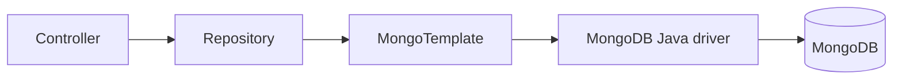

# Spring Data MongoDB

---

## 🟢 Junior Level

### 1. What is Spring Data MongoDB?

**Spring Data MongoDB** is the Spring module that maps Java objects to MongoDB documents and gives you repositories so you rarely write driver code. Add the starter:

```xml
<dependency>
    <groupId>org.springframework.boot</groupId>
    <artifactId>spring-boot-starter-data-mongodb</artifactId>
</dependency>
```

```yaml
spring:
  data:
    mongodb:
      uri: mongodb://localhost:27017/shop
```

Boot auto-configures `MongoClient`, `MongoTemplate` and repositories.

### 2. Minimal working example

```java
import org.springframework.data.annotation.Id;
import org.springframework.data.mongodb.core.mapping.Document;
import org.springframework.data.mongodb.repository.MongoRepository;
import java.util.List;

@Document("products")
public record Product(@Id String id, String name, double price, String category) {}

public interface ProductRepository extends MongoRepository<Product, String> {
    List<Product> findByCategory(String category);                  // derived query
    List<Product> findByPriceBetweenOrderByPriceAsc(double min, double max);
}
```

```java
@RestController
@RequestMapping("/products")
class ProductController {
    private final ProductRepository repo;
    ProductController(ProductRepository repo) { this.repo = repo; }

    @PostMapping Product create(@RequestBody Product p) { return repo.save(p); }
    @GetMapping List<Product> byCategory(@RequestParam String category) { return repo.findByCategory(category); }
}
```



> [!IMPORTANT]
> Records work as immutable documents (Spring Data 3.x supports constructor-based mapping). A `null` `id` makes Mongo generate an `ObjectId` on save.

---

## 🟡 Middle Level

### 1. Mapping annotations

| Annotation | Purpose |
| :--- | :--- |
| `@Document("coll")` | Collection name |
| `@Id` | `_id` mapping (String maps to ObjectId when valid hex) |
| `@Field("n")` | Custom field name |
| `@Indexed`, `@CompoundIndex`, `@TextIndexed` | Index declaration |
| `@Transient` | Not persisted |
| `@DBRef` | Reference (discouraged; lazy and extra queries) |
| `@Version` | Optimistic locking |
| `@CreatedDate`, `@LastModifiedDate` | Auditing (`@EnableMongoAuditing`) |
| `@TypeAlias` | Stable type name in `_class` field |

### 2. Repository query options

```java
public interface OrderRepository extends MongoRepository<OrderDoc, String> {

    // 1. Derived
    List<OrderDoc> findByCustomerIdAndStatus(String customerId, String status);

    // 2. JSON @Query with positional parameters
    @Query("{ 'status': ?0, 'total': { $gte: ?1 } }")
    List<OrderDoc> findBigOrders(String status, long minTotal);

    // 3. Projection
    @Query(value = "{ 'customerId': ?0 }", fields = "{ 'status': 1, 'total': 1 }")
    List<OrderDoc> findSummaries(String customerId);

    // 4. Aggregation
    @Aggregation("{ $group: { _id: '$status', count: { $sum: 1 } } }")
    List<StatusCount> countByStatus();

    // 5. Paging
    Page<OrderDoc> findByCustomerId(String customerId, Pageable pageable);

    // 6. Interface projection and streams
    Stream<OrderSummary> streamByStatus(String status);
}

public interface OrderSummary { String getId(); long getTotal(); }
public record StatusCount(String id, long count) {}
```

### 3. MongoTemplate for dynamic and atomic operations

Repositories are great for CRUD; use `MongoTemplate` for partial and atomic updates (avoid read-modify-write races):

```java
@Service
class StockService {
    private final MongoTemplate template;
    StockService(MongoTemplate template) { this.template = template; }

    public boolean reserve(String sku, int qty) {
        Query q = Query.query(Criteria.where("sku").is(sku).and("available").gte(qty));
        Update u = new Update().inc("available", -qty).inc("reserved", qty);
        return template.updateFirst(q, u, "inventory").getModifiedCount() == 1;
    }

    public List<Product> search(String category, Double maxPrice) {
        Criteria c = new Criteria();
        if (category != null) c = c.and("category").is(category);
        if (maxPrice != null) c = c.and("price").lte(maxPrice);
        return template.find(new Query(c).limit(50), Product.class);
    }
}
```

### 4. Auditing, optimistic locking, indexes

```java
@Configuration
@EnableMongoAuditing
class MongoConfig {}

@Document("accounts")
class Account {
    @Id String id;
    @Version Long version;               // OptimisticLockingFailureException on conflict
    @CreatedDate Instant created;
    @LastModifiedDate Instant modified;
    long balance;
}
```

Boot 3: index auto-creation is off by default; enable `spring.data.mongodb.auto-index-creation=true` for dev, manage via migrations (Mongock, mongosh scripts) for prod.

### 5. Reactive variant

`spring-boot-starter-data-mongodb-reactive` provides `ReactiveMongoRepository` and `ReactiveMongoTemplate` returning `Mono`/`Flux`, backed by the reactive streams driver. Use only if the whole stack is reactive (WebFlux); mixing blocks the event loop. Virtual threads (Java 21) with the sync driver are often a simpler alternative.

### 6. Common mistakes

1. `save()` on an entity with a pre-set `@Id` performs upsert-like replace of the whole document, overwriting concurrent changes. Use `@Version` or `update`.
2. **Loading entire documents** when only two fields are needed - use projections.
3. Overusing `@DBRef`: it triggers extra queries; prefer storing ids and fetching explicitly.
4. `findAll()` on big collections without paging.
5. Forgetting the `_class` field creates coupling to class names; use `@TypeAlias` or remove via `MappingMongoConverter.setTypeMapper(new DefaultMongoTypeMapper(null))`.
6. Using `Double` for money; use `Decimal128`/`BigDecimal` (Spring maps `BigDecimal` to String by default; configure `MongoCustomConversions` with `BigDecimalDecimal128Converter` (`MongoCustomConversions.MongoConverterConfigurationAdapter#bigDecimal(BigDecimalRepresentation.DECIMAL128)`).

---

## 🔴 Senior Level

### 1. Configuring the driver properly

```java
@Configuration
class MongoClientConfig {
    @Bean
    MongoClientSettingsBuilderCustomizer customizer() {
        return builder -> builder
            .applyToConnectionPoolSettings(p -> p.maxSize(50).minSize(5)
                .maxConnectionIdleTime(5, java.util.concurrent.TimeUnit.MINUTES))
            .applyToClusterSettings(c -> c.serverSelectionTimeout(5, java.util.concurrent.TimeUnit.SECONDS))
            .readPreference(com.mongodb.ReadPreference.primaryPreferred())
            .writeConcern(com.mongodb.WriteConcern.MAJORITY)
            .retryWrites(true);
    }

    @Bean
    MongoCustomConversions conversions() {
        return MongoCustomConversions.create(a -> a.
            bigDecimal(MongoCustomConversions.BigDecimalRepresentation.DECIMAL128));
    }
}
```

### 2. Observability

- Enable Micrometer command metrics: Spring Boot auto-configures `MongoMetricsCommandListener` and connection pool metrics (`mongodb.driver.commands`, `mongodb.driver.pool.*`) when Actuator and Micrometer are present.
- Log slow queries: `logging.level.org.springframework.data.mongodb.core.MongoTemplate=DEBUG` (development only).
- Add the `@Query` JSON carefully: it is **string-templated with bound parameters**; never concatenate user input into JSON (NoSQL injection).

### 3. Transactions and change streams

```java
@Bean
MongoTransactionManager txManager(MongoDatabaseFactory f) { return new MongoTransactionManager(f); }

// Change stream consumer (sync) with resume token handling
@Bean
MessageListenerContainer container(MongoTemplate template) {
    var container = new DefaultMessageListenerContainer(template);
    container.register(
        ChangeStreamRequest.builder(
            (MessageListener<ChangeStreamDocument<Document>, Product>) m ->
                log.info("Changed: {}", m.getBody()))
            .collection("products")
            .filter(Aggregation.newAggregation(Aggregation.match(Criteria.where("operationType").in("insert", "update"))))
            .build(),
        Product.class);
    container.start();
    return container;
}
```

Persist the **resume token** so the consumer can recover after restarts without missing events (oplog window permitting).

### 4. Testing

```java
@Testcontainers
@DataMongoTest
class ProductRepositoryTest {
    @Container @ServiceConnection
    static MongoDBContainer mongo = new MongoDBContainer("mongo:7.0");

    @Autowired ProductRepository repo;

    @Test void findsByCategory() {
        repo.save(new Product(null, "Pen", 1.5, "office"));
        assertThat(repo.findByCategory("office")).hasSize(1);
    }
}
```

`MongoDBContainer` starts a single-node replica set, so transactions and change streams work.

### 5. Performance tips

- Use `bulkOps(BulkMode.UNORDERED, ...)` for batch inserts/upserts.
- Fetch large result sets with `Stream` / `ScrollPosition` (keyset `Window` API in Spring Data 3.1+) instead of offset paging.
- Keep entities small; avoid mapping giant nested trees you don't use (use projections).
- `MappingMongoConverter` reflection cost is minimal due to generated accessors, but custom converters on hot paths should be stateless and cached.

```java
Window<OrderDoc> first = repo.findFirst10ByStatusOrderByCreatedAt("OPEN", ScrollPosition.keyset());
Window<OrderDoc> next = repo.findFirst10ByStatusOrderByCreatedAt("OPEN", first.positionAt(first.size() - 1));
```

### 6. Edge cases

- `@Id String` mapping: a 24-hex string converts to `ObjectId` in storage; a non-hex string is stored as-is. Mixed ids cause "not found" surprises.
- Polymorphic collections require stable `_class` aliases or you will hit `MappingInstantiationException` when classes are renamed.
- Sharded collection `save()` with shard-key change is rejected (shard key immutability pre-4.2).

---

## 🎯 Interview Cheat Sheet

### 30-second pitch
"Spring Data MongoDB maps POJOs or records to documents and generates repositories with derived, JSON and aggregation queries. For atomic partial updates and dynamic criteria I drop to MongoTemplate. In production I configure write concern, retry writes, pool sizes, optimistic locking, manage indexes explicitly and test with a Testcontainers replica set."

### Must-know bullets
- `MongoRepository` for CRUD/derived queries; `MongoTemplate` for dynamic and atomic updates.
- `@Version` for optimistic locking; `@EnableMongoAuditing` for audit fields.
- Index auto-creation is off by default in Boot 3.
- Transactions require `MongoTransactionManager` and a replica set.
- Avoid `@DBRef`; use projections; use keyset pagination.

### Common follow-ups
- How do you make a stock decrement atomic?
- What is the `_class` field?
- Repository vs `MongoTemplate`?
- How do you test with real MongoDB?

### 🚩 Red flags
- Read-modify-write on hot documents.
- Building `@Query` strings by concatenation.
- Running `findAll()` in controllers.

### Related topics
- [MongoDB basics](06.%20MongoDB%20basics.md)
- [MongoDB indexes and aggregation pipeline](08.%20MongoDB%20indexes%20and%20aggregation%20pipeline.md)
- [MongoDB replica sets, sharding and transactions](09.%20MongoDB%20replica%20sets%20sharding%20and%20transactions.md)
