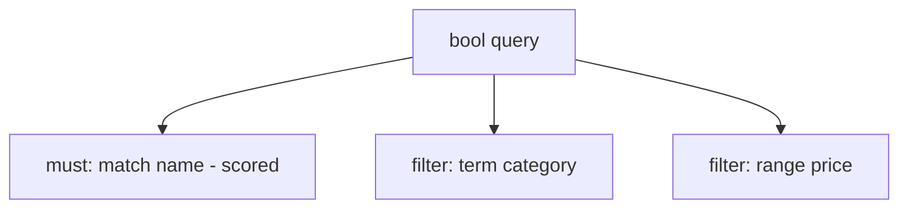

# Elasticsearch queries and mapping

---

## 🟢 Junior Level

### 1. Mapping = the schema of an index

A **mapping** defines each field's type and how it is indexed. The two string types you must know:

| Type | Analyzed? | Use |
| :--- | :--- | :--- |
| `text` | Yes (tokenized) | Full-text search ("quick brown fox") |
| `keyword` | No (exact value) | Filtering, sorting, aggregations, ids, emails, enums |

Others: `integer`, `long`, `double`, `scaled_float`, `boolean`, `date`, `object`, `nested`, `geo_point`, `dense_vector`.

```json
PUT /products
{
  "mappings": {
    "properties": {
      "name":      { "type": "text", "fields": { "raw": { "type": "keyword" } } },
      "category":  { "type": "keyword" },
      "price":     { "type": "scaled_float", "scaling_factor": 100 },
      "createdAt": { "type": "date" }
    }
  }
}
```

### 2. Your first queries

```json
GET /products/_search
{
  "query": {
    "bool": {
      "must":   [ { "match": { "name": "wireless mouse" } } ],
      "filter": [ { "term": { "category": "electronics" } },
                  { "range": { "price": { "lte": 50 } } } ]
    }
  }
}
```

- `match` - full-text query on analyzed fields, scored.
- `term` - exact value, for keyword/numeric fields, not analyzed.
- `bool` - combines `must` (AND, scored), `filter` (AND, unscored, cached), `should` (OR), `must_not`.



---

## 🟡 Middle Level

### 1. Query vs filter context

Clauses in **query context** compute a relevance `_score`; clauses in **filter context** only answer yes/no, are cacheable and faster. Rule: *use `filter` for everything that is not full-text relevance* (category, status, date range, tenant id).

### 2. Common query types

| Query | Purpose |
| :--- | :--- |
| `match`, `match_phrase`, `multi_match` | Full-text; phrase and multi-field with boosts |
| `term`, `terms`, `range`, `exists`, `prefix`, `wildcard` | Structured/exact |
| `fuzzy` / `match` with `fuzziness: AUTO` | Typo tolerance |
| `nested` | Query array-of-objects while preserving field correlation |
| `function_score` | Custom ranking (recency decay, popularity) |
| `knn` | Vector search |
| `aggs` | Aggregations (terms, date_histogram, stats, cardinality) |

```json
GET /products/_search
{
  "query": { "multi_match": { "query": "wireles mouse", "fields": ["name^3", "description"], "fuzziness": "AUTO" } },
  "aggs": { "by_category": { "terms": { "field": "category", "size": 10 } },
            "price_stats": { "stats": { "field": "price" } } },
  "highlight": { "fields": { "name": {} } },
  "sort": [ "_score", { "createdAt": "desc" } ]
}
```

### 3. Spring Data Elasticsearch

Spring Boot 3 + Spring Data Elasticsearch 5.x (uses the new Java API client):

```java
@Document(indexName = "products")
@Setting(shards = 3, replicas = 1)
public class ProductDoc {
    @Id private String id;

    @MultiField(mainField = @Field(type = FieldType.Text, analyzer = "standard"),
                otherFields = @InnerField(suffix = "raw", type = FieldType.Keyword))
    private String name;

    @Field(type = FieldType.Keyword) private String category;
    @Field(type = FieldType.Double)  private double price;
    @Field(type = FieldType.Date, format = DateFormat.date_time) private Instant createdAt;

    // getters/setters omitted for brevity
}

public interface ProductSearchRepository extends ElasticsearchRepository<ProductDoc, String> {
    List<ProductDoc> findByCategoryAndPriceLessThan(String category, double price);
}
```

```yaml
spring:
  elasticsearch:
    uris: http://localhost:9200
```

For complex queries use `ElasticsearchOperations` with `NativeQuery`:

```java
@Service
class ProductSearchService {
    private final ElasticsearchOperations ops;
    ProductSearchService(ElasticsearchOperations ops) { this.ops = ops; }

    public SearchHits<ProductDoc> search(String text, String category, double maxPrice) {
        NativeQuery q = NativeQuery.builder()
            .withQuery(b -> b.bool(bool -> bool
                .must(m -> m.multiMatch(mm -> mm.query(text).fields("name^3", "description").fuzziness("AUTO")))
                .filter(f -> f.term(t -> t.field("category").value(category)))
                .filter(f -> f.range(r -> r.number(n -> n.field("price").lte(maxPrice))))))
            .withAggregation("by_category", Aggregation.of(a -> a.terms(t -> t.field("category"))))
            .withPageable(PageRequest.of(0, 20))
            .build();
        return ops.search(q, ProductDoc.class);
    }
}
```

### 4. Mapping design rules

- Define mappings **explicitly**; set `"dynamic": "strict"` (or `false`) to prevent field explosion.
- Use `keyword` for IDs and enums; add `.keyword` sub-fields only when you need both.
- Disable indexing for fields never searched: `"index": false`, `"enabled": false` for blobs.
- Use `date` rather than strings; use `scaled_float` for prices.
- Custom analyzers for synonyms, `edge_ngram` autocomplete, language stemming.

```json
PUT /suggest
{
  "settings": { "analysis": {
      "analyzer": { "autocomplete": { "type": "custom", "tokenizer": "edge_tok", "filter": ["lowercase"] } },
      "tokenizer": { "edge_tok": { "type": "edge_ngram", "min_gram": 2, "max_gram": 15, "token_chars": ["letter","digit"] } } } },
  "mappings": { "properties": { "title": { "type": "text", "analyzer": "autocomplete", "search_analyzer": "standard" } } }
}
```

### 5. Common mistakes

1. `term` query on a `text` field (looks for the whole unanalyzed term, e.g. `"Wireless"` never matches `wireless`).
2. Sorting/aggregating on `text` fields (error or fielddata heap blowup).
3. Using `object` arrays and expecting correlated matching: arrays of objects are flattened; use `nested`.
4. Leading wildcards (`*phone`) - scans the term dictionary.
5. Not using `filter` for non-scoring clauses.

---

## 🔴 Senior Level

### 1. Nested vs flattened vs join

```json
"variants": [ {"color":"red","size":"L"}, {"color":"blue","size":"S"} ]
```

With `object` mapping the stored form is `variants.color: [red, blue]`, `variants.size: [L, S]`, so the query `red AND S` falsely matches. `nested` indexes each element as a hidden Lucene document (cost: more docs, slower queries and updates - any change reindexes the whole parent block). `join` (parent-child) is more flexible but slower; prefer **denormalisation**.

### 2. Zero-downtime mapping changes

Mappings are mostly immutable. Pattern:

1. Create `products_v2` with the new mapping.
2. `_reindex` from `products_v1` (use `slices: auto`, throttle with `requests_per_second`).
3. Atomically switch alias `products` from v1 to v2 using `_aliases`.
4. Applications always address the alias.

```java
// Spring Data: alias-aware index operations
IndexOperations idx = ops.indexOps(IndexCoordinates.of("products_v2"));
idx.createWithMapping();
idx.alias(new AliasActions(new AliasAction.Add(
    AliasActionParameters.builder().withIndices("products_v2").withAliases("products").build())));
```

### 3. Deep pagination and scrolling

`from + size` is capped at `index.max_result_window` (10,000) and costs O(from + size) per shard. Use:

- **`search_after`** with a point-in-time (PIT) and a unique tiebreaker sort (e.g., `_shard_doc` or an id) for stable deep paging;
- **`scroll`** (older) or `_reindex` for exports.

```java
NativeQuery q = NativeQuery.builder()
    .withQuery(b -> b.matchAll(m -> m))
    .withSort(Sort.by("createdAt").descending().and(Sort.by("id")))
    .withSearchAfter(List.of(lastCreatedAtMillis, lastId))
    .withPageable(PageRequest.ofSize(100))
    .build();
```

### 4. Performance tuning

- Use `filter` context and `constant_score` where scoring is irrelevant; the query cache and request cache benefit.
- Prefer `keyword` + `terms` over regex; pre-compute (e.g., a `price_bucket` field) rather than script queries.
- Limit `_source` (`"_source": ["name","price"]`) and use `docvalue_fields` when returning few fields.
- `"track_total_hits": false` (or an int cap) avoids counting millions of hits.
- Profile with `"profile": true`; check `rewrite_time`, per-clause `score` vs `next_doc` timings.
- Avoid script scoring on hot paths; use `rank_feature` fields.
- Heavy aggregations: use `composite` for pagination, `cardinality` (HyperLogLog++, approximate), `sampler`; high-cardinality `terms` aggregations are approximate in multi-shard setups (`doc_count_error_upper_bound`).

### 5. Edge cases

- Changing an analyzer on an existing field requires reindex (closed-index setting updates only apply to new analysis components).
- Multi-field synonyms: apply at search time (`synonym_graph`) so you can update without reindexing.
- Mapping explosion: `index.mapping.total_fields.limit` defaults to 1000; log dumps with arbitrary keys should use `flattened` field type.
- Near-duplicate IDs: Spring Data `save()` is an upsert of the whole doc; concurrent updates lose writes unless you use `if_seq_no`/`if_primary_term` or partial `UpdateQuery`.
- Version differences: Spring Data Elasticsearch must match the server major version (client 8.x talks to 8.x servers; compat mode header handles 7.x).

---

## 🎯 Interview Cheat Sheet

### 30-second pitch
"I define explicit mappings: text for searchable prose, keyword for exact values, nested when correlated sub-objects matter. Queries use bool with must for relevance and filter for everything else, aggregations for facets, search_after for deep paging, and aliases plus reindex for mapping changes. In Spring I use ElasticsearchOperations with NativeQuery for anything non-trivial."

### Must-know bullets
- `text` is analyzed; `keyword` is exact; use multi-fields for both.
- Query context scores; filter context caches and is faster.
- `term` on `text` field is a classic bug.
- Arrays of objects flatten; use `nested` for correlated matching.
- Mappings are immutable: reindex + alias swap.
- `search_after` + PIT instead of deep `from/size`.

### Common follow-ups
- How would you implement autocomplete?
- How do you handle typos and synonyms?
- When use `nested` vs denormalisation?
- How do you change a field's type in production?

### 🚩 Red flags
- Relying on dynamic mapping in production.
- Using `from=50000` pagination.
- Running aggregations on `text` fields.

### Related topics
- [Elasticsearch fundamentals](11.%20Elasticsearch%20fundamentals.md)
- [Search use cases vs database](13.%20Search%20use%20cases%20vs%20database.md)
- [Polyglot persistence and choosing a database in interviews](19.%20Polyglot%20persistence%20and%20choosing%20a%20database%20in%20interviews.md)
