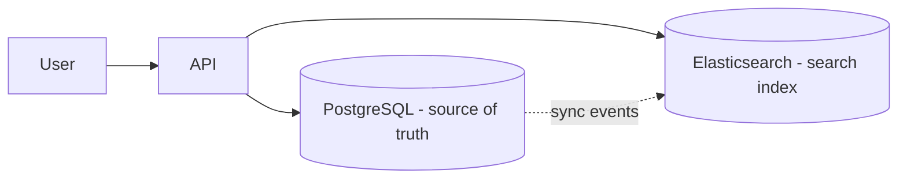

# Search use cases vs database

---

## 🟢 Junior Level

### 1. Why not just use `LIKE`?

A relational database can search text with `WHERE title LIKE '%phone%'`, but that has serious limits:

- A leading wildcard cannot use a B-tree index, so every row is scanned (slow on millions of rows).
- It matches substrings only: no stemming ("running" vs "run"), no typo tolerance, no synonyms, no ranking.
- It cannot easily say "this result is *more relevant* than that one".

A **search engine** (Elasticsearch, OpenSearch, Solr, Meilisearch, Typesense) builds an **inverted index** that answers "which documents contain this word?" instantly and ranks them.

**Analogy:** Asking a librarian to read every book for the word "volcano" (database scan) vs. using the card catalogue that lists books by keyword (search index).

### 2. Typical search use cases

| Use case | Why a search engine |
| :--- | :--- |
| E-commerce product search | Typos, facets (brand, price), ranking by relevance + popularity |
| Autocomplete / suggestions | Prefix and n-gram analysis, millisecond latency |
| Log and observability search (ELK) | Huge volumes, time-based indices, aggregations |
| Document / knowledge-base search | Relevance, highlighting, synonyms |
| Geo search ("restaurants near me") | Geo-distance filters and sorting |
| Semantic / vector search | Embeddings with kNN |

### 3. Quick comparison in code

```java
// Database: slow for large tables, no relevance
@Query("select p from Product p where lower(p.name) like lower(concat('%', :q, '%'))")
List<Product> naiveSearch(@Param("q") String q);

// Search engine: relevance-ranked, typo tolerant
NativeQuery query = NativeQuery.builder()
    .withQuery(b -> b.match(m -> m.field("name").query(q).fuzziness("AUTO")))
    .build();
SearchHits<ProductDoc> hits = operations.search(query, ProductDoc.class);
```



---

## 🟡 Middle Level

### 1. When the database is enough

Do not add Elasticsearch prematurely. PostgreSQL has solid built-in full-text search:

```sql
ALTER TABLE products ADD COLUMN tsv tsvector
  GENERATED ALWAYS AS (to_tsvector('english', name || ' ' || coalesce(description, ''))) STORED;
CREATE INDEX idx_products_tsv ON products USING GIN (tsv);

SELECT id, name, ts_rank(tsv, q) AS rank
FROM products, websearch_to_tsquery('english', 'wireless mouse') q
WHERE tsv @@ q
ORDER BY rank DESC LIMIT 20;
```

Add `pg_trgm` (trigram GIN index) for fuzzy/`LIKE '%x%'` matching. For up to a few million documents, no complex facets, and modest relevance needs, this avoids a whole new system.

### 2. When to add a search engine

| Signal | Why |
| :--- | :--- |
| Need typo tolerance, synonyms, multilingual stemming | Rich analyzers |
| Need faceted navigation with counts | Aggregations over filtered results |
| Search load would hurt the OLTP database | Offload read-heavy queries |
| Tens of millions+ docs, relevance tuning, personalisation | Scoring, `function_score`, learning-to-rank |
| Log/event analytics | Time-based indices, ILM |

### 3. Keeping the index in sync

The database stays the **source of truth**; the search index is a **derived, rebuildable** view. Options:

1. **Dual write** from the app - simple but can diverge when one write fails. Avoid.
2. **Transactional outbox + relay** - app writes entity and outbox row in one DB transaction; a publisher sends events to Kafka; a consumer updates Elasticsearch.
3. **Change Data Capture (Debezium)** - reads the DB log, no app changes.
4. **Periodic batch reindex** - for catalogue data that tolerates staleness.

```java
@Component
class ProductIndexer {
    private final ElasticsearchOperations ops;
    ProductIndexer(ElasticsearchOperations ops) { this.ops = ops; }

    @KafkaListener(topics = "product-events", groupId = "indexer")
    void on(ProductEvent e) {
        if (e.deleted()) {
            ops.delete(e.id(), ProductDoc.class);
        } else {
            ops.save(new ProductDoc(e.id(), e.name(), e.category(), e.price(), e.version()));
        }
    }
}
```

Make the consumer **idempotent** and order-safe using the entity `version` as Elasticsearch **external versioning** so an older event never overwrites a newer one.

### 4. Common mistakes

1. Using Elasticsearch as the primary datastore (no transactions, risky recovery).
2. Dual writes with no reconciliation job.
3. Letting search results show data that was deleted/hidden in the DB (always re-check authorization; filter by tenant and permissions in the query).
4. Indexing the entire relational schema; index only denormalised, search-relevant fields.
5. Forgetting the lag: users add an item and don't see it in search; show "may take a few seconds" or use read-your-writes tricks for the author.

---

## 🔴 Senior Level

### 1. Architecture and capacity

Typical design for e-commerce search:

- PostgreSQL (catalogue) -> Debezium -> Kafka -> indexer -> Elasticsearch (`products` alias).
- Read path: API -> Elasticsearch for ids + facets -> optional hydration from cache/DB for volatile fields (price, stock) -> response.
- **Hybrid approach**: store volatile fields (stock, price) outside the index or update via partial updates; stale search scores are acceptable, stale prices are not - re-validate at checkout.

Capacity thinking: 50 M products x 2 KB = 100 GB source. With 1 replica ~200 GB plus index overhead (typically 1-1.5x of source) -> plan ~500 GB across e.g. 3 data nodes with 16-32 GB heap each, shards of 20-40 GB (3-6 primaries). Test with representative queries (Rally benchmarks), not guesses.

### 2. Relevance engineering

- Offline evaluation: curate judgement lists, measure NDCG/MRR when changing analyzers or boosts.
- Combine lexical (BM25) and semantic (embeddings kNN) via **hybrid search** with Reciprocal Rank Fusion; keep BM25 for exact SKU/brand matches.
- Business signals: popularity (`rank_feature`), recency decay (`function_score` with `gauss`), margin, personalised boosts.
- Query understanding: spelling correction (`suggest`), synonyms (`synonym_graph`), query rewriting, filters inferred from text ("red shoes under 50").

### 3. Reindex and recovery strategy

Because the index is derived, you must be able to rebuild it: keep a replayable stream (Kafka compaction or DB scan) and a **bulk backfill job** that writes to a new versioned index, then swap the alias. Measure rebuild time as an RTO figure. Snapshot to object storage for faster recovery of large indices.

```java
// Blue/green alias swap after a full rebuild
client.indices().updateAliases(u -> u
    .actions(a -> a.remove(r -> r.index("products_v1").alias("products")))
    .actions(a -> a.add(ad -> ad.index("products_v2").alias("products"))));
```

### 4. Failure modes

| Failure | Impact | Mitigation |
| :--- | :--- | :--- |
| Search cluster down | Search broken | Circuit breaker + fallback to DB `tsvector`/simple browse |
| Indexer lag | Stale results | Lag metric, alert; DLQ for poison messages |
| Mapping drift between versions | Failed bulk | CI check of mappings, versioned indices |
| Hot shard from tenant skew | Latency spikes | Custom `routing`, per-tenant indices for whale tenants |
| Security leak | Users see others' docs | Document-level security / mandatory filter in server code |

```java
// Fallback with Resilience4j
@CircuitBreaker(name = "search", fallbackMethod = "dbFallback")
public List<ProductView> search(String q) { return elastic.search(q); }

List<ProductView> dbFallback(String q, Throwable t) { return jdbc.simpleLike(q); }
```

### 5. Edge cases

- Eventual consistency of the index vs delete operations: tombstone events must not be lost; periodically reconcile counts and checksums (`count(*)` vs `_count`).
- Multi-tenant isolation: index-per-tenant vs shared index with `tenantId` filter and routing; the latter scales better for many small tenants.
- Search-as-you-type latency budget: p99 < 100 ms requires warm caches, small `_source`, and `edge_ngram` or `completion` suggester rather than wildcard.

---

## 🎯 Interview Cheat Sheet

### 30-second pitch
"Databases are built for exact lookups and transactions; search engines are built for relevance, text analysis, facets and fuzzy matching over large corpora. I start with PostgreSQL full-text search if requirements are modest, and add Elasticsearch as a derived index fed by outbox or CDC when I need ranking, typo tolerance, faceting or offload."

### Must-know bullets
- `LIKE '%x%'` does not scale and has no relevance.
- The search index is derived data; DB remains the source of truth.
- Sync via outbox/CDC, idempotent consumers with versioning; avoid blind dual writes.
- PostgreSQL FTS + `pg_trgm` is often enough.
- Plan for rebuild, lag monitoring, and fallback.

### Common follow-ups
- How do you keep search and database consistent?
- How do you handle deletes and permissions in search results?
- Design product search for an e-commerce site.
- Elasticsearch vs PostgreSQL full-text search?

### 🚩 Red flags
- Proposing Elasticsearch for simple exact-match lookups.
- No rebuild or reconciliation plan.
- Ignoring index lag in UX.

### Related topics
- [Elasticsearch fundamentals](11.%20Elasticsearch%20fundamentals.md)
- [Elasticsearch queries and mapping](12.%20Elasticsearch%20queries%20and%20mapping.md)
- [Polyglot persistence and choosing a database in interviews](19.%20Polyglot%20persistence%20and%20choosing%20a%20database%20in%20interviews.md)
- [SQL vs NoSQL and how to choose](01.%20SQL%20vs%20NoSQL%20and%20how%20to%20choose.md)
