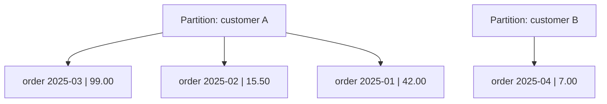

# Cassandra data model

---

## 🟢 Junior Level

### 1. What is Apache Cassandra?

**Apache Cassandra** is a distributed **wide-column** database designed for huge write volumes, linear horizontal scale and no single point of failure. Every node is equal (peer-to-peer, no leader). You query it with **CQL** (Cassandra Query Language), which looks like SQL but has strict rules: there are no joins, and queries must follow how the table was designed.

**Analogy:** Think of a huge set of filing cabinets (partitions). The label on the cabinet (partition key) tells you which cabinet to open instantly. Inside, folders are sorted in a fixed order (clustering key).

### 2. Core concepts

| Concept | Meaning |
| :--- | :--- |
| **Keyspace** | Like a database/schema; defines replication |
| **Table** | Collection of rows |
| **Partition key** | Decides which nodes store the row (hashed to a token) |
| **Clustering key** | Sorts rows *within* a partition |
| **Primary key** | Partition key + clustering columns |
| **Wide row / partition** | A partition containing many clustering rows |

```sql
CREATE KEYSPACE shop WITH replication = {'class': 'NetworkTopologyStrategy', 'dc1': 3};

CREATE TABLE shop.orders_by_customer (
    customer_id uuid,
    order_time  timestamp,
    order_id    uuid,
    total       decimal,
    status      text,
    PRIMARY KEY ((customer_id), order_time, order_id)
) WITH CLUSTERING ORDER BY (order_time DESC, order_id ASC);
```

Here `customer_id` is the partition key; `order_time, order_id` are clustering columns. Fetching the latest 10 orders of a customer reads **one partition**, already sorted:

```sql
SELECT * FROM shop.orders_by_customer WHERE customer_id = ? LIMIT 10;
```



---

## 🟡 Middle Level

### 1. Query-first modelling

In SQL you model entities then write queries. In Cassandra you **list the queries first**, then design **one table per query**, duplicating data as needed.

| Query | Table |
| :--- | :--- |
| Orders of a customer, newest first | `orders_by_customer (customer_id, order_time, ...)` |
| Orders by status per day | `orders_by_status_day ((status, day), order_time, order_id)` |
| One order by id | `orders_by_id (order_id)` |

Writes are cheap, so writing the same order into three tables (denormalisation) is normal.

### 2. The rules of thumb

1. **Queries must supply the full partition key** (equality). Without it you need `ALLOW FILTERING` (full cluster scan - anti-pattern).
2. Clustering columns can be restricted left-to-right: equality on earlier ones, a range on the last used.
3. Spread data **evenly** across partitions; each partition should be bounded - aim < 100 MB and < ~100,000 rows (soft guidance).
4. Avoid **hot partitions** (e.g., partition key = `country` or a date for all current writes).
5. **Bucket** time-series partitions: `((device_id, day), ts)`.

### 3. Partition key vs clustering key at runtime

The partition key is hashed with **Murmur3** to a 64-bit token; the **token ring** assigns ranges of tokens to nodes (with **vnodes**, each node owns many small ranges, default 16 in 4.x). The replication strategy copies the partition to RF nodes. Within a partition on disk, rows are sorted by clustering key, so range scans and `LIMIT` are efficient.

### 4. Spring Data Cassandra

```java
@Table("orders_by_customer")
public class OrderByCustomer {

    @PrimaryKeyClass
    public record Key(
        @PrimaryKeyColumn(name = "customer_id", type = PrimaryKeyType.PARTITIONED) UUID customerId,
        @PrimaryKeyColumn(name = "order_time", ordinal = 0, type = PrimaryKeyType.CLUSTERED, ordering = Ordering.DESCENDING) Instant orderTime,
        @PrimaryKeyColumn(name = "order_id", ordinal = 1, type = PrimaryKeyType.CLUSTERED) UUID orderId) {}

    @PrimaryKey private Key key;
    private BigDecimal total;
    private String status;
    // getters/setters
}

public interface OrderByCustomerRepository extends CassandraRepository<OrderByCustomer, OrderByCustomer.Key> {
    Slice<OrderByCustomer> findByKeyCustomerId(UUID customerId, Pageable pageable);
}
```

```yaml
spring:
  cassandra:
    contact-points: localhost:9042
    local-datacenter: dc1
    keyspace-name: shop
    schema-action: none        # manage schema with migrations in prod
```

Dev only: `schema-action: create_if_not_exists`.

### 5. Data types and features

- `uuid`/`timeuuid` (time-ordered ids), `text`, `decimal`, `timestamp`, `blob`.
- **Collections**: `list`, `set`, `map` (small, bounded; stored inline) and **UDTs**; `frozen<>` stores them as a single blob.
- **Static columns**: one value per partition (e.g., customer name shared by all order rows).
- **TTL**: `INSERT ... USING TTL 86400`.
- **Counters**: special tables with `counter` columns.
- Secondary indexes exist but are discouraged on high-cardinality or heavily written columns; **SAI** (Storage-Attached Indexes, Cassandra 5.0) improves this. **Materialized views** are experimental in practice; prefer manual denormalisation.

### 6. Common mistakes

- Designing like a relational schema, then using `ALLOW FILTERING` or secondary indexes everywhere.
- **Unbounded partitions** (e.g., `PRIMARY KEY (user_id, event_time)` for a very active user over years).
- Using `IN` with many partition keys (coordinator fan-out); issue parallel async queries instead.
- Large collections or frequently overwritten collections (create tombstones).
- Timestamps in partition keys that create a single hot partition ("now").

---

## 🔴 Senior Level

### 1. Partition sizing math

Row ~ 200 bytes, 1 write/second per device, partition `(device_id)` -> 86,400 rows/day x 200 B = 17 MB/day -> exceeds 100 MB in about 6 days. Bucket by day: `((device_id, day), ts)` -> 17 MB per partition. For bursty users use a computed bucket (`hash(event_id) % N`) and fan-out on reads.

Check live partition sizes with `nodetool tablehistograms keyspace.table` and `nodetool tablestats` ("Compacted partition maximum bytes"). Large partitions cause GC pressure, long repairs, and slow reads because the **partition index** and column index must be read.

### 2. Modelling patterns

```sql
-- Time-series with bucketing and TTL
CREATE TABLE telemetry (
    device_id text, day date, ts timestamp, value double,
    PRIMARY KEY ((device_id, day), ts)
) WITH CLUSTERING ORDER BY (ts DESC)
  AND default_time_to_live = 7776000
  AND compaction = {'class': 'TimeWindowCompactionStrategy', 'compaction_window_unit': 'DAYS', 'compaction_window_size': 1};

-- Lookup table to avoid scans: email -> user_id
CREATE TABLE users_by_email (email text PRIMARY KEY, user_id uuid);
```

Keep the lookup tables consistent with a **logged batch** (atomicity across tables, but not isolation) or an outbox/idempotent write that can be repaired.

```java
// Async fan-out instead of IN (DataStax Java driver 4.x)
List<CompletionStage<AsyncResultSet>> futures = ids.stream()
    .map(id -> session.executeAsync(prepared.bind(id)))
    .toList();
```

### 3. Operational diagnostics

| Command | Reveals |
| :--- | :--- |
| `nodetool tablestats` | Partition sizes, tombstones per read, SSTable counts |
| `nodetool tpstats` | Dropped mutations, pending compactions |
| `nodetool toppartitions` | Hot partitions |
| `TRACING ON` in cqlsh | Per-query path across replicas |
| `nodetool ring`, `status` | Token ownership, balance |

### 4. Edge cases

- **Primary key is immutable**: changing a partition/clustering key means writing a new row and deleting the old.
- **Prepared statements** are mandatory in production (parsing cost, token-aware routing in the driver).
- **Token-aware + datacenter-aware load balancing** (`local-datacenter` required in driver 4.x) avoids cross-DC hops.
- **Lightweight transactions** (`IF NOT EXISTS`) serialise on a partition via Paxos; use only for uniqueness/rare CAS.
- Counter updates are not idempotent: retries can double count.
- `SELECT COUNT(*)` across partitions is a cluster scan; maintain counters explicitly.

---

## 🎯 Interview Cheat Sheet

### 30-second pitch
"Cassandra is a peer-to-peer wide-column store. The partition key decides where data lives via consistent hashing, the clustering key sorts rows inside the partition. You model by query: one denormalised table per access pattern, bounded partitions, no joins, and no filtering without the partition key."

### Must-know bullets
- Primary key = (partition key), clustering columns.
- Queries need the partition key; `ALLOW FILTERING` is an anti-pattern.
- Design tables per query; denormalise; writes are cheap.
- Bound partition size (bucketing); avoid hot partitions.
- Use prepared statements, token-aware driver, async fan-out rather than big `IN`.

### Common follow-ups
- Explain partition key vs clustering key.
- How do you model "latest N events per user"?
- Why is a secondary index risky?
- How do you handle a very large partition?

### 🚩 Red flags
- Normalised relational schema in Cassandra.
- Low-cardinality partition keys (`status`, `country`).
- `ALLOW FILTERING` in production code.

### Related topics
- [Cassandra write path, LSM tree, compaction and tombstones](15.%20Cassandra%20write%20path%20LSM%20tree%20compaction%20and%20tombstones.md)
- [Tunable consistency in Cassandra](16.%20Tunable%20consistency%20in%20Cassandra.md)
- [Data modeling for access patterns and SQL to NoSQL migration pitfalls](20.%20Data%20modeling%20for%20access%20patterns%20and%20SQL%20to%20NoSQL%20migration%20pitfalls.md)
- [Sharding and partitioning strategies](21.%20Sharding%20and%20partitioning%20strategies.md)
