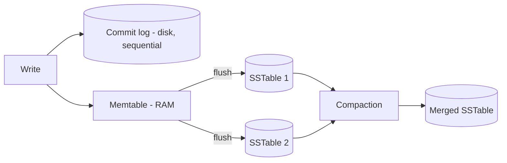

# Cassandra write path LSM tree compaction and tombstones

---

## 🟢 Junior Level

### 1. Why are Cassandra writes so fast?

Cassandra never updates data in place on disk. A write is:

1. Appended to the **commit log** (sequential disk write, for crash recovery).
2. Put into an in-memory sorted structure called the **memtable**.
3. Acknowledged to the client.

When the memtable gets full it is **flushed** to disk as an immutable sorted file called an **SSTable**. This design is a **Log-Structured Merge tree (LSM tree)**.

**Analogy:** A busy cashier jots every sale on a running tape (commit log) and in a notebook sorted by customer (memtable). At the end of the day the notebook is filed as a finished, never-edited volume (SSTable). Old volumes are periodically merged into bigger ones (compaction).



### 2. Deletes are writes too

Because SSTables are immutable, a delete writes a marker called a **tombstone**. The data is physically removed later during compaction (after `gc_grace_seconds`, default 10 days).

```sql
INSERT INTO users (id, name) VALUES (1, 'Alice');
DELETE FROM users WHERE id = 1;           -- writes a tombstone, nothing is erased yet
```

```java
// Java driver 4.x: a write is just an async call; durability depends on consistency level
CqlSession session = CqlSession.builder().withLocalDatacenter("dc1").build();
PreparedStatement ps = session.prepare("INSERT INTO shop.users (id, name) VALUES (?, ?)");
session.execute(ps.bind(UUID.randomUUID(), "Alice").setConsistencyLevel(DefaultConsistencyLevel.LOCAL_QUORUM));
```

---

## 🟡 Middle Level

### 1. Detailed write path on a replica

1. **Commit log**: appended; synced `periodic` (every 10 s default) or `batch`/`group` mode.
2. **Memtable**: per-table, sorted by partition token and clustering key; overwrites merge in memory.
3. **Flush** when the memtable reaches its threshold (heap/off-heap share) or the commit log segment space is full: written as an SSTable (`Data.db`, `Index.db`, `Summary.db`, `Filter.db` (bloom filter), `Statistics.db`...). Commit log segments are recycled after flush.

The coordinator node receives the request, hashes the partition key, sends the mutation to **all RF replicas** in parallel and waits for as many acks as the consistency level requires.

### 2. Read path (why reads are costlier)

For a partition the replica merges: memtable + all SSTables that may contain it. To avoid reading every SSTable, it uses:

- **Bloom filter** (per SSTable): "definitely not here" for most files.
- **Partition key cache / index summary / partition index**: locate the offset.
- **Row cache** (rarely helpful) and the OS page cache.
- **Timestamps** decide which version wins (newest timestamp); tombstones hide older data.

**Read amplification** grows with the number of SSTables: that is what compaction controls.

### 3. Compaction strategies

| Strategy | Best for | Trade-off |
| :--- | :--- | :--- |
| **SizeTieredCompactionStrategy (STCS)** (default) | Write-heavy, general | Needs up to 50% free disk headroom; many SSTables -> read amplification |
| **LeveledCompactionStrategy (LCS)** | Read-heavy, many updates | Higher write amplification (10x), lower space amplification |
| **TimeWindowCompactionStrategy (TWCS)** | Time-series with TTL | Needs append-only data, no out-of-order updates/deletes |
| **UnifiedCompactionStrategy (UCS)** (5.0) | Adaptive, replaces the above | Newer, configurable by scaling parameter |

### 4. Tombstone types

- **Cell tombstone** (single column delete)
- **Row tombstone**
- **Range tombstone** (delete a clustering range)
- **Partition tombstone**
- **TTL expiry** creates tombstones too
- **Null inserts**: writing `null` to a column creates a tombstone! Use `unset` for bound parameters (supported by protocol v4+).

```java
// Avoid creating tombstones for absent optional fields
BoundStatementBuilder b = ps.boundStatementBuilder().setUuid("id", id);
if (nickname != null) b = b.setString("nickname", nickname);   // otherwise left UNSET, not null
session.execute(b.build());
```

(Spring Data Cassandra by default writes nulls as nulls unless configured; check entity mapping for sparsely populated columns.)

### 5. Tombstone problems

Reads must scan tombstones to know what is deleted. Defaults warn at **1,000** tombstones (`tombstone_warn_threshold`) and abort the query at **100,000** (`tombstone_failure_threshold`) with `TombstoneOverwhelmingException`. Typical causes: **queue-like workloads** (insert, process, delete), deleting wide ranges, TTL-heavy tables with STCS.

### 6. Common mistakes

- Using Cassandra as a **queue**.
- Lowering `gc_grace_seconds` without running repairs within that window: a replica that missed the delete can **resurrect** deleted data ("zombie data").
- Large batches (>5 KB warning, 50 KB failure by default) as a "performance" trick.
- Running out of disk during STCS compaction.

---

## 🔴 Senior Level

### 1. Amplification trade-offs (the RUM conjecture)

| Strategy | Write amp | Read amp | Space amp |
| :--- | :--- | :--- | :--- |
| STCS | Low (~O(log N)) | High | High (up to 2x) |
| LCS | High (~10x per level) | Low (~1 SSTable per level) | Low (~1.1x) |
| TWCS | Lowest for TTL'd time data | Low in recent window | Low |

Choose by workload; measure via `nodetool tablestats` (SSTable count, "SSTables per read" histogram from `tablehistograms`), `nodetool compactionstats`, and disk I/O.

### 2. Repair, hints, and tombstone GC

Deletes must reach every replica before tombstones are purged. Mechanisms: hinted handoff (3 h window), read repair, and **anti-entropy repair** (`nodetool repair` using Merkle trees). Run **incremental/full repairs** at least once per `gc_grace_seconds` (e.g., via Cassandra Reaper). Tombstone purge also requires that no overlapping SSTable still holds shadowed data (`unsafe_aggressive_sstable_expiration` exists for TWCS but is risky).

```bash
nodetool repair -pr shop orders_by_customer    # primary-range repair
nodetool tablestats shop.orders_by_customer     # check tombstones per slice
```

### 3. Diagnosing a tombstone-heavy table

1. `system.log` warnings: "Read X live rows and Y tombstone cells for query...".
2. `nodetool tablestats`: "Average tombstones per slice" and "Maximum tombstones per slice".
3. `TRACING ON` and run the query; count tombstones scanned.
4. Fix at the model level: time-bucketed partitions (drop whole bucket by TTL/TWCS), avoid deleting rows in the middle of a hot partition, write nothing instead of null, use `DELETE ... WHERE partition_key` (one partition tombstone) instead of many cell deletes.

```sql
-- Queue anti-pattern fix: bucket by hour and let TWCS drop entire SSTables once expired
CREATE TABLE jobs (
    bucket timestamp, job_id timeuuid, payload text,
    PRIMARY KEY ((bucket), job_id)
) WITH default_time_to_live = 86400
  AND compaction = {'class':'TimeWindowCompactionStrategy','compaction_window_unit':'HOURS','compaction_window_size':1};
```

### 4. Memory and GC

- Memtables live in heap (`heap_buffers`) or off-heap (`offheap_objects`); Cassandra 4+/5 mostly recommends off-heap for lower GC pressure.
- Use G1 or ZGC (5.0 supports Java 17); keep heap 8-31 GB; the rest is page cache for SSTables.
- Large partitions and many tombstones allocate big short-lived objects -> young GC pauses -> nodes marked down -> hinted-handoff storms.
- Compaction throughput throttle (`compaction_throughput`) balances against foreground latency; `nodetool setcompactionthroughput`.

### 5. Edge cases

- **Overwrite-heavy** workloads create overlapping SSTables with obsolete versions: LCS handles them best.
- **Out-of-order writes with TWCS** break time-window purity and block dropping SSTables.
- **Timestamps**: client-supplied `USING TIMESTAMP` plus clock skew makes "newer" writes lose; NTP and server-side timestamps matter.
- The commit log `periodic` sync means a simultaneous power loss of all replicas of a mutation can lose ~10 s of acked writes; use `commitlog_sync: group` or rack/DC diversity for stricter durability.
- Cassandra 5.0 trie-based memtables and SSTable formats (BTI) reduce memory and improve read performance.

---

## 🎯 Interview Cheat Sheet

### 30-second pitch
"Cassandra writes append to a commit log and an in-memory memtable, then flush to immutable SSTables, which is an LSM tree: sequential I/O means very fast writes. Reads merge memtable and SSTables using bloom filters, so compaction keeps read amplification low. Deletes are tombstones kept for gc_grace_seconds, which is why queue-like deletes hurt and repairs must run regularly."

### Must-know bullets
- Commit log -> memtable -> flush to SSTable -> compaction.
- Bloom filters avoid reading irrelevant SSTables.
- Strategies: STCS (write), LCS (read), TWCS (time-series TTL), UCS (5.0).
- Tombstones: warn at 1,000, fail at 100,000 per read; null inserts create them.
- Repair within `gc_grace_seconds` to prevent zombie data.

### Common follow-ups
- Why is Cassandra write-optimised but read-costlier?
- What is a tombstone and when is it removed?
- Which compaction would you use for metrics with TTL?
- What causes resurrected deleted data?

### 🚩 Red flags
- Using Cassandra as a queue.
- Lowering `gc_grace_seconds` without a repair process.
- Inserting nulls for optional columns.

### Related topics
- [Cassandra data model](14.%20Cassandra%20data%20model.md)
- [Tunable consistency in Cassandra](16.%20Tunable%20consistency%20in%20Cassandra.md)
- [Replication strategies](22.%20Replication%20strategies.md)
- [NoSQL families](02.%20NoSQL%20families.md)
