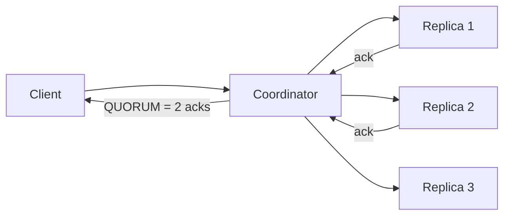

# Tunable consistency in Cassandra

---

## 🟢 Junior Level

### 1. What does "tunable consistency" mean?

In Cassandra every table's data is copied to several nodes (**replication factor, RF**, e.g. 3). For **each read or write** you choose a **consistency level (CL)**: how many of those replicas must respond before the operation counts as successful.

- Lower CL (e.g., `ONE`): fast and highly available, but you might read stale data.
- Higher CL (e.g., `QUORUM`, `ALL`): safer, slower, less available if nodes are down.

**Analogy:** Asking a committee of 3 doctors. `ONE`: take the first opinion (fast, may be wrong). `QUORUM`: wait until 2 of 3 agree. `ALL`: wait for all three (slow, blocked if one is on holiday).

### 2. Common levels

| CL | Replicas that must respond (RF=3) |
| :--- | :--- |
| `ANY` (writes only) | Even a hint counts - weakest |
| `ONE` | 1 |
| `TWO`, `THREE` | 2, 3 |
| `QUORUM` | majority = RF/2 + 1 = 2 |
| `LOCAL_QUORUM` | Majority in the local datacenter only |
| `EACH_QUORUM` | Quorum in every DC (writes) |
| `ALL` | All replicas |
| `LOCAL_ONE` | One replica in the local DC |
| `SERIAL` / `LOCAL_SERIAL` | For lightweight transactions (Paxos) |

### 3. Setting it in Java

```java
CqlSession session = CqlSession.builder().withLocalDatacenter("dc1").build();

PreparedStatement select = session.prepare("SELECT * FROM shop.users WHERE id = ?");
Row row = session.execute(select.bind(id)
        .setConsistencyLevel(DefaultConsistencyLevel.LOCAL_QUORUM)).one();

SimpleStatement write = SimpleStatement.builder("UPDATE shop.users SET name = ? WHERE id = ?")
        .addPositionalValues("Bob", id)
        .setConsistencyLevel(DefaultConsistencyLevel.LOCAL_QUORUM)
        .build();
session.execute(write);
```



---

## 🟡 Middle Level

### 1. The overlap rule: R + W > RF

If the number of replicas **read (R)** plus the number **written (W)** is greater than **RF**, every read set intersects the latest successful write set, so the read sees the latest value (given timestamps resolve conflicts).

| RF | Write CL | Read CL | R + W | Strongly consistent reads? |
| :--- | :--- | :--- | :--- | :--- |
| 3 | QUORUM (2) | QUORUM (2) | 4 > 3 | Yes |
| 3 | ONE (1) | ALL (3) | 4 > 3 | Yes (but write fast, read slow/less available) |
| 3 | ALL (3) | ONE (1) | 4 > 3 | Yes (write slow) |
| 3 | ONE (1) | ONE (1) | 2 <= 3 | No - eventual |

### 2. Multi-datacenter

- `LOCAL_QUORUM` is the production default for multi-DC: low latency (no cross-DC wait), strong consistency within the DC, asynchronous replication to other DCs.
- `QUORUM` across 2 DCs (RF 3+3=6, quorum 4) forces cross-DC round trips and fails if the link breaks.
- `EACH_QUORUM` gives cross-DC durability for writes but costs latency.

### 3. What makes replicas converge

- **Hinted handoff**: coordinator stores writes for a down replica for up to `max_hint_window` (3 h).
- **Read repair**: on reads at CL > ONE, mismatching replicas are fixed (and a background blocking read repair for digest mismatches).
- **Anti-entropy repair**: `nodetool repair` with Merkle trees.
- **Timestamps (last-write-wins)** per cell resolve conflicts: highest timestamp wins; ties break by value comparison.

### 4. Lightweight transactions (LWT)

For compare-and-set semantics (uniqueness, state machines) use `IF` conditions, executed via Paxos with **linearizable** consistency at the partition level:

```java
ResultSet rs = session.execute(SimpleStatement.builder(
        "INSERT INTO shop.users_by_email (email, user_id) VALUES (?, ?) IF NOT EXISTS")
    .addPositionalValues(email, userId)
    .setSerialConsistencyLevel(DefaultConsistencyLevel.LOCAL_SERIAL)
    .build());
if (!rs.wasApplied()) {
    throw new IllegalStateException("Email already taken");
}
```

LWT costs about 4 round trips (prepare/promise, read, propose/accept, commit); use only on low-contention paths.

### 5. Spring Data Cassandra configuration

```java
@Configuration
class CassandraConfig {
    @Bean
    DriverConfigLoaderBuilderCustomizer consistency() {
        return builder -> builder
            .withString(DefaultDriverOption.REQUEST_CONSISTENCY, "LOCAL_QUORUM")
            .withString(DefaultDriverOption.REQUEST_SERIAL_CONSISTENCY, "LOCAL_SERIAL")
            .withDuration(DefaultDriverOption.REQUEST_TIMEOUT, java.time.Duration.ofSeconds(2));
    }
}
```

Per-operation override using `WriteOptions`/`QueryOptions` with `CassandraTemplate`:

```java
InsertOptions options = InsertOptions.builder()
    .consistencyLevel(DefaultConsistencyLevel.LOCAL_QUORUM).ttl(java.time.Duration.ofDays(1)).build();
cassandraTemplate.insert(entity, options);
```

### 6. Common mistakes

1. Mixing `ONE` writes with `ONE` reads and expecting read-your-writes.
2. Using `ALL`: one node down = outage for that partition.
3. Using `QUORUM` in multi-DC when `LOCAL_QUORUM` is intended.
4. Setting the driver's local DC wrong, so "local" levels go cross-DC or fail.
5. Retrying non-idempotent statements (counter updates, `list` appends) after timeouts: a write timeout does not mean failure.
6. Forgetting that a failed `QUORUM` write may still be partially applied (visible later).

---

## 🔴 Senior Level

### 1. Failure semantics

- `UnavailableException`: the coordinator knows not enough replicas are alive for the CL, so the write was not attempted.
- `WriteTimeoutException`: coordinator sent writes but did not get enough acks in time. The write **may still succeed**; make writes idempotent and retry.
- `ReadTimeoutException`: not enough responses in time, or data not retrieved (inspect `dataPresent`).
- Speculative execution (`speculative-execution-policy: ConstantSpeculativeExecutionPolicy`) cuts tail latency but only for idempotent statements (mark with `setIdempotent(true)`).

```java
SimpleStatement st = SimpleStatement.builder("SELECT * FROM shop.users WHERE id = ?")
    .addPositionalValue(id).setIdempotent(true).build();
```

### 2. Consistency is not just CL

R + W > RF gives **quorum overlap**, not full linearizability:

- Concurrent writes with last-write-wins can drop updates; clock skew among clients/coordinators produces anomalies.
- A failed quorum write that applied on one replica can later be read by a `QUORUM` read, "time travel" of an unacknowledged write.
- Reads at `QUORUM` can return non-monotonic results unless read repair completes first.
- Strict linearizability requires LWT (Paxos) or the new **Accord** transaction protocol (CEP-15, Cassandra 5.1+/ongoing), which supports multi-partition ACID transactions.

### 3. Speculative retry and dynamic snitching

Table option `speculative_retry = '99PERCENTILE'` re-sends a read to another replica if the first is slow, improving p99. The driver and coordinator pick replicas by latency (dynamic snitch in the coordinator, token-aware routing in the driver). Combined with `LOCAL_QUORUM` this keeps tail latency stable during node GC pauses.

### 4. Capacity and availability math

RF=3, 3 racks, `LOCAL_QUORUM` both ways: tolerates the loss of **1 replica per partition** (one node, or one rack if replicas are rack-spread). With RF=5, `QUORUM`=3: tolerates 2 failures. Availability of a partition for CL requiring k of RF replicas with per-node availability p: sum of binomial probabilities; for p=0.999, RF=3 quorum availability ≈ 0.999997.

### 5. Operations

- Alert on dropped mutations (`nodetool tpstats`: `MutationStage`, "Dropped"), hint backlog, pending compactions, repair age (> `gc_grace_seconds` is dangerous).
- Change RF safely: raise RF then run `nodetool repair` (full) on all nodes **before** relying on the new CL; reducing RF then `nodetool cleanup`.
- Test failure: `nodetool drain`/stop a node and watch error rates at your CL; run the same with a whole rack down.
- Use the DataStax driver's metrics (`cql-requests`, `errors.request.write-timeouts`, `speculative-executions`) via Micrometer.

### 6. Edge cases

- `EACH_QUORUM` is unsupported for reads; `ANY` is write-only.
- Counter tables ignore `ANY` and are not idempotent across retries.
- `ALLOW FILTERING` plus `QUORUM` can touch the entire cluster.
- Materialized view/SAI/secondary-index reads effectively read local index shards on every node and are affected differently by CL.

---

## 🎯 Interview Cheat Sheet

### 30-second pitch
"In Cassandra, consistency is chosen per query: how many replicas must acknowledge. With replication factor 3, QUORUM writes plus QUORUM reads overlap (R+W>RF) so reads see the latest acknowledged write; ONE/ONE is faster but only eventually consistent. In multi-DC I default to LOCAL_QUORUM, and use LWT sparingly for compare-and-set."

### Must-know bullets
- QUORUM = floor(RF/2)+1; R + W > RF gives overlap.
- LOCAL_QUORUM avoids cross-DC latency and outages.
- Write timeout != failure; design idempotent writes.
- Convergence: hints, read repair, anti-entropy repair, LWW timestamps.
- LWT = Paxos, ~4 round trips; Accord is the future for transactions.

### Common follow-ups
- What CL would you use for a shopping cart? For a payment ledger?
- Why is `ALL` rarely used?
- How does Cassandra resolve conflicting writes?
- What happens when a node is down during a QUORUM write?

### 🚩 Red flags
- "QUORUM = strongly consistent, always."
- Retrying counter increments blindly.
- Ignoring the local datacenter driver setting.

### Related topics
- [Consistency models](05.%20Consistency%20models%20eventual%20causal%20and%20strong.md)
- [CAP theorem and PACELC](03.%20CAP%20theorem%20and%20PACELC.md)
- [Cassandra write path, LSM tree, compaction and tombstones](15.%20Cassandra%20write%20path%20LSM%20tree%20compaction%20and%20tombstones.md)
- [Replication strategies](22.%20Replication%20strategies.md)
