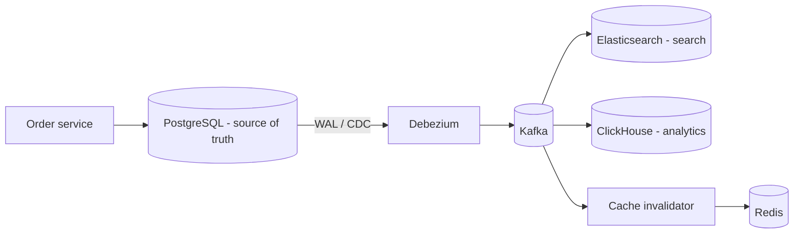

# Polyglot persistence and choosing a database in interviews

---

## 🟢 Junior Level

**Polyglot persistence** means using **different databases for different needs** within one system, instead of forcing everything into one store. A typical e-commerce platform:

| Need | Store |
| --- | --- |
| Orders, payments, inventory (transactions, constraints) | PostgreSQL |
| Product catalog with flexible attributes | MongoDB or PostgreSQL JSONB |
| Full-text search, facets | Elasticsearch / OpenSearch |
| Sessions, caching, rate limits | Redis |
| Event log / integration | Kafka |
| Clickstream analytics | ClickHouse / BigQuery / data lake |
| Recommendations ("people also bought") | Graph DB or precomputed tables |

### The default answer
**Start with a relational database** (PostgreSQL). It handles transactions, joins, constraints, JSON documents, full-text search, geospatial (PostGIS) and moderate scale extremely well. Add specialized stores when a concrete requirement exceeds what it does well — and be ready to justify the operational cost.

---

## 🟡 Middle Level

### A decision framework for interviews
Ask (or state assumptions about):
1. **Data shape and relationships** — highly relational with integrity rules? Documents read as a whole? Graph traversals? Time series?
2. **Access patterns** — point lookups by key, range scans, ad-hoc analytical queries, full-text search, aggregations?
3. **Consistency** — must reads see the latest write? Multi-entity transactions?
4. **Scale** — data size (GB vs TB vs PB), read/write QPS, growth, write-heavy vs read-heavy.
5. **Latency** — p99 targets; global users?
6. **Operational reality** — managed service available? Team expertise? Backup, restore and compliance needs?

### Mapping requirements to stores

| Requirement | Good fit | Why |
| --- | --- | --- |
| ACID transactions, complex queries, constraints | PostgreSQL / MySQL | Mature, flexible, strong consistency |
| Massive write throughput, wide rows, predictable queries | Cassandra / ScyllaDB | LSM storage, linear write scaling, tunable consistency |
| Serverless key-value at any scale | DynamoDB | Managed, predictable latency, pay per request |
| Flexible documents, nested data read together | MongoDB | Document model, secondary indexes, aggregation |
| Search, relevance, facets, log analytics | Elasticsearch / OpenSearch | Inverted index, analyzers, aggregations |
| Sub-millisecond cache, counters, queues, leaderboards | Redis | In-memory data structures |
| Deep relationship traversal | Neo4j / Neptune | Index-free adjacency |
| Time series metrics | TimescaleDB, InfluxDB, Prometheus | Time-partitioned storage, downsampling |
| Analytical scans over billions of rows | ClickHouse, BigQuery, Snowflake | Columnar storage, vectorized execution |

---

## 🔴 Senior Level

### The costs of polyglot persistence
Every additional store adds: provisioning, upgrades, backups and restore drills, monitoring, security hardening, on-call knowledge, client libraries, and **data synchronization**. The last one is the hardest:
* Keep **one source of truth** per piece of data; other stores are **derived** (search index, cache, analytics).
* Synchronize via **CDC** (Debezium → Kafka → sink connectors) or a transactional outbox — not dual writes from the application, which inevitably diverge on partial failures.
* Derived stores must be **rebuildable** from the source (reindex Elasticsearch from PostgreSQL or replay Kafka), which also enables schema changes and disaster recovery.

### How to answer "which database would you use?" well
* Name the **access patterns** first, then the store. "Orders need transactional writes and lookups by customer and status → PostgreSQL with indexes on (customer_id, created_at) and partial index on status; search across products with typos and facets → OpenSearch fed by CDC."
* Quantify: "50k writes/s of sensor data with 90-day retention ≈ 400 GB/day → Cassandra or a time-series database; PostgreSQL would need partitioning and careful vacuum tuning."
* State **consistency trade-offs**: "search results can lag by a second; checkout reads PostgreSQL."
* Mention **operability**: "on AWS I'd use Aurora PostgreSQL and OpenSearch Service rather than running clusters ourselves."

### Common anti-patterns
* **Résumé-driven architecture** — five databases for a small product.
* **Using the cache or search index as the source of truth.**
* **Dual writes** to DB and search/cache in request code.
* **Sharing one database between many services** (tight coupling) — or the opposite extreme, a different exotic store per microservice without a platform team to run them.

---

## 🎯 Interview Cheat Sheet

**30-second pitch:** Polyglot persistence uses the right store for each need — relational for transactions, document stores for flexible aggregates, search engines for full text, Redis for caching, columnar stores for analytics. I default to PostgreSQL, add stores only for concrete requirements, keep one source of truth per dataset, feed derived stores via CDC or outbox rather than dual writes, and make them rebuildable.

**Must know:**
* Decision factors: data shape, access patterns, consistency, scale, latency, operations.
* Typical mapping of requirements to stores.
* Source of truth vs derived stores; CDC with Debezium.
* Operational cost of each new store.
* Answer with access patterns and numbers.

**Common follow-ups:**
* How do you keep Elasticsearch in sync with PostgreSQL?
* When is PostgreSQL JSONB enough instead of MongoDB?
* What would make you choose Cassandra?

**Red flags:** choosing NoSQL "for scale" without numbers; dual writes; every microservice with its own exotic database.

**Related:**
* [SQL vs NoSQL and how to choose](01.%20SQL%20vs%20NoSQL%20and%20how%20to%20choose.md)
* [Search use cases vs database](13.%20Search%20use%20cases%20vs%20database.md)
* [Data modeling for access patterns and SQL to NoSQL migration pitfalls](20.%20Data%20modeling%20for%20access%20patterns%20and%20SQL%20to%20NoSQL%20migration%20pitfalls.md)
* [Transactional outbox pattern](../28.%20Messaging%20Beyond%20Kafka/12.%20Transactional%20outbox%20pattern.md)
