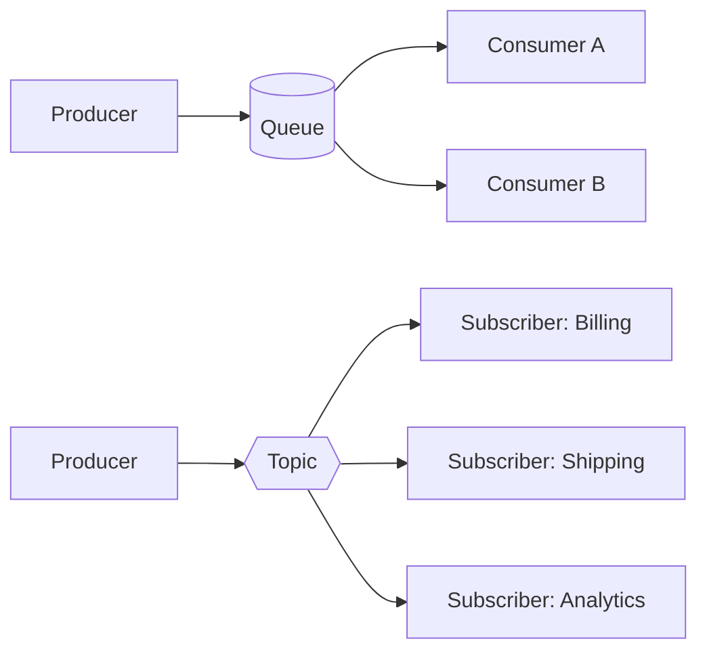

# Messaging fundamentals sync vs async and queues vs topics

---

## 🟢 Junior Level

### 1. What is messaging?

**Messaging** is a way for two programs to communicate by sending small packets of data (*messages*) through an intermediary called a **message broker**, instead of calling each other directly. The sender (the **producer**) does not need to know who will read the message or whether the reader is online right now. The reader (the **consumer**) pulls or receives the message whenever it is ready.

**Real-world analogy:** A synchronous call is a phone call — both people must be present at the same moment, and you wait on the line. Messaging is a post office (or a WhatsApp message): you drop the letter in the box and go on with your day; the receiver reads it later, and the post office guarantees it will be delivered.

### 2. Synchronous vs asynchronous communication

| Aspect | Synchronous (HTTP/REST, gRPC) | Asynchronous (messaging) |
| :--- | :--- | :--- |
| Coupling in time | Both services must be up at the same time | Broker buffers messages while a consumer is down |
| Caller waits? | Yes, blocks for the response | No, continues immediately after publishing |
| Failure propagation | Failure of callee fails the caller | Failure isolated; message waits or is retried |
| Load spikes | Callee must absorb the peak | Broker queues the peak, consumers drain at their own speed |
| Result | Immediate response | Eventual, needs a reply message or callback |
| Debugging | Easy: one stack trace | Harder: need correlation IDs and tracing |

### 3. Queues vs topics (the two classic models)

- **Queue (point-to-point):** every message is delivered to **exactly one** consumer. If several consumers listen to the same queue, they *share* the work (competing consumers). Use it for *commands* and *tasks*: "send this email", "charge this card".
- **Topic (publish-subscribe):** every message is delivered to **all** subscribers. Use it for *events*: "OrderPlaced" must reach billing, shipping and analytics.



In the queue part each message goes to either A **or** B; in the topic part each message goes to all three subscribers.

### 4. Minimal working example (Spring Boot + RabbitMQ)

Dependency: `spring-boot-starter-amqp`. The producer:

```java
import org.springframework.amqp.core.Queue;
import org.springframework.amqp.rabbit.core.RabbitTemplate;
import org.springframework.context.annotation.Bean;
import org.springframework.context.annotation.Configuration;
import org.springframework.stereotype.Service;

@Configuration
class QueueConfig {
    @Bean
    Queue emailQueue() {
        return new Queue("email.send", true); // durable queue
    }
}

@Service
class EmailProducer {
    private final RabbitTemplate rabbit;

    EmailProducer(RabbitTemplate rabbit) {
        this.rabbit = rabbit;
    }

    public void requestEmail(String to) {
        rabbit.convertAndSend("email.send", to); // default exchange routes by queue name
    }
}
```

The consumer:

```java
import org.springframework.amqp.rabbit.annotation.RabbitListener;
import org.springframework.stereotype.Component;

@Component
class EmailConsumer {
    @RabbitListener(queues = "email.send")
    void onMessage(String to) {
        System.out.println("Sending email to " + to);
    }
}
```

> [!TIP]
> The producer returns in microseconds even if the email server is down. That is the main selling point of messaging.

---

## 🟡 Middle Level

### 1. Anatomy of a message

A message has three parts: **headers/properties** (message id, correlation id, content type, timestamp, TTL, priority, reply-to), a **body** (bytes — JSON, Avro, Protobuf), and **routing metadata** (queue/exchange/routing key/topic name). Always put a `messageId` and `correlationId` in headers; you will need them for deduplication and tracing.

### 2. Three kinds of messages

| Kind | Intent | Typical routing | Example |
| :--- | :--- | :--- | :--- |
| **Command** | "Do this" — one handler, expects action | Queue | `ChargeCard` |
| **Event** | "This happened" — zero..N listeners, past tense | Topic / fanout | `PaymentCaptured` |
| **Document** | "Here is data" — carries state | Either | `CustomerSnapshot` |

Naming a command as an event (or vice versa) is a classic design smell; see [Event-driven architecture and message types](13.%20Event-driven%20architecture%20and%20message%20types.md).

### 3. Why teams adopt messaging

1. **Temporal decoupling** — producer and consumer need not be alive together.
2. **Load levelling** — a queue absorbs bursts (Black Friday) and protects the database.
3. **Resilience** — retries and dead-lettering instead of cascading failures.
4. **Fan-out** — one event, many independent reactions.
5. **Scalability** — add consumers to increase throughput.

### 4. The costs (be honest in interviews)

- **Eventual consistency** — the UI cannot assume the work is done after `publish()` returns.
- **Operational burden** — a broker is a stateful system to run, monitor and upgrade.
- **Duplicates and reordering** — you must design consumers for at-least-once delivery (see [Delivery guarantees and the exactly-once myth](07.%20Delivery%20guarantees%20and%20the%20exactly-once%20myth.md)).
- **Harder debugging** — no single stack trace; needs distributed tracing and correlation ids.

### 5. Common mistakes

- Using messaging for a **query** that needs an immediate answer (use REST/gRPC, or [request-reply](16.%20Request-reply%20over%20messaging.md) knowingly).
- Sending huge payloads (hundreds of MB) through the broker; store in S3 and send a reference (*claim check* pattern).
- Publishing inside a DB transaction with no coordination — message and row can diverge (see [Transactional outbox pattern](12.%20Transactional%20outbox%20pattern.md)).
- Treating a topic subscriber as if it were a queue consumer and expecting load sharing.

### 6. Spring abstractions

| Technology | Spring project | Template / listener |
| :--- | :--- | :--- |
| JMS (ActiveMQ, Artemis, IBM MQ) | Spring JMS | `JmsTemplate`, `@JmsListener` |
| AMQP (RabbitMQ) | Spring AMQP | `RabbitTemplate`, `@RabbitListener` |
| Kafka | Spring for Apache Kafka | `KafkaTemplate`, `@KafkaListener` |
| Broker-agnostic | Spring Cloud Stream | `Function<I,O>` beans + bindings |

A fan-out example with a JMS topic:

```java
import jakarta.jms.ConnectionFactory;
import org.springframework.context.annotation.Bean;
import org.springframework.context.annotation.Configuration;
import org.springframework.jms.annotation.JmsListener;
import org.springframework.jms.config.DefaultJmsListenerContainerFactory;
import org.springframework.jms.core.JmsTemplate;
import org.springframework.stereotype.Component;

@Configuration
class TopicConfig {
    @Bean
    DefaultJmsListenerContainerFactory topicFactory(ConnectionFactory cf) {
        DefaultJmsListenerContainerFactory f = new DefaultJmsListenerContainerFactory();
        f.setConnectionFactory(cf);
        f.setPubSubDomain(true); // listen on topics
        return f;
    }
}

@Component
class OrderEvents {
    private final JmsTemplate jms;

    OrderEvents(JmsTemplate jms) {
        this.jms = jms;
        this.jms.setPubSubDomain(true); // publish to a topic instead of a queue
    }

    void publish(String orderId) {
        jms.convertAndSend("orders.placed", orderId);
    }
}

@Component
class BillingListener {
    @JmsListener(destination = "orders.placed", containerFactory = "topicFactory")
    void on(String orderId) { /* bill */ }
}
```

---

## 🔴 Senior Level

### 1. Choosing a communication style per interaction

A senior engineer does not say "microservices must use messaging". Decide per interaction:

- **Need an answer now to render a page** → sync (REST/gRPC) with timeouts, circuit breaker, bulkhead.
- **Side effects that can lag** (email, search indexing, analytics) → async events.
- **Cross-service write consistency** → events + saga/outbox ([Saga with messaging](14.%20Saga%20with%20messaging.md)).
- **High-volume replayable log** → a log such as Kafka (covered in the Kafka section); **task distribution with rich routing** → a broker such as RabbitMQ ([RabbitMQ vs Kafka when to choose which](10.%20RabbitMQ%20vs%20Kafka%20when%20to%20choose%20which.md)).

### 2. Little's law and queue behaviour

A queue is a buffer, not a capacity increase. By Little's law, `L = λ · W` (items in system = arrival rate × time in system). If arrival rate `λ` exceeds service rate `μ` for long, the queue grows without bound: latency climbs, memory/disk fills, and the broker eventually applies flow control that pushes the problem back to producers. Always monitor **queue depth** and **age of the oldest message**, and size consumers to `μ ≥ λ_peak` or accept bounded lag deliberately (see [Backpressure and consumer lag monitoring](17.%20Backpressure%20and%20consumer%20lag%20monitoring.md)).

### 3. Failure modes to design for

| Failure | Consequence | Mitigation |
| :--- | :--- | :--- |
| Producer crashes after DB commit, before publish | Lost event | Transactional outbox |
| Consumer crashes after processing, before ack | Redelivery → duplicate | Idempotent consumer |
| Broker restart | Non-persistent messages lost | Durable queues + persistent messages + publisher confirms |
| Slow/poison message | Head-of-line blocking | Retry with backoff + DLQ |
| Network partition | Split brain, duplicates | Quorum queues / proper partition handling |

### 4. Making the producer honest: publisher confirms

Fire-and-forget publishing is the most common production data-loss bug. With RabbitMQ enable confirms and returns so the producer learns about broker acceptance:

```java
import org.springframework.amqp.rabbit.connection.CorrelationData;
import org.springframework.amqp.rabbit.core.RabbitTemplate;
import org.springframework.stereotype.Service;
import java.util.UUID;

@Service
class ReliablePublisher {
    private final RabbitTemplate template;

    ReliablePublisher(RabbitTemplate template) {
        this.template = template;
        // requires spring.rabbitmq.publisher-confirm-type=correlated
        // and spring.rabbitmq.publisher-returns=true, template.setMandatory(true)
        template.setConfirmCallback((corr, ack, cause) -> {
            if (!ack) {
                System.err.println("NACK for " + (corr == null ? "?" : corr.getId()) + ": " + cause);
                // persist for retry / alert
            }
        });
    }

    void publish(String exchange, String key, Object payload) {
        template.convertAndSend(exchange, key, payload, new CorrelationData(UUID.randomUUID().toString()));
    }
}
```

### 5. Observability checklist

- Propagate `traceparent` through message headers (Micrometer Tracing / OpenTelemetry instruments Spring AMQP and JMS when observation is enabled on the template and listener container).
- Metrics: publish rate, consume rate, unacked count, queue depth, oldest message age, redeliveries, DLQ depth.
- Log `messageId` + `correlationId` on every hop.

### 6. Architectural trade-off summary

Messaging buys **availability and elasticity** and pays with **consistency, simplicity and debuggability**. In a system review, ask: *what happens to a user request when this consumer is down for one hour?* If the honest answer is "the system keeps working and catches up", async is justified. If the answer is "the user stares at a spinner forever", you probably wanted a synchronous call.

---

## 🎯 Interview Cheat Sheet

**30-second elevator pitch:** Messaging lets services communicate through a broker so sender and receiver are decoupled in time and load. Queues deliver each message to one consumer (work distribution), topics to all subscribers (events). The price is eventual consistency, duplicates and operational complexity, which you handle with acknowledgements, idempotent consumers, DLQs and observability.

**Must-know bullets:**
- Queue = point-to-point, competing consumers; topic = publish-subscribe, fan-out.
- Command (do this), event (it happened), document (data) — name and route them differently.
- Async improves resilience and load levelling, not raw speed of a single request.
- A queue is a buffer; sustained λ > μ means unbounded lag.
- Always add correlation ids and publisher confirms.

**Common follow-up questions:**
- When would you *not* use messaging?
- How do you get a response from an async operation?
- What happens to messages if the broker restarts?
- How is a RabbitMQ topic exchange different from a JMS topic?

**🚩 Red flags:**
- "Async is always faster."
- Ignoring duplicate delivery.
- Publishing to a broker inside a DB transaction and assuming atomicity.

**Related topics:**
- [JMS API with ActiveMQ and Artemis](02.%20JMS%20API%20with%20ActiveMQ%20and%20Artemis.md)
- [AMQP and RabbitMQ exchanges queues and bindings](03.%20AMQP%20and%20RabbitMQ%20exchanges%20queues%20and%20bindings.md)
- [Delivery guarantees and the exactly-once myth](07.%20Delivery%20guarantees%20and%20the%20exactly-once%20myth.md)
- [Event-driven architecture and message types](13.%20Event-driven%20architecture%20and%20message%20types.md)
