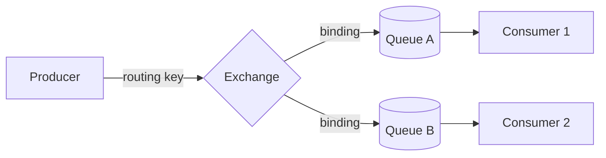

# AMQP and RabbitMQ exchanges queues and bindings

---

## 🟢 Junior Level

### 1. What is AMQP and RabbitMQ?

**AMQP (Advanced Message Queuing Protocol)** is a binary, wire-level protocol for brokers. Unlike JMS (a Java API), AMQP defines the bytes on the wire, so clients in Java, Python or Go interoperate. **RabbitMQ** is the most popular broker; it natively speaks **AMQP 0-9-1** (the version most clients use) and supports AMQP 1.0, MQTT and STOMP through plugins/native support.

### 2. The key idea: producers never write to queues directly

In RabbitMQ a producer publishes to an **exchange** with a **routing key**. The exchange applies **bindings** (rules) and copies the message into zero or more **queues**. Consumers read from queues.

**Analogy:** The exchange is the mail sorting office; the routing key is the address on the envelope; bindings are the sorting rules; queues are the mailboxes.



### 3. Four exchange types

| Type | Routing rule | Typical use |
| :--- | :--- | :--- |
| **direct** | Routing key equals binding key exactly | Task routing: `invoice`, `email` |
| **fanout** | Ignores the key; copies to all bound queues | Broadcast events |
| **topic** | Key is dot-separated words; binding patterns use `*` (one word) and `#` (zero or more words) | `order.eu.created` matches `order.*.created`, `order.#` |
| **headers** | Matches on message header attributes (`x-match=all|any`) | Rare; routing on multiple attributes |

The **default exchange** (name `""`) is a direct exchange where every queue is automatically bound with its own name — that is why `convertAndSend("queueName", msg)` works.

### 4. Minimal Spring AMQP example

```java
import org.springframework.amqp.core.Binding;
import org.springframework.amqp.core.BindingBuilder;
import org.springframework.amqp.core.Queue;
import org.springframework.amqp.core.TopicExchange;
import org.springframework.amqp.rabbit.annotation.RabbitListener;
import org.springframework.amqp.rabbit.core.RabbitTemplate;
import org.springframework.context.annotation.Bean;
import org.springframework.context.annotation.Configuration;
import org.springframework.stereotype.Component;

@Configuration
class RabbitTopology {
    static final String EXCHANGE = "orders.exchange";
    static final String BILLING_Q = "billing.orders";

    @Bean TopicExchange ordersExchange() { return new TopicExchange(EXCHANGE, true, false); }
    @Bean Queue billingQueue()           { return new Queue(BILLING_Q, true); }
    @Bean Binding billingBinding(Queue billingQueue, TopicExchange ordersExchange) {
        return BindingBuilder.bind(billingQueue).to(ordersExchange).with("order.*.created");
    }
}

@Component
class OrderPublisher {
    private final RabbitTemplate rabbit;
    OrderPublisher(RabbitTemplate rabbit) { this.rabbit = rabbit; }

    void created(String region, String json) {
        rabbit.convertAndSend(RabbitTopology.EXCHANGE, "order." + region + ".created", json);
    }
}

@Component
class BillingListener {
    @RabbitListener(queues = RabbitTopology.BILLING_Q)
    void handle(String json) { System.out.println("Billing got " + json); }
}
```

Spring's `RabbitAdmin` (auto-configured by Boot) declares these exchanges/queues/bindings on the broker when the connection opens. Declaration is idempotent as long as the arguments match.

---

## 🟡 Middle Level

### 1. Connection, channel, and thread model

A TCP **Connection** is expensive; a **Channel** is a lightweight virtual connection multiplexed over it. Channels are **not thread-safe for concurrent publishing** with confirms; Spring's `CachingConnectionFactory` keeps one connection and caches channels (`channelCacheSize`, default 25). Rule of thumb: one connection per application for publishing and one for consuming (`usePublisherConnection=true`), many channels.

### 2. Declarative topology with `@RabbitListener`

You can declare topology right where it is consumed:

```java
import org.springframework.amqp.core.ExchangeTypes;
import org.springframework.amqp.rabbit.annotation.Exchange;
import org.springframework.amqp.rabbit.annotation.Queue;
import org.springframework.amqp.rabbit.annotation.QueueBinding;
import org.springframework.amqp.rabbit.annotation.RabbitListener;
import org.springframework.stereotype.Component;

@Component
class ShippingListener {
    @RabbitListener(bindings = @QueueBinding(
            value = @Queue(name = "shipping.orders", durable = "true",
                           arguments = @org.springframework.amqp.rabbit.annotation.Argument(
                               name = "x-queue-type", value = "quorum")),
            exchange = @Exchange(name = "orders.exchange", type = ExchangeTypes.TOPIC),
            key = {"order.eu.#", "order.us.created"}))
    void onOrder(String json) {
        System.out.println("Shipping: " + json);
    }
}
```

### 3. Choosing the exchange type

- **One consumer group per task** → direct.
- **Event broadcast with an unknown number of subscribers** → fanout or topic. Prefer **topic** — it gives subscribers the option to filter later without changing producers.
- **Multi-attribute routing** → headers exchange works but is slower and harder to reason about; a topic key such as `region.type.priority` is usually clearer.
- **Exchange-to-exchange bindings** let you build layered topologies (e.g., a public topic exchange feeding internal exchanges).

### 4. Message properties you must know

`delivery_mode` (1 transient / 2 persistent), `content_type`, `message_id`, `correlation_id`, `reply_to`, `expiration` (per-message TTL), `priority`, `headers`, `type`. With Spring, `MessageProperties` exposes them, and `MessagePostProcessor` customizes them on send:

```java
import org.springframework.amqp.core.MessageDeliveryMode;
import org.springframework.amqp.rabbit.core.RabbitTemplate;
import org.springframework.stereotype.Service;
import java.util.UUID;

@Service
class PropertyAwarePublisher {
    private final RabbitTemplate rabbit;
    PropertyAwarePublisher(RabbitTemplate rabbit) { this.rabbit = rabbit; }

    void send(String json) {
        rabbit.convertAndSend("orders.exchange", "order.eu.created", json, m -> {
            m.getMessageProperties().setMessageId(UUID.randomUUID().toString());
            m.getMessageProperties().setDeliveryMode(MessageDeliveryMode.PERSISTENT);
            m.getMessageProperties().setExpiration("60000"); // 60 s TTL, string in ms
            m.getMessageProperties().setHeader("tenant", "acme");
            return m;
        });
    }
}
```

### 5. JSON serialization

By default `RabbitTemplate` uses `SimpleMessageConverter` (Java serialization for `Serializable` objects — avoid). Register a `Jackson2JsonMessageConverter` bean; Boot picks it up automatically for template and listeners:

```java
import org.springframework.amqp.support.converter.Jackson2JsonMessageConverter;
import org.springframework.amqp.support.converter.MessageConverter;
import org.springframework.context.annotation.Bean;
import org.springframework.context.annotation.Configuration;

@Configuration
class JsonConfig {
    @Bean
    MessageConverter jsonMessageConverter() {
        return new Jackson2JsonMessageConverter();
    }
}
```

### 6. Common mistakes

- Publishing to a nonexistent exchange (channel is closed with `404 NOT_FOUND`) or with a routing key that matches nothing — the message is **silently dropped** unless the `mandatory` flag + `ReturnsCallback` is used.
- Redeclaring a queue with different arguments (`PRECONDITION_FAILED`) after changing durability or type. Queue arguments are immutable; delete and recreate (or migrate by a new queue name).
- Using `#` bindings everywhere and creating accidental fan-out loops.
- Forgetting that fanout/topic copies a message into *each* bound queue (storage multiplies).

---

## 🔴 Senior Level

### 1. Protocol internals

AMQP 0-9-1 is frame-based: method frames (`basic.publish`, `basic.deliver`), content header frame (properties, body size) and body frames (split by `frame_max`, default 128 KiB). Heartbeats (default 60 s) detect dead TCP peers; set `spring.rabbitmq.requested-heartbeat` thoughtfully behind load balancers with idle timeouts. Connection/channel level errors are reported by closing the channel (soft) or connection (hard); Spring's `CachingConnectionFactory` auto-recovers, and `RabbitAdmin` re-declares topology on reconnect.

### 2. Reliability handshake on the producer side

Use publisher confirms *and* mandatory returns for lossless publishing:

```java
import org.springframework.amqp.rabbit.core.RabbitTemplate;
import org.springframework.amqp.rabbit.connection.CorrelationData;
import org.springframework.context.annotation.Bean;
import org.springframework.context.annotation.Configuration;
import org.springframework.amqp.rabbit.connection.ConnectionFactory;

@Configuration
class ReliableRabbitConfig {
    @Bean
    RabbitTemplate rabbitTemplate(ConnectionFactory cf) {
        RabbitTemplate t = new RabbitTemplate(cf);
        t.setMandatory(true); // unroutable messages are returned, not dropped
        t.setReturnsCallback(r -> System.err.println("UNROUTABLE " + r.getRoutingKey()
                + " reply=" + r.getReplyText()));
        t.setConfirmCallback((CorrelationData c, boolean ack, String cause) -> {
            if (!ack) System.err.println("Broker NACK " + (c != null ? c.getId() : "") + " " + cause);
        });
        return t;
    }
}
```
with `spring.rabbitmq.publisher-confirm-type=correlated` and `spring.rabbitmq.publisher-returns=true`. Alternate-exchange (`alternate-exchange` argument) is a broker-side alternative: unroutable messages are redirected to a catch-all fanout exchange for inspection.

### 3. Performance considerations

- **Topic exchange matching** uses a trie; cost is proportional to routing key length, not the number of bindings, so thousands of bindings are fine. Headers exchanges scan bindings linearly.
- **Message size**: keep under ~128 KiB; RabbitMQ is not a blob store.
- **Throughput**: single quorum/classic queue is processed by one Erlang process — a hot queue caps at roughly tens of thousands msg/s. Scale by sharding queues with the **consistent-hash exchange** plugin (`x-consistent-hash`), then having a consumer per shard (also gives per-key ordering; see [Message ordering partitioning and competing consumers](09.%20Message%20ordering%20partitioning%20and%20competing%20consumers.md)).
- **Lazy / classic queue v2** and **quorum queues** store most messages on disk, avoiding RAM blow-ups with long queues.
- **Streams** (`x-queue-type=stream`) offer an append-only log with replay and offset tracking, for Kafka-like use cases ([RabbitMQ vs Kafka when to choose which](10.%20RabbitMQ%20vs%20Kafka%20when%20to%20choose%20which.md)).

### 4. Topology design for a multi-team system

A robust pattern: each **producer team owns an exchange** (`billing.events`, topic type, durable), each **consumer team owns its queues** and the bindings from the producer exchange to them. Consumers never share queues across services (a shared queue means competing consumers, not pub/sub). Name queues `<consumer-service>.<producer>.<purpose>`. Version routing keys or exchanges for breaking changes (see [Schema evolution and message contracts](17.%20Schema%20evolution%20and%20message%20contracts.md)).

### 5. Diagnostics

- `rabbitmqctl list_exchanges name type`, `list_bindings`, `list_queues name messages_ready messages_unacknowledged consumers`.
- Management UI (`:15672`): the *Publish* panel and *Get messages* (requeue = true!) are useful for debugging unroutable messages.
- Use `rabbitmq-diagnostics check_running`, and Prometheus plugin on `:15692`.
- Wireshark has an AMQP dissector, useful for diagnosing framing/heartbeat issues.

---

## 🎯 Interview Cheat Sheet

**30-second elevator pitch:** AMQP is a wire protocol and RabbitMQ is its flagship broker. Producers publish to exchanges, never to queues; bindings and routing keys decide which queues receive a copy. Direct, fanout, topic and headers exchanges cover task routing, broadcast, pattern routing and attribute routing. Spring AMQP declares topology via `RabbitAdmin` and offers `RabbitTemplate` and `@RabbitListener`.

**Must-know bullets:**
- Exchange → binding → queue → consumer; the default exchange routes by queue name.
- Topic wildcards: `*` one word, `#` zero or more.
- Unroutable messages are dropped unless `mandatory` or an alternate exchange is used.
- Queue arguments are immutable once declared.
- Use confirms for publishers, JSON converter instead of Java serialization.
- Connection = TCP, Channel = lightweight; cache channels.

**Common follow-up questions:**
- What is the difference between a routing key and a binding key?
- How do you broadcast an event to multiple services with RabbitMQ?
- How would you debug a message that "disappeared"?
- How does RabbitMQ differ from JMS topics?

**🚩 Red flags:**
- "The producer sends to a queue" (without understanding the exchange).
- Using one queue shared by different services to emulate pub/sub.
- Ignoring `mandatory`/confirms.

**Related topics:**
- [Message acknowledgements and prefetch](04.%20Message%20acknowledgements%20and%20prefetch.md)
- [Message durability and persistence](05.%20Message%20durability%20and%20persistence.md)
- [Dead letter queues retries and poison messages](06.%20Dead%20letter%20queues%20retries%20and%20poison%20messages.md)
- [Operating brokers clustering and quorum queues](22.%20Operating%20brokers%20clustering%20and%20quorum%20queues.md)
