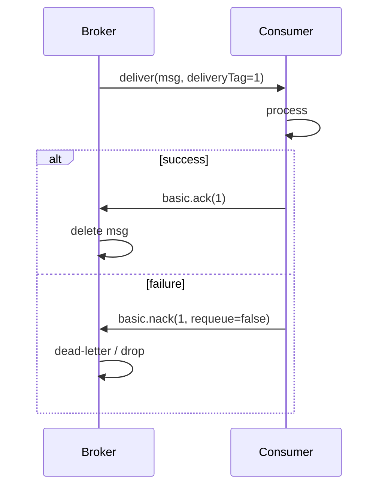

# Message acknowledgements and prefetch

---

## 🟢 Junior Level

### 1. What is an acknowledgement?

An **acknowledgement (ack)** is the consumer's way of telling the broker: "I received and processed this message, you can delete it now." Until the ack arrives, the broker keeps the message and, if the consumer disappears, hands it to someone else. This is the core mechanism behind **at-least-once** delivery.

**Analogy:** A courier hands you a parcel and waits for your signature. No signature → the courier assumes it failed and tries again.

### 2. The three outcomes

| Outcome | AMQP method | Meaning |
| :--- | :--- | :--- |
| **ack** | `basic.ack` | Success; remove the message |
| **nack / reject (requeue)** | `basic.nack`, `basic.reject` with `requeue=true` | Failure; put it back for redelivery |
| **nack / reject (no requeue)** | same with `requeue=false` | Failure; discard or send to a dead-letter exchange |

### 3. Spring AMQP: acknowledge modes



Spring's listener container has `AcknowledgeMode`:

- `AUTO` (default) — the container acks after the listener returns, and **nacks (with requeue unless configured otherwise)** if it throws.
- `MANUAL` — your code calls `channel.basicAck(...)`.
- `NONE` — broker auto-acks on delivery (`autoAck`): fastest, but a crash loses messages (at-most-once).

### 4. Minimal example

```java
import org.springframework.amqp.rabbit.annotation.RabbitListener;
import org.springframework.stereotype.Component;

@Component
class PaymentListener {
    @RabbitListener(queues = "payments")
    void handle(String payment) {
        // return normally => ack; throw => nack
        if (payment.isBlank()) {
            throw new IllegalArgumentException("empty payment");
        }
        System.out.println("Paid " + payment);
    }
}
```

> [!WARNING]
> With default settings an exception leads to *requeue and immediate redelivery* — an infinite hot loop for a message that can never succeed. See [Dead letter queues retries and poison messages](06.%20Dead%20letter%20queues%20retries%20and%20poison%20messages.md).

### 5. What is prefetch?

**Prefetch (QoS)** limits how many unacknowledged messages the broker pushes to one consumer at a time. With prefetch = 10 the broker sends up to 10 messages, then waits for acks before sending more. It is how a push-based broker implements flow control.

---

## 🟡 Middle Level

### 1. Manual acknowledgement

Use manual ack when the decision depends on asynchronous work or you need fine control (e.g., ack only after the database commit):

```java
import com.rabbitmq.client.Channel;
import org.springframework.amqp.core.Message;
import org.springframework.amqp.rabbit.annotation.RabbitListener;
import org.springframework.amqp.support.AmqpHeaders;
import org.springframework.messaging.handler.annotation.Header;
import org.springframework.stereotype.Component;
import java.io.IOException;

@Component
class ManualAckListener {

    @RabbitListener(queues = "invoices", ackMode = "MANUAL")
    void onInvoice(String body, Channel channel,
                   @Header(AmqpHeaders.DELIVERY_TAG) long tag) throws IOException {
        try {
            process(body);
            channel.basicAck(tag, false);              // multiple=false: just this one
        } catch (TransientException e) {
            channel.basicNack(tag, false, true);       // requeue
        } catch (Exception e) {
            channel.basicReject(tag, false);           // dead-letter
        }
    }

    private void process(String body) { /* business logic */ }
    static class TransientException extends RuntimeException {}
}
```

Key details:
- The **delivery tag** is scoped to a channel. Acking on a different channel throws `PRECONDITION_FAILED - unknown delivery tag`.
- `multiple=true` acks all deliveries up to and including the tag — efficient but easy to misuse with concurrency.
- Acking twice closes the channel with an error.

### 2. Prefetch tuning

`spring.rabbitmq.listener.simple.prefetch=N` (default **250** in Spring AMQP 2.x+; RabbitMQ's own default is unlimited). Think of it as an in-flight window per consumer.

| Prefetch | Effect |
| :--- | :--- |
| 1 | Perfect fairness; each consumer holds one message. Throughput limited by network round-trip. Good for long, uneven tasks (video encoding). |
| 10-50 | Good compromise for typical millisecond-scale handlers. |
| 250+ | High throughput for tiny, uniform messages; risk of one consumer hoarding messages while peers idle; larger redelivery storm on crash. |
| Unlimited (0) | Dangerous; consumer memory can explode. |

Rule of thumb: `prefetch ≈ throughput_per_consumer × round_trip_time` for fast handlers, and 1-5 for slow ones.

### 3. Batching acks

`SimpleMessageListenerContainer` has `batchSize` / `txSize` to ack several messages at once, reducing round-trips; the container also supports consumer **batch listeners** (`spring.rabbitmq.listener.simple.consumer-batch-enabled=true`) delivering a `List<Message>`:

```java
import org.springframework.amqp.rabbit.annotation.RabbitListener;
import org.springframework.stereotype.Component;
import java.util.List;

@Component
class BatchListener {
    // requires consumer-batch-enabled=true, batch-size=50, receive-timeout=500ms
    @RabbitListener(queues = "audit")
    void batch(List<String> events) {
        System.out.println("Bulk insert of " + events.size() + " audit events");
        // one exception nacks the whole batch -> design for it
    }
}
```

### 4. Common mistakes

- **Ack before processing** (or `autoAck`) — data loss when the process dies.
- **Ack after a long, non-transactional chain** — duplicates when the process dies after side effects but before ack. Pair with idempotency ([Idempotent consumers deduplication and the inbox pattern](08.%20Idempotent%20consumers%20deduplication%20and%20the%20inbox%20pattern.md)).
- Forgetting to ack in `MANUAL` mode: `unacked` count grows until the prefetch window is full and the consumer stops receiving; messages appear "stuck". On channel close they return to the queue.
- Swallowing exceptions in `AUTO` mode: the container sees success and acks → message silently lost.
- `consumer_timeout` (RabbitMQ 3.8.15+, default 30 min): if a delivery stays unacked longer, the broker closes the channel (`PRECONDITION_FAILED`). Long jobs must ack early or raise the timeout.

### 5. JMS equivalents

JMS `CLIENT_ACKNOWLEDGE` ≈ manual ack; `SESSION_TRANSACTED` ≈ ack on commit; the broker-side window is ActiveMQ's `prefetchPolicy.queuePrefetch` (default 1000 in Classic) and Artemis `consumerWindowSize` ([JMS API with ActiveMQ and Artemis](02.%20JMS%20API%20with%20ActiveMQ%20and%20Artemis.md)). SQS has no prefetch; you decide batch size on `ReceiveMessage` ([AWS SQS and SNS standard vs FIFO and visibility timeout](11.%20AWS%20SQS%20and%20SNS%20standard%20vs%20FIFO%20and%20visibility%20timeout.md)).

---

## 🔴 Senior Level

### 1. How ack and redelivery work internally (RabbitMQ)

When a queue delivers a message to a consumer it moves it from `ready` to `unacked` and tracks it per channel. If the channel closes without acking, all its unacked messages are returned to the queue (flagged `redelivered=true`, placed back at their original position for classic queues if possible — ordering is therefore **not** guaranteed after redelivery). Quorum queues additionally count deliveries in the `x-delivery-count` header and support a `delivery-limit` (default 20 in RabbitMQ 4) after which the message is dead-lettered — a built-in poison message guard.

### 2. Sizing prefetch with data

Measure instead of guessing. Let `t` be handler time, `r` network round-trip. A single consumer with prefetch `p` processes at most `p / (t + r)`... more precisely the pipe stays full if `p ≥ (t + r) / t`. For `t = 5 ms`, `r = 1 ms`, `p = 2` suffices to saturate one consumer; any larger prefetch just adds hoarding. For a pool of `N` concurrent consumers (threads) each gets its own prefetch, so total in-flight = `N × p`. Diagnostics:

- Management UI: queue shows `Ready`, `Unacked`; if `Unacked ≈ consumers × prefetch` consistently and `Ready` is high, consumers are the bottleneck.
- If `Unacked` is low and `Ready` is high, prefetch/ack latency is the bottleneck.

### 3. Spring container tuning in code

```java
import org.springframework.amqp.rabbit.config.SimpleRabbitListenerContainerFactory;
import org.springframework.amqp.rabbit.connection.ConnectionFactory;
import org.springframework.amqp.core.AcknowledgeMode;
import org.springframework.context.annotation.Bean;
import org.springframework.context.annotation.Configuration;
import org.springframework.util.backoff.FixedBackOff;

@Configuration
class ListenerTuning {
    @Bean
    SimpleRabbitListenerContainerFactory slowJobsFactory(ConnectionFactory cf) {
        SimpleRabbitListenerContainerFactory f = new SimpleRabbitListenerContainerFactory();
        f.setConnectionFactory(cf);
        f.setAcknowledgeMode(AcknowledgeMode.AUTO);
        f.setPrefetchCount(1);            // fair dispatch for long jobs
        f.setConcurrentConsumers(4);
        f.setMaxConcurrentConsumers(16);  // scales up under load
        f.setDefaultRequeueRejected(false); // exceptions -> dead-letter, no hot loop
        f.setRecoveryBackOff(new FixedBackOff(5000, FixedBackOff.UNLIMITED_ATTEMPTS));
        return f;
    }
}
```

Use it with `@RabbitListener(queues="jobs", containerFactory="slowJobsFactory")`.

Also consider `DirectRabbitListenerContainerFactory` (`consumersPerQueue`): it runs the listener directly on the AMQP client's thread, lower overhead, but you manage thread pools yourself; blocking handlers should hand work off to an executor.

### 4. Failure scenarios

| Scenario | What happens | Fix |
| :--- | :--- | :--- |
| Listener thread hangs forever | Message unacked, `consumer_timeout` closes channel after 30 min, redelivered to another consumer, hangs again → poison loop | Handler timeouts, bulkheads |
| Consumer killed mid-batch | All unacked in window are redelivered, some already processed | Idempotent processing |
| DB slow, prefetch 1000 | Consumers hold 1000 msgs each; scaling out does not help because first consumers hoard | Lower prefetch |
| Ack lost (network drop after processing) | Redelivery → duplicate | Dedup key |

### 5. Quorum-queue note

Acks on quorum queues are replicated through Raft; they are cheap but sensitive to disk latency. Avoid acking one message at a time with enormous throughput needs — use `multiple=true` or batch consumers to cut log entries. See [Operating brokers clustering and quorum queues](22.%20Operating%20brokers%20clustering%20and%20quorum%20queues.md).

---

## 🎯 Interview Cheat Sheet

**30-second elevator pitch:** Acknowledgements tell the broker a message was processed; without them the broker redelivers, which gives at-least-once semantics. Prefetch caps unacked messages per consumer so a push broker doesn't flood a slow consumer; low values give fairness, high values give throughput. Use Spring's AUTO mode with a dead-letter policy for most cases and MANUAL when ack timing matters.

**Must-know bullets:**
- ack = done; nack/reject + requeue = retry; nack/reject without requeue = DLQ/drop.
- AUTO ack on exception requeues by default → set `defaultRequeueRejected=false` or use a retry/DLQ policy.
- Delivery tags are per channel; don't ack on another channel.
- Prefetch 1 for long uneven jobs; tens to hundreds for fast uniform ones.
- `consumer_timeout` closes channels with long-unacked deliveries.
- Auto-ack (`NONE`) = at-most-once.

**Common follow-up questions:**
- Why can a message be processed twice even though you acked?
- What happens to unacked messages when a consumer dies?
- How would you pick a prefetch value?
- Difference between `basic.nack` and `basic.reject`? (nack supports `multiple`.)

**🚩 Red flags:**
- Catching and swallowing exceptions in a listener.
- Leaving default requeue behavior with no DLQ.
- "Prefetch larger is always better."

**Related topics:**
- [Dead letter queues retries and poison messages](06.%20Dead%20letter%20queues%20retries%20and%20poison%20messages.md)
- [Delivery guarantees and the exactly-once myth](07.%20Delivery%20guarantees%20and%20the%20exactly-once%20myth.md)
- [Backpressure and consumer lag monitoring](19.%20Backpressure%20and%20consumer%20lag%20monitoring.md)
- [Message ordering partitioning and competing consumers](09.%20Message%20ordering%20partitioning%20and%20competing%20consumers.md)
