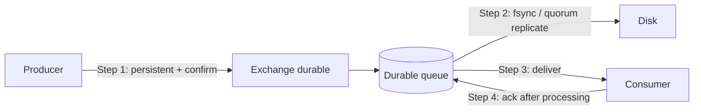

# Message durability and persistence

---

## 🟢 Junior Level

### 1. What does "durable" mean?

A message broker usually keeps data in memory for speed. **Durability** is about surviving a **broker restart or crash**: will the queue and its messages still exist afterwards? Two separate things must be durable, and beginners often forget one:

1. The **queue/exchange definition** (durable queue → the *container* survives).
2. The **message itself** (persistent message → the *content* is written to disk).

If either is missing, the message can vanish on restart.

**Analogy:** A durable queue is a mailbox bolted to the wall; a persistent message is a letter in a sealed envelope. A letter on a mailbox that is removed in a restart is gone; a bolted mailbox with a scrap of paper that was never written down is empty.

| Queue | Message | After broker restart |
| :--- | :--- | :--- |
| durable | persistent | Queue and message survive |
| durable | transient | Queue survives, message lost |
| transient | persistent | Queue lost, so message lost |
| transient | transient | Everything lost |

### 2. Minimal example (Spring AMQP)

```java
import org.springframework.amqp.core.Queue;
import org.springframework.amqp.core.QueueBuilder;
import org.springframework.amqp.core.MessageDeliveryMode;
import org.springframework.amqp.rabbit.core.RabbitTemplate;
import org.springframework.context.annotation.Bean;
import org.springframework.context.annotation.Configuration;
import org.springframework.stereotype.Service;

@Configuration
class DurableConfig {
    @Bean
    Queue ordersQueue() {
        return QueueBuilder.durable("orders").build();   // survives restart
    }
}

@Service
class DurableSender {
    private final RabbitTemplate rabbit;
    DurableSender(RabbitTemplate rabbit) { this.rabbit = rabbit; }

    void send(String body) {
        rabbit.convertAndSend("", "orders", body, m -> {
            m.getMessageProperties().setDeliveryMode(MessageDeliveryMode.PERSISTENT);
            return m;
        });
    }
}
```

In Spring AMQP, `RabbitTemplate` already sends messages as **persistent by default** (`MessageProperties.DEFAULT_DELIVERY_MODE = PERSISTENT`) and `new Queue(name)` is durable by default; but raw RabbitMQ clients default to transient — always check!

---

## 🟡 Middle Level

### 1. Durability is not the same as "no loss"

Persistent flag ≠ written to disk *yet*. RabbitMQ classic queues batch fsyncs for performance, so there is a small window between broker acceptance and fsync. To know that the broker really took responsibility, use **publisher confirms**; for persistent messages on classic queues the confirm is sent after the message is persisted to disk; for quorum queues after it is replicated to a majority and fsynced.

Full durability chain:



Any one weak link (transient message, non-durable queue, auto-ack, no confirm) breaks end-to-end durability.

### 2. Broker comparison

| Broker | Persistence mechanism | Notes |
| :--- | :--- | :--- |
| RabbitMQ classic | Message store + queue index files | Persistent flag per message |
| RabbitMQ quorum queues | Raft log (Write-Ahead Log) replicated across nodes | Always durable, always persistent; transient messages not supported |
| RabbitMQ streams | Append-only segments, replicated | Retention by size/time |
| ActiveMQ Classic | KahaDB (journal), JDBC | `deliveryMode=PERSISTENT` default in JMS |
| ActiveMQ Artemis | Append-only journal (AIO/NIO) + paging | `ANYCAST` queue `durable=true` |
| AWS SQS | Replicated across multiple AZs automatically | No knob; 4-day default retention, up to 14 days |
| Kafka | Replicated log | `acks=all`, `min.insync.replicas` (see Kafka section) |

### 3. Durable subscribers on topics

On a pub/sub model a durable subscription (JMS) or a *named durable queue bound to a topic/fanout exchange* (RabbitMQ) keeps messages for an offline subscriber. A *non-durable/exclusive auto-delete* queue — the default for `fanout` demos with `AnonymousQueue` — loses events while the subscriber is offline. Use named queues in production.

```java
import org.springframework.amqp.core.AnonymousQueue;
import org.springframework.amqp.core.Queue;
import org.springframework.amqp.core.QueueBuilder;
import org.springframework.context.annotation.Bean;
import org.springframework.context.annotation.Configuration;

@Configuration
class SubscriberQueues {
    @Bean Queue demoOnly()   { return new AnonymousQueue(); }                       // exclusive, auto-delete: loses data
    @Bean Queue billingSub() { return QueueBuilder.durable("billing.events").build(); } // production
}
```

### 4. TTL and expiry interplay

Persistence is not infinite retention: `x-message-ttl` (queue) and `expiration` (message) drop old messages; `x-max-length` and `x-max-length-bytes` with `overflow` (`drop-head`, `reject-publish`) cap size. Choose `reject-publish` + confirms when losing the oldest data silently is unacceptable. Set `x-expires` to delete idle queues (useful for per-client reply queues).

### 5. Common mistakes

- Declaring `durable=true` queue but publishing with `deliveryMode=1`.
- Redeclaring an existing queue with a different durability — `PRECONDITION_FAILED`.
- Believing mirrored/quorum replication replaces backups; it does not protect against logical errors (a bad purge replicates).
- Assuming `autoDelete` queues are durable: they are deleted when the last consumer disconnects.
- Putting RabbitMQ data dir on ephemeral container storage (no PersistentVolume in Kubernetes) — "durable" queues then disappear on pod reschedule.

---

## 🔴 Senior Level

### 1. Disk path and fsync cost

Every persistent message costs I/O. Classic queues (v2 since RabbitMQ 3.12) write small messages (< 4 KB by default `queue_index_embed_msgs_below`) into the queue index and larger ones into a shared message store, which is compacted by a garbage-collecting process. Quorum queues write everything to the Raft WAL, then to segments, and require `fsync` before acknowledging to the leader; so **disk latency directly bounds publish latency**. Production guidance: dedicated SSD/NVMe, avoid network filesystems with unpredictable fsync latency, monitor `disk_free_limit` — when free space drops below it, RabbitMQ raises a **disk alarm and blocks all publishers** cluster-wide.

### 2. The trade-off table you should be able to draw

| Setting | Durability | Throughput |
| :--- | :--- | :--- |
| transient + auto-ack | none | highest (hundreds of thousands msg/s) |
| persistent + confirms (batch) | high | high if confirms are batched/asynchronous |
| persistent + confirm per message (synchronous wait) | high | dramatically lower (one RTT + fsync per message) |
| Quorum queue + confirms | highest in RabbitMQ | moderate, depends on disk and network |
| Transactions (`tx.commit`) | high | ~250× slower than confirms – avoid |

Use asynchronous confirms with a bounded in-flight window; Spring's `CorrelationData.getFuture()` makes that straightforward:

```java
import org.springframework.amqp.rabbit.connection.CorrelationData;
import org.springframework.amqp.rabbit.core.RabbitTemplate;
import org.springframework.stereotype.Service;
import java.util.concurrent.TimeUnit;
import java.util.concurrent.TimeoutException;
import java.util.concurrent.ExecutionException;

@Service
class ConfirmedSender {
    private final RabbitTemplate template;
    ConfirmedSender(RabbitTemplate template) { this.template = template; }

    // blocks until the broker confirms - use for critical, low-volume messages
    boolean sendAndWait(String exchange, String key, Object payload)
            throws InterruptedException, ExecutionException, TimeoutException {
        CorrelationData cd = new CorrelationData();
        template.convertAndSend(exchange, key, payload, cd);
        CorrelationData.Confirm confirm = cd.getFuture().get(5, TimeUnit.SECONDS);
        return confirm.isAck();
    }
}
```

### 3. Crash scenarios and what actually happens

1. **Broker crashes right after confirming a persistent classic-queue message** — safe; recovered from disk on boot.
2. **Broker crashes before fsync, no confirm yet** — message may be lost; producer never got confirm so it retries (duplicate possible if actually persisted) → consumers must be idempotent ([Idempotent consumers deduplication and the inbox pattern](08.%20Idempotent%20consumers%20deduplication%20and%20the%20inbox%20pattern.md)).
3. **Node loss in a quorum queue** — a new leader is elected from nodes that hold the committed entries; no committed message lost as long as a majority survives.
4. **Whole-cluster power loss with `fsync` disabled by the storage layer (volatile write cache)** — silent loss; verify hardware cache policy.
5. **Producer crash after DB commit before publish** — durability of the broker is irrelevant; use [Transactional outbox pattern](12.%20Transactional%20outbox%20pattern.md).

### 4. Memory and flow control

Persistence does not imply the message leaves memory. Classic queues keep recently-used messages in RAM; when memory exceeds `vm_memory_high_watermark` (default 0.6 of RAM) a **memory alarm** blocks publishers. Backing connections show state `blocked`/`blocking` in the management UI; clients see `ConnectionBlockedListener` notifications. Handle them: Spring's `CachingConnectionFactory` publishes `ConnectionBlockedEvent`-style signals that you can log and alert on. Prefer quorum queues or streams for long backlogs, since they keep only a bounded in-memory tail.

### 5. Verification drill (what a senior does before go-live)

1. Publish 100 000 persistent messages with confirms, kill -9 the broker, restart, and compare counts.
2. Repeat for node failover in a 3-node quorum cluster while under load (e.g., with `PerfTest`: `bin/runjava com.rabbitmq.perf.PerfTestMulti` or the `pivotalrabbitmq/perf-test` image).
3. Check `rabbitmq-diagnostics check_if_node_is_quorum_critical` before node maintenance.
4. Snapshot RabbitMQ definitions (`rabbitmqctl export_definitions`) to version-control topology.

---

## 🎯 Interview Cheat Sheet

**30-second elevator pitch:** Durability needs three things: durable queues/exchanges, persistent messages, and producer-side confirms (plus consumer acks for the other side). Even then you rely on fsync policy and replication; quorum queues replicate through Raft for node-failure tolerance. Persistence costs throughput, so batch confirms, don't use AMQP transactions, and design consumers for the duplicates retries cause.

**Must-know bullets:**
- Durable queue ≠ persistent message; you need both.
- Spring AMQP is persistent by default; raw clients may not be.
- Confirms tell you the broker accepted responsibility; transactions are too slow.
- Quorum queues are always durable and replicated; classic mirrored queues were removed in RabbitMQ 4.
- Disk/memory alarms block publishers.
- Kubernetes needs PersistentVolumes for broker data.

**Common follow-up questions:**
- What survives a RabbitMQ restart if only the queue is durable?
- Why use confirms instead of transactions?
- How does SQS achieve durability without you configuring anything?
- Does replication replace backups?

**🚩 Red flags:**
- "durable=true so I'm safe."
- No plan for disk-full or memory alarms.
- Treating a message broker as long-term storage.

**Related topics:**
- [Message acknowledgements and prefetch](04.%20Message%20acknowledgements%20and%20prefetch.md)
- [Delivery guarantees and the exactly-once myth](07.%20Delivery%20guarantees%20and%20the%20exactly-once%20myth.md)
- [Operating brokers clustering and quorum queues](20.%20Operating%20brokers%20clustering%20and%20quorum%20queues.md)
- [RabbitMQ vs Kafka when to choose which](10.%20RabbitMQ%20vs%20Kafka%20when%20to%20choose%20which.md)
