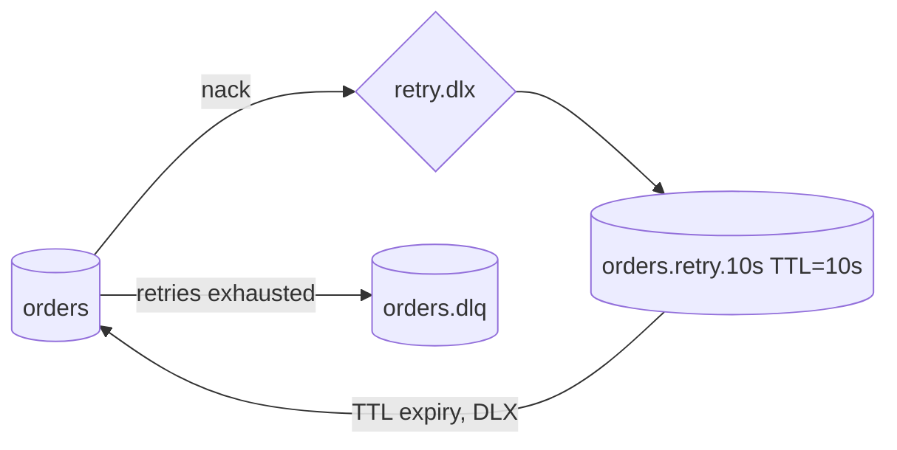

# Dead letter queues retries and poison messages

---

## 🟢 Junior Level

### 1. The problem: a message that can never succeed

Some messages fail **temporarily** (database briefly down) and some fail **forever** (malformed JSON, a reference to a customer that does not exist). The second kind is a **poison message**. If the broker keeps redelivering it, the consumer spends all its time on one message and everything behind it waits — or the CPU spins in a hot loop.

A **Dead Letter Queue (DLQ)** is a side queue where the broker or the consumer parks messages that have failed too many times, expired, or were rejected. A human or a repair job inspects them later.

**Analogy:** The post office cannot deliver a letter with a wrong address. After a few attempts it does not keep walking the same route; it puts the letter in a "dead letter office" where someone investigates.

### 2. Why messages become dead letters

| Reason | Example |
| :--- | :--- |
| Rejected / nacked without requeue | Consumer threw an exception after retries |
| TTL expired | Message waited longer than `x-message-ttl` |
| Queue length limit exceeded | `x-max-length` with `drop-head` |
| Delivery limit reached (quorum queues) | Delivered > `x-delivery-limit` times |

### 3. Minimal RabbitMQ example

```java
import org.springframework.amqp.core.Binding;
import org.springframework.amqp.core.BindingBuilder;
import org.springframework.amqp.core.DirectExchange;
import org.springframework.amqp.core.Queue;
import org.springframework.amqp.core.QueueBuilder;
import org.springframework.context.annotation.Bean;
import org.springframework.context.annotation.Configuration;

@Configuration
class DlqConfig {
    @Bean DirectExchange dlx() { return new DirectExchange("orders.dlx"); }

    @Bean Queue ordersDlq() { return QueueBuilder.durable("orders.dlq").build(); }

    @Bean Binding dlqBinding() {
        return BindingBuilder.bind(ordersDlq()).to(dlx()).with("orders");
    }

    @Bean Queue ordersQueue() {
        return QueueBuilder.durable("orders")
                .deadLetterExchange("orders.dlx")       // x-dead-letter-exchange
                .deadLetterRoutingKey("orders")         // x-dead-letter-routing-key
                .build();
    }
}
```

A listener that throws `AmqpRejectAndDontRequeueException` (or when `defaultRequeueRejected=false`) causes the broker to republish the message to `orders.dlx`, ending up in `orders.dlq`.

```java
import org.springframework.amqp.AmqpRejectAndDontRequeueException;
import org.springframework.amqp.rabbit.annotation.RabbitListener;
import org.springframework.stereotype.Component;

@Component
class OrderConsumer {
    @RabbitListener(queues = "orders")
    void handle(String json) {
        if (!json.startsWith("{")) {
            throw new AmqpRejectAndDontRequeueException("Malformed, sending to DLQ");
        }
        // process...
    }
}
```

---

## 🟡 Middle Level

### 1. Classify failures first

| Type | Example | Strategy |
| :--- | :--- | :--- |
| **Transient** | Timeout, deadlock, 503 from downstream | Retry with backoff |
| **Permanent** | Deserialization error, validation failure, business rule violation | Straight to DLQ, no retry |
| **Unknown** | NullPointerException | Limited retries, then DLQ |

Retrying a permanent failure wastes capacity; not retrying a transient one creates needless DLQ traffic.

### 2. In-process retry with Spring Retry (Spring Boot properties)

```properties
spring.rabbitmq.listener.simple.retry.enabled=true
spring.rabbitmq.listener.simple.retry.max-attempts=4
spring.rabbitmq.listener.simple.retry.initial-interval=1s
spring.rabbitmq.listener.simple.retry.multiplier=2.0
spring.rabbitmq.listener.simple.retry.max-interval=10s
spring.rabbitmq.listener.simple.default-requeue-rejected=false
```

After the final attempt the `RejectAndDontRequeueRecoverer` throws, the container nacks without requeue, and the DLX takes over. Drawback: the consumer thread sleeps during back-off (blocking the channel and holding the unacked message), and a restart resets attempt counters. Suitable for short delays (seconds).

### 3. Non-blocking retry topology (delay queues)

For longer delays use **retry queues with TTL** that dead-letter back to the main queue:



Spring AMQP builds that with `QueueBuilder.durable("orders.retry.10s").ttl(10_000).deadLetterExchange("").deadLetterRoutingKey("orders")`. Count attempts using the `x-death` header that RabbitMQ adds to each dead-lettered message:

```java
import org.springframework.amqp.core.Message;
import org.springframework.amqp.core.MessageProperties;
import org.springframework.amqp.core.QueueBuilder;
import org.springframework.amqp.core.Queue;
import org.springframework.amqp.rabbit.annotation.RabbitListener;
import org.springframework.amqp.rabbit.core.RabbitTemplate;
import org.springframework.context.annotation.Bean;
import org.springframework.stereotype.Component;
import java.util.List;
import java.util.Map;

@Component
class RetryingConsumer {
    private static final int MAX_ATTEMPTS = 3;
    private final RabbitTemplate rabbit;

    RetryingConsumer(RabbitTemplate rabbit) { this.rabbit = rabbit; }

    @Bean Queue retry10s() {
        return QueueBuilder.durable("orders.retry.10s").ttl(10_000)
                .deadLetterExchange("").deadLetterRoutingKey("orders").build();
    }

    @RabbitListener(queues = "orders")
    void handle(Message message) {
        try {
            process(new String(message.getBody()));
        } catch (RuntimeException ex) {
            if (attempts(message.getMessageProperties()) >= MAX_ATTEMPTS) {
                rabbit.send("orders.dlx", "orders", message);     // park for humans
            } else {
                rabbit.send("", "orders.retry.10s", message);     // retry later
            }
        }
    }

    @SuppressWarnings("unchecked")
    private long attempts(MessageProperties props) {
        List<Map<String, ?>> xDeath = props.getXDeathHeader();
        return xDeath == null ? 0 : xDeath.stream()
                .mapToLong(m -> ((Number) m.getOrDefault("count", 0L)).longValue()).sum();
    }

    private void process(String body) { /* business logic */ }
}
```

Note: the `ack` happens when `handle` returns, so the original is removed after being re-published. If publishing to the retry queue fails, throw to avoid losing the message.

### 4. Quorum queues: delivery limit

With quorum queues you can skip custom counters: `QueueBuilder.durable("orders").quorum().deliveryLimit(5).deadLetterExchange("orders.dlx").build()`. The broker tracks `x-delivery-count`. Dead-lettering with `at-least-once` strategy (`x-dead-letter-strategy=at-least-once`, requires `overflow=reject-publish`) gives safe DLX handoff.

### 5. Spring Cloud Stream and JMS

- **Spring Cloud Stream Rabbit binder:** `spring.cloud.stream.rabbit.bindings.<in>.consumer.auto-bind-dlq=true`, `republish-to-dlq=true` (adds stack trace in headers). See [Spring Cloud Stream binder model](18.%20Spring%20Cloud%20Stream%20binder%20model.md).
- **JMS/Artemis:** broker `max-delivery-attempts` + `dead-letter-address` ([JMS API with ActiveMQ and Artemis](02.%20JMS%20API%20with%20ActiveMQ%20and%20Artemis.md)).
- **SQS:** `RedrivePolicy` with `maxReceiveCount` ([AWS SQS and SNS standard vs FIFO and visibility timeout](11.%20AWS%20SQS%20and%20SNS%20standard%20vs%20FIFO%20and%20visibility%20timeout.md)).

### 6. Common mistakes

- Unlimited requeue → hot loop, 100% CPU, log flooding.
- A DLQ nobody monitors — it becomes a silent data graveyard. Alert on DLQ depth > 0.
- Dead-lettering without the original headers/exception — can't diagnose. Store cause, stack trace, timestamp, original routing key.
- Re-driving from the DLQ blindly into the same bug (an infinite loop). Fix the bug first, then redrive.
- Same DLQ for many queues so you can't tell the origin.

---

## 🔴 Senior Level

### 1. Head-of-line blocking and ordering

Retrying in place preserves order but blocks everything behind the failing message. Moving it to a retry queue unblocks the line but **reorders** processing (message 2 is processed before 1). Decide per business flow: for ordered streams, either block (retry in place with limits and alerting) or park the **whole entity key** (e.g., all events of `orderId=42`) while it is being retried; otherwise accept reordering with versioned/idempotent handlers ([Message ordering partitioning and competing consumers](09.%20Message%20ordering%20partitioning%20and%20competing%20consumers.md)).

### 2. Retry storms and amplification

When a downstream dependency dies, every consumer retries every message: `N consumers × prefetch × attempts` requests hammer a recovering system. Mitigations:

- **Exponential backoff with jitter** (full jitter: `sleep = random(0, min(cap, base·2^attempt))`).
- **Circuit breaker** around the dependency (Resilience4j); when open, **pause the listener container** (`MessageListenerContainer.stop()` or `RabbitListenerEndpointRegistry`) instead of burning retry budgets.
- Cap concurrency and prefetch; use a rate limiter.

```java
import org.springframework.amqp.rabbit.listener.RabbitListenerEndpointRegistry;
import org.springframework.stereotype.Component;

@Component
class ListenerPauser {
    private final RabbitListenerEndpointRegistry registry;
    ListenerPauser(RabbitListenerEndpointRegistry registry) { this.registry = registry; }

    void pause(String listenerId)  { registry.getListenerContainer(listenerId).stop(); }
    void resume(String listenerId) { registry.getListenerContainer(listenerId).start(); }
}
```
(with `@RabbitListener(id = "orders-listener", queues = "orders")`).

### 3. Deserialization poison pills

A message whose body cannot be converted fails *before* your code runs, and in Spring AMQP produces `MessageConversionException` — which is classified **fatal** by `ConditionalRejectingErrorHandler` and rejected without requeue automatically. Verify this for custom error handlers: replacing the default `ErrorHandler` without keeping fatal-exception logic causes infinite redelivery of undeserializable messages. (Kafka's `ErrorHandlingDeserializer` solves the equivalent problem there.)

### 4. DLQ operations playbook

1. **Alert**: DLQ depth > 0 for 5 min, plus age of oldest message.
2. **Triage**: categorise by `x-exception-message` / `x-first-death-reason`; count by type.
3. **Fix** the code/data/downstream.
4. **Redrive** with a controlled tool: RabbitMQ *shovel* plugin (`dynamic shovel` from DLQ to source exchange), SQS *start-message-move-task* (DLQ redrive), or an admin endpoint that republishes with rate limiting.
5. **Retention**: set TTL on DLQ so it doesn't grow indefinitely, after archiving to S3/DB if audit demands.
6. **Idempotency** on redrive is mandatory — the message may have partially applied effects.

### 5. Observability

Expose micrometer counters: `messages.processed`, `messages.retried`, `messages.deadlettered{queue,reason}`. In RabbitMQ, the Prometheus plugin exposes `rabbitmq_queue_messages_ready` for the DLQ; in SQS `ApproximateNumberOfMessagesVisible` on the DLQ. Tag trace IDs on dead-lettered messages so one trace connects original failure and re-drive.

### 6. Design principle

**Fail fast, fail loudly, fail separately.** Separate transient from permanent errors, bound every retry, isolate poison messages and make parked messages observable and replayable. The unbounded redelivery loop is the #1 cause of broker-related production incidents.

---

## 🎯 Interview Cheat Sheet

**30-second elevator pitch:** A poison message always fails; without limits it blocks the queue. Dead letter queues park messages that were rejected, expired or exceeded a delivery limit. Retry transient errors with exponential backoff and jitter, send permanent errors straight to the DLQ, alert on DLQ depth, and redrive only after fixing the root cause — with idempotent consumers.

**Must-know bullets:**
- DLX/DLQ in RabbitMQ via `x-dead-letter-exchange`; `x-death` header records history.
- Spring: `defaultRequeueRejected=false`, `AmqpRejectAndDontRequeueException`, retry properties.
- Quorum queues: `delivery-limit`; SQS: `maxReceiveCount`; Artemis: `max-delivery-attempts`.
- Delay retry via TTL queues; in-process retry blocks the thread.
- Retrying reorders messages.
- Monitor and redrive DLQs.

**Common follow-up questions:**
- How do you implement delayed retry in RabbitMQ without a plugin?
- How do you prevent a retry storm on a failing dependency?
- How do you replay DLQ messages safely?
- What happens to a message that cannot be deserialized?

**🚩 Red flags:**
- Infinite requeue.
- Catching `Exception` and logging only.
- A DLQ with no alerting or ownership.

**Related topics:**
- [Message acknowledgements and prefetch](04.%20Message%20acknowledgements%20and%20prefetch.md)
- [Delivery guarantees and the exactly-once myth](07.%20Delivery%20guarantees%20and%20the%20exactly-once%20myth.md)
- [Idempotent consumers deduplication and the inbox pattern](08.%20Idempotent%20consumers%20deduplication%20and%20the%20inbox%20pattern.md)
- [Backpressure and consumer lag monitoring](17.%20Backpressure%20and%20consumer%20lag%20monitoring.md)
