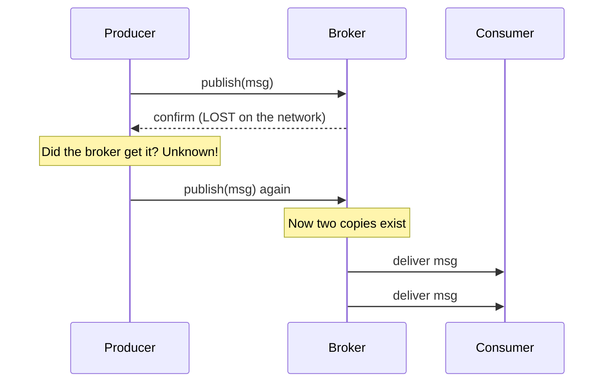

# Delivery guarantees and the exactly-once myth

---

## 🟢 Junior Level

### 1. The three guarantees

When a producer sends a message and a consumer processes it, three questions arise: can the message be **lost**? can it be **delivered twice**? The answers define the guarantee.

| Guarantee | Lost? | Duplicated? | How it is built |
| :--- | :--- | :--- | :--- |
| **At-most-once** | Possible | Never | Fire-and-forget; auto-ack before processing |
| **At-least-once** | Never (if configured correctly) | Possible | Retry until acknowledged |
| **Exactly-once** | Never | Never | Cannot be fully guaranteed end-to-end in a distributed system; *simulated* with at-least-once + idempotency |

**Analogy:** Mailing a cheque. At-most-once: drop it in a box and hope. At-least-once: keep re-mailing until the bank confirms — the bank may receive two copies. Exactly-once: the bank receives two copies but **ignores the second** because the cheque number repeats. The bank's duplicate check creates "effectively once" processing.

### 2. Why can't we get "true" exactly-once?

The **Two Generals Problem**: if the network can lose any message (including the acknowledgement), the sender can never be sure whether the receiver processed the message. Either it retries (and risks a duplicate) or it gives up (and risks loss). There is no third option on an unreliable network.



### 3. Minimal example: at-least-once consumer that tolerates duplicates

```java
import org.springframework.amqp.rabbit.annotation.RabbitListener;
import org.springframework.stereotype.Component;
import java.util.Set;
import java.util.concurrent.ConcurrentHashMap;

@Component
class PaymentConsumer {
    private final Set<String> processed = ConcurrentHashMap.newKeySet(); // demo only; use a DB in production

    @RabbitListener(queues = "payments")
    void onPayment(org.springframework.amqp.core.Message msg) {
        String id = msg.getMessageProperties().getMessageId();
        if (!processed.add(id)) {
            return; // duplicate, ignore but still ack
        }
        System.out.println("Charging for " + id);
    }
}
```

---

## 🟡 Middle Level

### 1. Where duplicates and losses originate

| Stage | Loss cause | Duplicate cause |
| :--- | :--- | :--- |
| Producer → broker | Fire-and-forget, no confirm; unroutable dropped | Retry after lost confirm |
| Broker storage | Transient message, non-durable queue, crash before fsync | Failover replays unacked |
| Broker → consumer | Auto-ack then crash | Consumer crashes before ack, ack lost, visibility timeout expires |
| Consumer → side effect | Ack before DB commit | Commit succeeded, ack failed |

### 2. Building at-least-once end to end

1. Producer: durable queue + persistent messages + **publisher confirms** + retry on NACK/timeout.
2. Broker: replicated storage (quorum queue / SQS / ack=all).
3. Consumer: **manual or post-processing ack**, so ack happens after the side effect is committed.
4. Failure policy: retries with limits + DLQ ([Dead letter queues retries and poison messages](06.%20Dead%20letter%20queues%20retries%20and%20poison%20messages.md)).
5. Side effects: idempotent.

### 3. Broker-specific "exactly-once" claims

- **Kafka**: idempotent producer (PID + sequence numbers) removes duplicates *within a partition session*; transactions give atomic write to multiple topics and offsets (`read_committed`) — exactly-once **within Kafka** (consume-transform-produce). A side effect on an external DB is outside this guarantee. The Kafka section covers details.
- **SQS FIFO**: *deduplication* within a 5-minute window via `MessageDeduplicationId` — producer-side dedupe only; the consumer can still see a message twice if visibility timeout expires ([AWS SQS and SNS standard vs FIFO and visibility timeout](11.%20AWS%20SQS%20and%20SNS%20standard%20vs%20FIFO%20and%20visibility%20timeout.md)).
- **Artemis**: duplicate detection with `_AMQ_DUPL_ID`.
- **RabbitMQ**: no built-in dedup; at-least-once (or at-most-once) only.
- **JMS + XA**: atomic across broker and DB via 2PC — real but costly.

### 4. Practical recipe: "effectively once"

> *effectively-once = at-least-once delivery + idempotent processing*

Idempotent processing options:

| Technique | Example |
| :--- | :--- |
| Natural idempotence | `SET status='SHIPPED' WHERE id=42` |
| Unique constraint on message/business key | `INSERT ... ON CONFLICT DO NOTHING` |
| Version/sequence check | Apply only if `event.version = entity.version + 1` |
| Dedup table in same transaction as the side effect | See next question |

A dedup table in the same DB transaction as the business change:

```java
import org.springframework.dao.DuplicateKeyException;
import org.springframework.jdbc.core.JdbcTemplate;
import org.springframework.stereotype.Service;
import org.springframework.transaction.annotation.Transactional;

@Service
class PaymentService {
    private final JdbcTemplate jdbc;
    PaymentService(JdbcTemplate jdbc) { this.jdbc = jdbc; }

    @Transactional
    public void apply(String messageId, long accountId, long amount) {
        try {
            jdbc.update("INSERT INTO processed_message(message_id) VALUES (?)", messageId);
        } catch (DuplicateKeyException dup) {
            return; // already applied: commit nothing, ack the message
        }
        jdbc.update("UPDATE account SET balance = balance - ? WHERE id = ?", amount, accountId);
    }
}
```
Both statements commit or roll back together, so the consumer is exactly-once *in effect*.

### 5. Common mistakes

- Marketing slogans: "our broker provides exactly-once" interpreted without scope.
- Dedupe in memory (lost on restart, not shared across instances).
- Dedup key = timestamp or random UUID generated *per delivery attempt* (must be stable across retries — generate it once at the producer or derive from business data).
- Writing to DB, then publishing, with no atomicity ([Transactional outbox pattern](12.%20Transactional%20outbox%20pattern.md)).
- Using at-most-once for money/inventory because it "performs better."

---

## 🔴 Senior Level

### 1. Formalising the guarantee

Define the **delivery** semantic (broker↔client), the **processing** semantic (effects on state) and the **scope** (single queue, whole pipeline). A pipeline `DB → outbox → broker → consumer → DB` composes: the end-to-end guarantee equals the **weakest** stage. Draw each hop and annotate which failure produces loss or duplication. Interviewers love hearing "exactly-once *processing* is achievable only where state change and offset/ack commit are atomic or idempotent".

### 2. Atomic ack + state change options

1. **Same transactional resource**: consumer reads from a DB-backed queue, or tracks consumed offsets inside the DB (Kafka consumers storing offsets in the target DB with the data). Atomic by construction.
2. **XA / JTA**: JMS + DB, 2PC. Works, but coordinator becomes a bottleneck and in-doubt transactions need manual recovery.
3. **Inbox table**: store `message_id` with business change in one local transaction; dedupe on conflict ([Idempotent consumers deduplication and the inbox pattern](08.%20Idempotent%20consumers%20deduplication%20and%20the%20inbox%20pattern.md)).
4. **Best-effort 1PC / chained transactions** (Spring `ChainedTransactionManager`, deprecated) — can still leave windows; avoid.

### 3. Window analysis for the dedup-by-database approach

Failure: DB commit succeeds, ack fails → redelivery → INSERT hits unique key → skip + ack. Safe. Failure: ack succeeds (auto-ack before processing) → crash → message gone — thus ack **after** commit. Edge: the dedup table grows forever → TTL purge by date, keeping the retention window larger than the maximum possible redelivery delay (broker retention, DLQ redrive horizon). Partitioning by day and dropping partitions is the cheap cleanup.

### 4. Producer-side idempotence in Spring with RabbitMQ

RabbitMQ will not dedupe for you, so the producer should assign a stable `messageId` and retry only with the same id:

```java
import org.springframework.amqp.core.Message;
import org.springframework.amqp.core.MessageBuilder;
import org.springframework.amqp.rabbit.connection.CorrelationData;
import org.springframework.amqp.rabbit.core.RabbitTemplate;
import org.springframework.stereotype.Service;
import java.util.UUID;

@Service
class StableIdPublisher {
    private final RabbitTemplate rabbit;
    StableIdPublisher(RabbitTemplate rabbit) { this.rabbit = rabbit; }

    // businessKey makes the id deterministic so a retry carries the same id
    void publishPayment(String paymentId, byte[] json) {
        String messageId = UUID.nameUUIDFromBytes(("payment:" + paymentId).getBytes()).toString();
        Message m = MessageBuilder.withBody(json)
                .setMessageId(messageId)
                .setContentType("application/json")
                .build();
        rabbit.send("payments.exchange", "payment.captured", m, new CorrelationData(messageId));
    }
}
```

### 5. SQS example: duplicates despite FIFO

With SQS the consumer receives a message, processes it for longer than the visibility timeout, and SQS makes it visible again. Two consumers now hold the same message. Mitigations: set visibility timeout > p99 processing time, extend it using `ChangeMessageVisibility` heartbeat, and keep handlers idempotent.

```java
import software.amazon.awssdk.services.sqs.SqsClient;
import software.amazon.awssdk.services.sqs.model.ChangeMessageVisibilityRequest;

class VisibilityHeartbeat {
    static void extend(SqsClient sqs, String queueUrl, String receiptHandle, int seconds) {
        sqs.changeMessageVisibility(ChangeMessageVisibilityRequest.builder()
                .queueUrl(queueUrl)
                .receiptHandle(receiptHandle)
                .visibilityTimeout(seconds)
                .build());
    }
}
```

### 6. Testing the guarantee

Chaos-test: kill the consumer after DB commit and before ack (use a debugger breakpoint or a fault-injection flag), kill the broker mid-publish, drop network with Toxiproxy (Testcontainers module) and assert the **final state** equals the expected state with no double effects. Verify the counts: `published == processedUnique`, `duplicatesDetected ≥ 0`. See [Testing messaging code with Testcontainers](19.%20Testing%20messaging%20code%20with%20Testcontainers.md).

---

## 🎯 Interview Cheat Sheet

**30-second elevator pitch:** Networks fail, so a system either retries and may duplicate (at-least-once) or doesn't and may lose (at-most-once). Exactly-once delivery is impossible in the general case; what we build is exactly-once *processing* by combining at-least-once delivery with idempotent consumers, deduplication tables or atomic transactions. Brokers' "exactly-once" features are always scoped (e.g., inside Kafka), never covering your external side effects.

**Must-know bullets:**
- At-most-once = auto-ack/no retry; at-least-once = ack after processing + retry.
- Effectively-once = at-least-once + idempotency.
- Two Generals: a lost ack makes duplicates unavoidable.
- Ack after the side effect commits; dedupe key must be stable across retries.
- SQS FIFO dedup window is 5 minutes and producer-side only.
- The pipeline is as strong as its weakest hop.

**Common follow-up questions:**
- Does Kafka really provide exactly-once?
- How do you make a payment consumer idempotent?
- What happens if the DB commits but the ack fails?
- What is the difference between delivery and processing guarantees?

**🚩 Red flags:**
- "We use exactly-once so no dedup needed."
- In-memory dedupe set.
- Generating a new message id at every retry.

**Related topics:**
- [Idempotent consumers deduplication and the inbox pattern](08.%20Idempotent%20consumers%20deduplication%20and%20the%20inbox%20pattern.md)
- [Transactional outbox pattern](12.%20Transactional%20outbox%20pattern.md)
- [Message acknowledgements and prefetch](04.%20Message%20acknowledgements%20and%20prefetch.md)
- [Message durability and persistence](05.%20Message%20durability%20and%20persistence.md)
