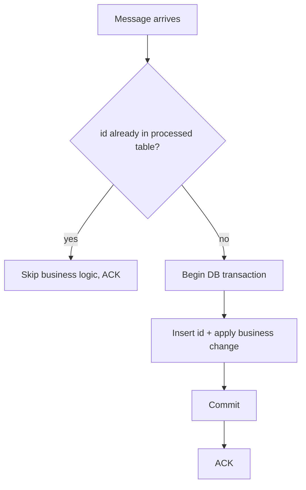

# Idempotent consumers deduplication and the inbox pattern

---

## 🟢 Junior Level

### 1. What is idempotency?

An operation is **idempotent** if doing it once or many times gives the same final result. `SET balance = 100` is idempotent; `balance = balance + 10` is not. Because brokers deliver **at-least-once**, the same message *will* sometimes arrive twice (consumer crash before ack, network hiccup, visibility timeout). An **idempotent consumer** is one that handles a duplicate safely.

**Analogy:** An elevator button. Pressing "5" ten times still takes you to floor 5 once. A vending machine "add coin" button is not idempotent — each press adds another coin.

### 2. Why it matters

If your `OrderPaid` consumer sends an email and charges a card, a duplicate means two emails and a double charge. Duplicates are not a bug in the broker; they are an inherent property of reliable delivery ([Delivery guarantees and the exactly-once myth](07.%20Delivery%20guarantees%20and%20the%20exactly-once%20myth.md)).

### 3. The simplest technique: remember processed message IDs

Every message carries a unique, stable **message id**. The consumer records ids it has handled and skips repeats.



### 4. Minimal example

```sql
CREATE TABLE processed_message (
    message_id   VARCHAR(64) PRIMARY KEY,
    processed_at TIMESTAMP NOT NULL DEFAULT CURRENT_TIMESTAMP
);
```

```java
import org.springframework.amqp.core.Message;
import org.springframework.amqp.rabbit.annotation.RabbitListener;
import org.springframework.dao.DuplicateKeyException;
import org.springframework.jdbc.core.JdbcTemplate;
import org.springframework.stereotype.Component;
import org.springframework.transaction.annotation.Transactional;

@Component
class InvoiceConsumer {
    private final JdbcTemplate jdbc;
    InvoiceConsumer(JdbcTemplate jdbc) { this.jdbc = jdbc; }

    @RabbitListener(queues = "invoices")
    @Transactional
    public void handle(Message msg) {
        String id = msg.getMessageProperties().getMessageId();
        try {
            jdbc.update("INSERT INTO processed_message(message_id) VALUES (?)", id);
        } catch (DuplicateKeyException e) {
            return; // duplicate: nothing to do, container acks
        }
        jdbc.update("INSERT INTO invoice(ref) VALUES (?)", new String(msg.getBody()));
    }
}
```
The unique primary key is the guard; the check and the business change commit atomically.

---

## 🟡 Middle Level

### 1. Techniques ranked

| Technique | How | Pros | Cons |
| :--- | :--- | :--- | :--- |
| **Natural idempotence** | Upsert, `SET`, `DELETE` by key | No extra storage | Not always possible (counters, emails) |
| **Unique business key** | Unique index on `(order_id, type)` | Simple | Needs good key |
| **Inbox table (dedup table)** | `message_id` PK in same TX | General, robust | Extra table, cleanup |
| **Version / sequence check** | Apply event only if `version = current+1` | Handles reordering too | Needs per-entity versions |
| **External idempotency key** | Pass key to payment API (`Idempotency-Key` header) | Delegates to provider | Provider must support it |
| **Redis `SETNX` with TTL** | Cache check | Fast | Not atomic with DB → gaps; only for non-critical work |

### 2. The inbox pattern

The **inbox pattern** is the consumer-side twin of the outbox ([Transactional outbox pattern](12.%20Transactional%20outbox%20pattern.md)). Instead of only a `message_id` column, the consumer stores the *incoming message* in an `inbox` table inside its local transaction, then processes it. Two flavours:

1. **Dedup inbox** (what we did above): only ids, processing inline.
2. **Full inbox**: persist the message (id, payload, status `RECEIVED/PROCESSED/FAILED`), **ack immediately**, and let a worker process rows asynchronously. Benefits: broker ack is decoupled from slow processing, prefetch can stay small, retries/backoff are managed in SQL (`attempts`, `next_attempt_at`), and you get a durable audit trail. Cost: extra latency and a polling worker (use `SELECT ... FOR UPDATE SKIP LOCKED` for safe concurrent workers).

```java
import jakarta.persistence.Column;
import jakarta.persistence.Entity;
import jakarta.persistence.Id;
import jakarta.persistence.Table;
import java.time.Instant;

@Entity
@Table(name = "inbox_message")
class InboxMessage {
    @Id
    @Column(name = "message_id")
    String messageId;                 // primary key = dedup guard

    @Column(columnDefinition = "text")
    String payload;

    String status = "RECEIVED";       // RECEIVED -> PROCESSED / FAILED
    int attempts;
    Instant receivedAt = Instant.now();

    protected InboxMessage() {}
    InboxMessage(String messageId, String payload) { this.messageId = messageId; this.payload = payload; }
}
```

```java
import org.springframework.data.jpa.repository.JpaRepository;
import org.springframework.data.jpa.repository.Query;
import org.springframework.data.jpa.repository.Modifying;
import org.springframework.data.repository.query.Param;

interface InboxRepository extends JpaRepository<InboxMessage, String> {
    // portable "insert if absent": returns 1 when inserted, 0 on duplicate (PostgreSQL syntax)
    @Modifying
    @Query(value = "INSERT INTO inbox_message(message_id, payload, status, attempts, received_at) "
            + "VALUES (:id, :payload, 'RECEIVED', 0, now()) ON CONFLICT DO NOTHING", nativeQuery = true)
    int insertIfAbsent(@Param("id") String id, @Param("payload") String payload);
}
```

### 3. Choosing the idempotency key

- **Producer-generated UUID** per logical message (stable across publish retries) — preferred.
- **Business key** (e.g., `paymentId + ":" + eventType`) — makes the dedupe resilient even if the producer regenerates the message.
- Never use the broker-assigned delivery tag (changes on redelivery) or the timestamp.

### 4. Cleanup and retention

The dedup window must outlast the longest possible redelivery. Purge `processed_message` rows older than e.g. 7-14 days (≥ broker retention + DLQ redrive horizon). Use date partitions or a nightly `DELETE ... WHERE processed_at < now() - interval '14 days'` in small batches.

### 5. Common mistakes

- Check-then-insert in two steps without a unique constraint → race between two concurrent consumers. Let the database constraint arbitrate.
- Committing the inbox row in a **different** transaction than the business change → either lost or duplicated effects.
- Making the **ack** happen before the transaction commits.
- Swallowing the `DuplicateKeyException` *inside* a Postgres transaction without a savepoint: the transaction is already aborted. Use `ON CONFLICT DO NOTHING` (as above) or a separate/new transaction (`REQUIRES_NEW`).
- Idempotence only for the DB, but not for external calls (emails, payment APIs). Pass idempotency keys downstream, or record the call intent ("email outbox").

---

## 🔴 Senior Level

### 1. Concurrency and isolation

Two consumers may process the same message simultaneously (visibility timeout expiry, redelivery while the first copy is still running). The unique index serialises them: the second INSERT *blocks* until the first transaction ends, then fails (or in PostgreSQL with `ON CONFLICT DO NOTHING`, returns 0). Therefore a second copy never executes business logic concurrently, but it waits — keep the transaction short, and do external I/O outside the transaction where possible.

```java
import org.springframework.stereotype.Service;
import org.springframework.transaction.annotation.Transactional;

@Service
class IdempotentHandler {
    private final InboxRepository inbox;
    private final OrderService orders;

    IdempotentHandler(InboxRepository inbox, OrderService orders) {
        this.inbox = inbox;
        this.orders = orders;
    }

    @Transactional
    public void handle(String messageId, String payload) {
        if (inbox.insertIfAbsent(messageId, payload) == 0) {
            return;                      // duplicate
        }
        orders.apply(payload);           // same transaction
    }
}

interface OrderService { void apply(String payload); }
```

### 2. Out-of-order and stale events

Dedup by id does not protect against *reordering*: `OrderCancelled` arriving before `OrderShipped`. Add **per-entity versioning**: `UPDATE orders SET status=?, version=? WHERE id=? AND version < ?` (monotonic, last-writer-wins by version) or buffer events until the missing predecessor arrives. Combine with ordered partitioning where available ([Message ordering partitioning and competing consumers](09.%20Message%20ordering%20partitioning%20and%20competing%20consumers.md)).

### 3. Side effects outside the database

For non-transactional effects use the **"intent then execute"** approach: in the consumer transaction record `email_to_send` (status PENDING); a sender job executes and marks it SENT, passing the row's id as the provider idempotency key (Stripe `Idempotency-Key`, SES message tag). This is the outbox pattern again — duplicates are absorbed at the provider.

### 4. Scaling the dedup store

At 10k msg/s a relational dedup table becomes a hotspot (index contention, WAL volume). Options: shard the table by hash of the message id or partition by tenant; use **natural keys** to avoid the table; use a **Redis/Dynamo conditional put** (`attribute_not_exists(pk)`) as the *authoritative* store only if the business state lives there too; keep a Bloom filter as a pre-check to skip DB hits, never as the source of truth (false positives would drop real messages — only use it for "definitely new" shortcuts in the negative direction).

DynamoDB conditional write for a serverless consumer (AWS SDK v2):

```java
import software.amazon.awssdk.services.dynamodb.DynamoDbClient;
import software.amazon.awssdk.services.dynamodb.model.AttributeValue;
import software.amazon.awssdk.services.dynamodb.model.ConditionalCheckFailedException;
import software.amazon.awssdk.services.dynamodb.model.PutItemRequest;
import java.util.Map;

class DynamoDedup {
    private final DynamoDbClient ddb;
    private final String table;

    DynamoDedup(DynamoDbClient ddb, String table) { this.ddb = ddb; this.table = table; }

    /** @return true if first time seen */
    boolean firstTime(String messageId, long ttlEpochSeconds) {
        try {
            ddb.putItem(PutItemRequest.builder()
                    .tableName(table)
                    .item(Map.of(
                            "pk", AttributeValue.fromS(messageId),
                            "ttl", AttributeValue.fromN(Long.toString(ttlEpochSeconds))))
                    .conditionExpression("attribute_not_exists(pk)")
                    .build());
            return true;
        } catch (ConditionalCheckFailedException e) {
            return false;
        }
    }
}
```
Caveat: if business effects are in a different store than the dedup record, the pair is not atomic — you must order operations so that failure leads to *re-execution of an idempotent step* rather than skipping a needed one (record **after** success, accepting a rare repeat, when the effect is idempotent).

### 5. Production diagnostics

- Metric `duplicates_total` — a healthy system sees a small but non-zero rate; zero for months suggests you aren't detecting them, a spike means broker/consumer instability (visibility timeouts, rebalancing).
- Log `messageId`, `attempt`, `redelivered` flag (`message.getMessageProperties().isRedelivered()`), which is a hint only — duplicates can arrive with `redelivered=false` if the producer retried.
- Chaos test duplicates deliberately: publish every message twice in staging and compare resulting state.

### 6. Trade-off summary

Inbox gives correctness at the cost of a write per message and a cleanup job. For naturally idempotent flows (upserts, projections) skip it. For financial flows, combine inbox + provider idempotency keys + versioned state.

---

## 🎯 Interview Cheat Sheet

**30-second elevator pitch:** Brokers redeliver, so consumers must be idempotent. The robust approach is an inbox/dedup table with the message id as primary key, inserted in the same database transaction as the business change and acked afterward; duplicates hit the unique constraint and are skipped. Add versioning for reordering and idempotency keys for external APIs.

**Must-know bullets:**
- Idempotent = same result after repeated execution.
- Key must be stable across retries (producer UUID or business key).
- Unique constraint beats check-then-insert.
- Same transaction for dedup record and effect; ack after commit.
- Inbox ≈ consumer-side outbox; full inbox decouples ack from processing.
- Purge dedup rows after a retention window.

**Common follow-up questions:**
- How would you make "send email" idempotent?
- What if two consumers process the same message concurrently?
- How long do you keep dedupe records?
- How do you handle out-of-order events?

**🚩 Red flags:**
- In-memory `Set` as dedupe.
- Using delivery tag or timestamp as the key.
- Relying on `redelivered` flag alone.

**Related topics:**
- [Delivery guarantees and the exactly-once myth](07.%20Delivery%20guarantees%20and%20the%20exactly-once%20myth.md)
- [Transactional outbox pattern](12.%20Transactional%20outbox%20pattern.md)
- [Dead letter queues retries and poison messages](06.%20Dead%20letter%20queues%20retries%20and%20poison%20messages.md)
- [Saga with messaging](16.%20Saga%20with%20messaging.md)
