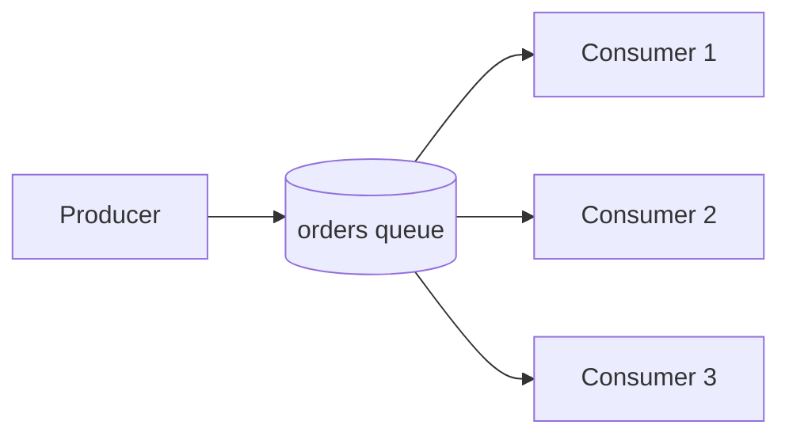

# Message ordering partitioning and competing consumers

---

## 🟢 Junior Level

### 1. Competing consumers

The **competing consumers** pattern means several consumer instances read from the **same queue**. The broker hands each message to just one of them, so the instances *compete* for work. This is the standard way to scale processing: if one consumer handles 100 msg/s and you need 400, run four.

**Analogy:** A supermarket with one line and four cashiers. Each customer goes to whichever cashier is free. Throughput quadruples, but customers no longer leave in the exact order they arrived.



### 2. Ordering in one sentence

A single queue with a single consumer preserves **FIFO** order. As soon as you add parallelism (more consumers, retries, requeues), **global order is lost**. You can only keep order *per key* (per customer, per order, per account) by routing all messages of that key to the same consumer.

### 3. Minimal example: scale with concurrency

```java
import org.springframework.amqp.rabbit.annotation.RabbitListener;
import org.springframework.stereotype.Component;

@Component
class ThumbnailWorker {
    // 4 to 8 parallel consumers in this JVM, each with its own channel
    @RabbitListener(queues = "thumbnails", concurrency = "4-8")
    void resize(String imageId) throws InterruptedException {
        Thread.sleep(200); // simulate work
        System.out.println(Thread.currentThread().getName() + " resized " + imageId);
    }
}
```

Start the application on three machines and all 3 × (4 to 8) consumers compete for the same queue — no code change.

> [!NOTE]
> Messages for the same image may be processed out of order or in parallel. If that is unacceptable you need per-key ordering, covered below.

---

## 🟡 Middle Level

### 1. Why ordering breaks (even with one consumer)

| Cause | Explanation |
| :--- | :--- |
| Multiple consumers | Message 2 finishes before message 1 |
| Requeue after failure | Redelivered message goes back, later messages overtake it |
| Retry queues / delay queues | Failed message re-enters after later ones |
| Multiple producers / threads | Publish order itself is not defined |
| Priority queues, selectors | Reordering by design |
| Multiple queues/partitions | Order only within each |

### 2. Per-key ordering strategies

**A. Message groups (ActiveMQ/Artemis).** Set `JMSXGroupID=customer-42`; the broker pins every message of that group to one consumer — ordering per group, parallelism across groups.

**B. Consistent-hash exchange (RabbitMQ plugin).** Messages are hashed by routing key (or header) onto N queues, each with one consumer (*sharding*). Same key → same queue → same consumer.

**C. Single Active Consumer (RabbitMQ).** `x-single-active-consumer=true` lets many consumers register on one queue but only one receives messages; the others stand by for failover. Gives ordered processing with HA but no parallelism; combine with several sharded queues.

**D. Partitions (Kafka, Kinesis)** — key hashing to partitions, one consumer per partition (see the Kafka section).

**E. SQS FIFO message groups.** `MessageGroupId` provides ordered delivery per group, parallelism across groups ([AWS SQS and SNS standard vs FIFO and visibility timeout](11.%20AWS%20SQS%20and%20SNS%20standard%20vs%20FIFO%20and%20visibility%20timeout.md)).

### 3. RabbitMQ sharding by key (Spring AMQP)

The consistent-hash exchange type `x-consistent-hash` requires the plugin `rabbitmq_consistent_hash_exchange`. Binding keys are *weights*:

```java
import org.springframework.amqp.core.Binding;
import org.springframework.amqp.core.BindingBuilder;
import org.springframework.amqp.core.CustomExchange;
import org.springframework.amqp.core.Declarables;
import org.springframework.amqp.core.Queue;
import org.springframework.amqp.core.QueueBuilder;
import org.springframework.amqp.rabbit.annotation.RabbitListener;
import org.springframework.amqp.rabbit.core.RabbitTemplate;
import org.springframework.context.annotation.Bean;
import org.springframework.context.annotation.Configuration;
import org.springframework.stereotype.Component;
import java.util.ArrayList;
import java.util.List;
import java.util.Map;

@Configuration
class ShardedTopology {
    static final int SHARDS = 4;

    @Bean
    Declarables shardedOrders() {
        CustomExchange ex = new CustomExchange("orders.sharded", "x-consistent-hash", true, false,
                Map.of("hash-header", "customerId"));
        List<Object> declarables = new ArrayList<>(List.of(ex));
        for (int i = 0; i < SHARDS; i++) {
            Queue q = QueueBuilder.durable("orders.shard." + i).build();
            declarables.add(q);
            declarables.add(BindingBuilder.bind(q).to(ex).with("1").noargs()); // weight 1
        }
        return new Declarables(declarables.stream()
                .map(o -> (org.springframework.amqp.core.Declarable) o).toList());
    }
}

@Component
class ShardedPublisher {
    private final RabbitTemplate rabbit;
    ShardedPublisher(RabbitTemplate rabbit) { this.rabbit = rabbit; }

    void publish(String customerId, String json) {
        rabbit.convertAndSend("orders.sharded", "ignored", json, m -> {
            m.getMessageProperties().setHeader("customerId", customerId);
            return m;
        });
    }
}

@Component
class ShardConsumers {
    @RabbitListener(queues = "orders.shard.0") void s0(String m) { handle(m); }
    @RabbitListener(queues = "orders.shard.1") void s1(String m) { handle(m); }
    @RabbitListener(queues = "orders.shard.2") void s2(String m) { handle(m); }
    @RabbitListener(queues = "orders.shard.3") void s3(String m) { handle(m); }
    private void handle(String m) { /* sequential per shard (concurrency=1 default) */ }
}
```

Each listener has concurrency 1, so a shard is processed strictly in order. Changing the shard count later remaps keys — plan capacity (e.g., start with 16-64 shards).

### 4. Single active consumer

```java
import org.springframework.amqp.core.Queue;
import org.springframework.amqp.core.QueueBuilder;
import org.springframework.context.annotation.Bean;
import org.springframework.context.annotation.Configuration;

@Configuration
class SacConfig {
    @Bean
    Queue ledgerQueue() {
        return QueueBuilder.durable("ledger").singleActiveConsumer().build();
    }
}
```

### 5. Common mistakes

- Expecting FIFO from a queue with `concurrency="5"`.
- Using priorities or delayed retries on flows that need order.
- Assuming "RabbitMQ preserves order" without qualifying: it does only per queue, per publisher channel, with a single consumer and no requeue.
- Starving: one hot key overloads one shard (hot partition problem).
- Not planning for hash rebalancing when scaling consumers.

---

## 🔴 Senior Level

### 1. Competing consumers internals

RabbitMQ delivers round-robin among consumers with available prefetch credit. With high prefetch, **a fast consumer is not fed more** until it acks, while a slow consumer hoards its window; use low prefetch for heterogeneous work ([Message acknowledgements and prefetch](04.%20Message%20acknowledgements%20and%20prefetch.md)). SQS has no push; consumers poll and get any visible message, so scaling is trivial but order is only guaranteed in FIFO queues. Autoscale consumers on **queue depth per instance / age of oldest message** (KEDA `rabbitmq` / `aws-sqs-queue` scalers) rather than CPU.

### 2. Ordering vs throughput trade-off

Throughput per ordered key is limited by one consumer: `1 / handler_latency`. A key with 1000 msg/s and 5 ms latency (200 msg/s max) cannot be served in order — you must reduce latency (batching, async I/O) or relax ordering. Pragmatic options:

1. **Commutative/idempotent handlers** with versioning (`WHERE version < :v`) so order doesn't matter.
2. **Reordering buffer** keyed by entity: hold events with `seq > expected` until gaps fill, with a timeout fallback.
3. **Last-state events** (document messages carrying full state with version) instead of deltas — a stale message is simply ignored.

```java
import org.springframework.jdbc.core.JdbcTemplate;
import org.springframework.stereotype.Service;

@Service
class VersionedProjection {
    private final JdbcTemplate jdbc;
    VersionedProjection(JdbcTemplate jdbc) { this.jdbc = jdbc; }

    /** Applies the event only if it is newer; stale or duplicate events affect 0 rows. */
    boolean apply(long orderId, String status, long version) {
        return jdbc.update(
                "UPDATE order_view SET status = ?, version = ? WHERE id = ? AND version < ?",
                status, version, orderId, version) == 1;
    }
}
```

### 3. Failure semantics of per-key ordering

If the consumer for shard 2 crashes, the keys on that shard stall until failover (single active consumer standby takes over). A poison message blocks the *whole shard*, not just one key — so keep a retry limit and route to a DLQ even though this violates ordering for that key, or **quarantine the key** (persist "key blocked", then skip its subsequent messages into a parking queue until the head failure is resolved) ([Dead letter queues retries and poison messages](06.%20Dead%20letter%20queues%20retries%20and%20poison%20messages.md)).

### 4. Cross-technology comparison

| Technology | Order unit | Parallelism unit | Notes |
| :--- | :--- | :--- | :--- |
| RabbitMQ classic/quorum | Queue (single consumer, no requeue) | Queues (shards) | Requeue puts message back in position for classic; no guarantee with quorum+retries |
| RabbitMQ stream | Stream / super-stream partition | Super-stream partitions | Kafka-like; single active consumer per partition |
| Artemis | Message group | Groups | Group stuck to consumer until closed |
| SQS FIFO | MessageGroupId | Groups (up to 300 TPS/api per queue, 3000 with batching; high-throughput mode more) | Dedup 5 min |
| Kafka | Partition | Partitions | See Kafka section |

### 5. Diagnostics

- Uneven shard depth → skewed keys; check per-shard `messages_ready` and consumer utilisation (`consumer_utilisation` in management stats: below ~100% means consumer is the bottleneck, ~100% means queue is busy being drained fully).
- Log `(key, sequence, thread)` and write a test asserting monotonic sequence per key under load.
- Reproduce reordering by running 2 consumers and throwing intermittently from handlers.

### 6. Decision guide

1. No ordering needed → competing consumers, max parallelism.
2. Order per entity needed → shard by key (or SQS FIFO groups / Kafka partitions) + 1 consumer per shard.
3. Strict global order → single queue + single (active) consumer; accept throughput limit.
4. Order matters only for state convergence → version checks and idempotent upserts.

---

## 🎯 Interview Cheat Sheet

**30-second elevator pitch:** Competing consumers let many workers share one queue to scale throughput, but parallelism, retries and requeues destroy global ordering. When order matters per entity, route all messages of a key to one consumer: message groups in Artemis, consistent-hash sharding or single active consumer in RabbitMQ, FIFO message groups in SQS, partitions in Kafka. Otherwise make handlers version-aware and idempotent so order stops mattering.

**Must-know bullets:**
- One queue + one consumer + no requeue = FIFO; otherwise not.
- Scale consumers on lag/queue depth, not CPU.
- Per-key ordering = partitioning by key; hot keys limit throughput.
- Retries and DLQs reorder messages.
- Single Active Consumer: ordered failover, no parallelism.
- Versioned upserts make order-insensitive consumers.

**Common follow-up questions:**
- How do you guarantee order for one customer but process customers in parallel?
- What happens to ordering when a message fails and is retried?
- How do you pick the number of shards?
- How is SQS FIFO different from standard?

**🚩 Red flags:**
- "Add more consumers" for a flow that requires strict order.
- Promising global ordering at scale.
- Ignoring hot partitions.

**Related topics:**
- [Message acknowledgements and prefetch](04.%20Message%20acknowledgements%20and%20prefetch.md)
- [RabbitMQ vs Kafka when to choose which](10.%20RabbitMQ%20vs%20Kafka%20when%20to%20choose%20which.md)
- [Idempotent consumers deduplication and the inbox pattern](08.%20Idempotent%20consumers%20deduplication%20and%20the%20inbox%20pattern.md)
- [Backpressure and consumer lag monitoring](19.%20Backpressure%20and%20consumer%20lag%20monitoring.md)
