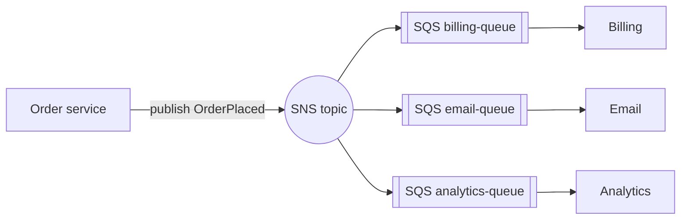

# AWS SQS and SNS standard vs FIFO and visibility timeout

---

## 🟢 Junior Level

* **Amazon SQS (Simple Queue Service)** — a fully managed **queue**. Producers send messages; consumers **poll**, process and **delete** them. Point-to-point: each message is processed by one consumer.
* **Amazon SNS (Simple Notification Service)** — a managed **pub/sub topic**. Publishers send to a topic; SNS **pushes** copies to all subscribers (SQS queues, Lambda, HTTP endpoints, email, SMS).

A common pattern is **fan-out**: SNS topic → several SQS queues, one per consuming service, so each service gets its own durable copy and processes at its own pace.



### Standard vs FIFO queues

| | Standard | FIFO |
| --- | --- | --- |
| Throughput | Nearly unlimited | 300 msg/s per API action (3,000 with batching); high-throughput mode much higher, per message group |
| Ordering | Best-effort | Strict **within a message group** |
| Delivery | **At least once** (duplicates possible) | Exactly-once *processing* within a 5-minute deduplication window |
| Name | any | must end in `.fifo` |

---

## 🟡 Middle Level

### The visibility timeout
SQS doesn't delete a message when you receive it. It hides it for the **visibility timeout** (default 30 s, max 12 h). If the consumer deletes it in time → done. If the consumer crashes or is too slow → the message becomes visible again and is redelivered.

```java
// Spring Cloud AWS 3.x
@SqsListener(value = "billing-queue", maxConcurrentMessages = "10", maxMessagesPerPoll = "10")
public void onOrder(OrderPlaced event) {
    billing.open(event);        // success => message deleted (acknowledged) automatically
}                               // exception => not deleted => redelivered after visibility timeout
```

Rules:
* Visibility timeout > maximum processing time (plus margin). For variable work, **extend** it while processing (`ChangeMessageVisibility`) — Spring Cloud AWS supports visibility extension.
* Use **long polling** (`WaitTimeSeconds` up to 20) to cut empty receives and cost.
* **Batch** sends, receives and deletes (up to 10 messages per call) — SQS bills per request.

### Dead-letter queues
Configure a **redrive policy**: after `maxReceiveCount` failed receives (e.g. 5), SQS moves the message to a DLQ. Alarm on DLQ depth (`ApproximateNumberOfMessagesVisible`) and use **DLQ redrive** to move messages back after fixing the bug.

### FIFO details
* `MessageGroupId` — ordering scope (e.g. `orderId`). Messages in one group are delivered in order, **one in-flight batch at a time**; different groups proceed in parallel.
* `MessageDeduplicationId` (or content-based deduplication) — duplicates within 5 minutes are dropped at send time.

---

## 🔴 Senior Level

### Idempotency is still required
* Standard queues deliver **at least once**, occasionally duplicating and reordering.
* Even FIFO's deduplication only covers **sends** within 5 minutes; a consumer that processes a message, crashes before deleting, gets it again after the visibility timeout. Consumers must be idempotent (inbox table, conditional writes, natural keys).

### Ordering vs throughput in FIFO
A message group is processed strictly sequentially. A hot group (one huge customer) becomes a bottleneck, and one poison message **blocks its whole group** until it's moved to the DLQ. Choose group IDs with enough cardinality (per order, not per customer, if that's sufficient) and keep `maxReceiveCount` low enough to unblock groups.

### SNS specifics
* **Message filtering** with subscription filter policies (on attributes or payload) so each queue only receives relevant events — reduces cost and consumer work.
* **SNS FIFO topics** preserve order into SQS FIFO queues for fan-out with ordering.
* **Raw message delivery** to avoid the SNS JSON envelope in SQS messages.
* SNS retries HTTP endpoints with a delivery policy; SQS subscriptions are the durable choice.

### Limits and design constraints
* Max message size **256 KB** (larger payloads: store in S3 and send a pointer — the Extended Client Library does this).
* Retention 1 minute to 14 days (default 4 days).
* Delay queues / per-message delay up to 15 minutes; for longer scheduling, use EventBridge Scheduler or Step Functions.
* Consumers in Lambda: event source mappings poll and scale automatically; set **batch size**, **maximum concurrency**, and use **partial batch responses** (`ReportBatchItemFailures`) so one failed message doesn't redeliver the whole batch.

### Choosing SQS/SNS vs Kafka/RabbitMQ on AWS
SQS/SNS: zero operations, pay-per-use, elastic, IAM-integrated — ideal for task queues and fan-out between services. Kafka (MSK): replay, retention, stream processing, very high sustained throughput. Amazon MQ (RabbitMQ/ActiveMQ): when migrating apps that depend on AMQP/JMS semantics. EventBridge: event routing with rules, schema registry and SaaS integrations.

---

## 🎯 Interview Cheat Sheet

**30-second pitch:** SQS is a managed pull-based queue; SNS is managed push-based pub/sub, and SNS → SQS gives durable fan-out. Standard queues are at-least-once with best-effort order; FIFO gives ordering per message group and send-side deduplication within five minutes. The visibility timeout hides received messages until they're deleted, so it must exceed processing time; DLQs via redrive policy handle poison messages, and consumers must still be idempotent.

**Must know:**
* Visibility timeout mechanics and extension.
* Standard vs FIFO; `MessageGroupId`, `MessageDeduplicationId`.
* DLQ with `maxReceiveCount`; redrive.
* Long polling, batching; 256 KB limit; 14-day retention.
* SNS filter policies; Lambda partial batch responses.

**Common follow-ups:**
* Why did a message get processed twice?
* How do you keep order per customer in SQS?
* How do you send a 5 MB payload?

**Red flags:** visibility timeout shorter than processing time; assuming FIFO means no duplicates ever; one message group for everything.

**Related:**
* [Dead letter queues retries and poison messages](06.%20Dead%20letter%20queues%20retries%20and%20poison%20messages.md)
* [Idempotent consumers deduplication and the inbox pattern](08.%20Idempotent%20consumers%20deduplication%20and%20the%20inbox%20pattern.md)
* [RabbitMQ vs Kafka when to choose which](10.%20RabbitMQ%20vs%20Kafka%20when%20to%20choose%20which.md)
* [SQS SNS and EventBridge](../33.%20Cloud%20and%20AWS/12.%20SQS%20SNS%20and%20EventBridge.md)
