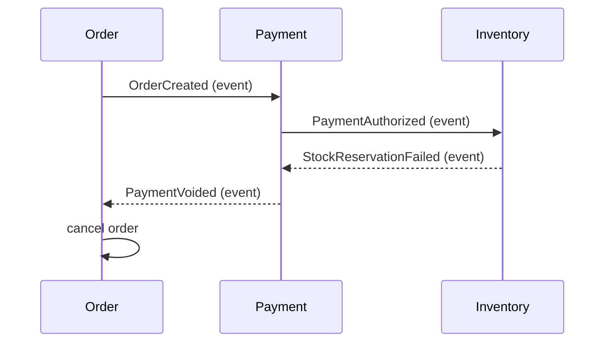

# Saga with messaging

---

## 🟢 Junior Level

A **saga** implements a business transaction that spans several services **without a distributed transaction**. It's a sequence of **local transactions**, each in one service; if a step fails, previously completed steps are undone by **compensating transactions**.

Example: placing an order.

| Step | Service | Local transaction | Compensation |
| --- | --- | --- | --- |
| 1 | Order | Create order `PENDING` | Mark order `CANCELLED` |
| 2 | Payment | Authorize payment | Void authorization / refund |
| 3 | Inventory | Reserve stock | Release reservation |
| 4 | Order | Mark order `CONFIRMED` | — |

If inventory can't reserve stock in step 3, the saga runs compensations for step 2 (void the payment) and step 1 (cancel the order).

### Why not two-phase commit (2PC)?
2PC needs all participants to support XA and hold locks while waiting for a coordinator; it blocks on coordinator failure and doesn't fit brokers, HTTP services or many cloud databases. Sagas give up atomic isolation in exchange for availability and loose coupling.

---

## 🟡 Middle Level

### Choreography-based saga
Each service listens for events and emits the next ones:



Simple for 2–4 steps; the flow is implicit and spread across services, which makes it hard to change and monitor, and risks cyclic dependencies.

### Orchestration-based saga
A **saga orchestrator** (often in the order service) holds the state machine and sends commands, reacting to replies:

```java
@Component
class PlaceOrderSaga {
    @Transactional
    void start(Order order) {
        sagas.save(new SagaState(order.id(), Step.AUTHORIZE_PAYMENT));
        outbox.add(new AuthorizePayment(order.id(), order.total(), "pay-" + order.id()));   // command
    }

    @Transactional
    void on(PaymentAuthorized reply) {
        SagaState s = sagas.get(reply.orderId()).advance(Step.RESERVE_STOCK);
        outbox.add(new ReserveStock(reply.orderId(), s.lines()));
    }

    @Transactional
    void on(StockReservationFailed reply) {
        SagaState s = sagas.get(reply.orderId()).advance(Step.COMPENSATING);
        outbox.add(new VoidPayment(reply.orderId(), "void-" + reply.orderId()));
    }

    @Transactional
    void on(PaymentVoided reply) {
        orders.get(reply.orderId()).cancel("out of stock");
        sagas.get(reply.orderId()).finish(Outcome.COMPENSATED);
    }
}
```

The orchestrator persists saga state, uses the outbox for commands, and every handler is idempotent. Workflow engines (Temporal, Camunda, AWS Step Functions) provide durable state, timers and retries out of the box.

---

## 🔴 Senior Level

### Designing steps and compensations
* **Compensations are semantic, not rollbacks**: you can't "un-send" an email; you send a correction. A refund is not the same as never charging (fees, statements).
* Order steps by risk: **pivot transaction** — the step after which the saga can't be compensated and must complete (e.g. shipping). Put compensatable steps before it, retriable steps (that will eventually succeed) after it.
* Every step and compensation must be **idempotent** and **retriable** — messages will be redelivered.
* **Timeouts** are steps too: "if no payment reply in 15 minutes, compensate".

### Lack of isolation (anomalies)
Other transactions can see intermediate saga states:
* **Lost updates** — another saga overwrites data between steps.
* **Dirty reads** — a report counts a reserved-then-released stock.
Countermeasures (Garcia-Molina/Chris Richardson's catalog):
* **Semantic locks** — state flags like `PENDING_APPROVAL` that other operations respect.
* **Commutative updates** — designs where order doesn't matter (debit/credit amounts rather than setting balances).
* **Pessimistic view / reread value** — re-validate before acting.
* **Versioning** of records modified by sagas.

### Observability and operations
* Persist saga instances with state, step history, correlation ID and timestamps; expose a dashboard of stuck sagas (no progress for N minutes).
* Alert on compensations rate (business signal) and on sagas stuck in `COMPENSATING` (needs human intervention — compensations can fail too; plan manual resolution).
* Trace across messages (traceparent in headers) to see the whole flow.

### Choosing choreography vs orchestration

| | Choreography | Orchestration |
| --- | --- | --- |
| Steps | Few (2–4) | Many, branching |
| Visibility | Implicit, spread out | Central state machine |
| Coupling | Services react to each other's events | Participants only know commands/replies |
| Change | Touch several services | Change the orchestrator |
| Failure analysis | Hard | Easier |

---

## 🎯 Interview Cheat Sheet

**30-second pitch:** A saga splits a cross-service business transaction into local transactions with compensating actions, coordinated via messaging either by choreography (services react to events) or orchestration (a stateful coordinator sends commands). Each step uses an outbox to publish reliably and is idempotent; I design semantic compensations, a pivot point, timeouts, and countermeasures for the missing isolation.

**Must know:**
* Saga vs 2PC; local transactions + compensations.
* Choreography vs orchestration trade-offs.
* Outbox for commands/events; idempotent handlers.
* Pivot transaction; compensatable vs retriable steps.
* Isolation anomalies and semantic locks.

**Common follow-ups:**
* What if a compensation fails?
* How do you prevent two sagas from overselling stock?
* When would you use Temporal or Step Functions?

**Red flags:** "compensation = database rollback"; sagas without persisted state; non-idempotent steps.

**Related:**
* [Transactional outbox pattern](12.%20Transactional%20outbox%20pattern.md)
* [Event-driven architecture and message types](13.%20Event-driven%20architecture%20and%20message%20types.md)
* [Idempotent consumers deduplication and the inbox pattern](08.%20Idempotent%20consumers%20deduplication%20and%20the%20inbox%20pattern.md)
* [How to handle distributed data consistency](../37.%20Architecture%20and%20Technical%20Leadership/15.%20How%20to%20handle%20distributed%20data%20consistency.md)
