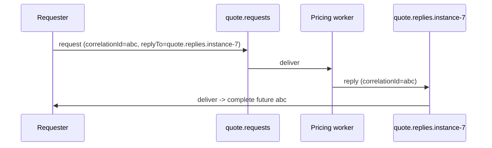

# Request-reply over messaging

---

## 🟢 Junior Level

Messaging is usually one-way, but sometimes the sender needs an answer — "price this quote", "validate this address". **Request-reply over messaging** implements this with two message flows:

1. The requester sends a request to a **request queue**, including:
   * a **`reply-to`** address (queue/topic where the answer should go),
   * a **correlation ID** to match the reply to the request.
2. The responder processes it and sends the reply to `reply-to` with the same correlation ID.
3. The requester waits (with a timeout) for the reply with its correlation ID.



### Why use it instead of HTTP?
* The responder can be **offline briefly** — the request waits in the queue.
* **Load leveling** — workers pull at their own pace; bursts queue up instead of overloading them.
* Works where only messaging connectivity exists (legacy mainframes via MQ, partners via brokers).

---

## 🟡 Middle Level

### RabbitMQ with Spring AMQP

```java
// Requester: convertSendAndReceive handles reply-to and correlation (direct reply-to by default)
@Service
class QuoteClient {
    private final RabbitTemplate rabbit;

    QuoteClient(RabbitTemplate rabbit) {
        this.rabbit = rabbit;
        this.rabbit.setReplyTimeout(2_000);                // ms; returns null on timeout
    }

    Quote price(QuoteRequest req) {
        Quote q = (Quote) rabbit.convertSendAndReceive("quotes", "quote.request", req);
        if (q == null) throw new QuoteTimeoutException(req.id());
        return q;
    }
}

// Responder: returning a value sends it to the reply-to address automatically
@RabbitListener(queues = "quote.requests")
Quote handle(QuoteRequest req) { return pricing.quote(req); }
```

RabbitMQ's **direct reply-to** (`amq.rabbitmq.reply-to`) avoids creating a reply queue per request. For async callers, `AsyncRabbitTemplate.convertSendAndReceive` returns a `CompletableFuture`.

### Kafka with Spring Kafka

```java
@Bean
ReplyingKafkaTemplate<String, QuoteRequest, Quote> replyingTemplate(
        ProducerFactory<String, QuoteRequest> pf,
        ConcurrentMessageListenerContainer<String, Quote> repliesContainer) {
    var t = new ReplyingKafkaTemplate<>(pf, repliesContainer);   // container listens on quote-replies
    t.setDefaultReplyTimeout(Duration.ofSeconds(2));
    return t;
}

RequestReplyFuture<String, QuoteRequest, Quote> f =
        replyingTemplate.sendAndReceive(new ProducerRecord<>("quote-requests", req.id(), req));
Quote quote = f.get(2, TimeUnit.SECONDS).value();

@KafkaListener(topics = "quote-requests")
@SendTo                                   // reply topic taken from the KafkaHeaders.REPLY_TOPIC header
Quote handle(QuoteRequest req) { return pricing.quote(req); }
```

With multiple requester instances, each must receive **its own** replies: use a reply topic per instance, or a shared reply topic with a reply-partition header per instance, or a unique consumer group per instance (each instance reads all replies and filters by correlation ID — wasteful at scale).

---

## 🔴 Senior Level

### Pitfalls
* **Synchronous coupling in disguise** — if the requester blocks a thread waiting, you've recreated RPC with more moving parts and latency (broker hops add milliseconds). Use it when you need the buffering/decoupling, otherwise prefer HTTP/gRPC.
* **Timeouts and late replies** — the requester times out and returns an error, then the reply arrives. The reply must be discarded safely (unknown correlation ID) and the operation must be idempotent if the requester retries. Set message TTL/expiration on requests so stale work isn't processed after the caller gave up (`expiration` property in AMQP; deadline in headers for Kafka).
* **Instance affinity** — replies addressed to a requester instance that has since died are lost; for long-running operations, use a durable store of pending operations instead of in-memory futures.
* **Correlation ID uniqueness** — UUIDs; never reuse business IDs if the same business entity can have concurrent requests.
* **Backpressure** — a flood of requests with short timeouts produces wasted work; bound in-flight requests on the requester (semaphore) and size worker concurrency to downstream capacity.

### Long-running operations: async request-reply over HTTP
For operations taking seconds to minutes, expose them as:
1. `POST /quotes` → `202 Accepted` + `Location: /quotes/requests/abc`.
2. Internally, enqueue the work; workers process and store the result.
3. Clients poll `GET /quotes/requests/abc` (or receive a webhook / SSE notification) until `200` with the result.

This avoids holding connections or threads open and survives instance restarts, because state lives in a database, not in in-memory futures.

### Observability
Propagate trace context in message headers so the request and reply appear in one trace; record metrics for request-reply latency, timeouts and late replies per operation.

---

## 🎯 Interview Cheat Sheet

**30-second pitch:** Request-reply over messaging sends a request with a reply-to address and correlation ID; the responder replies to that address and the requester matches the reply, with a timeout. Spring AMQP's `convertSendAndReceive` (direct reply-to) and Spring Kafka's `ReplyingKafkaTemplate` implement it. It's useful for load leveling and temporarily unavailable responders, but it's still coupling, so I handle timeouts, late replies, idempotency and instance affinity — or use async 202-and-poll for long operations.

**Must know:**
* `reply-to` + correlation ID; reply timeout.
* RabbitMQ direct reply-to; Kafka reply topic/partition per instance.
* Late replies; request expiration/deadlines.
* Bounded in-flight requests.
* Async request-reply HTTP pattern (202 + status resource).

**Common follow-ups:**
* How do multiple instances get their own replies in Kafka?
* What happens when the reply arrives after the timeout?
* When would you prefer HTTP?

**Red flags:** blocking threads for minutes waiting for replies; in-memory pending maps for long-running business processes.

**Related:**
* [Messaging fundamentals sync vs async and queues vs topics](01.%20Messaging%20fundamentals%20sync%20vs%20async%20and%20queues%20vs%20topics.md)
* [AMQP and RabbitMQ exchanges queues and bindings](03.%20AMQP%20and%20RabbitMQ%20exchanges%20queues%20and%20bindings.md)
* [How to design long-running operations and async APIs](../34.%20API%20Design%20and%20Integration/12.%20How%20to%20design%20long-running%20operations%20and%20async%20APIs.md)
* [Backpressure and consumer lag monitoring](17.%20Backpressure%20and%20consumer%20lag%20monitoring.md)
