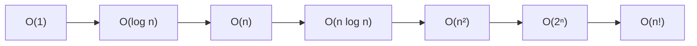

# What is Big-O notation and amortized analysis

---

## 🟢 Junior Level

**Big-O notation** describes how the running time (or memory use) of an algorithm *grows* as the input size `n` grows. It ignores constants and lower-order terms and focuses on the dominant growth trend, giving an **upper bound** for the worst case.

- **Time complexity** — how many basic steps are executed as a function of `n`.
- **Space complexity** — how much *extra* memory is used as a function of `n` (the input itself is usually not counted — this is called *auxiliary space*).

### Real-world analogy
Finding a name in a phone book:
- Reading every page from the start is **O(n)** — double the book, double the time.
- Opening in the middle and halving the search area each time is **O(log n)** — doubling the book adds just one more step.
- Knowing the page number in advance is **O(1)** — the size of the book does not matter.

### Common complexity classes

| Notation | Name | Example | n = 1,000,000 (approx. steps) |
|---|---|---|---|
| O(1) | Constant | `array[i]`, `HashMap.get` (average) | 1 |
| O(log n) | Logarithmic | Binary search, `TreeMap.get` | 20 |
| O(n) | Linear | Loop over an array | 1,000,000 |
| O(n log n) | Linearithmic | Merge sort, `Arrays.sort` | 20,000,000 |
| O(n²) | Quadratic | Nested loops, bubble sort | 10¹² (too slow) |
| O(2ⁿ) | Exponential | Naive subsets / Fibonacci | astronomically large |
| O(n!) | Factorial | Brute-force permutations | astronomically large |



### Minimal example

```java
public class ComplexityBasics {

    // O(1) time, O(1) space
    static int first(int[] a) {
        return a[0];
    }

    // O(n) time, O(1) space
    static int sum(int[] a) {
        int total = 0;
        for (int x : a) {
            total += x;
        }
        return total;
    }

    // O(n^2) time, O(1) space: compares every pair
    static boolean hasDuplicateBrute(int[] a) {
        for (int i = 0; i < a.length; i++) {
            for (int j = i + 1; j < a.length; j++) {
                if (a[i] == a[j]) {
                    return true;
                }
            }
        }
        return false;
    }

    public static void main(String[] args) {
        int[] data = {4, 8, 15, 16, 23, 42};
        System.out.println(first(data));               // 4
        System.out.println(sum(data));                 // 108
        System.out.println(hasDuplicateBrute(data));   // false
    }
}
```

### Rules of thumb
1. Drop constants: `O(2n)` → `O(n)`.
2. Drop lower-order terms: `O(n² + n)` → `O(n²)`.
3. Sequential blocks **add**, nested blocks **multiply**.
4. A loop that halves/doubles its counter is `O(log n)`.

---

## 🟡 Middle Level

### Big-O, Big-Omega, Big-Theta
- **O(f)** — upper bound (at most).
- **Ω(f)** — lower bound (at least).
- **Θ(f)** — tight bound (both). In interviews people say "O" but usually mean Θ of the worst case.

Always state **which case** you analyse: best, average, worst. Quick sort is `O(n log n)` on average but `O(n²)` in the worst case; `HashMap.get` is `O(1)` average and `O(log n)` worst case (treeified bins) in Java 8+.

### Analysing the dominant operations

```java
import java.util.ArrayList;
import java.util.List;

public class LoopAnalysis {

    // O(log n): counter doubles each iteration
    static int countDoublings(int n) {
        int steps = 0;
        for (int i = 1; i < n; i *= 2) {
            steps++;
        }
        return steps;
    }

    // O(n log n): outer linear, inner logarithmic
    static long nLogN(int n) {
        long ops = 0;
        for (int i = 0; i < n; i++) {
            for (int j = 1; j < n; j *= 2) {
                ops++;
            }
        }
        return ops;
    }

    // Still O(n), NOT O(n^2): j never moves backwards, so total inner work is bounded by n
    static int twoPointerStyle(int[] a) {
        int j = 0, moves = 0;
        for (int i = 0; i < a.length; i++) {
            while (j < a.length && a[j] <= a[i]) {
                j++;
                moves++;
            }
        }
        return moves;
    }

    // O(n^2) hidden cost: String concatenation in a loop copies the string every time
    static String slowJoin(List<String> parts) {
        String result = "";
        for (String p : parts) {
            result += p;
        }
        return result;
    }

    // O(n): StringBuilder appends are amortized O(1)
    static String fastJoin(List<String> parts) {
        StringBuilder sb = new StringBuilder();
        for (String p : parts) {
            sb.append(p);
        }
        return sb.toString();
    }

    public static void main(String[] args) {
        System.out.println(countDoublings(1 << 20)); // 20
        List<String> list = new ArrayList<>(List.of("a", "b", "c"));
        System.out.println(fastJoin(list));
    }
}
```

### Recurrences and the Master Theorem
For `T(n) = a·T(n/b) + O(nᵈ)`:
- `d > log_b a` → `O(nᵈ)`
- `d = log_b a` → `O(nᵈ log n)`
- `d < log_b a` → `O(n^(log_b a))`

Examples: merge sort `T(n)=2T(n/2)+O(n)` → `O(n log n)`; binary search `T(n)=T(n/2)+O(1)` → `O(log n)`; naive Fibonacci `T(n)=T(n-1)+T(n-2)` → `O(2ⁿ)`.

### Amortized analysis
**Amortized cost** is the average cost per operation over a *worst-case sequence* of operations — not a probabilistic average. A rare expensive operation is "paid for" by many cheap ones.

Classic example: `ArrayList.add`. Most appends cost `O(1)`; when the backing array is full, it grows by ~1.5× and copies `n` elements. Over `n` appends the total copying is a geometric series bounded by a constant multiple of `n`, so each append is **amortized O(1)**. Same logic applies to `StringBuilder.append`, `HashMap` resizing, and `ArrayDeque`.

```java
public class DynamicArray {
    private int[] data = new int[1];
    private int size;
    private long copies; // instrumentation

    void add(int value) {
        if (size == data.length) {
            int[] bigger = new int[data.length * 2];
            System.arraycopy(data, 0, bigger, 0, size);
            copies += size;
            data = bigger;
        }
        data[size++] = value;
    }

    public static void main(String[] args) {
        DynamicArray arr = new DynamicArray();
        int n = 1_000_000;
        for (int i = 0; i < n; i++) {
            arr.add(i);
        }
        // copies is < n, so the average extra cost per add is < 1 copy
        System.out.println("copies per add = " + (double) arr.copies / n);
    }
}
```

### Common mistakes
- Saying a `HashMap` lookup is *always* `O(1)` — it depends on hash quality and key `hashCode` cost (hashing a 1 MB string is `O(length)`).
- Ignoring the complexity of library calls: `list.contains()` is `O(n)`, `list.remove(0)` on `ArrayList` is `O(n)`, `String.substring` copies in modern JDKs.
- Forgetting **recursion stack space**: a recursive DFS on a skewed tree uses `O(h)` stack, up to `O(n)`.

For the internals of Java collections and their documented complexities see section 4 (Collections) — here we focus on algorithm analysis.

---

## 🔴 Senior Level

### Big-O is a model, not reality
Big-O counts abstract steps; production performance also depends on:
- **Memory hierarchy / cache locality**: iterating an `int[]` (contiguous) is often 5–50× faster than iterating a `LinkedList<Integer>` (pointer chasing + boxing) even though both are `O(n)`.
- **Constants**: for small `n` (say < 50) insertion sort beats merge sort; this is why TimSort and dual-pivot quicksort switch to insertion sort for tiny runs.
- **GC and allocation**: `O(n)` algorithms that allocate `n` objects can be dominated by GC pauses.
- **I/O and network**: one extra database round-trip dwarfs any `O(n log n)` in-memory sort. The N+1 select problem is "O(n) queries" and is the most common real-world complexity bug in Java full-stack apps.

### Space complexity gotchas
- Recursion depth counts. Java's default thread stack (~512 KB–1 MB) overflows around 10–20k frames; convert deep recursion to iteration with an explicit `Deque`.
- Streams: `list.stream().sorted().collect(...)` is `O(n log n)` time and `O(n)` extra space.
- Memoization trades space for time: `O(n)` memory to take Fibonacci from `O(2ⁿ)` to `O(n)`.

### Amortized vs average vs worst-case — in production
Amortized `O(1)` still has *latency spikes*: a single `ArrayList.add` that triggers a resize of a 1 GB array stalls one request. In low-latency services (trading, real-time bidding) you pre-size: `new ArrayList<>(expected)`, `new HashMap<>(expected * 4 / 3 + 1)`, or use incremental-resize structures. Likewise `HashMap` resize is amortized `O(1)` but single-threaded and blocking.

### Empirically verifying complexity
Do not trust intuition — measure with JMH and check the growth ratio when doubling `n`.

```java
import org.openjdk.jmh.annotations.*;
import java.util.*;
import java.util.concurrent.TimeUnit;

@State(Scope.Thread)
@BenchmarkMode(Mode.AverageTime)
@OutputTimeUnit(TimeUnit.MICROSECONDS)
public class ComplexityBenchmark {

    @Param({"1000", "2000", "4000", "8000"})
    int n;

    int[] data;

    @Setup(Level.Invocation)
    public void setup() {
        Random r = new Random(42);
        data = r.ints(n).toArray();
    }

    @Benchmark
    public int[] sortArray() {
        Arrays.sort(data);      // expect ~2.1x per doubling (n log n)
        return data;
    }

    @Benchmark
    public boolean quadraticDuplicates() {
        for (int i = 0; i < n; i++) {
            for (int j = i + 1; j < n; j++) {
                if (data[i] == data[j]) return true;
            }
        }
        return false;                // expect ~4x per doubling (n^2)
    }
}
```

Reading the results: if time ×2 when `n` ×2 → linear; ×4 → quadratic; ×~2.2 → `n log n`. A log-log plot gives the exponent as the slope.

### Diagnostics in the field
- **Async-profiler / JFR flame graphs** reveal the hot loops that actually consume time; a flat `O(n)` method called `n` times from a hidden place is the usual culprit.
- **Algorithmic complexity attacks**: crafted keys with colliding hashes degrade hash tables to `O(n)` (Java 8 mitigates via treeified buckets when keys are `Comparable`), and regex catastrophic backtracking (`(a+)+$`) gives exponential time — a DoS vector. Use input-length limits or RE2-style engines.
- **Cost models for distributed systems**: complexity is also measured in network hops, shuffles (Spark), and disk seeks (B-tree depth ≈ log base 500 of rows).

### Practical senior heuristics
1. Pick the simplest structure that meets the SLO at 10× expected `n`.
2. Constraint-driven choice: `n ≤ 20` → exponential OK; `n ≤ 500` → `O(n³)`; `n ≤ 5,000` → `O(n²)`; `n ≤ 10⁶` → `O(n log n)`; `n ≤ 10⁸` → `O(n)`.
3. Always state both time **and** space, and name the case.

---

## 🎯 Interview Cheat Sheet

### 30-Second Elevator Pitch
> "Big-O describes how an algorithm's time or space grows with input size, ignoring constants. I state the case (worst/average), analyse loops by multiplication for nesting and addition for sequence, use the Master Theorem for divide-and-conquer, and use amortized analysis for structures like `ArrayList` whose rare resizes are paid for by many cheap appends. In production I also account for cache locality, GC and I/O, and I verify with JMH."

### Must-Know Bullets
- O(1) < O(log n) < O(n) < O(n log n) < O(n²) < O(2ⁿ) < O(n!).
- Drop constants and lower-order terms; nested loops multiply.
- Amortized ≠ average: it is a guaranteed bound over a sequence of operations.
- `ArrayList.add` amortized O(1); `list.add(0, x)` O(n); `HashMap.get` O(1) average, O(log n) worst.
- Recursion uses stack space proportional to depth.

### Common Follow-Up Questions
1. Why is `ArrayList.add` amortized O(1) and what if the array grew by a constant instead of a factor? (Then total cost becomes O(n²).)
2. What is the complexity of building a heap from an array? (O(n), not O(n log n).)
3. What is the difference between average-case and amortized analysis?
4. What is the complexity of `String.contains`, `Collections.sort`, `TreeMap.put`?

### Red Flags (DO NOT Say)
- ❌ "O(n) means exactly n operations."
- ❌ "`HashMap` is always O(1)."
- ❌ "Space complexity means memory of the input."
- ❌ Giving only time complexity and forgetting recursion stack space.

### Related Topics
- [How to solve array and string problems](02.%20How%20to%20solve%20array%20and%20string%20problems.md)
- [How do sorting algorithms work and what does Java use](09.%20How%20do%20sorting%20algorithms%20work%20and%20what%20does%20Java%20use.md)
- [How to approach a coding interview](20.%20How%20to%20approach%20a%20coding%20interview.md)
