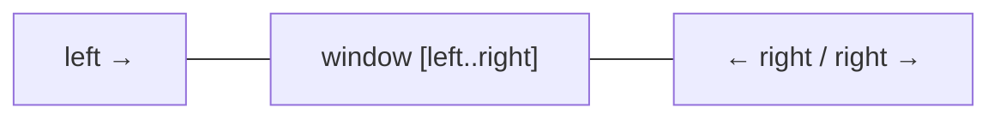

# How do two pointers and sliding window work

---

## 🟢 Junior Level

**Two pointers** is a technique that uses two indices moving through a sequence (often an array or string) to avoid a nested loop. **Sliding window** is a special case: the two pointers delimit a *contiguous range* (the window) that grows on the right and shrinks on the left.

Both turn many `O(n²)` brute-force solutions into `O(n)`.

### Real-world analogy
- **Two pointers**: two people walk toward each other along a corridor of sorted numbered doors until they meet.
- **Sliding window**: a magnifying glass slid along a line of text — you only look at what is inside it, and updating it as it moves costs one step.



### Example 1: Two-sum on a sorted array

```java
import java.util.Arrays;

public class TwoPointersBasic {

    // Sorted input. O(n) time, O(1) space. Returns 0-based indices, or an empty array.
    static int[] twoSumSorted(int[] a, int target) {
        int l = 0, r = a.length - 1;
        while (l < r) {
            int sum = a[l] + a[r];
            if (sum == target) return new int[]{l, r};
            if (sum < target) l++;   // need a bigger sum
            else r--;                // need a smaller sum
        }
        return new int[0];
    }

    public static void main(String[] args) {
        System.out.println(Arrays.toString(twoSumSorted(new int[]{1, 3, 4, 6, 8, 11}, 10))); // [2, 3]
    }
}
```

### Example 2: Fixed-size window — max sum of `k` consecutive elements

```java
public class FixedWindow {
    // Brute force is O(n*k). Sliding: add the new element, subtract the one that left.
    static int maxSumOfK(int[] a, int k) {
        int window = 0;
        for (int i = 0; i < k; i++) window += a[i];
        int best = window;
        for (int i = k; i < a.length; i++) {
            window += a[i] - a[i - k];
            best = Math.max(best, window);
        }
        return best;
    }

    public static void main(String[] args) {
        System.out.println(maxSumOfK(new int[]{2, 1, 5, 1, 3, 2}, 3)); // 9
    }
}
```

---

## 🟡 Middle Level

### Why it is correct
In sorted two-sum, if `a[l] + a[r] < target`, then `a[l]` paired with *any* index `≤ r` is also too small, so `l` can be safely discarded. Each step discards at least one candidate → `O(n)`.

For sliding windows the key insight is that **each element enters the window once and leaves once**, so total work is `O(n)` even though there is a `while` inside the `for`.

### Pattern catalog

| Pattern | Pointer movement | Examples |
|---|---|---|
| Opposite ends | `l++` / `r--` | 2-sum sorted, 3-sum, container with most water, valid palindrome |
| Fast/slow (same direction) | `slow` writes, `fast` reads | remove duplicates, move zeroes, cycle detection |
| Fixed window | window size `k` constant | max average subarray, anagram window |
| Variable window (grow/shrink) | shrink while invalid | longest substring without repeats, minimum window substring |

### Variable window: longest substring without repeating characters

```java
import java.util.HashMap;
import java.util.Map;

public class LongestUnique {
    // O(n) time, O(min(n, alphabet)) space
    static int lengthOfLongestSubstring(String s) {
        Map<Character, Integer> lastSeen = new HashMap<>();
        int best = 0, left = 0;
        for (int right = 0; right < s.length(); right++) {
            char c = s.charAt(right);
            Integer prev = lastSeen.get(c);
            if (prev != null && prev >= left) {
                left = prev + 1;      // jump past the previous occurrence
            }
            lastSeen.put(c, right);
            best = Math.max(best, right - left + 1);
        }
        return best;
    }

    public static void main(String[] args) {
        System.out.println(lengthOfLongestSubstring("abcabcbb")); // 3
        System.out.println(lengthOfLongestSubstring("pwwkew"));   // 3
    }
}
```

### Minimum window substring (classic hard-ish)

```java
public class MinWindow {
    static String minWindow(String s, String t) {
        if (t.isEmpty() || s.length() < t.length()) return "";
        int[] need = new int[128];
        for (char c : t.toCharArray()) need[c]++;
        int missing = t.length();
        int bestStart = 0, bestLen = Integer.MAX_VALUE, left = 0;
        for (int right = 0; right < s.length(); right++) {
            if (need[s.charAt(right)]-- > 0) missing--;
            while (missing == 0) {                       // window is valid -> try to shrink
                if (right - left + 1 < bestLen) {
                    bestLen = right - left + 1;
                    bestStart = left;
                }
                if (++need[s.charAt(left++)] > 0) missing++;
            }
        }
        return bestLen == Integer.MAX_VALUE ? "" : s.substring(bestStart, bestStart + bestLen);
    }

    public static void main(String[] args) {
        System.out.println(minWindow("ADOBECODEBANC", "ABC")); // BANC
    }
}
```

The `need[]` array holds a *debt* counter: positive = still needed, zero or negative = surplus. This avoids a second map and is `O(|s| + |t|)`.

### 3-sum with duplicates handling

```java
import java.util.*;

public class ThreeSum {
    static List<List<Integer>> threeSum(int[] nums) {
        Arrays.sort(nums);
        List<List<Integer>> res = new ArrayList<>();
        for (int i = 0; i < nums.length - 2; i++) {
            if (i > 0 && nums[i] == nums[i - 1]) continue;       // skip duplicate anchors
            int l = i + 1, r = nums.length - 1;
            while (l < r) {
                int sum = nums[i] + nums[l] + nums[r];
                if (sum == 0) {
                    res.add(List.of(nums[i], nums[l], nums[r]));
                    while (l < r && nums[l] == nums[l + 1]) l++;
                    while (l < r && nums[r] == nums[r - 1]) r--;
                    l++;
                    r--;
                } else if (sum < 0) l++;
                else r--;
            }
        }
        return res;                                              // O(n^2) time
    }
}
```

### Common mistakes
- Using the sliding window when elements can be **negative** and the condition is "sum ≥ target" — shrinking is no longer monotonic; use prefix sums + hash map or a monotonic deque.
- Off-by-one in window length: it is `right - left + 1`.
- Forgetting to skip duplicates (3-sum) or to advance both pointers after a hit.
- Shrinking with `if` instead of `while`.

---

## 🔴 Senior Level

### Monotonicity is the real requirement
A variable window works when the validity predicate is *monotonic*: enlarging the window never makes an invalid window valid in the wrong direction. For "at most K distinct" it holds; for "exactly K distinct" use `atMost(K) - atMost(K-1)`. When it fails (negative numbers), switch to prefix sums with a `HashMap<Long,Integer>` (count of subarrays with sum `k`).

### Sliding window maximum with a monotonic deque — O(n)

```java
import java.util.ArrayDeque;
import java.util.Deque;

public class SlidingMax {
    static int[] maxSlidingWindow(int[] a, int k) {
        int n = a.length;
        int[] res = new int[n - k + 1];
        Deque<Integer> dq = new ArrayDeque<>();     // indices, values strictly decreasing
        for (int i = 0; i < n; i++) {
            while (!dq.isEmpty() && dq.peekFirst() <= i - k) dq.pollFirst();   // out of window
            while (!dq.isEmpty() && a[dq.peekLast()] <= a[i]) dq.pollLast();   // dominated
            dq.offerLast(i);
            if (i >= k - 1) res[i - k + 1] = a[dq.peekFirst()];
        }
        return res;
    }
}
```
Each index is pushed and popped at most once → `O(n)`; the naive heap approach is `O(n log k)`.

### Production variants: windows over streams
The same idea powers **rate limiters** and **metrics**:
- *Sliding window log*: store request timestamps in a deque, evict those older than the window — exact but `O(requests)` memory.
- *Sliding window counter*: keep fixed buckets (e.g., 60 × 1 s) in a ring array and sum; `O(buckets)` memory, approximate and lock-friendly with `LongAdder`.
- Libraries: Resilience4j `RateLimiter`, Bucket4j, Guava `RateLimiter` (token bucket), Micrometer's time-windowed distribution summaries.
- Stream processors (Kafka Streams, Flink) offer tumbling, hopping and sliding windows with event-time and watermarks — the same concept with late-data handling.

### Performance notes
- Prefer `int[128]`/`int[256]` over `HashMap<Character,Integer>` for ASCII: no boxing, branch-predictable, and cache resident.
- For Unicode, map code points with `HashMap<Integer,Integer>` or `Int2IntOpenHashMap` (fastutil).
- Avoid `substring` inside the loop; record indices and create the substring once at the end.
- Two pointers on `LinkedList` is a trap — random access is `O(n)`; copy to an array or use iterators.

### Testing
Use randomized differential testing: compare the `O(n)` solution against a brute-force `O(n²)` oracle on thousands of random small arrays (lengths 0–12, values −5..5). Window problems almost always fail on empty input, `k > n`, `k = 1`, and all-identical elements.

---

## 🎯 Interview Cheat Sheet

### 30-Second Elevator Pitch
> "Two pointers and sliding window replace nested loops with one pass. Opposite-end pointers need a sorted or monotonic structure; fast/slow pointers modify in place; a window expands on the right and shrinks on the left while a predicate is violated. Each element enters and leaves once, so it is O(n). When values can be negative I fall back to prefix sums with a hash map, and for window maximum I use a monotonic deque."

### Must-Know Bullets
- Sorted + pair/triplet → opposite-end pointers; 3-sum is O(n²).
- Variable window: expand right, `while` invalid shrink left.
- Window length = `right - left + 1`.
- Needs monotonic condition; negative numbers break it.
- Sliding max → monotonic deque in O(n).

### Common Follow-Up Questions
1. Why is the nested `while` still O(n)?
2. How do you count subarrays with sum exactly `k` including negatives?
3. How do you implement a rate limiter with a sliding window?
4. How to handle streams that do not fit in memory?

### Red Flags (DO NOT Say)
- ❌ "Nested loops mean O(n²)" without checking amortized pointer movement.
- ❌ Applying a window to negative-number sum problems.
- ❌ Re-computing the window sum from scratch each step.

### Related Topics
- [How to solve array and string problems](02.%20How%20to%20solve%20array%20and%20string%20problems.md)
- [How to solve hashing problems like two-sum and anagrams](04.%20How%20to%20solve%20hashing%20problems%20like%20two-sum%20and%20anagrams.md)
- [How to use stacks and queues including monotonic stack](06.%20How%20to%20use%20stacks%20and%20queues%20including%20monotonic%20stack.md)
