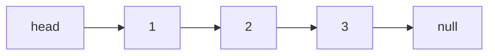

# How to reverse a linked list and detect a cycle

---

## 🟢 Junior Level

A **singly linked list** is a chain of nodes; each node stores a value and a reference to the next node. Unlike an array there is no index access: reaching the k-th element takes `O(k)`, but inserting or removing after a known node is `O(1)`.

### Real-world analogy
A scavenger hunt: each clue tells you where the next clue is. You cannot jump to clue #7 without following clues 1–6. A cycle means a clue sends you back to an earlier clue — you would walk forever.



### Node and reverse (iterative)
Reversing means flipping each `next` pointer. Use three references: `prev`, `curr`, `next`.

```java
public class ReverseList {

    static class ListNode {
        int val;
        ListNode next;
        ListNode(int val) { this.val = val; }
    }

    // O(n) time, O(1) space
    static ListNode reverse(ListNode head) {
        ListNode prev = null;
        ListNode curr = head;
        while (curr != null) {
            ListNode next = curr.next;   // 1. remember the rest
            curr.next = prev;            // 2. flip the pointer
            prev = curr;                 // 3. advance prev
            curr = next;                 // 4. advance curr
        }
        return prev;                     // prev is the new head
    }

    static ListNode of(int... values) {
        ListNode dummy = new ListNode(0), tail = dummy;
        for (int v : values) { tail.next = new ListNode(v); tail = tail.next; }
        return dummy.next;
    }

    static String toString(ListNode head) {
        StringBuilder sb = new StringBuilder();
        for (ListNode n = head; n != null; n = n.next) sb.append(n.val).append(n.next != null ? "->" : "");
        return sb.toString();
    }

    public static void main(String[] args) {
        System.out.println(toString(reverse(of(1, 2, 3, 4)))); // 4->3->2->1
    }
}
```

### Cycle detection — the simple way
Remember every visited node in a `HashSet`; if you see one again, there is a cycle. `O(n)` time but `O(n)` space.

```java
import java.util.HashSet;
import java.util.Set;

public class CycleWithSet {
    static boolean hasCycle(ReverseList.ListNode head) {
        Set<ReverseList.ListNode> seen = new HashSet<>();
        for (ReverseList.ListNode n = head; n != null; n = n.next) {
            if (!seen.add(n)) return true;
        }
        return false;
    }
}
```

---

## 🟡 Middle Level

### Floyd's tortoise-and-hare — O(1) space
Move `slow` one step and `fast` two steps. If there is a cycle, `fast` eventually laps `slow` and they meet; if `fast` reaches `null`, there is no cycle.

```java
public class FloydCycle {

    static class Node { int val; Node next; Node(int v) { val = v; } }

    static boolean hasCycle(Node head) {
        Node slow = head, fast = head;
        while (fast != null && fast.next != null) {
            slow = slow.next;
            fast = fast.next.next;
            if (slow == fast) return true;
        }
        return false;
    }

    // Find the node where the cycle begins
    static Node detectCycleStart(Node head) {
        Node slow = head, fast = head;
        while (fast != null && fast.next != null) {
            slow = slow.next;
            fast = fast.next.next;
            if (slow == fast) {                 // meeting point inside the cycle
                Node p = head;
                while (p != slow) {             // both move one step; they meet at the entry
                    p = p.next;
                    slow = slow.next;
                }
                return p;
            }
        }
        return null;
    }
}
```

**Why the entry-finding works.** Let `a` = distance from head to cycle entry, `b` = distance from entry to meeting point, `c` = cycle length. When they meet, `slow` travelled `a + b`, `fast` travelled `2(a + b)`, and the difference `a + b` is a multiple of `c`. So `a = kc − b`: walking `a` steps from the meeting point lands on the entry, exactly where a pointer starting at head arrives after `a` steps.

**Complexity**: time `O(n)` (slow enters the cycle in ≤ n steps and is caught within one lap), space `O(1)`.

### Recursive reverse and other classics

```java
public class ListClassics {

    static class Node { int val; Node next; Node(int v, Node n) { val = v; next = n; } }

    // Recursive: O(n) time but O(n) call-stack space -> risk of StackOverflowError for ~10k+ nodes
    static Node reverseRec(Node head) {
        if (head == null || head.next == null) return head;
        Node newHead = reverseRec(head.next);
        head.next.next = head;
        head.next = null;
        return newHead;
    }

    // Middle node with slow/fast
    static Node middle(Node head) {
        Node slow = head, fast = head;
        while (fast != null && fast.next != null) {
            slow = slow.next;
            fast = fast.next.next;
        }
        return slow;
    }

    // Merge two sorted lists using a dummy head (avoids special cases for the head)
    static Node merge(Node a, Node b) {
        Node dummy = new Node(0, null), tail = dummy;
        while (a != null && b != null) {
            if (a.val <= b.val) { tail.next = a; a = a.next; }
            else { tail.next = b; b = b.next; }
            tail = tail.next;
        }
        tail.next = (a != null) ? a : b;
        return dummy.next;
    }

    // Remove the n-th node from the end in one pass: gap of n between two pointers
    static Node removeNthFromEnd(Node head, int n) {
        Node dummy = new Node(0, head), lead = dummy, lag = dummy;
        for (int i = 0; i < n; i++) lead = lead.next;
        while (lead.next != null) { lead = lead.next; lag = lag.next; }
        lag.next = lag.next.next;
        return dummy.next;
    }
}
```

### Common mistakes
- Not saving `curr.next` before overwriting it — you lose the rest of the list.
- Returning `curr` instead of `prev` after the loop.
- `NullPointerException` from `fast.next.next` without checking `fast.next`.
- Forgetting the dummy node: head deletions then need special code.
- Comparing node values instead of node **references** when detecting cycles.

Java's `LinkedList` is a *doubly* linked list; its internals and when (rarely) to use it are covered in section 4.

---

## 🔴 Senior Level

### Reality check: linked lists on modern hardware
Each node is a separate heap object: 16-byte header+fields (≥ 24 bytes with a boxed value on compressed oops), scattered across memory. Traversing a million-node list causes cache misses at nearly every hop, so `ArrayList` / `ArrayDeque` typically beat `LinkedList` by 5–20× even where theory says `O(1)` insertion wins. Linked structures shine when you hold **a node reference** and need `O(1)` splice/removal — LRU caches (see the LRU question), intrusive queues, lock-free algorithms (Michael-Scott queue, `ConcurrentLinkedQueue`), and free lists.

### Reverse a sublist and reverse in k-groups

```java
public class ReverseAdvanced {

    static class Node { int val; Node next; Node(int v) { val = v; } }

    // Reverse nodes between positions left..right (1-based) in one pass
    static Node reverseBetween(Node head, int left, int right) {
        Node dummy = new Node(0);
        dummy.next = head;
        Node before = dummy;
        for (int i = 1; i < left; i++) before = before.next;
        Node curr = before.next;
        for (int i = 0; i < right - left; i++) {
            Node moved = curr.next;          // pull the next node to the front of the sublist
            curr.next = moved.next;
            moved.next = before.next;
            before.next = moved;
        }
        return dummy.next;
    }

    // Reverse in groups of k; leftover tail (< k nodes) stays as is. O(n) time, O(1) space
    static Node reverseKGroup(Node head, int k) {
        Node probe = head;
        for (int i = 0; i < k; i++) {
            if (probe == null) return head;
            probe = probe.next;
        }
        Node prev = reverseKGroup(probe, k), curr = head;   // recursion depth n/k
        for (int i = 0; i < k; i++) {
            Node next = curr.next;
            curr.next = prev;
            prev = curr;
            curr = next;
        }
        return prev;
    }
}
```

### Production considerations
1. **Cycles in real systems**: a cyclic `next` chain in an entity graph causes infinite loops in serialization (Jackson `JsonMappingException: Infinite recursion`), `toString`/`hashCode`/`equals` that traverse bidirectional JPA associations, and garbage-collection-unfriendly leaks. Break cycles with `@JsonIgnore` / `@JsonManagedReference` or DTOs.
2. **Detecting cycles in dependency graphs** (Spring circular bean dependencies, Gradle/Maven module cycles, microservice call loops) is the graph version of the same problem — use DFS coloring or Kahn's algorithm (see the graph question). Floyd is specific to functional graphs (each node has one successor), e.g. detecting loops in a `next` pointer, in a pseudo-random sequence (Pollard's rho factoring), or in repeating state machines.
3. **Brent's algorithm** is a variant needing fewer function evaluations than Floyd when `next()` is expensive (e.g., it calls a remote service).
4. **Stack safety**: recursion on long lists overflows around 10–20k frames with default stack sizes; prefer iteration or increase `-Xss` only as a last resort.
5. **Concurrency**: a plain linked list mutated by threads can produce cycles via lost updates. Use `ConcurrentLinkedQueue`/`CopyOnWriteArrayList`, or immutable persistent lists.

### Immutable (persistent) list sketch
Functional languages use linked lists because "prepend" shares the tail without copying — thread-safe by construction.

```java
public final class PList<T> {
    private final T head;
    private final PList<T> tail;
    private static final PList<?> EMPTY = new PList<>(null, null);

    private PList(T head, PList<T> tail) { this.head = head; this.tail = tail; }

    @SuppressWarnings("unchecked")
    public static <T> PList<T> empty() { return (PList<T>) EMPTY; }

    public PList<T> prepend(T value) { return new PList<>(value, this); }   // O(1), shares structure
    public boolean isEmpty() { return this == EMPTY; }
    public T head() { return head; }
    public PList<T> tail() { return tail; }
}
```

### Interview-grade verification
Write tests for: `null` head, single node, two nodes, odd/even length, cycle at head, cycle at tail (self-loop `n.next = n`), and a long list (1,000,000 nodes) to prove the iterative solution does not overflow the stack.

---

## 🎯 Interview Cheat Sheet

### 30-Second Elevator Pitch
> "To reverse a singly linked list iteratively I keep `prev`, `curr` and `next`, flipping one pointer per step — O(n) time, O(1) space. To detect a cycle I use Floyd's two-pointer technique: slow moves one step, fast two; if they meet there is a cycle, and resetting one pointer to the head and moving both one step finds the cycle's entry. It uses O(1) space versus O(n) for a HashSet. In production I remember linked lists have poor cache locality and cycles show up as serialization or dependency loops."

### Must-Know Bullets
- Iterative reverse: 4 lines inside the loop, return `prev`.
- Floyd: `while (fast != null && fast.next != null)`.
- Entry point: after meeting, `p = head`; move both one step until equal.
- Dummy head node removes edge cases.
- Recursive reverse costs O(n) stack.

### Common Follow-Up Questions
1. How do you find the cycle length? (After meeting, loop one pointer until it returns.)
2. Why does fast move 2 and not 3? (Relative speed 1 closes the gap by exactly one node per step, so they cannot jump over each other; with speed 3 the gap shrinks by 2 and, for an even cycle length with an odd gap, the pointers may never meet.)
3. How do you check if a list is a palindrome in O(1) space? (Find middle, reverse second half, compare.)
4. Why is `LinkedList` usually slower than `ArrayList` in practice?

### Red Flags (DO NOT Say)
- ❌ "Linked list insertion is O(1)" without mentioning you first need the node.
- ❌ Comparing `.val` instead of references to detect cycles.
- ❌ Not handling `null`/single-node input.

### Related Topics
- [How to use stacks and queues including monotonic stack](06.%20How%20to%20use%20stacks%20and%20queues%20including%20monotonic%20stack.md)
- [How to work with graphs BFS DFS and topological sort](13.%20How%20to%20work%20with%20graphs%20BFS%20DFS%20and%20topological%20sort.md)
- [How to implement an LRU cache](16.%20How%20to%20implement%20an%20LRU%20cache.md)
