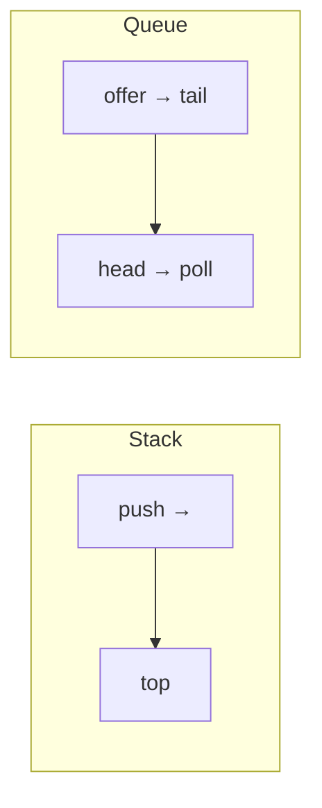

# How to use stacks and queues including monotonic stack

---

## 🟢 Junior Level

A **stack** is LIFO (last in, first out): `push`, `pop`, `peek`. A **queue** is FIFO (first in, first out): `offer`, `poll`, `peek`. A **deque** supports both ends.

### Real-world analogy
- Stack: a pile of plates — you take the top plate you put down last (browser Back button, undo, call stack).
- Queue: a supermarket line — first come, first served (print jobs, task scheduling, BFS).



### In Java use `ArrayDeque`
`java.util.Stack` is a legacy class that extends `Vector` (synchronized, slow). Prefer `Deque<T> stack = new ArrayDeque<>()` for both stack and queue use. `LinkedList` also works but is heavier. `ArrayDeque` does not permit `null` elements.

```java
import java.util.ArrayDeque;
import java.util.Deque;
import java.util.Queue;

public class StackQueueBasics {
    public static void main(String[] args) {
        Deque<Integer> stack = new ArrayDeque<>();
        stack.push(1);
        stack.push(2);
        System.out.println(stack.pop());     // 2 (LIFO)

        Queue<Integer> queue = new ArrayDeque<>();
        queue.offer(1);
        queue.offer(2);
        System.out.println(queue.poll());    // 1 (FIFO)
    }
}
```

### Valid parentheses
Given a string of `()[]{}`, decide whether brackets are balanced. Each closing bracket must match the most recent unmatched opening bracket — exactly what a stack gives.

```java
import java.util.ArrayDeque;
import java.util.Deque;

public class ValidParentheses {
    // O(n) time, O(n) space
    static boolean isValid(String s) {
        Deque<Character> stack = new ArrayDeque<>();
        for (char c : s.toCharArray()) {
            switch (c) {
                case '(' -> stack.push(')');
                case '[' -> stack.push(']');
                case '{' -> stack.push('}');
                default -> {
                    if (stack.isEmpty() || stack.pop() != c) return false;
                }
            }
        }
        return stack.isEmpty();
    }

    public static void main(String[] args) {
        System.out.println(isValid("{[()]}"));  // true
        System.out.println(isValid("(]"));      // false
        System.out.println(isValid("(("));      // false
    }
}
```

---

## 🟡 Middle Level

### Classic problems
| Problem | Structure | Complexity |
|---|---|---|
| Balanced brackets, HTML tag matching | stack | O(n) |
| Evaluate Reverse Polish Notation | stack of operands | O(n) |
| Min stack (`getMin` in O(1)) | stack + auxiliary min stack | O(1) per op |
| Queue using two stacks | in-stack + out-stack | amortized O(1) |
| Stack using two queues | rotate on push | O(n) push |
| BFS level order | queue | O(V+E) |
| Next greater element, daily temperatures | monotonic stack | O(n) |
| Sliding window maximum | monotonic deque | O(n) |

### Min stack

```java
import java.util.ArrayDeque;
import java.util.Deque;

public class MinStack {
    private final Deque<Integer> values = new ArrayDeque<>();
    private final Deque<Integer> mins = new ArrayDeque<>();

    public void push(int x) {
        values.push(x);
        mins.push(mins.isEmpty() ? x : Math.min(x, mins.peek()));
    }

    public int pop() {
        mins.pop();
        return values.pop();
    }

    public int top() { return values.peek(); }

    public int getMin() { return mins.peek(); }   // O(1)
}
```

### Queue implemented with two stacks (amortized O(1))

```java
import java.util.ArrayDeque;
import java.util.Deque;
import java.util.NoSuchElementException;

public class TwoStackQueue<T> {
    private final Deque<T> in = new ArrayDeque<>();
    private final Deque<T> out = new ArrayDeque<>();

    public void enqueue(T x) { in.push(x); }

    public T dequeue() {
        shift();
        if (out.isEmpty()) throw new NoSuchElementException();
        return out.pop();
    }

    private void shift() {
        if (out.isEmpty()) {
            while (!in.isEmpty()) out.push(in.pop());   // each element moves at most once
        }
    }
}
```
Each element is moved from `in` to `out` once, so `n` operations cost `O(n)` total: amortized `O(1)`.

### Monotonic stack — next greater element
Maintain a stack whose values are monotonic (here decreasing). When a new element is larger than the stack top, the top has found its "next greater".

```java
import java.util.ArrayDeque;
import java.util.Arrays;
import java.util.Deque;

public class DailyTemperatures {
    // result[i] = number of days until a warmer temperature, 0 if none. O(n) time, O(n) space.
    static int[] dailyTemperatures(int[] t) {
        int[] res = new int[t.length];
        Deque<Integer> stack = new ArrayDeque<>();          // indices with decreasing temperatures
        for (int i = 0; i < t.length; i++) {
            while (!stack.isEmpty() && t[stack.peek()] < t[i]) {
                int j = stack.pop();
                res[j] = i - j;
            }
            stack.push(i);
        }
        return res;
    }

    public static void main(String[] args) {
        System.out.println(Arrays.toString(dailyTemperatures(new int[]{73, 74, 75, 71, 69, 72, 76, 73})));
        // [1, 1, 4, 2, 1, 1, 0, 0]
    }
}
```
Every index is pushed once and popped once → `O(n)` even with the inner `while`.

### Largest rectangle in a histogram (monotonic increasing stack)

```java
import java.util.ArrayDeque;
import java.util.Deque;

public class Histogram {
    static int largestRectangle(int[] h) {
        Deque<Integer> stack = new ArrayDeque<>();
        int best = 0;
        for (int i = 0; i <= h.length; i++) {
            int cur = (i == h.length) ? 0 : h[i];             // sentinel flushes the stack
            while (!stack.isEmpty() && h[stack.peek()] > cur) {
                int height = h[stack.pop()];
                int left = stack.isEmpty() ? -1 : stack.peek();
                best = Math.max(best, height * (i - left - 1));
            }
            stack.push(i);
        }
        return best;
    }
}
```

### Common mistakes
- Calling `pop()` / `peek()` on an empty stack: `pop` throws `NoSuchElementException`, `peek` on `ArrayDeque` returns `null` (unboxing then NPEs).
- Using `java.util.Stack` or `LinkedList` unnecessarily.
- Pushing the **value** when you need the **index** in monotonic stack problems (you lose distance information).
- Forgetting the final `isEmpty()` check in bracket matching.

---

## 🔴 Senior Level

### Stack in the JVM and recursion conversion
Every thread has a call stack (`-Xss`, default ~1 MB on 64-bit Linux). Deep recursion (DFS over 100k nodes, naive parsers) throws `StackOverflowError`. The fix is an explicit `ArrayDeque` on the heap, which can grow to available memory and keeps frames small. Tail-call optimization is **not** performed by the JVM, so tail recursion does not help.

### Queue families in `java.util.concurrent`
Queues are the backbone of concurrent design (producer–consumer, thread pools, backpressure):

| Queue | Bounded | Blocking | Notes |
|---|---|---|---|
| `ArrayBlockingQueue` | yes | yes | single lock, fair mode optional |
| `LinkedBlockingQueue` | optional | yes | two locks (put/take), higher throughput |
| `ConcurrentLinkedQueue` | no | no | lock-free Michael–Scott, CAS based |
| `PriorityBlockingQueue` | no | take blocks | heap ordered |
| `SynchronousQueue` | zero capacity | yes | handoff; used by `newCachedThreadPool` |
| `LinkedTransferQueue` | no | yes | transfer semantics |
| LMAX Disruptor ring buffer | yes | busy-spin / wait strategies | pre-allocated, avoids GC and false sharing |

**Production guidance**: always bound queues feeding a `ThreadPoolExecutor` (an unbounded `LinkedBlockingQueue` hides overload until `OutOfMemoryError`), pick a rejection policy, and monitor queue depth as a key saturation metric. Message brokers (Kafka, RabbitMQ, SQS) are distributed queues with additional concerns: ordering per partition, at-least-once delivery, idempotent consumers.

### Monotonic deque for sliding window and DP optimisation
A monotonic deque yields sliding-window min/max in `O(n)`; it also optimises DP transitions of the form `dp[i] = max(dp[j]) + c` over `j ∈ [i-k, i-1]` (e.g., "jump game VI") from `O(nk)` to `O(n)`.

```java
import java.util.ArrayDeque;
import java.util.Deque;

public class JumpGameVI {
    // Max score reaching the last index, jumping at most k steps. O(n).
    static int maxResult(int[] nums, int k) {
        int n = nums.length;
        int[] dp = new int[n];
        dp[0] = nums[0];
        Deque<Integer> dq = new ArrayDeque<>();
        dq.offerLast(0);
        for (int i = 1; i < n; i++) {
            while (dq.peekFirst() < i - k) dq.pollFirst();
            dp[i] = dp[dq.peekFirst()] + nums[i];
            while (!dq.isEmpty() && dp[dq.peekLast()] <= dp[i]) dq.pollLast();
            dq.offerLast(i);
        }
        return dp[n - 1];
    }
}
```

### Ring buffer: fixed-capacity queue without allocation
A circular array queue gives `O(1)` offer/poll with zero per-element allocation — the idea behind `ArrayDeque`, Disruptor and network buffers.

```java
public class RingQueue {
    private final int[] buf;
    private int head, size;

    public RingQueue(int capacity) { buf = new int[capacity]; }

    public boolean offer(int x) {
        if (size == buf.length) return false;               // bounded: signal backpressure
        buf[(head + size++) % buf.length] = x;
        return true;
    }

    public int poll() {
        if (size == 0) throw new IllegalStateException("empty");
        int x = buf[head];
        head = (head + 1) % buf.length;
        size--;
        return x;
    }
}
```
`ArrayDeque` uses a power-of-two capacity so the modulo becomes a bit mask (`& (length - 1)`).

### Diagnostics
- Thread dumps showing many threads parked on `LinkedBlockingQueue.take` mean idle workers; many parked on `put` mean backpressure on a bounded queue.
- Growing heap with `LinkedBlockingQueue$Node` dominators → unbounded queue and slow consumers.
- Use JFR "Thread Park" events and executor metrics (`queue.size`, `rejected`) in Micrometer.

---

## 🎯 Interview Cheat Sheet

### 30-Second Elevator Pitch
> "A stack is LIFO and a queue is FIFO; in Java I use `ArrayDeque` for both, not `Stack`. Stacks solve matching and nesting problems like valid parentheses and expression evaluation; a monotonic stack finds next-greater elements and histogram rectangles in O(n) because each index is pushed and popped once. A queue drives BFS and scheduling; in production I always bound queues and watch depth for backpressure."

### Must-Know Bullets
- `ArrayDeque` > `Stack` / `LinkedList`; no nulls.
- Valid parentheses: push expected closing bracket, compare on pop.
- Monotonic stack: store indices; amortized O(n).
- Two-stack queue: amortized O(1).
- Bound executor queues; unbounded = latent OOM.

### Common Follow-Up Questions
1. Implement a queue with two stacks. Why amortized O(1)?
2. Next greater element in a circular array? (Iterate `2n` indices.)
3. Difference between `ArrayBlockingQueue` and `LinkedBlockingQueue`?
4. How to avoid `StackOverflowError` in deep recursion?

### Red Flags (DO NOT Say)
- ❌ "I'll use `java.util.Stack`."
- ❌ "A while inside a for loop makes the monotonic stack O(n²)."
- ❌ Ignoring empty-stack checks.

### Related Topics
- [How to reverse a linked list and detect a cycle](05.%20How%20to%20reverse%20a%20linked%20list%20and%20detect%20a%20cycle.md)
- [How do two pointers and sliding window work](03.%20How%20do%20two%20pointers%20and%20sliding%20window%20work.md)
- [How to traverse binary trees with DFS and BFS](10.%20How%20to%20traverse%20binary%20trees%20with%20DFS%20and%20BFS.md)
