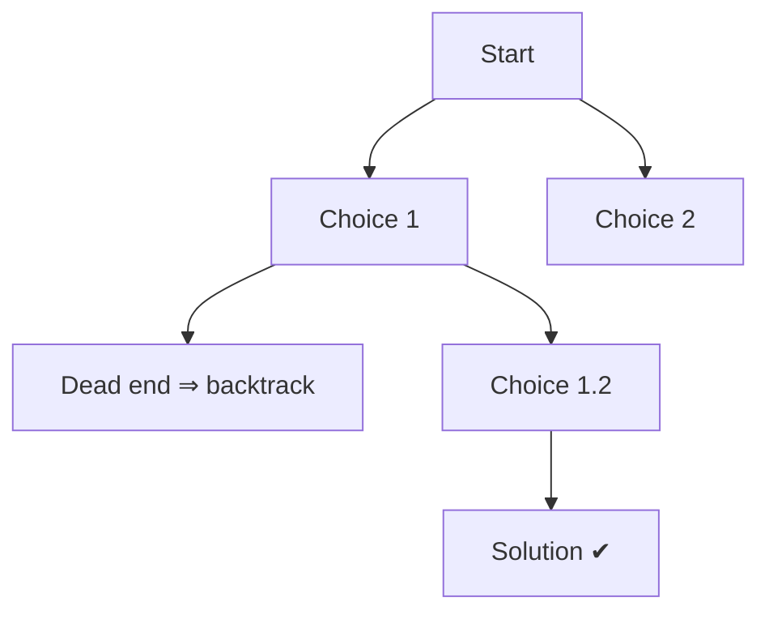

# How does recursion and backtracking work

---

## 🟢 Junior Level

**Recursion** is when a method solves a problem by calling itself on a smaller version of the same problem. Every recursive method needs:
1. A **base case** — the input so small the answer is known (stops the recursion).
2. A **recursive case** — reduce the problem and call yourself.

**Backtracking** is recursion that builds a solution step by step, and when a partial solution cannot lead to a valid answer, **undoes** the last choice ("backtracks") and tries another.

### Real-world analogy
- Recursion: Russian nesting dolls — to count dolls, open one, and count the rest the same way until you reach the smallest.
- Backtracking: walking a maze; at a dead end you go back to the last junction and take a different corridor.



### Example: factorial and Fibonacci

```java
public class RecursionBasics {

    // O(n) time, O(n) stack space
    static long factorial(int n) {
        if (n <= 1) return 1;                 // base case
        return n * factorial(n - 1);          // recursive case
    }

    // Naive Fibonacci: O(2^n) time because subproblems are recomputed
    static long fibNaive(int n) {
        if (n < 2) return n;
        return fibNaive(n - 1) + fibNaive(n - 2);
    }

    public static void main(String[] args) {
        System.out.println(factorial(10));   // 3628800
        System.out.println(fibNaive(10));    // 55
    }
}
```

### Example: sum of digits, power set size, print all subsets

```java
import java.util.ArrayList;
import java.util.List;

public class SubsetsIntro {

    static void subsets(int[] nums, int index, List<Integer> current, List<List<Integer>> out) {
        if (index == nums.length) {                     // base case: decided on every element
            out.add(new ArrayList<>(current));          // copy! current keeps changing
            return;
        }
        subsets(nums, index + 1, current, out);         // choice 1: skip nums[index]
        current.add(nums[index]);                       // choice 2: take it
        subsets(nums, index + 1, current, out);
        current.remove(current.size() - 1);             // undo the choice (backtrack)
    }

    public static void main(String[] args) {
        List<List<Integer>> out = new ArrayList<>();
        subsets(new int[]{1, 2, 3}, 0, new ArrayList<>(), out);
        System.out.println(out);   // 8 subsets
    }
}
```

---

## 🟡 Middle Level

### The backtracking template
```
backtrack(state):
    if state is a complete solution: record it; return
    for each choice available at this state:
        if choice is valid (prune):
            apply choice
            backtrack(next state)
            undo choice
```
Three ingredients: **choose → explore → un-choose**. Pruning invalid branches early is what separates backtracking from brute force.

### Permutations (n! results)

```java
import java.util.ArrayList;
import java.util.List;

public class Permutations {
    static List<List<Integer>> permute(int[] nums) {
        List<List<Integer>> out = new ArrayList<>();
        backtrack(nums, new boolean[nums.length], new ArrayList<>(), out);
        return out;
    }

    private static void backtrack(int[] nums, boolean[] used, List<Integer> cur, List<List<Integer>> out) {
        if (cur.size() == nums.length) {
            out.add(new ArrayList<>(cur));
            return;
        }
        for (int i = 0; i < nums.length; i++) {
            if (used[i]) continue;
            used[i] = true;
            cur.add(nums[i]);
            backtrack(nums, used, cur, out);
            cur.remove(cur.size() - 1);
            used[i] = false;
        }
    }
}
```
Time `O(n · n!)`, space `O(n)` recursion (plus output).

### Combination sum with duplicate-skipping (pruning)

```java
import java.util.ArrayList;
import java.util.Arrays;
import java.util.List;

public class CombinationSum {
    // Each candidate may be used once; result must contain no duplicate combinations
    static List<List<Integer>> combinationSum2(int[] candidates, int target) {
        Arrays.sort(candidates);
        List<List<Integer>> out = new ArrayList<>();
        dfs(candidates, target, 0, new ArrayList<>(), out);
        return out;
    }

    private static void dfs(int[] c, int remain, int start, List<Integer> cur, List<List<Integer>> out) {
        if (remain == 0) { out.add(new ArrayList<>(cur)); return; }
        for (int i = start; i < c.length; i++) {
            if (c[i] > remain) break;                          // prune: sorted, so the rest is too large
            if (i > start && c[i] == c[i - 1]) continue;       // skip duplicate at the same depth
            cur.add(c[i]);
            dfs(c, remain - c[i], i + 1, cur, out);
            cur.remove(cur.size() - 1);
        }
    }

    public static void main(String[] args) {
        System.out.println(combinationSum2(new int[]{10, 1, 2, 7, 6, 1, 5}, 8));
        // [[1, 1, 6], [1, 2, 5], [1, 7], [2, 6]]
    }
}
```

### N-Queens

```java
import java.util.ArrayList;
import java.util.List;

public class NQueens {
    static int count(int n) {
        return place(0, n, new boolean[n], new boolean[2 * n], new boolean[2 * n]);
    }

    // row-by-row; track used columns and both diagonals in O(1)
    private static int place(int row, int n, boolean[] cols, boolean[] diag, boolean[] anti) {
        if (row == n) return 1;
        int total = 0;
        for (int c = 0; c < n; c++) {
            int d = row - c + n, a = row + c;
            if (cols[c] || diag[d] || anti[a]) continue;       // prune attacked squares
            cols[c] = diag[d] = anti[a] = true;
            total += place(row + 1, n, cols, diag, anti);
            cols[c] = diag[d] = anti[a] = false;
        }
        return total;
    }

    public static void main(String[] args) {
        System.out.println(count(8)); // 92
    }
}
```

### Memoization — fixing exponential recursion
When the same subproblem recurs, cache it (top-down dynamic programming). `fib` drops from `O(2ⁿ)` to `O(n)`.

```java
import java.util.HashMap;
import java.util.Map;

public class FibMemo {
    private static final Map<Integer, Long> cache = new HashMap<>();

    static long fib(int n) {
        if (n < 2) return n;
        Long cached = cache.get(n);
        if (cached != null) return cached;
        long v = fib(n - 1) + fib(n - 2);
        cache.put(n, v);                    // avoid computeIfAbsent: recursive modification throws ConcurrentModificationException
        return v;
    }
}
```

### Common mistakes
- Missing or unreachable base case → `StackOverflowError`.
- Adding `cur` directly to results instead of a **copy**.
- Forgetting to undo state (`used[i] = false`).
- Using `HashMap.computeIfAbsent` with a recursive mapping function that modifies the same map.
- Not pruning, leading to `O(n!)` where `O(n)` pruning is possible.

### Complexity of recursion
Draw the recursion tree: cost = (number of nodes) × (work per node). Subsets: `2ⁿ` leaves × `O(n)` copy. Permutations: `n!` leaves. Space: depth of the tree × frame size.

---

## 🔴 Senior Level

### The JVM call stack
Each invocation allocates a stack frame (locals, operand stack, return address). Default `-Xss` is typically 512 KB–1 MB, i.e. about **10–20 thousand frames** for simple methods; JIT-compiled frames are smaller than interpreted ones, so depth can vary between runs — a classic source of non-deterministic `StackOverflowError`. The JVM performs **no tail-call optimization**, so converting tail recursion by hand is the only safe approach.

### Convert recursion to iteration
```java
import java.util.ArrayDeque;
import java.util.ArrayList;
import java.util.Deque;
import java.util.List;

public class IterativeSubsets {
    // Explicit stack replaces the call stack; no depth limit except heap
    record Frame(int index, List<Integer> chosen) { }

    static List<List<Integer>> subsets(int[] nums) {
        List<List<Integer>> out = new ArrayList<>();
        Deque<Frame> stack = new ArrayDeque<>();
        stack.push(new Frame(0, List.of()));
        while (!stack.isEmpty()) {
            Frame f = stack.pop();
            if (f.index() == nums.length) {
                out.add(f.chosen());
                continue;
            }
            stack.push(new Frame(f.index() + 1, f.chosen()));                 // skip
            List<Integer> with = new ArrayList<>(f.chosen());
            with.add(nums[f.index()]);
            stack.push(new Frame(f.index() + 1, with));                       // take
        }
        return out;
    }
}
```
The trade-off is copying the partial state (immutable frames) instead of mutating and undoing.

### Bitmask optimisation
For `n ≤ 20`, subsets can be enumerated with an integer mask (`for mask in 0..2^n`), avoiding recursion entirely; N-Queens can track columns/diagonals in three `int` bitmasks and use `Integer.lowestOneBit` to pick candidate squares, running 5–10× faster than boolean arrays.

```java
public class NQueensBits {
    static int solve(int n) {
        return go(n, 0, 0, 0, 0);
    }

    private static int go(int n, int row, int cols, int d1, int d2) {
        if (row == n) return 1;
        int total = 0;
        int free = ~(cols | d1 | d2) & ((1 << n) - 1);
        while (free != 0) {
            int bit = free & -free;               // lowest set bit
            free ^= bit;
            total += go(n, row + 1, cols | bit, (d1 | bit) << 1, (d2 | bit) >>> 1);
        }
        return total;
    }

    public static void main(String[] args) {
        System.out.println(solve(8)); // 92
    }
}
```

### Production uses of recursion and backtracking
- Parsers (recursive descent, JSON/XML), file tree walks (`Files.walkFileTree`), Spring bean dependency resolution, JSON serialization of nested objects, expression and rule engines, regex engines (backtracking regexes → catastrophic backtracking, a ReDoS vulnerability).
- Constraint solving: Sudoku, scheduling, configuration validation — real solvers (OptaPlanner/Timefold, OR-Tools) use backtracking with constraint propagation, heuristics (most-constrained variable first), and branch & bound.
- **Defensive limits**: recursion over **untrusted input** (deeply nested JSON/XML) is a DoS vector. Jackson enforces `StreamReadConstraints.maxNestingDepth` (default 1000 since 2.15); set explicit depth limits on custom parsers.
- **Cancellation/timeouts**: long backtracking should check `Thread.interrupted()` or a deadline every N nodes.
- **Memoization at scale**: use a bounded cache (Caffeine) or array/bitset DP table; an unbounded `HashMap` memo can leak memory.

### Memoization vs tabulation vs iteration
Memoized recursion only computes reachable states but pays call overhead and stack depth; tabulation (bottom-up) is faster and stack-safe. See the dynamic programming questions of this section for the full comparison.

### Debugging tips
- Print/log the recursion depth and arguments for small inputs; use a conditional breakpoint on the base case.
- Prove termination: define a measure (e.g., `n`) that strictly decreases toward the base case.
- Property-test by comparing to a simple brute force for tiny inputs.

---

## 🎯 Interview Cheat Sheet

### 30-Second Elevator Pitch
> "Recursion solves a problem by reducing it to smaller instances with a base case and a recursive case; its cost is nodes in the recursion tree times work per node, plus O(depth) stack space. Backtracking is recursion with choose–explore–undo and pruning, used for subsets, permutations, N-Queens and constraint problems. Overlapping subproblems call for memoization; deep recursion should become iteration with an explicit stack because the JVM has no tail-call optimization."

### Must-Know Bullets
- Always define the base case first.
- Template: choose → explore → un-choose; copy results.
- Subsets `2ⁿ`, permutations `n!`, naive Fibonacci `2ⁿ`.
- Prune early (sort + break, used arrays, diagonal sets).
- JVM: no TCO; ~10–20k frames by default.

### Common Follow-Up Questions
1. How would you avoid duplicates when the input has repeated elements?
2. How do you convert this recursion to iteration?
3. What is the time and space complexity (including output size)?
4. How do regex catastrophic backtracking and ReDoS happen?

### Red Flags (DO NOT Say)
- ❌ "Recursion is always slower/faster than loops" without context.
- ❌ Forgetting to copy the current path before adding it to results.
- ❌ "Java optimizes tail recursion."

### Related Topics
- [How to solve dynamic programming problems](17.%20How%20to%20solve%20dynamic%20programming%20problems.md)
- [How to traverse binary trees with DFS and BFS](10.%20How%20to%20traverse%20binary%20trees%20with%20DFS%20and%20BFS.md)
- [How to use bit manipulation](20.%20How%20to%20use%20bit%20manipulation.md)
