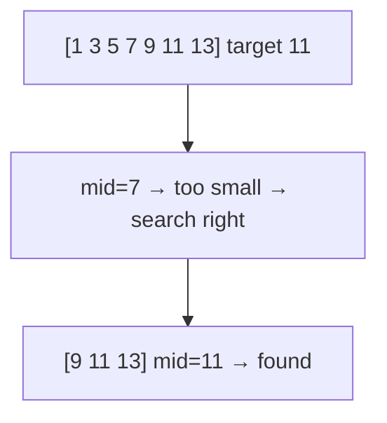

# How does binary search work and what are its variants

---

## 🟢 Junior Level

**Binary search** finds a target in a **sorted** array by repeatedly comparing it with the middle element and discarding half of the remaining range. Time `O(log n)`, space `O(1)` (iterative).

### Real-world analogy
Guess-the-number game: "higher or lower?" Starting at 50 out of 100, each answer halves the possibilities, so 7 guesses suffice for 100 numbers (and ~20 for a million).



### Minimal working implementation

```java
public class BinarySearchBasic {

    // Returns the index of target or -1. Requires a sorted array.
    static int search(int[] a, int target) {
        int lo = 0, hi = a.length - 1;
        while (lo <= hi) {
            int mid = lo + (hi - lo) / 2;      // avoids int overflow of (lo + hi)
            if (a[mid] == target) return mid;
            if (a[mid] < target) lo = mid + 1;
            else hi = mid - 1;
        }
        return -1;
    }

    public static void main(String[] args) {
        int[] a = {1, 3, 5, 7, 9, 11, 13};
        System.out.println(search(a, 11));  // 5
        System.out.println(search(a, 4));   // -1
    }
}
```

### Why not linear search?
For `n = 1,000,000,000` a linear scan needs up to a billion comparisons; binary search needs at most 30. The price: the data must be sorted (sorting costs `O(n log n)` once, worthwhile when you search many times).

### Java built-ins
- `Arrays.binarySearch(int[], key)` and `Collections.binarySearch(list, key)` return the index if found, otherwise `-(insertionPoint) - 1`.
- Results are **undefined** if the array is unsorted or contains duplicates and you need a specific one (any matching index may be returned).

---

## 🟡 Middle Level

### The three templates
Most bugs come from mixing loop conditions and boundary updates. Pick one template and stick to it.

**Template A — exact match** (`lo <= hi`, shown above).

**Template B — lower bound: first index with `a[i] >= target`** (half-open range `[lo, hi)`):

```java
public class BinarySearchVariants {

    // First index i with a[i] >= target; returns a.length if none. (lower bound / insertion point)
    static int lowerBound(int[] a, int target) {
        int lo = 0, hi = a.length;           // search space is [lo, hi)
        while (lo < hi) {
            int mid = lo + (hi - lo) / 2;
            if (a[mid] < target) lo = mid + 1;
            else hi = mid;                    // a[mid] could be the answer: keep it
        }
        return lo;
    }

    // First index with a[i] > target (upper bound)
    static int upperBound(int[] a, int target) {
        int lo = 0, hi = a.length;
        while (lo < hi) {
            int mid = lo + (hi - lo) / 2;
            if (a[mid] <= target) lo = mid + 1;
            else hi = mid;
        }
        return lo;
    }

    static int firstOccurrence(int[] a, int t) {
        int i = lowerBound(a, t);
        return (i < a.length && a[i] == t) ? i : -1;
    }

    static int lastOccurrence(int[] a, int t) {
        int i = upperBound(a, t) - 1;
        return (i >= 0 && a[i] == t) ? i : -1;
    }

    static int countOf(int[] a, int t) {
        return upperBound(a, t) - lowerBound(a, t);
    }

    public static void main(String[] args) {
        int[] a = {1, 2, 2, 2, 3, 5};
        System.out.println(firstOccurrence(a, 2)); // 1
        System.out.println(lastOccurrence(a, 2));  // 3
        System.out.println(countOf(a, 2));         // 3
        System.out.println(lowerBound(a, 4));      // 5 (insertion point)
    }
}
```

### Search in a rotated sorted array
One half around `mid` is always sorted; decide whether the target lies in that half.

```java
public class RotatedSearch {
    // Distinct values. O(log n)
    static int search(int[] a, int target) {
        int lo = 0, hi = a.length - 1;
        while (lo <= hi) {
            int mid = lo + (hi - lo) / 2;
            if (a[mid] == target) return mid;
            if (a[lo] <= a[mid]) {                         // left half sorted
                if (a[lo] <= target && target < a[mid]) hi = mid - 1;
                else lo = mid + 1;
            } else {                                       // right half sorted
                if (a[mid] < target && target <= a[hi]) lo = mid + 1;
                else hi = mid - 1;
            }
        }
        return -1;
    }

    // Minimum of a rotated sorted array (distinct values)
    static int findMin(int[] a) {
        int lo = 0, hi = a.length - 1;
        while (lo < hi) {
            int mid = lo + (hi - lo) / 2;
            if (a[mid] > a[hi]) lo = mid + 1;
            else hi = mid;
        }
        return a[lo];
    }
}
```
With duplicates the worst case degrades to `O(n)` (when `a[lo] == a[mid] == a[hi]` you can only shrink by one).

### Binary search on the answer
The most powerful variant: if a monotonic predicate `feasible(x)` is false...false, true...true, binary search finds the first true value even though there is **no array**.

Example: *Koko eating bananas* — minimum speed `k` so that all piles are eaten within `h` hours.

```java
public class BinarySearchOnAnswer {

    static int minEatingSpeed(int[] piles, int h) {
        int lo = 1, hi = 0;
        for (int p : piles) hi = Math.max(hi, p);
        while (lo < hi) {
            int mid = lo + (hi - lo) / 2;
            if (hoursNeeded(piles, mid) <= h) hi = mid;      // feasible: try smaller
            else lo = mid + 1;
        }
        return lo;
    }

    private static long hoursNeeded(int[] piles, int speed) {
        long hours = 0;
        for (int p : piles) hours += (p + speed - 1) / speed;   // ceil
        return hours;
    }

    public static void main(String[] args) {
        System.out.println(minEatingSpeed(new int[]{3, 6, 7, 11}, 8)); // 4
    }
}
```
Complexity: `O(n log maxPile)`. Other examples: ship packages within D days, split array largest sum, integer square root, aggressive cows.

### Common mistakes
- `(lo + hi) / 2` overflow for huge arrays; use `lo + (hi - lo) / 2` or `>>> 1`.
- Infinite loop: `lo = mid` with `mid` rounding down when `hi = lo + 1`.
- Mixing inclusive `hi = n - 1` with `lo < hi` templates.
- Applying binary search on unsorted data or a non-monotonic predicate.
- Using `Arrays.binarySearch` return value without handling negative insertion-point encoding.

---

## 🔴 Senior Level

### Floating-point and real-valued search
For doubles, loop a fixed number of iterations (e.g., 100) instead of testing `hi - lo > eps`; this guarantees termination despite rounding. Example: computing `sqrt` or solving `f(x)=0` for monotonic `f`.

```java
public class RealBinarySearch {
    static double sqrt(double x) {
        double lo = 0, hi = Math.max(1, x);
        for (int i = 0; i < 100; i++) {          // 2^-100 precision: more than a double holds
            double mid = (lo + hi) / 2;
            if (mid * mid < x) lo = mid;
            else hi = mid;
        }
        return lo;
    }
}
```

### Famous bug
Joshua Bloch's 2006 post: `Arrays.binarySearch`/`mergeSort` in the JDK computed `(low + high) / 2`, which overflowed for arrays with more than 2³⁰ elements and had been latent for years. The JDK fix is `(low + high) >>> 1`. Lesson: boundary arithmetic is part of correctness.

### Where binary search lives in production
- **Databases**: B-tree/B+-tree pages perform binary search within a node; sorted SSTables in LSM engines (RocksDB, Cassandra) binary-search the sparse index then the block.
- **`git bisect`** binary-searches commit history for a regression: `O(log n)` builds.
- **Time-series and logs**: finding the first record ≥ timestamp in sorted files (Kafka's offset index uses binary search over a memory-mapped sparse index).
- **Collections**: `TreeMap.floorKey/ceilingKey` (balanced-tree variants), `Collections.binarySearch` with a custom `Comparator`. On a `LinkedList`, `Collections.binarySearch` falls back to an iterator-based search with `O(n)` traversal even though comparisons are `O(log n)`.
- **Capacity planning / autoscaling**: binary search on the answer (minimum instance count meeting an SLO using a simulator).
- **Interpolation search** can be `O(log log n)` on uniformly distributed keys but degrades to `O(n)` on skewed data.

### Performance
- A branchy binary search suffers branch mispredictions (the comparison outcome is random ~50%). *Branchless* implementations use conditional moves, and for static arrays the **Eytzinger layout** or **B-tree-like (S-tree) layouts** improve cache and prefetch behaviour, giving 2–4× speedups over textbook binary search for large arrays (millions of elements) on x86.
- For small arrays (≤ ~64 ints) a linear scan is competitive because it is vectorisable and predictable.
- The first levels of the search touch the same few cache lines on every query — they remain hot; the last levels cause the cache misses.

### Correctness: loop invariants
State the invariant and you will never get off-by-one errors: for the lower-bound template `[lo, hi)`: *every index < lo has a[i] < target; every index ≥ hi has a[i] ≥ target*. Initially true (`lo=0`, `hi=n`), preserved by each update, and when `lo == hi` the answer is `lo`.

### Testing
Use exhaustive tests: all arrays of length 0–8 over values 0–3 and every target −1..4, comparing with a linear scan. This catches essentially all off-by-one issues cheaply.

```java
import java.util.Arrays;

public class ExhaustiveBsTest {
    public static void main(String[] args) {
        for (int n = 0; n <= 6; n++) {
            int total = (int) Math.pow(4, n);
            for (int code = 0; code < total; code++) {
                int[] a = new int[n];
                for (int i = 0, c = code; i < n; i++, c /= 4) a[i] = c % 4;
                Arrays.sort(a);
                for (int t = -1; t <= 4; t++) {
                    int expected = 0;
                    while (expected < n && a[expected] < t) expected++;
                    if (BinarySearchVariants.lowerBound(a, t) != expected)
                        throw new AssertionError(Arrays.toString(a) + " t=" + t);
                }
            }
        }
        System.out.println("all ok");
    }
}
```

---

## 🎯 Interview Cheat Sheet

### 30-Second Elevator Pitch
> "Binary search halves a sorted search space each step, giving O(log n) time and O(1) space. I keep a loop invariant and use `lo + (hi - lo) / 2`. The key variants are lower/upper bound for first/last occurrence and insertion point, searching a rotated array by identifying the sorted half, and binary search on the answer for any monotonic feasibility predicate. In production it underlies database indexes, `git bisect`, and sorted-file lookups."

### Must-Know Bullets
- Requires sorted data or a monotonic predicate.
- `lo + (hi - lo) / 2` avoids overflow.
- `Arrays.binarySearch` returns `-(insertionPoint) - 1` when absent.
- Lower bound template `[lo, hi)` with `hi = mid`.
- Rotated array: one half is always sorted; duplicates can force O(n).

### Common Follow-Up Questions
1. How to find the first/last occurrence or count of a value?
2. How to search in a rotated sorted array, and with duplicates?
3. How to apply binary search without an array (on the answer)?
4. Why is `Collections.binarySearch` on a `LinkedList` not really O(log n)?

### Red Flags (DO NOT Say)
- ❌ "Binary search works on any array."
- ❌ `mid = (lo + hi) / 2` without discussing overflow.
- ❌ Using `lo = mid` / `hi = mid` combos that can loop forever.

### Related Topics
- [How do sorting algorithms work and what does Java use](09.%20How%20do%20sorting%20algorithms%20work%20and%20what%20does%20Java%20use.md)
- [What are binary search trees and balanced trees](11.%20What%20are%20binary%20search%20trees%20and%20balanced%20trees.md)
- [How to solve interval problems](23.%20How%20to%20solve%20interval%20problems.md)
