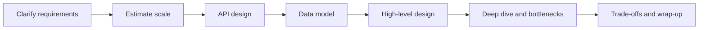
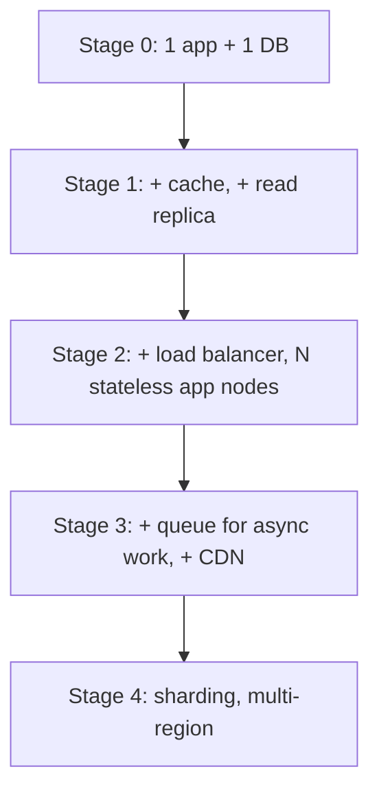
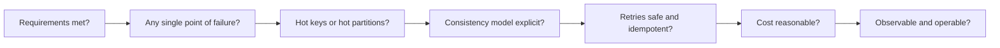

# How to approach a system design interview

---

## 🟢 Junior Level

A **system design interview** asks you to sketch how a large software system (a URL shortener, a chat app, a news feed) would be built. There is no single correct answer. The interviewer evaluates *how you think*: do you clarify the problem, make sensible assumptions, pick components, and explain trade-offs?

### Real-world analogy
Designing a system is like planning a restaurant. You first ask: how many guests, what cuisine, what budget (requirements)? Then you estimate (20 tables, 200 meals per evening), draw the floor plan (components), decide the menu (API), and plan the pantry (data model). Only after that do you worry about what happens on a Saturday night rush (scaling) or when the oven breaks (failures).

### The 7-step framework

1. **Clarify requirements** – functional (what the system does) and non-functional (latency, availability, scale).
2. **Estimate scale** – users, requests per second, storage, bandwidth.
3. **Define the API** – the public contract (REST endpoints, request/response).
4. **Design the data model** – entities, relationships, SQL vs NoSQL.
5. **Draw the high-level architecture** – clients, load balancer, services, database, cache, queue.
6. **Deep dive into bottlenecks** – scaling, hot keys, consistency, failures.
7. **Summarize trade-offs** – what you chose, what you rejected, what you would revisit.



### A tiny example: a minimal first design in code

When you begin, the simplest working design is a single service plus a database. Show that first, then evolve it.

```java
// Step 1 of any design: one stateless service, one database. Evolve from here.
@RestController
@RequestMapping("/api/v1/links")
public class LinkController {

    private final LinkRepository repository;

    public LinkController(LinkRepository repository) {
        this.repository = repository;
    }

    @PostMapping
    public ResponseEntity<LinkResponse> create(@RequestBody CreateLinkRequest request) {
        Link saved = repository.save(new Link(request.url()));
        return ResponseEntity.status(HttpStatus.CREATED).body(new LinkResponse(saved.getCode()));
    }

    public record CreateLinkRequest(String url) {}
    public record LinkResponse(String code) {}
}
```

### What interviewers look for
- You **ask questions** instead of jumping to boxes and arrows.
- You **state assumptions** out loud ("assume 100M daily active users").
- You **start simple** and add complexity only when a number justifies it.
- You can **explain why**, not just name technologies.

---

## 🟡 Middle Level

### Time boxing a 45-minute interview

| Phase | Minutes | Output |
|---|---|---|
| Requirements and scope | 5 | Written list of must-have and out-of-scope features |
| Estimation | 5 | QPS, storage, bandwidth numbers |
| API and data model | 8 | Endpoints, tables/collections, keys |
| High-level design | 10 | Diagram with data flow for the main use cases |
| Deep dive | 12 | 1–2 bottlenecks chosen with the interviewer |
| Wrap-up | 5 | Trade-offs, monitoring, future work |

### Choosing what to deep dive
Every system has a *signature problem*. Identify it early and spend your time there:

| System | Signature problem |
|---|---|
| URL shortener | Unique ID generation, read-heavy caching |
| Chat | Connection management, message ordering, fan-out |
| News feed | Fan-out on write vs read, celebrity problem |
| Rate limiter | Atomic distributed counters, clock skew |
| File storage | Large uploads, chunking, deduplication |

### API design discipline
State the contract before the internals. Mention pagination, idempotency keys, versioning and error codes.

```java
@RestController
@RequestMapping("/api/v1/orders")
class OrderController {

    // Idempotency-Key lets clients safely retry POST after a timeout
    @PostMapping
    ResponseEntity<OrderDto> place(@RequestHeader("Idempotency-Key") String key,
                                   @Valid @RequestBody PlaceOrderRequest body) {
        OrderDto dto = orderService.placeOnce(key, body);
        return ResponseEntity.status(HttpStatus.CREATED).body(dto);
    }

    // Cursor pagination scales better than OFFSET for large tables
    @GetMapping
    Page<OrderDto> list(@RequestParam(required = false) String cursor,
                        @RequestParam(defaultValue = "20") int limit) {
        return orderService.list(cursor, Math.min(limit, 100));
    }
}
```

### Data model reasoning
Derive the schema from **access patterns**, not from nouns. Write down the top 3 queries first ("get link by code", "list user's links"), then pick keys and indexes that serve them. Choose SQL when you need transactions and joins; choose a wide-column or key-value store when you need predictable latency at massive write volume and your queries are known in advance.

### Common mistakes at this level
1. Drawing a microservice per noun before knowing the load.
2. Naming technologies (Kafka, Cassandra) without stating the property you need from them.
3. Ignoring the read/write ratio, which drives nearly every decision.
4. Not driving the conversation: waiting for the interviewer to ask the next question.
5. Forgetting non-functional needs such as availability targets and latency percentiles.

### Evolving a design in stages



Each arrow should be justified by a number ("at 5k read QPS a single Postgres primary struggles, so add a cache").

---

## 🔴 Senior Level

### Thinking in failure modes
Seniors are distinguished by asking "what breaks?" for every box. For each component, state: what happens if it is slow, down, or returns wrong data? Typical answers: timeouts, retries with jitter, circuit breakers, fallbacks, bulkheads, and graceful degradation.

```java
// Resilience4j: every remote call in the design gets a timeout, retry and breaker
@Service
class PricingClient {

    private final RestClient http;

    PricingClient(RestClient.Builder builder) {
        this.http = builder.baseUrl("http://pricing").build();
    }

    @CircuitBreaker(name = "pricing", fallbackMethod = "cachedPrice")
    @Retry(name = "pricing")
    public Price price(String sku) {
        return http.get().uri("/prices/{sku}", sku).retrieve().body(Price.class);
    }

    Price cachedPrice(String sku, Throwable t) {
        return Price.stale(sku); // degrade gracefully instead of failing checkout
    }
}
```

### Quantify, then justify
A staff-level answer ties every decision to a number and an SLO:
- "p99 read latency under 100 ms, 99.95% availability" drives replication and caching.
- "Peak is 3x average; we provision for peak plus 30% headroom."
- "The write path is 2k QPS, which one sharded Postgres cluster handles; Kafka is unnecessary here."

### Trade-off vocabulary you must use precisely
- **Consistency vs availability** under partition (CAP), and **latency vs consistency** otherwise (PACELC).
- **Fan-out on write vs fan-out on read** (storage and write amplification vs read latency).
- **Push vs pull**, **sync vs async**, **strong vs eventual**, **cost vs durability**.
- **Build vs buy**, **monolith first vs services first**.

### Handling ambiguity and pushback
When the interviewer changes a requirement ("now 100x traffic"), do not restart. Locate the first component that breaks under the new number and fix it. This shows your design has understood bottlenecks rather than memorized a diagram.

### Operability is part of the design
Mention before being asked: metrics (RED/USE), structured logs with correlation IDs, distributed tracing, alerts based on SLOs, deployment strategy (canary, blue/green), schema migration safety (expand/contract), runbooks, and capacity planning. A design nobody can operate is incomplete.

### Diagnosing your own design: a checklist


### Senior-level communication habits
- Write the requirements and numbers on the board so you can refer back.
- Offer **two options** at a decision point, compare them in one sentence each, then commit.
- Say what you would **not** build in v1 and why.
- Close by listing risks and the metric that would tell you the design needs to change.

---

## 🎯 Interview Cheat Sheet

### 30-second elevator pitch
"I start by clarifying functional and non-functional requirements, then estimate QPS, storage and bandwidth. I define the API and data model from access patterns, draw a simple high-level design, and then deep dive into the signature bottleneck, discussing failure modes and trade-offs. I close with observability, risks and what I would build next."

### Must-know bullets
- Requirements first, numbers second, boxes third.
- Start with the simplest design that works, then evolve with justification.
- Read/write ratio and access patterns drive the data model.
- Every dependency needs timeout, retry (idempotent), and fallback.
- Always state trade-offs explicitly: what you gain and what you pay.
- Drive the conversation; check in with the interviewer at phase boundaries.

### Common follow-up questions
- What happens if traffic grows 10x or 100x?
- Which component is your single point of failure?
- How would you choose between SQL and NoSQL here?
- How do you monitor this and know it is healthy?
- What would you cut if you had only two weeks?

### Red flags
- Jumping straight to Kafka, Kubernetes and microservices.
- No numbers anywhere in the answer.
- Never mentioning failures, consistency or monitoring.
- Defending one design rigidly when requirements change.

### Related topics
- [Functional vs non-functional requirements](02.%20Functional%20vs%20non-functional%20requirements.md)
- [Back-of-the-envelope estimation and capacity planning](03.%20Back-of-the-envelope%20estimation%20and%20capacity%20planning.md)
- [Common system design mistakes](20.%20Common%20system%20design%20mistakes.md)
