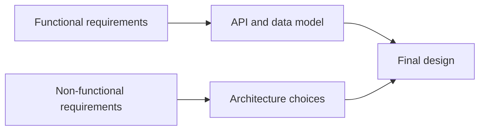
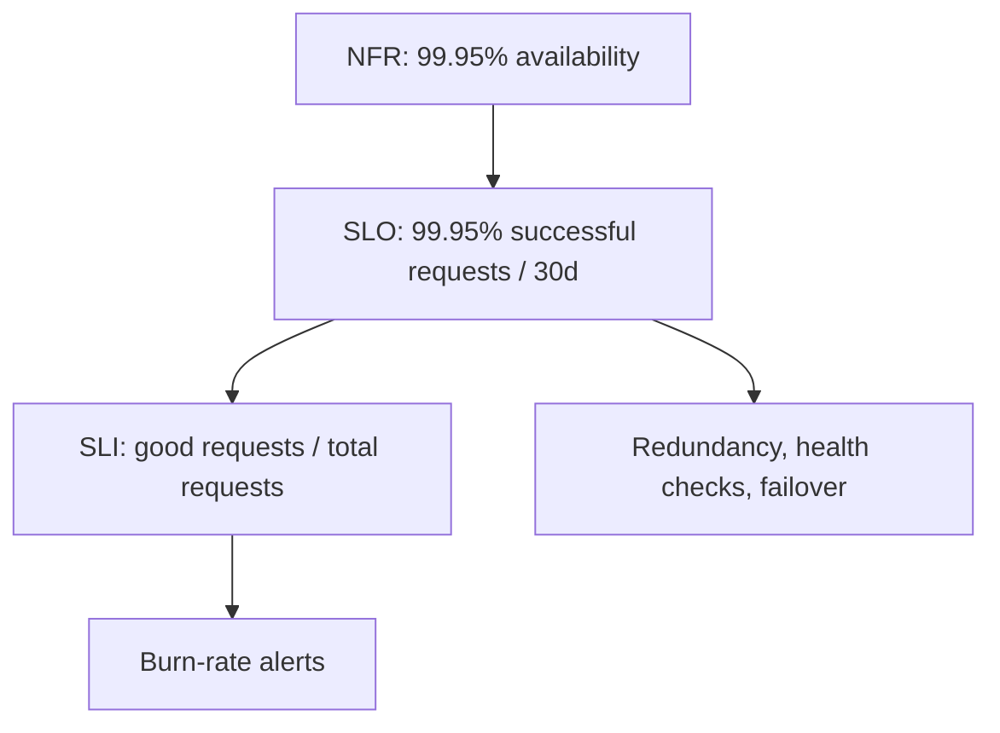

# Functional vs non-functional requirements

---

## 🟢 Junior Level

**Functional requirements (FR)** describe *what* the system does: features and behaviors a user can observe ("a user can shorten a URL", "a user can send a message").

**Non-functional requirements (NFR)**, also called quality attributes, describe *how well* the system does it: speed, availability, security, scalability, durability, cost, maintainability.

### Real-world analogy
For a taxi service: "takes me from A to B" is functional. "Arrives within 5 minutes, is clean, is safe, works at 3 AM, and costs under $20" are non-functional. A taxi that gets you there in 4 hours is functionally correct and practically useless.

### Examples side by side

| Functional | Non-functional |
|---|---|
| Create, read, delete a note | p99 read latency below 200 ms |
| Log in with email and password | 99.95% monthly availability |
| Upload a photo | Photos never lost (durability 11 nines) |
| Search products by name | Handles 50k search QPS at peak |
| Send a notification | Passwords hashed, data encrypted at rest |

### How requirements show up in design



FRs shape the **API and entities**. NFRs shape the **architecture**: caching, replication, sharding, queues, and deployment topology.

### Tiny Java example
A functional requirement becomes an endpoint. A non-functional requirement becomes configuration and annotations around it.

```java
@RestController
class NoteController {

    private final NoteService service;

    NoteController(NoteService service) { this.service = service; }

    // FR: read a note by id
    // NFR: cached to meet a 50 ms latency target
    @Cacheable("notes")
    @GetMapping("/notes/{id}")
    public Note get(@PathVariable long id) {
        return service.find(id);
    }
}
```

### Interview tip
At the start say: "Let me confirm the core features, then ask about scale, latency and availability." That one sentence shows maturity.

---

## 🟡 Middle Level

### Making NFRs measurable
Vague words ("fast", "scalable", "reliable") are useless. Turn each into a measurable target:

| Vague | Measurable |
|---|---|
| Fast | p50 < 50 ms, p99 < 300 ms for GET /feed |
| Highly available | 99.95% monthly (~22 minutes downtime/month) |
| Scalable | 10k writes/s now, ability to reach 100k/s within a year |
| Durable | No acknowledged write lost; RPO = 0 for payments |
| Secure | OWASP ASVS L2, data encrypted in transit and at rest |

### Availability numbers to memorize

| Availability | Downtime per year | Per month |
|---|---|---|
| 99% | 3.65 days | 7.3 hours |
| 99.9% | 8.76 hours | 43.8 minutes |
| 99.99% | 52.6 minutes | 4.4 minutes |
| 99.999% | 5.26 minutes | 26 seconds |

### Typical questions to extract NFRs
- How many users? DAU vs MAU? Peak vs average traffic?
- Read-heavy or write-heavy? What ratio?
- What latency does the user perceive as acceptable?
- Is stale data acceptable? For how long?
- What happens if we lose data? What if the site is down an hour?
- Which regions and regulations (GDPR, PCI) apply?
- Budget and team size?

### Trade-offs between NFRs
NFRs conflict, and design is choosing among them:
- **Consistency vs availability/latency**: synchronous cross-region replication is consistent but slow.
- **Durability vs write latency**: `fsync` per write is safe but slower.
- **Security vs usability**: strict MFA reduces conversion.
- **Cost vs availability**: active-active multi-region may double the bill.

### Encoding NFRs in the code and platform
NFRs should be executable, not only documented:

```java
// Timeouts enforce a latency NFR on downstream calls
@Bean
RestClient inventoryClient(RestClient.Builder builder) {
    var factory = new JdkClientHttpRequestFactory(
        HttpClient.newBuilder().connectTimeout(Duration.ofMillis(200)).build());
    factory.setReadTimeout(Duration.ofMillis(500));
    return builder.requestFactory(factory).baseUrl("http://inventory").build();
}
```

```yaml
# application.yml: availability and observability NFRs expressed as config
management:
  endpoints.web.exposure.include: health,prometheus
  endpoint.health.probes.enabled: true
  metrics.distribution.percentiles-histogram.http.server.requests: true
  metrics.distribution.slo.http.server.requests: 100ms,300ms,1s
```

### Common mistakes
1. Treating NFRs as an afterthought discussed in the last five minutes.
2. Gold-plating: asking for five nines when the business needs three.
3. Mixing requirement categories: "use Kafka" is a solution, not a requirement.
4. Forgetting **out-of-scope** statements, which protect you from scope creep in an interview and in real projects.

---

## 🔴 Senior Level

### NFRs as architecturally significant requirements
Only a handful of NFRs drive architecture ("architecturally significant requirements"). Find the two or three that are hardest and let them dominate: for a trading system it is latency and consistency; for a video platform it is bandwidth and cost; for a payments system it is correctness and auditability.

### Percentiles, not averages
Averages hide tail latency. With fan-out, tail latency amplifies: if one request calls 50 backends in parallel and each has p99 = 100 ms, the chance that at least one exceeds 100 ms is `1 - 0.99^50 ≈ 40%`. Therefore you need hedged requests, tighter timeouts, or fewer hops.

```java
// Measuring tail latency with Micrometer histograms, not averages
Timer timer = Timer.builder("checkout.latency")
        .publishPercentileHistogram()
        .serviceLevelObjectives(Duration.ofMillis(100), Duration.ofMillis(300))
        .register(meterRegistry);

timer.record(() -> checkoutService.process(cart));
```

### Quality attribute scenarios
Write NFRs as testable scenarios: *Source, Stimulus, Environment, Response, Response measure*. Example: "When a database primary fails (stimulus) during peak load (environment), the system promotes a replica (response) within 30 seconds with no acknowledged write lost (measure)." Such scenarios become **game-day tests** and chaos experiments.



### Cost and capacity as first-class NFRs
Include unit economics: cost per 1k requests, per GB stored per month. A design that meets latency but costs 10x budget fails. Senior engineers push back with data: "Active-active across three regions raises availability from 99.95 to 99.99 but costs 2.2x; is the extra 20 minutes of monthly uptime worth it?"

### Conflicting NFRs and how to resolve them
- Use **tiering**: critical paths (checkout) get strict SLOs; non-critical (recommendations) get relaxed SLOs and can degrade.
- Use **graceful degradation**: serve stale cache when the database is down.
- Use **load shedding** and priority queues to preserve core flows under overload.

### Validating NFRs in production
- Load test with realistic traffic shape (Gatling, k6) against production-like data volume.
- Chaos engineering to verify availability claims.
- Track SLO compliance and error budget burn.
- Revisit NFRs quarterly; they drift as the business grows.

### Edge cases
- **Compliance NFRs** (data residency) can force sharding by region regardless of performance preferences.
- **Multi-tenancy** adds isolation NFRs (noisy neighbor limits, per-tenant quotas).
- **Backward compatibility** is an NFR for public APIs and often the real constraint on change velocity.

---

## 🎯 Interview Cheat Sheet

### 30-second elevator pitch
"Functional requirements define what the system does and shape the API and data model. Non-functional requirements define how well it does it, such as latency, availability, durability and cost, and they drive the architecture. I always make NFRs measurable, like p99 under 300 ms and 99.95% availability, and I call out which ones conflict."

### Must-know bullets
- FR = features; NFR = quality attributes (performance, availability, scalability, security, durability, maintainability, cost).
- Quantify NFRs; use percentiles, not averages.
- NFRs conflict; design is choosing priorities explicitly.
- Define out-of-scope items.
- Memorize availability nines and downtime numbers.
- Turn NFRs into SLOs, alerts and tests.

### Common follow-up questions
- What is the difference between availability and durability?
- How much downtime does 99.9% allow?
- How would you prove the system meets its latency target?
- Which NFR would you sacrifice first and why?

### Red flags
- Saying "it must be fast and scalable" with no numbers.
- Treating the technology choice as a requirement.
- Ignoring security and compliance entirely.
- Asking for five nines without cost awareness.

### Related topics
- [How to approach a system design interview](01.%20How%20to%20approach%20a%20system%20design%20interview.md)
- [SLA, SLO, SLI and observability](24.%20SLA%2C%20SLO%2C%20SLI%20and%20observability.md)
- [High availability, disaster recovery and multi-region design](23.%20High%20availability%2C%20disaster%20recovery%20and%20multi-region%20design.md)
