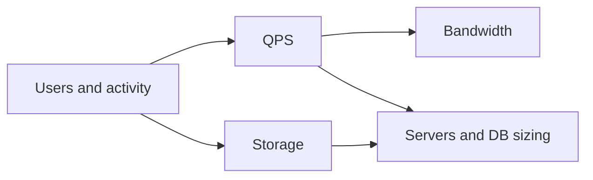
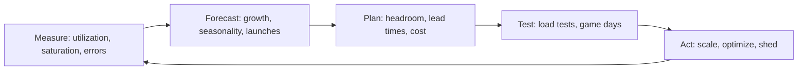

# Back-of-the-envelope estimation and capacity planning

---

## 🟢 Junior Level

**Back-of-the-envelope estimation** is rough arithmetic that tells you the *order of magnitude* of load and storage your system faces. You are not trying to be exact; you want to know whether you need 1 server or 1,000, 1 GB or 1 PB.

**Capacity planning** is the ongoing, real-world version: forecasting demand and provisioning resources (CPU, memory, disk, network) so the system stays healthy with headroom.

### Real-world analogy
Before hosting a wedding you estimate: 200 guests × 3 plates each = 600 plates, so you need roughly 30 tables and 5 waiters. You do not count every fork, but you avoid ordering food for 20 people or 2,000.

### Numbers every engineer should know

| Item | Value |
|---|---|
| 1 day | ~86,400 s (round to 100k) |
| 1 month | ~2.5 million s |
| 1 KB / 1 MB / 1 GB / 1 TB | 10^3 / 10^6 / 10^9 / 10^12 bytes |
| Memory read | ~100 ns |
| SSD random read | ~100 µs |
| Network round trip in a datacenter | ~0.5 ms |
| Cross-continent round trip | ~150 ms |
| Disk seek (HDD) | ~10 ms |

### The core formulas

- **Average QPS** = daily requests / 86,400
- **Peak QPS** ≈ 2–5 × average
- **Storage** = records per day × bytes per record × retention days × replication factor
- **Bandwidth** = QPS × average payload size

### Worked example: URL shortener
- 100M new URLs/month, read:write = 100:1.
- Write QPS = 100M / 2.5M s = 40 QPS. Read QPS = 4,000. Peak ≈ 12,000.
- Each record ≈ 500 bytes; 5 years: 100M × 12 × 5 = 6B records × 500 B = **3 TB**.
- Read bandwidth = 4,000 × 500 B = 2 MB/s. Trivially small.

Conclusion: a sharded or replicated relational DB plus cache is enough; no exotic technology needed.



### Java helper to keep the math honest

```java
public class CapacityCalculator {

    static final long SECONDS_PER_DAY = 86_400;

    static double averageQps(long requestsPerDay) {
        return (double) requestsPerDay / SECONDS_PER_DAY;
    }

    static long storageBytes(long recordsPerDay, int bytesPerRecord, int retentionDays, int replicas) {
        return recordsPerDay * bytesPerRecord * retentionDays * replicas;
    }

    public static void main(String[] args) {
        double qps = averageQps(400_000_000L);              // 400M requests/day
        System.out.printf("Avg QPS: %.0f, peak (x3): %.0f%n", qps, qps * 3);
        long bytes = storageBytes(3_300_000L, 500, 365 * 5, 3);
        System.out.printf("Storage: %.1f TB%n", bytes / 1e12);
    }
}
```

---

## 🟡 Middle Level

### From QPS to server count
A single Spring Boot node with Tomcat (200 threads) and ~20 ms average handler time serves about `200 / 0.02 = 10,000` RPS in theory when CPU-light, but real services with database calls and JSON serialization commonly reach **500–3,000 RPS per node**. Use measured numbers from load tests, then add headroom (target 50–60% utilization at peak) and N+1 or N+2 redundancy.

```
servers = ceil(peakQps / perNodeCapacity / targetUtilization) + redundancy
```

Example: peak 12,000 QPS, per-node 1,500, utilization 0.6 → `12000/1500/0.6 = 13.3 → 14`, plus 2 spare = 16 nodes.

### Little's Law
`L = λ × W`: concurrent requests in the system equal arrival rate times average latency. At 2,000 RPS with 100 ms latency you have 200 requests in flight. This sizes **thread pools, connection pools and queues**.

```java
// Sizing a HikariCP pool using Little's Law
// 1,000 DB queries/s * 5 ms average = 5 concurrent connections needed on average
// Pools should be small; add safety factor for bursts (e.g., 3x)
HikariConfig cfg = new HikariConfig();
cfg.setJdbcUrl("jdbc:postgresql://db/app");
cfg.setMaximumPoolSize(15);
cfg.setConnectionTimeout(500);
```

### Storage estimation details
- Include **index overhead** (often 20–100% of table size), **replication** (×3), **backups**, and **growth**.
- Distinguish hot (SSD), warm, and cold (object storage) data.
- Media dominates: 1M photos/day × 2 MB = 2 TB/day, ~730 TB/year before replication and thumbnails.

### Bandwidth and memory (cache) estimation
- Egress: 10,000 RPS × 100 KB = 1 GB/s = 8 Gbps; use a CDN.
- Cache by the **80/20 rule**: caching the hottest 20% of keys serves ~80% of reads. If daily unique reads touch 100 GB of data, cache ~20 GB.

### Common mistakes
1. Using average instead of peak.
2. Forgetting replication, indexes and backups in storage.
3. Mixing bits and bytes (network in bits, storage in bytes).
4. Over-precision: 3.2847 TB is silly. Round to 1 significant digit.
5. Computing the numbers but never using them to make a decision.

### Quick table of estimated component limits (rules of thumb)

| Component | Typical single-node throughput |
|---|---|
| PostgreSQL (OLTP, indexed) | 5k–20k simple queries/s reads; 1k–5k writes/s |
| Redis | 100k+ ops/s |
| Kafka broker | 100k–1M msgs/s depending on size |
| Nginx | 10k–50k RPS (proxy) |
| Elasticsearch node | 1k–5k queries/s |

Always verify with a benchmark on your hardware and data.

---

## 🔴 Senior Level

### Capacity planning as a continuous process



Use the **USE method** (Utilization, Saturation, Errors) for resources and **RED** (Rate, Errors, Duration) for services. Saturation (queue depth, thread pool rejection, GC pause) is a better leading indicator than CPU.

### Headroom and failure domains
Plan for **N+1 per availability zone** so that losing a zone doesn't overload the rest: with 3 zones, each must run at ≤ 66% to absorb a zone loss. Autoscaling lags 1–5 minutes (instance boot, JVM warm-up, cache fill), so it does not cover sudden spikes; pre-scale for known events (Black Friday) and use load shedding for unknown ones.

### JVM-specific capacity factors
- Heap sizing vs container memory: set `-XX:MaxRAMPercentage=70` and leave room for metaspace, thread stacks (1 MB default × threads), direct buffers.
- GC choice affects tail latency: G1 default, ZGC/Shenandoah for sub-10 ms pauses at large heaps.
- Warm-up: JIT-compiled code is slow for the first minutes; readiness probes and gradual traffic ramp avoid latency spikes. Consider CRaC or GraalVM native images when cold start dominates.
- Virtual threads (Java 21) raise concurrency ceilings for blocking I/O, but downstream pools (DB connections) remain the real limit.

```java
// Expose saturation signals so capacity decisions use data
@Bean
MeterBinder executorSaturation(ThreadPoolTaskExecutor executor) {
    return registry -> {
        Gauge.builder("app.executor.queue.size", executor, e -> e.getThreadPoolExecutor().getQueue().size())
             .register(registry);
        Gauge.builder("app.executor.active", executor, ThreadPoolTaskExecutor::getActiveCount)
             .register(registry);
    };
}
```

### Forecasting and the universal scalability law
Throughput does not grow linearly with nodes due to contention and coordination (Amdahl, USL). Measure at 1, 2, 4, 8 nodes and fit the curve; the shared database or lock is usually the knee. Capacity plans must name the **next bottleneck** and the trigger metric ("when DB CPU p95 > 60% for a week, begin sharding project; lead time 3 months").

### Cost modeling
Convert capacity into dollars: compute, storage tiers, cross-AZ and egress traffic (often the hidden killer), managed-service premiums. Compare reserved instances vs on-demand, and consider that sharding and caching are cheaper than bigger databases past a point.

### Diagnosing mismatched estimates
When production differs from estimates by more than 2x, find out why: wrong read/write ratio, fan-out larger than assumed (one post to 1M followers), retries multiplying load (retry storm: 3 retries × 3 layers = 27x), or payload bloat. Add rate limits and retry budgets.

### Edge cases
- **Thundering herd** after cache expiry or deploy.
- **Hot partitions**: averages hide skew; plan for the hottest key, not the mean.
- **Diurnal and global traffic**: peaks move with time zones; multi-region can flatten load.
- **Headroom for the failure of the failover**: a standby sized for 50% of load is not a standby.

---

## 🎯 Interview Cheat Sheet

### 30-second elevator pitch
"I convert users into requests per second using daily volume divided by 86,400, multiply by 2 to 5 for peak, then derive storage with record size, retention, and replication, and bandwidth from QPS times payload. I use those numbers to decide between a single node, caching, or sharding, and I keep 40–50% headroom and N+1 redundancy. In production I replace estimates with measured data."

### Must-know bullets
- 1 day ≈ 10^5 s; 1 month ≈ 2.5×10^6 s.
- Peak = 2–5 × average; plan for peak plus headroom.
- Storage = records × size × retention × replicas (+ indexes, backups).
- Little's Law sizes pools: L = λW.
- 80/20 rule for cache size.
- Round aggressively; show your work and state assumptions.

### Common follow-up questions
- How many servers do you need for 50k QPS?
- How much storage for 5 years of chat messages?
- How would autoscaling help, and why is it not enough?
- What metric tells you it's time to shard?

### Red flags
- Skipping estimation entirely.
- False precision or wrong unit conversions.
- Ignoring replication and peak factor.
- Not drawing a conclusion from the numbers.

### Related topics
- [How to approach a system design interview](01.%20How%20to%20approach%20a%20system%20design%20interview.md)
- [Vertical vs horizontal scaling and stateless services](04.%20Vertical%20vs%20horizontal%20scaling%20and%20stateless%20services.md)
- [Common system design mistakes](26.%20Common%20system%20design%20mistakes.md)
