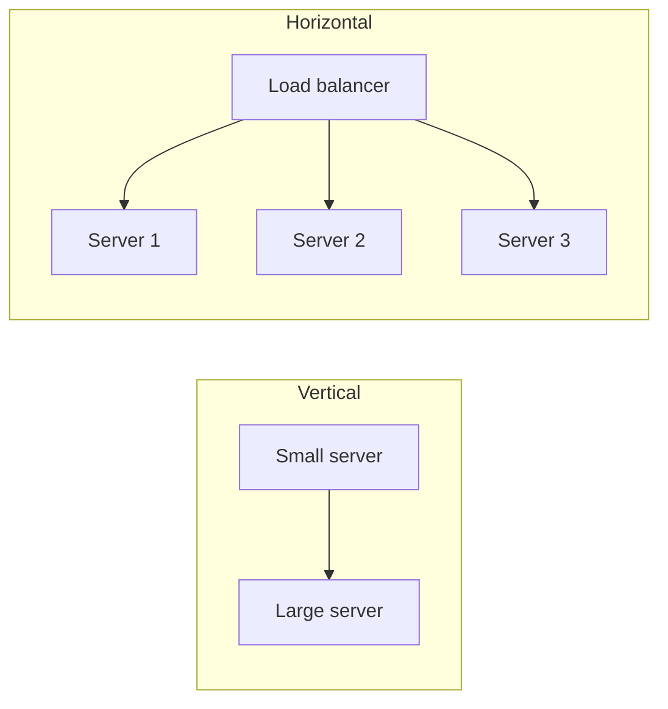
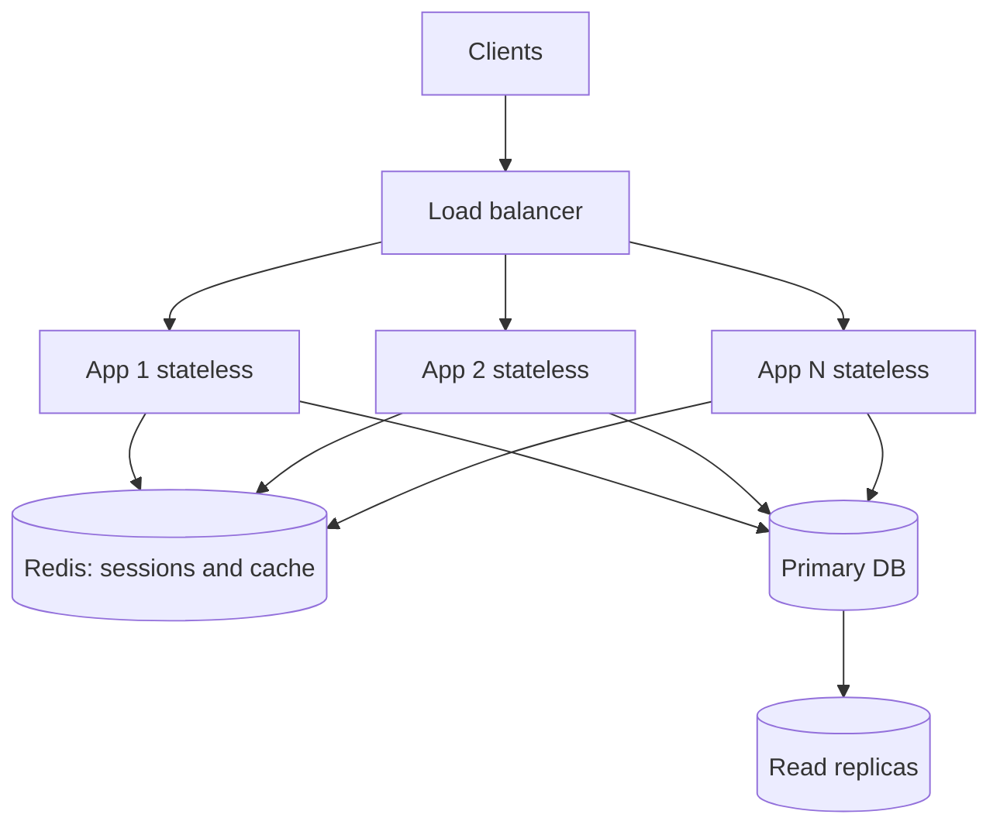

# Vertical vs horizontal scaling and stateless services

---

## 🟢 Junior Level

**Scalability** is a system's ability to handle growing load by adding resources.

- **Vertical scaling (scale up):** make one machine bigger (more CPU, RAM, faster disk).
- **Horizontal scaling (scale out):** add more machines and spread the work across them.

A **stateless service** keeps no client-specific data in its own memory between requests. Every request carries everything needed (or fetches it from a shared store), so any instance can serve any request. Statelessness is what makes horizontal scaling easy.

### Real-world analogy
Vertical scaling is hiring one superhuman cashier. Horizontal scaling is opening more checkout lanes. Lanes only work if any customer can go to any lane, meaning the cashier does not need to "remember" you from earlier. That is a stateless cashier: your basket and loyalty card hold the state.

### Comparison

| Aspect | Vertical | Horizontal |
|---|---|---|
| How | Bigger machine | More machines |
| Complexity | Low | Higher (load balancing, distribution) |
| Limit | Hardware ceiling | Practically unbounded |
| Failure | Single point of failure | Survives node loss |
| Downtime to scale | Often required | Usually none |
| Cost curve | Superlinear at high end | Roughly linear |



### Stateful vs stateless in Java
Bad (stateful): the cart is stored in the JVM's memory, so if the load balancer sends the next request to another node the user sees an empty cart.

```java
// Stateful anti-pattern: state lives in one JVM
@RestController
class CartController {
    private final Map<String, List<String>> carts = new HashMap<>(); // lost on restart, not shared

    @PostMapping("/cart/{user}/{item}")
    void add(@PathVariable String user, @PathVariable String item) {
        carts.computeIfAbsent(user, k -> new ArrayList<>()).add(item);
    }
}
```

Better: externalize the state.

```java
// Stateless service: state lives in Redis, any instance can serve any request
@RestController
class CartController {
    private final StringRedisTemplate redis;

    CartController(StringRedisTemplate redis) { this.redis = redis; }

    @PostMapping("/cart/{user}/{item}")
    void add(@PathVariable String user, @PathVariable String item) {
        redis.opsForList().rightPush("cart:" + user, item);
    }
}
```

---

## 🟡 Middle Level

### What counts as state?
- HTTP sessions, in-memory caches, uploaded files on local disk, scheduled-job locks, WebSocket connections, counters, and `static` mutable fields.

### Making a Spring Boot service stateless

1. **Sessions:** use token-based auth (JWT or opaque tokens) or Spring Session with Redis.
2. **Files:** store in object storage (S3), not the container filesystem.
3. **Caches:** use a distributed cache (Redis) or accept per-node caches with TTLs, understanding the inconsistency.
4. **Scheduled jobs:** ensure only one node runs them (ShedLock, leader election).
5. **Config:** externalized, no per-node special files.

```java
// Spring Session with Redis: HttpSession API unchanged, storage externalized
@Configuration
@EnableRedisHttpSession(maxInactiveIntervalInSeconds = 1800)
class SessionConfig { }
```

```java
// ShedLock: scheduled task runs on exactly one node
@Scheduled(cron = "0 0 * * * *")
@SchedulerLock(name = "hourlyReport", lockAtMostFor = "50m", lockAtLeastFor = "5m")
public void hourlyReport() {
    reportService.generate();
}
```

### Sticky sessions: a trade-off
Load balancer affinity (sticky sessions) lets you keep session state in memory, but it causes **uneven load**, **lost sessions on node failure or deploy**, and hampers autoscaling. Prefer externalized state; use stickiness only when a protocol requires it (WebSockets, some caches).

### Vertical scaling is still valid
Scale up first when it is cheap and quick: a bigger database instance buys months of runway with zero code change. Many real systems run one large PostgreSQL primary for years. The mistake is scaling out *prematurely* and paying the complexity tax.

### The database is the hard part
Stateless app tiers scale out trivially; **data tiers** do not. Typical progression:
1. Vertical scale the DB.
2. Add read replicas and caching.
3. Partition by function (split schemas/services).
4. Shard by key.



### Common mistakes
- Believing "microservices" equals scalable. Scalability comes from statelessness and data partitioning.
- Storing uploads locally, then losing them when the container is rescheduled.
- Autoscaling app nodes without scaling the database connection limits (each node opens a pool; 50 nodes × 20 connections = 1,000 connections).
- In-memory rate limiting per node, which multiplies the effective limit by N.

---

## 🔴 Senior Level

### Scaling laws and limits
Linear scale-out is limited by serialized portions (Amdahl's law) and coordination costs (Universal Scalability Law). A shared lock, a single leader, or a hot row caps throughput regardless of node count. Identify the **serial fraction**: if 5% of work is serialized, max speedup is 20x.

### Horizontal scaling patterns beyond "add nodes"
- **Functional decomposition** (split by feature) vs **data partitioning** (split by key) vs **replication** (copy for reads). These are the "scale cube" axes: X (clone), Y (functional), Z (data shard).
- **Cell-based architecture:** replicate the entire stack in isolated cells (each serving a subset of tenants) to bound blast radius and give linear scaling with predictable capacity per cell.

### Statelessness vs state locality
Pure statelessness costs a network hop for every state access. Hybrid approaches keep **soft state** locally to cut latency:
- Local Caffeine cache in front of Redis (L1/L2), with TTL or pub/sub invalidation.
- Session affinity for expensive-to-rebuild state, with fallback to rebuild on miss.
- Stateful stream processors (Kafka Streams, Flink) that keep local state backed by a changelog topic for recovery.

```java
// Two-level cache: Caffeine (L1, per node) + Redis (L2, shared)
@Service
class ProductLookup {
    private final Cache<Long, Product> l1 = Caffeine.newBuilder()
            .maximumSize(10_000).expireAfterWrite(Duration.ofSeconds(30)).build();
    private final RedisTemplate<String, Product> redis;
    private final ProductRepository db;

    ProductLookup(RedisTemplate<String, Product> redis, ProductRepository db) {
        this.redis = redis; this.db = db;
    }

    Product get(long id) {
        return l1.get(id, key -> {
            Product p = redis.opsForValue().get("product:" + key);
            if (p == null) {
                p = db.findById(key).orElseThrow();
                redis.opsForValue().set("product:" + key, p, Duration.ofMinutes(5));
            }
            return p;
        });
    }
}
```

### JVM and runtime factors at scale-out
- **Warm-up and readiness:** new pods start with cold JIT and empty caches; use readiness gates, slow-start in the load balancer, and pre-warming to avoid latency spikes when autoscaling.
- **Graceful shutdown:** `server.shutdown=graceful` with `spring.lifecycle.timeout-per-shutdown-phase` drains in-flight requests during scale-in.
- **Connection storms:** scaling out can overload the database; use connection poolers (PgBouncer, RDS Proxy) and cap pool sizes.
- **Autoscaling signals:** prefer saturation or requests-per-pod metrics (KEDA, HPA custom metrics) over raw CPU for I/O-bound services.

### Failure modes
- **Scale-out amplifies retries:** a slow dependency triggers retries across N nodes producing a retry storm; use retry budgets, backoff with jitter, and circuit breakers.
- **Split state:** if state is partially local, a rolling deploy can produce inconsistent behavior between nodes (version skew in cached or serialized objects). Use backward-compatible serialization.
- **Hot shard:** horizontal scaling of data fails when one key dominates; mitigate with key salting, caching, or request coalescing.

### Decision framework
1. Can a bigger box solve it for a year at acceptable cost and risk? Scale up.
2. Is the app tier the bottleneck and stateless? Scale out behind a load balancer.
3. Is the data tier the bottleneck? Cache, read replicas, then partition/shard.
4. Need failure isolation? Cells or multiple regions.

---

## 🎯 Interview Cheat Sheet

### 30-second elevator pitch
"Vertical scaling makes a node bigger: simple but capped and a single point of failure. Horizontal scaling adds nodes behind a load balancer and needs stateless services, with sessions in Redis or tokens, files in object storage and jobs guarded by locks. The app tier scales out easily; the data tier needs replicas, caching and sharding, so I scale up first when cheap and scale out when limits or availability demand."

### Must-know bullets
- Scale up = simpler, limited; scale out = complex, elastic, fault tolerant.
- Stateless = any instance serves any request; externalize state.
- Sticky sessions are a crutch with real costs.
- The database is usually the real scaling limit.
- Autoscaling needs warm-up, graceful shutdown and connection limits.
- Scale cube: clone (X), split by function (Y), shard by data (Z).

### Common follow-up questions
- How do you handle user sessions across many instances?
- Why can't I just add more app servers to fix a slow database?
- When is vertical scaling the right choice?
- How do you deploy with zero downtime across N nodes?

### Red flags
- Claiming horizontal scaling is always better.
- In-memory state in a multi-node service.
- Ignoring the connection pool total across nodes.
- Not mentioning the database tier.

### Related topics
- [Load balancing L4 vs L7 and algorithms](05.%20Load%20balancing%20L4%20vs%20L7%20and%20algorithms.md)
- [Database scaling with replication, sharding and partitioning](06.%20Database%20scaling%20with%20replication%2C%20sharding%20and%20partitioning.md)
- [Caching layers and CDN](09.%20Caching%20layers%20and%20CDN.md)
